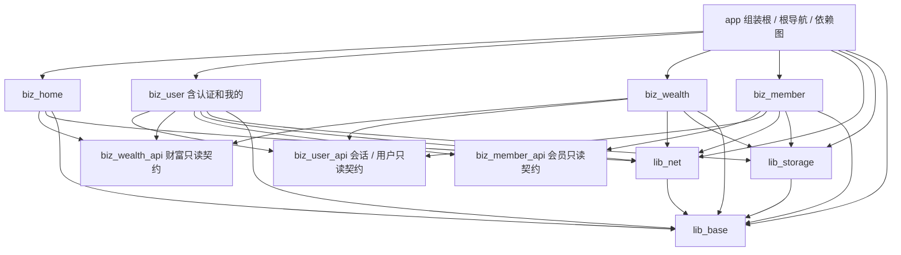
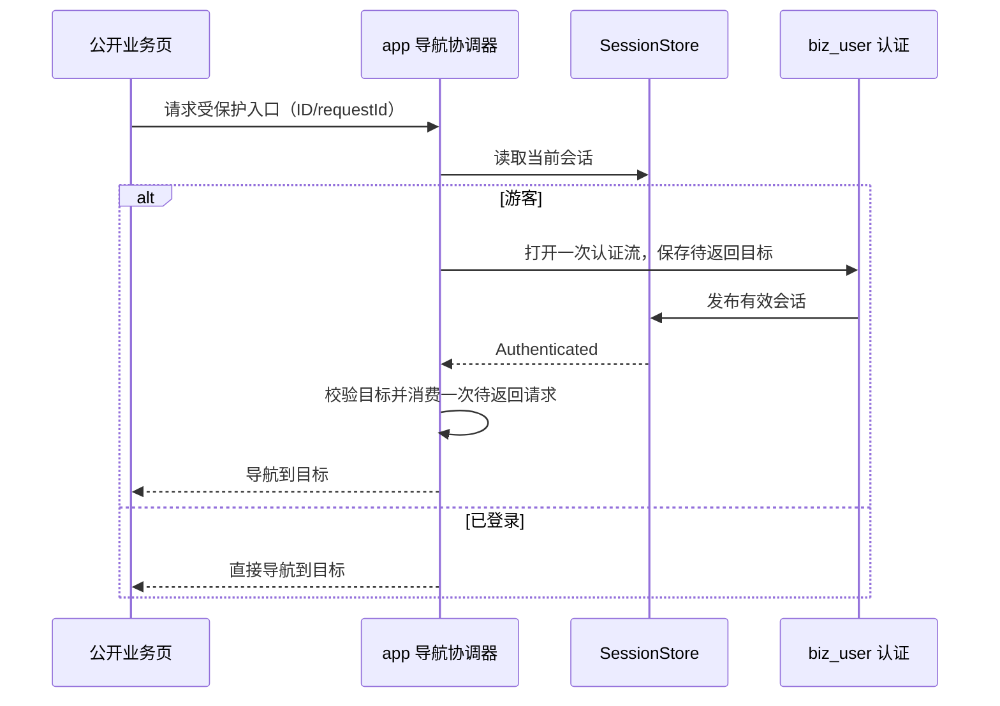

# EntryTask Android 工程架构与能力封装设计

> 2026-10-19：AppProxy 空类的旧描述已被 `AppGlobals + AppContextInitializer/AndroidX Startup` 取代。全局登录门禁、下载模块和当前六模块状态以 [Android 技术方案 V1.2](../../docs/design/Android%20技术方案.md) 为准；本历史初稿不再作为当前能力完成清单。

> 需求基线更新（2026-10-17）：本文件为旧技术方案初稿。后续方案请先阅读[原型需求规格说明书](../../docs/requirements/01-prototype-requirements.md)和[接口与 Mock 数据需求](../../docs/requirements/02-api-mock-requirements.md)。本期明确由 RN 实现四 Tab 及全部业务子页，Native 提供认证、宿主、网络/存储/日志能力；本地 Mock 经 Native 网络拦截并按 API 使用 JSON，普通请求随机延迟 1～3 秒；iOS 本期延期。本文中原生业务 UI 优先、直接 Fake 数据、注册返回登录及强制 Room 样板等冲突项不再作为本期实施依据，待技术方案统一修订。

版本：1.0 · 日期：2026-10-17 · 状态：建议基线，待评审采纳

## 1. 目标、范围与设计原则

为模拟银行业务的 EntryTask 建立可持续迭代的 Android 工程基线：业务按域独立，技术能力复用，MVVM 职责一致，错误、会话、缓存、导航与测试有统一规则。优先使现有登录注册成为可复制的样板，再迁移首页、财富、会员和我的。

本期交付目标是原型对应的展示、游客/登录切换、演示数据读取与基础交互。原型中出现转账、信用卡、借钱等入口，不等于已经定义真实金融交易需求。未来新增交易能力时，应补充服务端状态机、幂等和对账设计，不能仅靠客户端按钮防抖完成交易一致性。

原则：依赖单向；状态单一事实来源；接口小而明确；构造注入优先；组合优于复杂继承；本期需要的能力先落地；数据敏感性决定缓存策略。本文的模块划分是适配本项目的决策，不宣称是唯一架构。官方参考：[Android 模块化模式](https://developer.android.com/topic/modularization/patterns)。

## 2. 代码现状与差距

以下为静态源码核查结果；本次未执行 Gradle 构建，不将源码存在等同于运行验证通过。

| 范围/证据（相对 android） | 已有能力 | 差距与影响 | 目标 |
| --- | --- | --- | --- |
| `settings.gradle` | app、lib_base、lib_net、lib_storage、biz_user | 其余业务页面仍在 app | 按业务域迁移，app 只做组装 |
| `app/.../MainApplication.kt` | SP、网络、日志与 RN 初始化 | 日志晚于部分能力初始化；无明确失败策略 | 可见、可测、不可重复变更的初始化顺序 |
| `lib_base/.../AppGlobals.kt`、`AppContextInitializer.kt` | 已提供应用Context/包名/debug属性和Startup注册 | 不可变AppConfig、重复初始化冲突与行为测试待补齐 | 单一应用信息代理；不新增第二个AppProxy |
| `lib_base/.../mvvm/*` | BaseActivity、BaseViewModel、Result、BaseRepository | UI Loading 混入数据 Result；catch Throwable 吞取消；全局 Loading 布尔值不适合并发 | 明确区分数据结果、页面状态和协程取消 |
| `biz_user/.../UserViewModel.kt` | 登录注册状态与 Factory | 未采用已有 BaseViewModel；公开可变 Flow；用回调驱动成功/错误 | 统一状态、只读接口、构造注入 |
| `lib_net/.../NetManager.kt` | OkHttp/Retrofit/Gson、mTLS 接入 | 硬挂 Mock；lazy 后配置变化无效；TLS 初始化异常被吞；ignoreCert 参数未使用 | 不可变配置创建实例，失败可见，Mock 隔离 |
| `lib_net/.../MockInterceptor.kt` | 本地账号注册登录模拟 | 识别用户业务、依赖存储、明文保存密码、字符串拼 JSON、随机阻塞延迟 | 移到 biz_user 的 demo 实现，确定性测试 |
| `lib_storage/.../StorageManager.kt` | SharedPreferences 包装 | 包名拼成 stroage；Any 静默忽略类型；Double 转 Float；Base64 非加密；无 Room | 类型化 Key、作用域、迁移、安全存储接口 |
| `biz_user/.../UserRepository.kt`、`UserAuthManager.kt` | Token 落盘、内存布尔登录态 | 两套事实来源；logout 不清 Token；注册仓库注释与 VM 自动登录行为矛盾 | 单一 SessionStore 与明确注册语义 |
| `biz_user/.../model/User.kt` | User 与 ApiResponse | Token 混入用户资料；Mock 返回字段不完整 | DTO/领域/展示分离，必填字段映射校验 |
| `app/.../MainActivity.kt` | 4 Tab 与 Fragment 缓存 | onCreate/onResume 均强制鉴权；未从 FragmentManager 恢复缓存；commitAllowingStateLoss | 游客守卫、恢复已有 Fragment、安全导航 |
| `app/.../base/BaseFragment.kt` | XML/RN 宿主混合 | 生成容器 ID、重复挂载与恢复需治理 | 原生通用基类与 RN 适配职责拆分 |
| Gradle 各模块 | Kotlin、Compose、RN 工程基础 | 依赖重复、api 过度传递、SDK 硬编码、工具链未统一验证 | Version Catalog、显式依赖、兼容性基线 |
| app release 配置 | 可配置 release | 使用 debug 签名、混淆关闭 | 演示与正式分发有不同门禁 |

当前依赖链：`app → biz_user → {lib_net, lib_storage, lib_base}`；`lib_net → {lib_base, lib_storage}`；`lib_storage → lib_base`。`app` 直接使用多个 lib 类型却借助 biz_user 的 `api` 间接获得，不符合显式依赖目标。

当前记录的配置：RN 0.86.0、React 19.2.3、Kotlin 2.1.20、Gradle wrapper 9.3.1、compile/target SDK 36、min SDK 24、各 lib JVM target 17。RN Gradle 插件所带 catalog 声明 AGP 8.12.0，但这不是 Gradle 最终解析报告；实际 AGP/JDK/Gradle 兼容性需在实施阶段核验。现有 Lifecycle 版本同时出现 2.6.2 与 2.8.0，不据此断言已兼容。

## 3. 原型需求映射与范围决策

图片只有静态页面，不能确定完整接口、校验规则、分页、登录时效和交易流程。需求状态区分为“图片可见”“设计默认”“待确认”。

| ID | 原型证据 | 图片可见能力 | 目标归属 | 本期默认实现 |
| --- | --- | --- | --- | --- |
| PRD-H01 | Home.jpg | 扫描、搜索、消息与客服入口 | biz_home（入口） | 展示与明确的演示反馈；外部能力后续独立定义 |
| PRD-H02 | Home.jpg | 资产、账户、转账、信用卡快捷入口 | biz_home；未来相应业务域 | 受保护入口先登录，再进入已定义目标或演示说明 |
| PRD-H03 | Home.jpg | Banner、服务宫格、财富精选分类与卡片 | biz_home 展示；财富数据由 biz_wealth 提供 | 可滚动、切换分类、加载/空/失败状态 |
| PRD-W01 | Wealth.jpg | 财富/资讯切换、总资产与最新收益掩码 | biz_wealth | 游客占位，登录后模拟资产；可切换可见性 |
| PRD-W02 | Wealth.jpg | 产品宫格、优选基金等分类、活动 Banner | biz_wealth | 演示列表/详情；收益口径与图片数值分离 |
| PRD-M01 | Member.jpg | 会员/活动/已领权益，游客登录卡 | biz_member | 游客态可浏览公开活动，个人权益需鉴权 |
| PRD-M02 | Member.jpg | 会员专属/能量值、签到、权益卡片 | biz_member | 签到与领取采用明确模拟状态，防重复 |
| PRD-P01 | Me.jpg | 登录、设置、消息、头像、脱敏手机号和个人统计 | biz_user（我的） | 游客/登录模板分别定义，不将截图混合状态照搬 |
| PRD-P02 | Me.jpg | 资产总览、信用卡、借钱营销、账户入口 | biz_user 展示组合 | 只读跨域接口与路由；不在用户域计算财富规则 |
| PRD-N01 | 四张图片 | 财富、借钱、首页、会员、我的五个 Tab | app | 首期保留现有四域；借钱作为显式待定项 |
| AUTH-01 | 当前代码 | 登录注册与退出 | biz_user | 改造为 MVVM 样板；统一会话；补齐失败与取消路径 |

**需产品确认，但不阻碍基础能力改造的事项：**

| 问题 | 本方案默认值 | 确认时点/影响 |
| --- | --- | --- |
| 四 Tab 还是原型五 Tab、顺序与默认页 | 保留当前“首页/财富/会员/我的”，默认首页 | 页面实施前确认；若严格复刻则补 biz_loan 并调整顺序，不静默省略 |
| 是否游客可浏览 | 允许公开首页、财富推荐、会员活动；个人数据及操作鉴权 | 鉴权守卫接入前确认；替代目前全局强制登录 |
| 注册后自动登录还是返回登录 | 注册成功返回登录，保留账号、清空密码 | 用户模块迁移前确认；若自动登录必须返回完整会话并调用统一会话流程 |
| 重启后是否保持登录 | 延续现有注释意图：仅进程内会话；冷启动为游客 | SessionStore 实施前确认；删除旧 Token，不继续无用落盘 |
| 登录表单与密码规则 | 沿用账号密码；长度/字符/错误码以补充接口契约为准 | 不从图片新增短信、实名等未定义流程 |
| 签到、权益、资产与收益规则 | 固定可控演示规则，标注模拟；日期由注入 Clock 决定 | 业务实施前形成 fixture 与验收案例 |
| Me 图的登录与手机号同时出现 | 视为静态参考；游客不显示曾登录用户身份 | 我的页面实施前确认 |
| 接口/素材/详情页缺失 | demo fixture；本地素材或占位；未实现入口明确说明 | 页面视觉和交互验收前补齐；不擅自接真实银行接口 |

设计默认值必须进入任务描述和验收案例；若确认值变化，先更新本文与对应测试。

## 4. 目标架构与模块依赖

### 4.1 两种分层同时成立

工程层级：`app` 组装 → `biz_*` 业务域 → `lib_*` 技术能力。业务模块内部：View → ViewModel → 可选 UseCase → Repository → DataSource。内部逻辑层默认使用包，不强制每层一个 Gradle 模块。

跨域读取依赖小型契约模块，导航由 app 协调，不能用万能 EventBus 或全局 ServiceLocator 绕过依赖方向。契约模块属于对应业务域，包名仍为 `com.entry.biz.<domain>.api`。



图为最终需要这些共享能力时的静态依赖，不要求一次创建全部模块。三个 `biz_*_api` 为纯 Kotlin 契约，可声明 coroutine/Flow 依赖，不依赖 Android、UI、Retrofit、Room 或业务实现。`lib_net`、`lib_storage` 互不依赖，也不依赖业务 API。`lib_base` 不依赖其他工程模块或 RN。

| 模块 | 包名 | 职责与公开面 | 禁止内容 |
| --- | --- | --- | --- |
| app | 保持 com.entrytask | Application、MainActivity、根 Tab、AppContainer、模块装配、平台入口 | 业务 Service、DAO、业务 VM、页面业务判断 |
| lib_base | com.entry.lib.base.* | AppProxy、日志、错误/结果、协程调度接口、薄 MVVM、基础 UI、导航技术协议 | 账号/Token/资产等业务规则、网络或存储实现 |
| lib_net | com.entry.lib.net.* | NetworkClientFactory、TransportError、认证技术钩子、序列化基础设施 | UserService、登录页、用户数据 Key、业务 Mock |
| lib_storage | com.entry.lib.storage.* | 类型化 KV、加密存储、Room 创建和配置辅助、存储错误 | 用户/财富 Entity 和 DAO、全库万能 CRUD |
| biz_user | com.entry.biz.user.* | 登录注册、会话、用户资料、我的聚合展示、用户数据实现 | 财富/会员计算规则 |
| biz_home | com.entry.biz.home.* | 首页编排、首页内容与推荐展示 | 转账/财富交易规则 |
| biz_wealth | com.entry.biz.wealth.* | 财富页、产品、模拟资产和收益、脱敏显示状态 | 用户登录实现 |
| biz_member | com.entry.biz.member.* | 活动、权益、签到和能量值 | 修改用户会话 |
| biz_*_api | com.entry.biz.<domain>.api.* | 接口、最小领域快照与稳定 ID | DTO、Entity、UI 及实现单例 |

`biz_user` 暂含“我的”，因为现阶段以用户资料与用户入口聚合为主；若以后形成独立复杂业务流，再拆 `biz_profile`。借钱、账户、转账、消息等只有需求明确且形成独立规则时才建域，不把所有入口都先建成空模块。

### 4.2 包结构与依赖注入

```text
biz_user/src/main/java/com/entry/biz/user/
  entry/                 # 对 app 暴露 UserFeatureFactory / 路由注册
  presentation/auth/     # LoginRoute、LoginScreen、LoginViewModel、UiState
  presentation/profile/  # 我的页面及展示状态
  domain/model/          # UserProfile、Session；不含传输注解
  domain/repository/     # AuthRepository / UserRepository
  domain/usecase/        # 仅放确有编排规则的用例
  data/remote/           # UserService、DTO、Mapper、RemoteDataSource
  data/local/            # UserDao、Entity、LocalDataSource（需要时）
  data/repository/       # DefaultAuthRepository 等实现
  session/               # DefaultSessionStore、过期与失效协调
  di/                    # 模块工厂；内部对象创建
src/demo/...             # 本域 Fake/演示 fixtures，不能进入真实环境
```

采用手动构造注入，延续现有 Factory 学习成本。`app/AppContainer` 在应用初始化时构建网络、存储和各域工厂；业务 ViewModel 只接收 Repository、UseCase、Dispatcher/Clock 等所需接口。模块工厂接受依赖参数，内部实现保持 `internal`，对外只暴露入口/契约。UI 通过宿主传入 Factory，不自行 `new UserRepository(userService)`，不遍历全局容器取依赖。

作用域：配置、网络与普通 KV 为应用级；会话相关仓库/内存缓存按用户会话隔离；ViewModel 按页面或明确导航图范围；UI 宿主引用仅页面生命周期。首期不强制 Hilt/Koin，出现复杂依赖图再用 ADR 引入，不能与手动图并存成两套单例。

## 5. MVVM 的统一落地

### 5.1 各层职责

| 层 | 输入和输出 | 可做 | 不可做 |
| --- | --- | --- | --- |
| View（Activity/Fragment/Composable） | UiState + 用户操作回调 | 渲染、焦点/键盘、权限交互、调用导航宿主 | 请求接口、读写 Token/KV、判定签到或资产规则 |
| ViewModel | 方法输入；只读 StateFlow 输出 | 校验表单、调度用例、生成页面状态、处理重入与取消 | 持有 Activity/View/NavController、直接访问 Retrofit/DAO |
| UseCase（可选） | 领域入参/结果 | 跨仓库编排、可复用规则 | 简单透传也强制新增一层、启动页面 |
| Repository | suspend 单次操作、Flow 持续观察 | 数据源协调、缓存策略、业务错误归一 | Loading、Toast、导航、页面字符串 |
| DataSource | DTO / Entity 等内部类型 | HTTP、KV、Room 操作 | 触发 UI、副作用广播登录跳转 |

### 5.2 状态、结果与副作用

统一结果为 `AppResult<T> = Success<T> | Failure(AppError)`；没有 Idle/Loading。`AppError` 位于 lib_base，最小分类包括 Network、Timeout、Http、Serialization、Storage、Unauthenticated、Business、Unknown，并带安全错误码/traceId；领域特有原因由本域映射，不能把所有业务枚举堆进 base。Throwable 留在内部诊断，不直接成为界面文案。

每页面定义自己的 `UiState`，包含内容、初始加载、刷新、提交和错误；不要让全局 `isLoading` 控制所有任务。表单错误与页面加载错误分开；已有内容刷新失败保留旧数据并提示。多个区块并发时各自持有加载态，通过 `supervisorScope` 隔离允许部分成功的任务。

示意契约（设计示例，不是已加入源码的 API）：

```kotlin
data class LoginUiState(
    val username: String = "",
    val password: String = "", // 仅当前 VM 内存，离开认证流即清理
    val submitting: Boolean = false,
    val usernameError: String? = null,
    val passwordError: String? = null,
    val error: UiError? = null
)

interface AuthRepository {
    suspend fun login(username: String, password: String): AppResult<Session>
    suspend fun register(username: String, password: String): AppResult<Unit>
}
// VM: private val _uiState = MutableStateFlow(LoginUiState())
// 对外: val uiState = _uiState.asStateFlow()
// 操作: onUsernameChanged(value)、onPasswordChanged(value)、submit()
```

密码不进入 SavedStateHandle、Bundle、日志、持久化或跨页面共享状态。登录与注册使用各自的 ViewModel/表单状态，避免当前共享 UserViewModel 造成密码残留。普通筛选条件和非敏感 ID 可通过 SavedStateHandle 恢复。

关键事实通过状态表达：登录是否成功以 SessionStore 为准；签到和领取以仓库结果为准。导航宿主观察状态变化并结合当前目的地进行幂等处理。必要的待处理导航请求以 requestId + 确认消费的状态保存；不能靠 `SharedFlow(replay=0)` 保证关键操作必达。Toast/Snackbar 等允许丢失的短暂提示可以使用有明确缓冲与消费约定的 effect 流；Channel 也不等于跨进程可靠队列。官方参考：[UI 事件处理](https://developer.android.com/topic/architecture/ui-layer/events)。

Compose Route 使用 `collectAsStateWithLifecycle`；纯 Screen 接收 state 和回调，不直接拿仓库。Fragment 使用 `viewLifecycleOwner.repeatOnLifecycle(STARTED)`；被隐藏的 Tab 必须降到合适生命周期，避免所有 Tab 都维持 RESUMED 请求数据。

### 5.3 协程、并发与基类

- `viewModelScope` 管理页面任务，数据源对调用方保证主线程安全；阻塞文件/加密走注入 IO，CPU 密集转换走 Default。Retrofit suspend/Room suspend 本身已有异步支持，不对所有 Flow 无差别 `flowOn(IO)`。
- 捕获异常先 `catch (e: CancellationException) { throw e }`，随后捕获预期异常；不吞 JVM Error，不把取消包装成失败 Toast。官方参考：[协程最佳实践](https://developer.android.com/kotlin/coroutines/coroutines-best-practices)。
- 提交操作检查提交状态或用互斥机制防重入；查询搜索可用 debounce + distinctUntilChanged + flatMapLatest；刷新保留单任务引用并定义替换或忽略策略。
- 退出/切换用户取消原会话请求；请求附带会话 generation，回写前核对，避免旧账号请求覆盖新账号页面或缓存。
- BaseViewModel 只保留少量通用错误映射/调度辅助；不强制通用 Action/Reducer 框架，不强制所有 VM 继承。是否符合 MVVM 取决于职责和数据流，非继承关系。
- BaseRepository 改为无 UI 状态的函数辅助或组合组件；一次请求用 suspend，订阅缓存/会话用 Flow。取消当前未实际统一使用的 safeApiCall 模式。
- BaseActivity/BaseFragment 只处理稳定宿主职责；ViewBinding、Compose 容器、RN 宿主不塞进一个万能基类。

## 6. lib_base 能力设计

### 6.1 应用信息代理（原AppProxy，当前AppGlobals）

当前为 `AppGlobals` object，由 AndroidX Startup 的 `AppContextInitializer` 注入 applicationContext，公开 context、applicationId 和宿主 isDebug；未初始化访问明确失败。旧稿 AppProxy 类已不适用，不新增第二个代理或并行手动初始化链。重复初始化冲突、线程发布和不可变配置仍需按 [Android V1.2 §2](../../docs/design/Android%20技术方案.md) 补齐，不能视为现已完成。

不缓存 Activity/Fragment、不保存 Token、用户对象、仓库或网络 Client；不成为业务全局服务定位器。环境选择由构建变体决定，客户端不能在运行中把真实账户无提示切到演示环境。测试优先注入配置接口，测试重置能力不暴露给生产代码。

初始化职责为 Startup 轻量注入 Context，随后 MainApplication 组装日志、存储、网络和 RN。Initializer 不同步初始化 MMKV/网络/数据库或 RN；异步迁移与预加载按需执行，失败区分阻断与可降级。AppEnvironment/AppConfig 是后续显式注入的不可变信息，不由代理推断或动态改写业务环境。

### 6.2 日志与可观测性

`MLog` 保留 facade，引入 `Logger`/`LogSink`、Level、统一 Tag 和字段脱敏器。应用配置等级；业务不能修改全局开关。禁止记录密码、Authorization、Cookie、完整手机号、卡号、资产响应体；用户名同样避免明文识别。错误按白名单记录分类、接口路径模板、耗时、traceId。Throwable 信息也需检查，不默认视为安全。

Debug 可输出安全诊断；非 demo 的 release 关闭详细网络日志并用受控 sink 记录必要错误。认证接口不打印 body，不只依赖对 Header 脱敏。首期不建设文件日志平台，需导出日志时另定义保留时长、权限和脱敏验收。

### 6.3 UI 与技术契约

先统一包为 `com.entry.lib.base.log`、`.ui`、`.mvvm`、`.coroutines`、`.error`、`.navigation`。现有 `com.entry.lib.log`、`com.entry.lib.ui` 虽满足 lib 总前缀，但调整到模块名下以明确归属。

基础 UI：颜色/字号/间距/形状 token、按钮、输入框、页面状态（loading/empty/error/content）、错误重试、通用 Tab 外观、金额掩码展示组件。首页资产卡、权益卡等领域组件留在 biz。`TabItem` 的技术外观数据可留 base，具体 Tab 列表、图标映射和权限属于 app。

`BackPressHelper` 的计时用单调时钟，状态限定当前宿主；不要跨页面共享最近一次返回时间。普通子页正常返回，认证子页可返回游客页；是否双击退出只由根宿主决定。

base 现阶段允许依赖 AndroidX 与 Compose UI，但禁止 RN/网络/数据库依赖。若无 UI 消费方大量承担 UI 依赖成本，再将 UI 提到 `lib_ui`；没有证据前不强制继续拆分。

## 7. lib_net 能力设计

### 7.1 构建与扩展边界

将可变 NetManager 演进为 `NetworkClientFactory.create(NetworkConfig, hooks)`，返回不可变客户端或 ServiceFactory。创建前完成 baseUrl、timeout、TLS、序列化与拦截器配置；首次使用后禁止悄悄修改。baseUrl 不可使用 `api.example.com` 作为真实环境兜底，真实环境配置缺失应使构建或初始化失败。

保留 OkHttp + Retrofit + Gson，不为换库而改造。Retrofit Service 与具体 DTO 放业务域；底层创建机制集中，业务不要到处构造不同 Client。`lib_net` 的 ServiceFactory 公开签名可不暴露 Retrofit Builder；若向业务公开拦截器扩展点确需 OkHttp 类型，则相应依赖可 `api`，必须有明确依据。

认证由技术钩子注入，例如 `CredentialProvider.snapshot(): CredentialSnapshot?` 和 `onCredentialRejected(version)`。快照包含 Header 值与会话版本；接口定义在 lib_net，由 app 适配 SessionStore。lib_net 不导入 biz_user_api，不从 SP 读取 `key_token`，不打开 AuthActivity。

登录/注册使用无认证客户端或显式标记为公开请求，防止错误携带旧 Token。认证拦截器仅向允许的 API host 注入凭证，跨 host 重定向不得转发凭证。

### 7.2 响应解析与错误

分开处理 HTTP 非成功状态、网络故障、JSON 解析与业务 code。`ApiEnvelope<T>` 若所有域确有相同协议，可归 lib_net；若接口不同，各域保留自己的 DTO，不能强行假设所有接口 `code=200`。

DTO 字段空缺、类型错误、成功但必需 data 为空，应返回可诊断的 Serialization/Protocol 错误，不能依赖 Gson 绕过 Kotlin 非空声明后的偶然默认值。`UserDto.toDomain()` 明确校验 id、username 和登录所需凭证，资料与凭证分别映射。

网络底层生成 TransportError，Repository 映射领域错误，再由 ViewModel 映射安全可读文案。401 表示凭证无效时通知会话协调器；403 默认是权限不足，不等价于退出；业务码含义由接口契约确定。超时、断网、证书错误和服务端拒绝不能全部显示“账号密码错误”。

### 7.3 超时、重试与 TLS

起始参数建议 connect=10s、read/write=15s、call=30s，按接口耗时验证后调整；这不是已测得的 SLA。短查询只对明确可重试的瞬时错误最多一次，遵守取消和 Retry-After；避免应用层与 OkHttp 底层恢复叠加为不可控重放。登录、注册、签到、领取、未来交易写请求不做业务自动重试；对不可重放请求核查并配置 OkHttp 自动恢复行为，后端有幂等键协议后才允许安全重试。

使用系统信任链与主机名校验，禁止 trust-all 和关闭 hostname 校验。删除当前未实现的 ignoreCert 参数；测试私有 CA 用明确的 debug 配置。mTLS 本期默认不启用；保留需求时应配置完成即关闭证书流、避免长时间缓存密码、初始化失败直接失败，不能 catch 后降级成普通 TLS 请求。证书固定并非默认需求，需要证书轮换与灾备策略后再引入。

### 7.4 Mock 与环境隔离

本期首选 `biz_user/src/demo` 中实现 FakeAuthRepository/DataSource，其他业务同样由本域负责 demo 数据；通过 app 变体装配。测试 Retrofit 解析、Header、错误映射用 MockWebServer；需要跨域演示统一脚本时再增加独立演示组件，不污染 lib_net。

Fake 使用内存多账号记录和可注入延迟/Clock，不保存真实密码；默认进程结束后账号 fixture 重置，预置固定测试账号供演示。若需要持久化演示注册账号，单独确认范围并明确数据仅为测试数据，不沿用明文 SP 密码模式。响应通过序列化工具构造，覆盖引号、特殊字符等输入；未匹配路由返回明确错误，不把 demo 请求放到公网兜底。测试不使用随机 sleep。

变体建议 `demo`（模拟）和 `real`（真实接口），buildType 为 debug/release。当前阶段允许 demoDebug，确需演示分发可 demoRelease 并明显标记；真实环境 release 的依赖图和产物不得包含 Fake、MockInterceptor、测试证书或调试开关。

## 8. lib_storage 能力设计

### 8.1 类型化 KV 与兼容迁移

迁正 namespace/package：`com.entry.lib.stroage → com.entry.lib.storage`。包名修改不自动改 SP 文件名，也不等于数据迁移；明确保留原 `app_default_pref` 作为读取来源。现有 SharedPreferences 先用适配器封装，新的异步设置优先采用 DataStore；两者通过接口隔离，不让调用方同时读取同一 Key 的两种来源。DataStore 提供持久化机制，本身不代表敏感数据加密。参考：[DataStore](https://developer.android.com/topic/libraries/architecture/datastore)。

建议接口：`SettingsStore.observe(key: SettingKey<T>): Flow<T>`、`suspend set(key, value)`、`remove(key)`；Key 声明含类型、默认值和作用域。支持的类型显式列举；不支持类型编译期约束或立即失败，不静默丢弃。Double 如有必要用可逆编码，禁止转 Float；金额不使用 Float/Double。

应用设置、用户设置、演示数据分开文件/命名空间；用户作用域含非敏感内部 userId，不能使用手机号。`clearUser(userId)` 不删除主题语言等全局配置；`clearAll` 只用于明确的调试/重置入口。

迁移流程：读取旧 Key → 校验 → 一次性写入新目标 → 验证成功 → 标记版本 → 清理旧 Key。失败可重试，不能先删后写；账户切换不复用上一用户缓存。当前明文 `mock_db_password`、旧 `key_token` 为删除项，不迁移到普通设置。由于默认会话不持久化，迁移后进入游客态是预期行为。

### 8.2 安全存储与会话策略

提供可选 `SecureStore` 技术能力，使用 Android Keystore 管理密钥，应用私有文件保存加密数据；Keystore 不直接存任意长度 Token。加密采用经过平台支持验证的认证加密方案，例如 AES-GCM，保证每次加密 nonce 唯一，不硬编码密钥。参考：[Android Keystore](https://developer.android.com/privacy-and-security/keystore)。

本期 Token 只进内存 SessionStore，不因为提供 SecureStore 就必须落盘。若未来采纳持久登录，必须补充恢复/过期策略、密钥失效处理、备份排除、原子写入与存储失败行为；解密失败清除会话并重新登录，不无限重试或崩溃。

普通 KV、Base64、Room 和 DataStore 均不能被当作天然加密。敏感值不进入日志、剪贴板、导航参数或备份；检查 Android 12+ dataExtractionRules 和旧版 fullBackupContent，不能只凭 allowBackup=false 判断所有设备迁移均已排除。参考：[备份安全建议](https://developer.android.com/privacy-and-security/risks/backup-best-practices)。

### 8.3 Room 的职责与使用时机

本期先为确有缓存需求的财富公开产品列表落地一处 Room 样板，不要求为一页静态数据建库。lib_storage 提供 DB 配置、IO/错误辅助；`ProductEntity`、DAO、Migration、`WealthDatabase` 放 biz_wealth 内，因为表结构属于业务域。其他业务沿用同一规则；不得让 lib_storage 依赖业务 Entity，或建一个任意表万能 BaseDao。

每域默认独立数据库，用户关联数据带 userId；一个进程同一数据库文件只创建一个实例。DAO 使用 suspend/Flow，禁止主线程查询；事务维护多表原子性。导出 schema 入库，升级写 Migration，并测试所有受支持旧版本到当前版本的路径；重要数据禁止 destructive migration。参考：[Room 数据库迁移](https://developer.android.com/training/data-storage/room/migrating-db-versions)。

公开列表采用本地数据源作为唯一事实来源：观察 Room → 请求远端 → 事务写库 → Flow 更新 UI。保存 fetchedAt、数据来源和 TTL；过期内容可先展示并明确陈旧状态。资产/余额等个人信息本期默认不落盘，离线显示不可用而不是假装实时。登出即取消订阅并清用户数据；真实金融数据的缓存策略另评审。

## 9. 用户、会话与鉴权链路

### 9.1 单一会话事实来源

`biz_user_api` 定义只读 `SessionReader`（StateFlow<SessionState>）和最小 UserSummary；`biz_user` 持有可写 SessionStore。SessionState 为 Guest、Authenticating、Authenticated(profile, credential, generation)、Expired；对外共享状态不暴露凭证字段，可使用安全的 SessionSummary。Token 获取仅经 app 的网络适配器；普通业务 VM 不拿 Token。

登录成功流程：接口成功与字段校验 → 生成完整 Session → 单次发布 Authenticated → 清空密码 → 宿主完成导航。默认不持久化，进程重启为 Guest。注册默认成功后返回登录，不更新登录状态；若产品选择自动登录，必须获得并校验完整会话，复用同一登录完成用例，不能只设置 true。

logout/401 失效流程：先递增 generation 并停止旧会话写入 → 清内存凭证与用户状态 → 取消旧任务、清用户缓存及旧持久化残留 → 发布 Guest/Expired → 根宿主关闭受保护页面。退出不依赖撤销接口成功；未来有服务端撤销能力可补充调用，不能因此继续保留本地已退出会话。旧请求返回的 401 只有 generation 匹配时才可失效当前会话。

没有 refresh 接口契约时，401 直接失效，不虚构自动刷新。以后有 refresh 时使用单次并发刷新、凭证版本检查、最多一次重放，且写请求必须满足幂等条件；刷新失败清会话。

### 9.2 导航与登录守卫

lib_base 定义类型化技术协议 `NavigationRequest(featureKey, actionKey, id, requestId)` 与 `FeatureNavigator`，具体目的地 Key 由目标域 entry/API 定义，app 注册分发和参数白名单。参数只传 ID，不传 User/Token/完整业务对象，不允许任意字符串 Intent 或任意 URL 执行。



认证流取消则留在原公开页；不能 finishAffinity 退出应用。401 失效提示只显示一次，多个并发失败合并到同一个状态迁移，不能重复打开 AuthActivity。app 是唯一跨域导航协调器，不在 Repository 或拦截器调用 startActivity。

### 9.3 现有 Fragment 与 RN 边界

首期保留 MainActivity + Fragment 宿主和现有 AuthActivity，先稳定恢复与导航；新业务 Fragment 可用 ComposeView 渲染，设置与 viewLifecycleOwner 对齐的销毁策略。已有 XML 可保留至该页迁移，不强制一次重写根导航。

FragmentManager 恢复时按稳定 tag 找回已有 Fragment；保存当前 Tab 和每页非敏感 UI 状态，容器 ID 保持稳定。避免重复 add 或无条件 replace 已恢复子 Fragment；不用 commitAllowingStateLoss 处理普通用户导航。宿主 isStateSaved 时延迟至安全生命周期再执行，处理重复导航请求。隐藏页设置 maxLifecycle，恢复时验证仅当前页处于活跃状态。

RN 保留在 app 的平台适配区域，不依赖到 lib_base。只有确定某页使用 RN 时，才引入独立适配层；原生仍是会话和业务 Repository 的事实来源，RN 通过受控的状态/操作契约适配，不在 JS 复制 Token、网络缓存或再建一套不同业务规则。桥接接口只传必要 DTO、错误码和 ID，处理取消、Host 销毁、订阅注销与线程边界。未来若改为 RN 主业务，应另写 ADR 定义 JS MVVM 与原生域服务边界，不能仅从 RN CLI 初始化方式推定所有页面必须 RN。

## 10. 业务域样板与横向规则

### 10.1 首页/财富/会员/我的

首页 ViewModel 管理公开内容、分类选择与推荐；财富推荐通过 WealthCatalogReader 获取最小卡片数据，不导入 WealthRepository 实现。不同区块可独立失败，避免整个页面因一个 Banner 错误不可用。

财富 VM 观察 SessionSummary 与公开产品列表；资产请求与当前用户 generation 绑定。Money 使用 `BigDecimal + currency` 或按币种最小单位的 Long，不能统一假设所有币种两位小数；收益率使用明确单位与精度的十进制值，格式化集中处理。数据带更新时间、收益统计区间，图片收益数值不作为固定业务承诺。金额可见状态按页面/用户隔离，游客和后台敏感页默认掩码。

会员使用 MemberRepository：公开活动与个人权益分离；签到结果包含业务日、连续天数、积分/能量值变化与是否已签到。Clock、时区和服务端业务日来源显式定义；演示默认 Asia/Shanghai，真实接口以服务端为准。同日重复签到返回已签到状态而非再加值；领取操作同样有稳定权益 ID 和幂等约定。

“我的”读取 UserSummary、WealthSummaryReader、MemberSummaryReader 进行展示编排，不能直接操作其他域 DAO；跨仓库复杂编排才抽 GetProfileOverviewUseCase。游客态不泄漏前一用户手机号、头像、资产或缓存；退出后各 Tab 同步刷新。

### 10.2 UI、性能与可访问性

统一主题 token、图片比例、加载占位、无数据与重试组件。列表使用 LazyColumn/RecyclerView，图片加载统一选择一种实现并在能力确需复用后封装；不把截图直接当页面背景实现所有点击。

验收覆盖窄屏、系统字体放大、深色策略（不支持时明确固定主题）、TalkBack 描述、触控区域与状态栏/导航栏 inset。性能以真机/模拟器基线比较冷启动、Tab 切换、滚动、请求次数和内存；不预设未经测量的“零卡顿”结论。启动不阻塞网络，Tab 不重复请求，页面销毁释放 UI/RN 订阅。

## 11. 构建、质量与演进

统一 Version Catalog 管理插件与库，Compose BOM、Lifecycle、SDK/JVM 配置统一；扩展模块多时再引入 convention plugin。保留 RN Gradle 自动链接，不为了 Android 分层随意删除 RN 插件。版本选择先验证 RN 模板和实际工具链兼容矩阵，不直接升级到所有库最新版。

新增模块默认 implementation；公开签名必须出现的外部类型才 api。app 对实际使用的 base/net/storage 显式依赖；业务模块不得转导全部基础库。通过项目依赖白名单、源码 import 检查和公开 API 审查形成门禁，不能只靠文档。

测试集中于真实风险：VM 状态转换与取消、会话一致性、错误映射、JSON 必填校验、账户隔离、Room 迁移、游客守卫、Tab 恢复。演示全链路测试使用 Fake，协议测试使用 MockWebServer；关键 UI 覆盖注册返回登录、登录后回到原操作、401 合并、退出、旋转/进程重建。具体顺序和验收见[实施路线](03-implementation-roadmap.md)。

正式分发使用专用签名和机密管理，不把密钥放仓库；release 配置检查 Mock、日志、明文网络、备份、导出组件。R8 开启后验证 Retrofit/Gson/Room 反射与序列化规则，不能只验证 debug。

## 12. 决策依据与后续评审

| 决策 | 选择理由 | 何时重新评估 |
| --- | --- | --- |
| 单业务模块内部包分层 | 适合 EntryTask，避免模块爆炸 | 跨团队、构建成本或多端复用明确 |
| 手动依赖注入 | 延续现有 Factory，依赖可见且容易测试 | 对象图规模明显上升 |
| 原生 MVVM + Compose 渐进迁移 | 现有登录 Compose、主页 Fragment，改造成本可控 | 产品明确要求 RN 业务页 |
| lib_base 暂保留基础 UI | 符合现有底层能力定位 | 非 UI 模块依赖成本明显 |
| 会话默认仅内存 | 与当前 UserAuthManager 注释一致，减少无用 Token 落盘 | 产品确认持久登录并提供时效契约 |
| Room 表归域所有 | 防止技术库反向依赖业务模型 | 产生真实跨域强事务时重审域边界 |

评审重点：确认第 3 节产品默认值；认可模块依赖白名单与 API 归属；确认会话和缓存策略；按阶段验收，不将全部架构与页面改造塞入一次提交。
