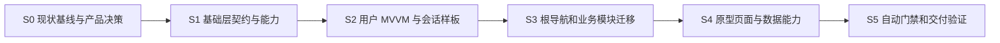

# EntryTask Android 实施路线与验收清单

> 需求基线更新（2026-10-17）：本文件为旧技术方案初稿。后续方案请先阅读[原型需求规格说明书](../../docs/requirements/01-prototype-requirements.md)和[接口与 Mock 数据需求](../../docs/requirements/02-api-mock-requirements.md)。本期明确由 RN 实现四 Tab 及全部业务子页，Native 提供认证、宿主、网络/存储/日志能力；本地 Mock 经 Native 网络拦截并按 API 使用 JSON，普通请求随机延迟 1～3 秒；iOS 本期延期。本文中原生业务 UI 优先、直接 Fake 数据、注册返回登录及强制 Room 样板等冲突项不再作为本期实施依据，待技术方案统一修订。

版本：1.0 · 日期：2026-10-17 · 状态：待实施计划

本文将[架构设计](01-architecture-design.md)和[工程规范](02-engineering-standards.md)转成可拆任务。所有验收框初始均未勾选；本次仅文档交付，不代表对应改造已完成。任务负责人在实际执行时填写，阶段完成以验证证据为准。

## 1. 实施策略与依赖顺序

先建立可构建基线，再修底层边界和会话，最后复制样板到其他业务域。每个阶段保持演示主链路可运行，避免先删旧实现再补新实现。



团队可在接口稳定后安排独立页面任务，但 SessionStore、模块依赖和根导航变更必须按上述依赖顺序集成。暂不承诺固定天数；S0 获取环境、接口与验收范围后再按人力估算。

## 2. S0：记录真实基线与确认产品假设

输入：当前仓库、四张 PRD 图、构建环境。

执行项：

1. 记录实际 JDK、Gradle、AGP/Kotlin 解析结果与 Android SDK；验证现有 debug 构建、登录注册主链路。保存现有错误而不混入无关升级。
2. 确认四/五 Tab、游客权限、注册后行为、会话时效；给图片入口分级：本期完整实现、演示说明、后续范围。
3. 记录现有 SP 文件与 Key、登录/注册行为、页面返回栈和冷启动状态。
4. 形成接口或 fixture 契约：UserDto 必填字段、错误码、资产格式、签到业务日、各页空/失败数据。
5. 建立目标依赖白名单和 README 入口；为当前已有违规保留明确待清理清单。

交付：环境基线表、产品决策记录、接口/fixture 清单、可重现的运行记录。

验收：

- [ ] 能从干净构建缓存之外的正常开发环境复现 debug 构建，或明确记录实际阻塞原因。
- [ ] 工具链兼容性有实际 Gradle 解析/构建依据，不能只引用文件中的版本字符串。
- [ ] 架构文档第 3 节默认值已确认或在任务中明确暂按默认实施。
- [ ] 所有入口均有本期行为定义，借钱 Tab 差异有决策。

## 3. S1：收敛基础库与构建配置

依赖：S0 的工具链基线；无需等待全部视觉素材。

| 任务 | 修改范围 | 完成条件 |
| --- | --- | --- |
| S1-01 统一版本管理 | 根 Gradle、catalog、各模块 | SDK/JVM/核心依赖统一，RN 自动链接仍可构建 |
| S1-02 AppProxy | lib_base、MainApplication | 单点初始化、只读配置、重复/未初始化行为明确，无 UI 泄漏 |
| S1-03 结果/错误与协程 | lib_base mvvm/error/coroutines | AppResult 不含 UI 态，取消向上传播，Dispatcher 可注入 |
| S1-04 日志 | lib_base log、调用方 | 包归属统一，敏感字段和认证 body 不输出 |
| S1-05 存储 | lib_storage 与使用方 | 迁正 storage 包，类型化 Key、作用域、旧数据删除/迁移 |
| S1-06 网络 | lib_net | 配置不可变，lib_net 不依赖 lib_storage/biz，TLS 失败不降级 |
| S1-07 演示隔离 | biz_user demo、app variants | Mock 从网络技术库移出，演示数据确定且不访问公网兜底 |

为保持现有功能，先增加新接口和适配器，再切换 UserRepository，最后删除旧 API。禁止长期并存两套认证状态；旧方法可短期 @Deprecated，但必须列明唯一委托目标，不能双写不同状态。

验收：

- [ ] 依赖图满足 lib_base 无工程下游依赖、lib_net/lib_storage 互不依赖。
- [ ] 未知 KV 类型有明确失败；金额不经过 Float；旧密码和无用 Token 有删除策略。
- [ ] app 初始化日志早于其他诊断调用；初始化错误可追踪且不泄露敏感信息。
- [ ] 网络配置在创建后不能修改；无效 baseUrl 和 mTLS 配置有确定失败测试。
- [ ] 相同 fixture、Clock 与输入得到确定结果，取消不产生业务失败。
- [ ] 当前用户演示流程仍能通过适配层运行。

## 4. S2：登录注册成为 MVVM 样板

依赖：S1 的结果、网络、存储契约稳定。

执行顺序：

1. 新建 `biz_user_api`，定义安全 SessionSummary/SessionReader 与 UserSummary；凭证只在用户实现内部和受控网络适配器可见。
2. 分离 UserDto/UserProfile/Session，完善 Mapper；定义 AuthRepository，注入 Fake/真实 DataSource。
3. 建立唯一 SessionStore，将 UserAuthManager 改为短期兼容委托，再移除独立 Boolean 与 setLoginSuccess。
4. 登录/注册拆 VM；状态只读；去除 VM 接收成功/失败 UI 回调的模式；表单错误与请求错误分离。
5. 按产品确认实施注册返回登录或完整会话自动登录；本方案默认返回登录。
6. 处理 logout、401、请求 generation、密码清理、冷启动与旧 Token 清理。
7. AuthActivity 只宿主认证内容与返回；认证取消回游客页，不直接退出全应用。

验收：

- [ ] 空输入展示字段错误；合法格式规则与接口契约一致。
- [ ] 连续点击只产生一次提交；成功、失败、取消后 submitting 正确结束。
- [ ] 密码不进日志、SP、Bundle/SavedStateHandle；离开认证流清除密码。
- [ ] 登录状态、资料与凭证不存在“Boolean 为真但凭证为空”的组合。
- [ ] 注册默认返回登录且不发布 Authenticated；若选择自动登录，证明走完整会话流程。
- [ ] 退出删除旧 Token 和用户数据，公开页不残留上一用户信息。
- [ ] 用户 A 请求未结束时退出并登录 B，A 的结果/401 不覆盖或退出 B。
- [ ] 冷启动行为与确认的会话时效一致；进程内策略不意外从 SP 恢复登录。

## 5. S3：根导航与业务模块迁移

依赖：S2 的 SessionReader 与认证入口稳定。

执行项：

- app 建 AppContainer、FeatureNavigator 和鉴权守卫；一次只存在一个认证流，认证成功后安全恢复原目标。
- 创建 biz_home、biz_wealth、biz_member；将 app/home 四个页面分别迁入对应域，“我的”进入 biz_user。
- 迁移资源并增加域前缀；按需要创建 biz_wealth_api、biz_member_api，保持公开契约最小。
- 将 BaseFragment 原生宿主能力归 base；RN 专属容器保留 app/适配层。没有实际 RN 页时不新增桥接功能。
- 修复恢复：稳定容器 ID/tag、findFragmentByTag、保存当前 Tab、限制隐藏页生命周期、延迟 state saved 时导航。
- app 显式声明实际使用的 lib 依赖；删除 biz_user 对全部基础库的无理由 api 转导。

验收：

- [ ] app 无业务 ViewModel、业务 Retrofit Service、DAO 和页面业务逻辑。
- [ ] biz 实现之间无直接 Gradle/import 依赖，也不通过全局容器反查实现。
- [ ] 游客能浏览已确认公开页面；受保护入口只打开一次认证。
- [ ] 登录成功返回原操作，取消回原页；401 不导致重复跳转。
- [ ] 切 Tab、重建 Activity 和模拟进程恢复不重复 add Fragment、不丢当前 Tab。
- [ ] state saved 后触发导航不丢失用户意图、不靠 commitAllowingStateLoss 掩盖问题。
- [ ] 若决定五 Tab，借钱的展示/说明和顺序已经实现并更新 PRD 映射；若四 Tab，有显式范围记录。

## 6. S4：按原型补齐业务与数据能力

依赖：S3；各域内部可按明确契约分任务实现。

| 业务 | 最小交付 | 数据与验收重点 |
| --- | --- | --- |
| 首页 | Banner、快捷入口、服务宫格、分类推荐 | 独立区块状态；入口有定义；推荐通过财富契约获取 |
| 财富 | 资产掩码、分类/资讯切换、产品列表/演示详情、活动 | 金额与收益精度；游客不请求个人数据；产品 Room 缓存样板 |
| 会员 | 游客卡、活动分类、签到与权益演示 | 业务日、重复签到、重复领取、防重入与失败回滚 |
| 我的 | 游客/登录资料、统计与跨域概要、设置/退出入口 | 脱敏；跨域只读接口；退出后所有概要清空 |
| 基础 UI | 主题 token、通用表单/按钮、页面状态/重试 | 字体放大、窄屏、TalkBack、系统栏与键盘 |

Room 样板落实步骤：定义产品 Entity/DAO/WealthDatabase → schema 导出 → 本地 Flow 为列表事实来源 → 网络事务写库 → TTL 和 stale 状态 → 迁移测试。未来新增表不能只修改 Entity 就直接升级版本。

验收：

- [ ] 每项 PRD ID 都能定位到页面、任务与行为验证；未实现能力有明确演示说明。
- [ ] 各页覆盖首载、空、失败、重试；刷新失败不清已有内容。
- [ ] 模拟收益、资产、额度等明确为演示数据，未接入真实银行服务。
- [ ] 财富金额保留约定精度，收益单位不误乘 100，掩码不改变底层数据。
- [ ] 重复签到/领取不重复增加权益，跨日与时区边界可重复验证。
- [ ] Room schema 与迁移测试入库，离线公开列表带更新时间；个人资产不误用公开缓存。
- [ ] 退出/切账号之后四域没有缓存串用或过期请求回写。
- [ ] 窄屏、字体放大、系统栏、键盘与关键无障碍流程通过人工或自动验证。

## 7. S5：质量门禁与交付闭环

依赖：前述行为稳定；部分静态门禁可更早接入。

- 依赖白名单自动检查：项目依赖图无环、lib 不依赖 biz/app/RN、业务实现不互依赖。
- 单测覆盖 VM、会话、Mapper、网络错误、关键存储逻辑；设备覆盖 Room、导航与生命周期。
- CI 运行 Lint、目标单测、demoDebug 编译与主要设备集成；真实环境配置具备后增加 realRelease 产物检查。
- 检查最终合并 Manifest、证书配置、备份排除、日志、签名、R8 与 Mock/Fake 依赖隔离。
- 记录冷启动、Tab 切换、列表滚动和请求次数基线；修复重复请求和主线程阻塞。
- 删除已完成迁移的旧 UserAuthManager 状态、NetManager 可变 API、原 MockInterceptor、旧包与旧资源，更新文档。

验收：

- [ ] 人工评审与 CI 有实际执行证据，失败项可复现。
- [ ] demo 产物明显标识；真实 release 不带模拟实现或测试证书。
- [ ] 正式分发签名来自安全配置；未接正式签名时不得称为可正式发布。
- [ ] R8 开启后的目标产物完成关键业务验证，序列化和反射不因压缩失效。
- [ ] 删除兼容层后无遗留引用；文档反映最终模块结构和产品决策。

## 8. 关键行为验收用例

| 用例 | 前置与操作 | 期望 |
| --- | --- | --- |
| AT-01 游客浏览 | 清应用演示数据后冷启动，进入各公开页 | 不强制全局登录；无历史用户身份/资产 |
| AT-02 登录返回目标 | 游客点击受保护入口，完成登录 | 只开一个认证流，成功后到原目标一次 |
| AT-03 取消认证 | 游客触发登录后返回 | 回原公开页；应用不直接退出 |
| AT-04 注册语义 | 注册新演示账号 | 默认回登录，保留账号清密码，状态仍为游客 |
| AT-05 失败与重入 | 慢响应时连续点登录，再注入业务失败 | 一次提交；展示安全错误；可再次操作 |
| AT-06 取消任务 | 提交后销毁 VM/取消请求 | 不提示业务失败、不回写旧 UI/缓存 |
| AT-07 多请求 401 | 同一用户并发请求都返回 401 | 一次失效与认证提示，受保护页面关闭 |
| AT-08 旧会话响应 | A 请求挂起，退出后登录 B，再返回 A 结果/401 | B 状态与缓存保持正确 |
| AT-09 退出清理 | 登录、打开资产、退出并切换所有 Tab | 无 Token、个人数据和头像等残留 |
| AT-10 生命周期 | 切 Tab，ActivityScenario 重建，再执行受控进程恢复测试 | 无重复 Fragment，Tab/非敏感筛选恢复；进程内会话回游客 |
| AT-11 协议错误 | 200+业务失败、空 data、坏 JSON、超时、403 | 错误分类符合契约；403 不默认退出 |
| AT-12 缓存与迁移 | 已有公开缓存后断网；升级旧 schema | 展示带时间旧内容；迁移不丢应保留数据 |
| AT-13 签到重复 | 同一业务日连续签到，推进到下一日 | 同日不重复奖励；下一日按演示规则更新 |
| AT-14 敏感字段 | 检查测试构建日志/KV/导航状态 | 无密码、Token、完整身份或资产响应 |
| AT-15 变体隔离 | 查看 realRelease 依赖和产物（环境具备时） | 无业务 Mock/Fake/调试 CA，正式配置有效 |

进程恢复不等同于 Activity 重建：AT-10 必须分别记录两种验证。生产发布相关用例在无真实配置时标记“不适用/未验证”并说明原因，不能记为通过。

## 9. 验证命令与证据记录

以下在 `android/` 目录执行。第一组面向当前模块，后续变体/测试配置按任务接入。命令是执行建议，本次文档交付未运行它们。

```sh
./gradlew --version
./gradlew :app:buildEnvironment
./gradlew :app:assembleDebug
./gradlew :lib_base:testDebugUnitTest :lib_net:testDebugUnitTest :lib_storage:testDebugUnitTest :biz_user:testDebugUnitTest
./gradlew :app:lintDebug
```

引入 flavor 后，先 `./gradlew :app:tasks --all` 确认任务名；预计采用：

```sh
./gradlew :app:assembleDemoDebug
./gradlew :app:lintDemoDebug
./gradlew :app:dependencies --configuration demoDebugRuntimeClasspath
./gradlew :app:connectedDemoDebugAndroidTest
./gradlew :app:assembleRealRelease
```

库模块若也引入 flavor，其单测任务随变体变化；以实际任务列表为准。设备测试要求已连接设备/模拟器；真实 release 要求真实接口配置与安全签名。CI 中缺配置时给出明确状态，不使用演示实现顶替真实验证。

每阶段填写：

| 项目 | 实际记录 |
| --- | --- |
| 阶段/负责人/日期 | 待填写 |
| commit / 构建变体 / 设备 / JDK | 待填写 |
| 执行命令与结果 | 待填写 |
| 用例与证据位置 | 待填写 |
| 未通过/未验证与影响 | 待填写 |
| 回滚入口与剩余任务 | 待填写 |

## 10. 迁移和回滚策略

- 拆成可独立构建的小提交；网络与存储先加接口适配，业务切换后删除旧实现，禁止双写两套登录事实。
- 会话默认由落盘 Token 改为内存时，升级后的重新登录是有意行为，需写进演示说明；旧版本回滚不得从残留 Token 复活会话。
- KV 迁移成功前保留非敏感源数据；删除明文密码/旧凭证不可反向恢复，回滚需要重新登录或重建演示 fixture。
- Room 版本升级前验证迁移；旧 APK 不保证可读新 schema，优先前向修复。演示数据若可丢弃，必须确认并记录范围，不将生产用户数据一起清除。
- 每次页面迁移保留路由 ID 的兼容映射；取消兼容项前确认无旧入口与深链使用。
- 环境切换不得复用 Token/数据库用户数据；测试数据和真实环境命名空间隔离。

## 11. 风险与处置

| 风险 | 处置与关闭条件 |
| --- | --- |
| 静态图片不是完整 PRD | 先确认第 3 节产品假设；每入口有可验收定义 |
| RN 模板与当前工具链组合未验证 | S0 实测解析与构建，不盲目整体升级 |
| 注册/登录语义在旧代码中冲突 | S2 单一 SessionStore 和行为用例证明 |
| 拆模块后隐藏的传递依赖失效 | app 显式依赖、每阶段编译与依赖报告 |
| 客户端看似退出但旧响应污染新会话 | generation + 取消 + 用户缓存隔离测试 |
| Fragment 恢复或 RN 宿主重复挂载 | 稳定 ID/tag、管理器恢复和独立容器验证 |
| 演示实现进入真实产物 | 源集隔离、依赖图与 release 产物检查 |
| 架构过度抽象拖慢新手项目 | 包内分层、可选 UseCase、确有需求再建模块 |

## 附录 A：新增业务任务模板

```markdown
任务：
需求/原型 ID：
用户路径与游客/登录行为：
本期包含与范围外：
所属 biz 与拟用 lib/API：
UiState / 操作 / 防重策略：
领域模型、接口或 demo fixture：
数据事实来源、缓存与迁移：
失败/取消/账号切换/恢复行为：
验证用例与命令：
文档/ADR 变更：
负责人、风险与回滚：
```

## 附录 B：ADR 模板

```markdown
# ADR-编号：决策标题
日期：
状态：拟议 / 采纳 / 替代
负责人：
背景与具体问题：
约束和已确认产品规则：
可选方案及成本：
最终决策与理由：
影响的模块、API、数据与安全策略：
兼容迁移与回滚：
验证与完成条件：
替代的旧决策/后续重审条件：
```
