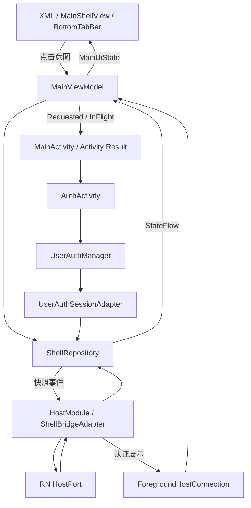

# Android 首页分阶段改造：先 MVVM 与混合宿主，后 Compose

日期：2026-10-21。按最新范围，当前只交付 XML + MVVM + 混合宿主适配，Compose 转换延期独立实施。此前将架构与 Compose 一起修改的工作区已拆开，历史 Compose 验证结果不作为当前 XML 版本证据。

首页指 MainActivity 的 Native Shell（RN 容器、根 Tab、认证协调、Insets 和返回），银行业务继续由 RN 实现。认证模块原有 Compose 不属于此次首页转换，不回退。

## 1. 分步执行与验收边界

| 步骤 | 本次状态 | 改动 | 验收 |
| --- | --- | --- | --- |
| A：MVVM 与 Bridge 解耦 | 已落地 | MainViewModel / MainUiState、ShellRepository、NativeSessionPort、ShellGraph、ShellBridgeAdapter；移除旧 ShellCoordinator | 单一状态源；VM 不持有 UI/JSON/凭证；相同更新去重；epoch 不回退 |
| B：混合宿主与平台适配 | 已落地 | XML 纯渲染适配、稳定 Fragment 恢复、Activity Result 认证、前台端点、返回与 Insets | 保留 singleTask / 单 ReactHost；认证往返保留首页；重建无重复宿主；返回及安全区正确 |
| C：Compose UI 转换 | 未执行，后续单独交付 | 替换 activity_home.xml / MainShellView / BottomTabBar，选择并验证 Compose 与 Fragment 互操作 | 不改变 Repository / VM / Bridge 协议；只替换 View 层并补 UI 对照及恢复测试 |

A/B 在同一份 XML 交付中完成；需要代码提交时可按“状态与契约 → 宿主与 XML 绑定 → 验证文档”组织，不自动提交或拆建项目。C 不混入当前差异。

## 2. 当前架构与依赖

| 路径 | 当前职责 |
| --- | --- |
| app/.../shell/domain | ShellSnapshot / ShellCommand / ShellRepository / NativeSessionPort / RootBackPolicy |
| app/.../shell/data | DefaultShellRepository / UserAuthSessionAdapter；会话只从 Native 权威读取 |
| app/.../shell/presentation | MainViewModel / MainUiState / MainShellView；后者仅适配 XML，不访问 IO |
| app/.../shell/host | HostFragmentHandle / ForegroundHostConnection；View 作用域句柄与可撤销前台端点 |
| app/.../shell/di | ShellGraph；Application 作用域组装 |
| app/.../bridge | HostModule 保持 Codegen 边界；ShellBridgeAdapter 负责 JSON 与类型化命令转换 |
| app/.../res/layout/activity_home.xml | 稳定根容器、RN 区域和底栏组；布局保持 XML |
| lib_base/.../ui/BottomTabBar | 现有 View 控件；点击只上报，selectTab 只渲染外观 |

MainUiState 组合 ShellSnapshot 和 AuthLaunchState；bottomBarVisible 派生自 authenticated && depth==0。Repository 是 tabId/depth/revision 的唯一事实来源；UserAuthManager 是会话权威。BottomTabBar 的选中缓存仅用于绘制，不在点击时自行改变业务状态。

MainActivity 在 STARTED 区间收集 uiState 并调用 MainShellView.render；认证副作用在 RESUMED 区间执行。VM 不依赖 XML、Compose、Activity、Fragment、JSON 或 ReactHost。SavedStateHandle 只保存非敏感 Tab；同进程已有选择优先于旧 Bundle，新进程无会话回首页门禁。

## 3. 混合宿主约定

### 3.1 Fragment 与 RN

MainActivity.setContentView 后查找 entrytask-root-hub；已有 HomeFragment 直接复用，缺失才在允许事务的 onCreate 阶段添加到 R.id.fragmentContainer。保留旧 XML 的外层 tag，不引入或迁移 Compose 的自动 tag；当前未发布的 Compose 工作区实现不作为安装恢复基线。

BaseFragment 使用稳定 R.id.rn_content / entrytask-rn-root 复用内层 ReactFragment；RNScreensFragmentFactory 在 super.onCreate 前设置。Tab 和认证不替换 Fragment，不创建第二个 runtime。HomeFragment.USE_REACT_NATIVE 保留 Native-only 分支，VM 不持有宿主句柄。

### 3.2 认证与返回

RN 查询 NativeSession 后决定门禁，并经 HostPort 发 authenticate。HostModule 工作线程校验，主线程执行 ShellBridgeAdapter。ForegroundHostConnection 仅在 MainActivity RESUMED 时绑定；VM 合并重复认证请求并输出 Requested(id)。Activity 确认 InFlight 后以 Activity Result 启动 AuthActivity。

ACK 仅表示受理，不证明登录成功。AuthActivity 成功先提交 Native 会话，再 setResult / finish 自身；原 MainActivity 的结果回调和 onResume 重读会话。取消留门禁，失败可重试；onNewIntent 重查 singleTask 重入状态。没有业务主动 finish 首页，仍不保证系统永不回收进程。

返回唯一入口：IME → ReactFragment → RN 子栈 → Native 根策略。其他根 Tab 返回首页，首页沿用单调时钟 500ms 双击退出。depth 冲突只重同步，由 RN 实际导航栈纠正；不推定子页已消费或直接退出。没有新增返回 ACK 协议。

### 3.3 Insets

XML 根由 ViewCompat 窗口 Insets 监听预留底部系统导航区；RN 容器预留顶部及侧边 systemBars/displayCutout。RN SafeAreaView 在裁剪后的真实视口中计算剩余安全区，不两端硬编码同一高度。底栏与分割线成组显隐，宿主容器始终存在。

### 3.4 Bridge 生命周期

HostModule 模块协程与有界单消费者队列按受理顺序处理请求；Default 校验/读资源，Main.immediate 更新状态。容量64，队列满返回 HOST_COMMAND_BUSY；模块 invalidate 取消队列/订阅。UI 停止收集不阻断 Bridge 的 Shell 事件。公开 specs、协议、包名、入口和 APK 资源生产链保持兼容。

## 4. 后续 Compose 的独立任务

1. 基于本阶段已验证的 XML 版本记录外观、返回、认证与重建基线。
2. app 单独启用 Compose 编译插件/buildFeatures，并声明直接 UI 依赖；不因首页转换升级 RN 或全局工具链。
3. 用 MainRoute / MainScreen / 无状态 RootBottomBar 替换 MainShellView，继续消费原 MainUiState 和动作。
4. 单独选择 AndroidFragment 或保留 View 容器互操作；验证旧 XML 外层 tag 的恢复迁移、Surface 生命周期与 Insets。不能同时手动管理同一个外层 Fragment。
5. 通过字体/点击语义、视觉对照、Tab/认证不重建、Activity 重建、返回及官方 CLI 验证后，再删除无引用的 XML/View 文件。

Compose 的收益在声明式布局和 UI 组合，不把当前 Repository、认证或 Bridge 解耦算为 Compose 独有收益。本阶段不保留一套闲置 Compose 实现，也不维护双渲染器开关。

## 5. 本阶段验证

以下为本次 XML 阶段实测，不引用之前 Compose 版本的测试结论。

| 检查 | 结果 |
| --- | --- |
| RN 静态与行为 | typecheck / lint / architecture:check 通过；Jest 7 suites / 18 tests 通过，本次指定 --watchman=false，不跳过用例 |
| Native JVM | app 10 tests 通过，覆盖快照去重、epoch、认证防重/重试、前台端点和返回策略 |
| 构建/生成 | Codegen、Debug/Release 全默认ABI构建、lintDebug 通过；未改变 RN 入口、包名、注册名、Mock 资源生产链 |
| APK | Debug/Release 各79份 contracts/mock JSON 与源码逐字节一致；Release 内置JS Bundle；无旧首页MainScreenKt类 |
| 设备 | API37/arm64/手势导航的只读隔离模拟器；5 tests，0 failures/errors/skipped；XML渲染、20次Tab、固定tag恢复、RN真实内容恢复、认证取消/成功返回同一MainActivity、深度纠正与真实子页/根Tab返回、安全区边界均通过 |
| 视觉复核 | 重建用例额外复跑通过，截图确认XML布局的RN内容、状态栏/侧边安全区、底栏和系统导航区正常分离 |
| 官方 CLI | 根目录官方 npx react-native run-android --no-packager --device <serial> 构建、安装、启动通过；使用已有 Metro，并通过 ANDROID_SERIAL 限定目标设备 |

首次测试编译发现缺失 Lifecycle 导入，补齐后重新通过；没有删除失败用例。设备测试使用已有临时官方 Maven 依赖目录，绕过本机 Java TLS 下载故障；此临时仓库未写入工程配置。另一台既有模拟器响应异常，本次未重启或清数据。

设备认证使用内存合成会话，不注册账号或改写用户已有账号。真实凭证表单、多设备/系统版本、Native-only 开关设备路径、完整预测返回/IME/字体矩阵及性能采样单独记录，不能由构建或宿主测试推定通过。

相关文档：[Android技术方案](Android%20技术方案.md)、[Android README](../../android/README.md)、[启动全链路](../development/启动与登录全链路源码详解.md)、[ADR-012](../adr/012-shell-mvvm-before-compose.md)。
