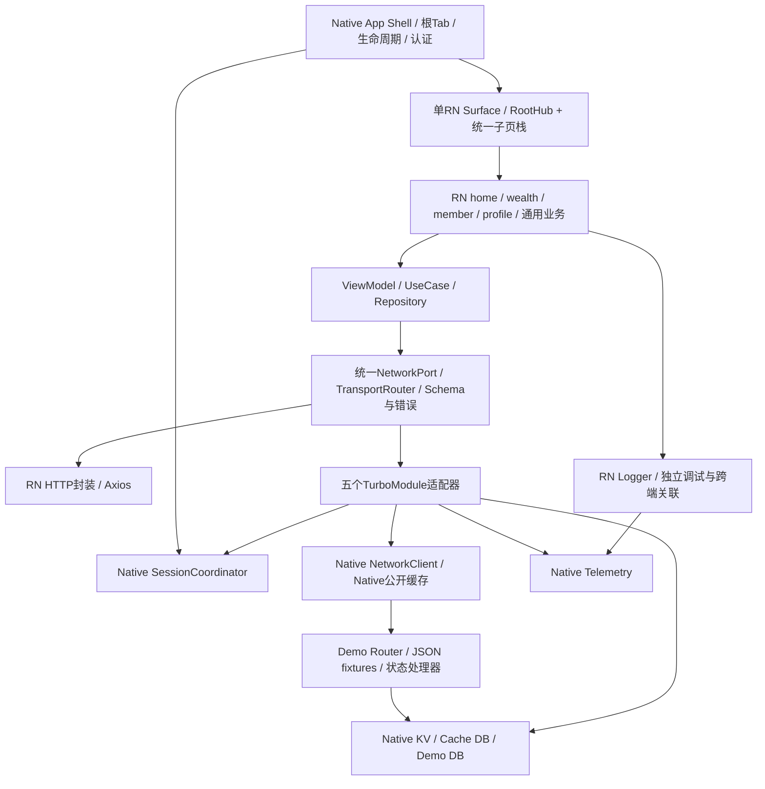
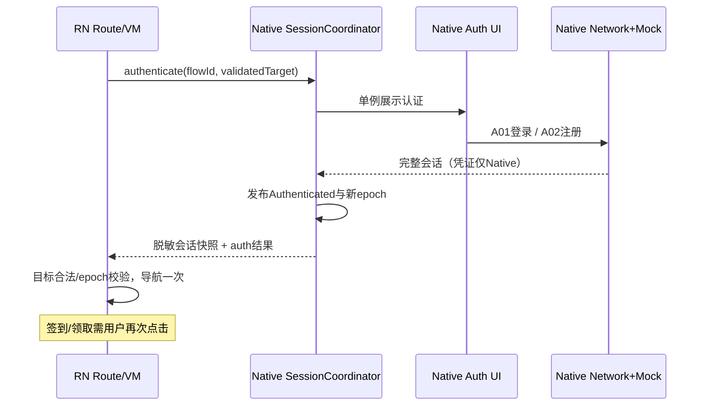

# EtryTask 项目设计方案

版本：1.1 · 日期：2026-10-18 · 状态：待评审技术设计  
工程名称：EntryTask（本文文件名按交付要求保留 EtryTask）  
2026-10-19 认证修订：全应用 RN 页面必须登录，替代本文 V1.1 游客浏览默认；实现边界见 [ADR-011](../adr/011-required-native-authentication.md) 与 [Android方案 §5](Android%20技术方案.md)。其余目标设计不因此自动视为已实施。

总体方案负责人：架构负责人（实施启动时实名登记）

## 1. 方案定位与阅读方式

本方案将当前原型需求转为可演进的中大型混合应用架构，覆盖工程组织、运行架构、跨端契约、数据一致性、性能与稳定性、交付和治理。**本次仅交付技术设计，不代表模块、接口、测试或性能指标已经实现或验证。**

需求输入：[原型需求规格说明书](../requirements/01-prototype-requirements.md)、[接口与 Mock 数据需求](../requirements/02-api-mock-requirements.md)。配套详细设计：[前端RN技术方案](前端RN技术方案.md)、[Android 技术方案](Android%20技术方案.md)、[iOS技术方案](iOS技术方案.md)。总体方案定义公共契约和跨端规则，三端方案补充平台实现，冲突时先修订文档及ADR再实施。

本期四Tab为首页、财富、会员、我的；根宿主/底栏/认证、存储及可复用网络/日志能力由Native提供，RN拥有业务HTTP封装与独立Logger，四域页面和子页属于RN。按API策略选择通路；无后端的37原型API默认Native Mock、按API使用随包JSON，普通Mock请求随机延迟1000～3000ms。Android本期实施；iOS完成详细设计，本期不修改代码。真实交易、第五Tab、远程热更新和生产上架不扩入本期。

游客浏览、进程内会话、注册完整自动登录、签到3/7日奖励等沿用需求中的“补充默认”，并未因写入技术方案变成已确认产品事实；评审改变规则时同步需求、fixture、契约和用例。

### 1.1 设计取舍

| 决策ID | 决策 | 依据与代价 |
| --- | --- | --- |
| ADR-001 | 单应用仓库、模块化单体，按业务域与技术职责分层 | 支持团队并行与边界治理，避免本期拆多仓/微前端的版本发布成本 |
| ADR-002 | 每进程一个RN运行时，一个RN业务Surface；Native四Tab驱动RN RootHub，RN单一子页栈 | 减少运行时/根视图重复，统一会话；改造现有四占位Fragment，需严格实现导航同步 |
| ADR-003 | RN使用TypeScript MVVM；Native认证使用平台MVVM；依赖由组装根构造注入 | 可独立测试VM，避免重复业务状态；不会要求每层单独建物理模块 |
| ADR-004 | 新架构TurboModule + Codegen，业务依赖无平台的能力Port | 仓库已启用新架构/Hermes；需G0先验证生成、注册与生命周期，不新增旧桥接双实现 |
| ADR-005 | Native单一银行会话与持久化；RN用RTK Query统一内存查询缓存、RTK slices管理客户端状态 | 避免银行Token及持久缓存重复；内存查询/客户端状态由成熟库封装，跨层统一版本与请求上下文 |
| ADR-006 | JSON驱动的Native Mock模拟服务端；平台分别实现协议一致的状态引擎 | 无真实后端，需跨端一致性；不引入KMP/C++共享业务引擎，靠共享schema/向量防漂移 |
| ADR-007 | 子页使用React Navigation native-stack；页面标题用RN组件，Native底栏仅根页可见 | 利用平台转场/手势，需验证react-native-screens与RN0.86兼容 |
| ADR-009 | RN HTTP + Native网络按API选择，禁止失败回退 | Native保留银行认证/Mock，RN允许独立公开服务，不将NativeModule视为唯一请求入口 |
| ADR-010 | Axios + Redux Toolkit/RTK Query封装；RN Logger独立且关联Native | 避免自研状态/查询框架，开发前完成目录与样板门禁 |
| ADR-008 | 当前构建版本先复现，再锁兼容矩阵；新增依赖采用G0验证过的精确版本 | 不以“最新”代替兼容，不在设计期虚构可构建的依赖组合 |
| [ADR-011](../adr/011-required-native-authentication.md) | 所有RN页面先登录，Native会话权威与singleTask首页上方认证页 | 2026-10-19用户明确要求；替代游客浏览默认，取消停留门禁 |

单运行时是资源和一致性决策，不宣称能自动消除卡顿；单RN instance是用户明确约束，Tab/页面/认证不另建实例；异常重建先释放旧runtime/监听再创建新runtime，禁止双实例同时运行或后台预热第二实例。

## 2. 静态工程基线

| 项目 | 核查到的配置 | 状态/风险 |
| --- | --- | --- |
| RN/React | package.json及本地RN包：0.86.0/19.2.3 | 业务为NewAppScreen模板，无能力模块 |
| Node | 项目声明>=22.11.0；本地RN包要求^20.19.4或^22.13.0或^24.3.0或>=25.0.0 | 取交集，拟选Node22且>=22.13；精确补丁及npm版本G0锁定 |
| Android | min24、compile/target36、Kotlin2.1.20、Gradle9.3.1、NDK27.1.12297006 | app未显式锁AGP；实际AGP/JDK/NDK与RN兼容需构建核实 |
| Android基础库 | OkHttp4.12、Retrofit2.9、Gson2.10.1；不同Lifecycle版本并存 | 保留可用依赖后逐项治理，非整体盲升 |
| Android宿主 | Native四Tab、占位Fragment、RN宿主辅助代码 | 未验证配置恢复/返回，存在强制认证与允许状态丢失提交 |
| iOS | RN factory模板；deployment target15.1；SWIFT_VERSION5.0；Podfile使用RN最低版本 | 本地RN helper也声明15.1；Xcode/SDK/Pods兼容未实测，未来G0-I核查 |
| 会话/存储 | 内存Boolean、Token落SP、单账号明文Mock密码 | 不能作为目标状态，迁移必须清旧凭证并重新认证 |

本次只读源码和本地依赖，未运行Gradle、Pods、设备测试或基准测试。配置字符串不是兼容结论；G0的失败单列环境问题，不静默删RN插件或随意降级规避。

## 3. 目标运行架构



图中是运行调用方向，不代表通用网络库依赖Demo业务。Demo拦截器由AppContainer注入NetworkClient，网络库只认识Interceptor接口。RN域Repository通过统一NetworkPort/TransportRouter访问A04～A37，descriptor决定Native或RN HTTP；本期默认Native Mock，不绕过网络读取Demo数据库；A01/A02由Native认证调用，A03由SessionCoordinator内部调用。

### 3.1 事实来源和失效边界

| 事实 | 唯一权威 | 可派生投影 | 清理时机 |
| --- | --- | --- | --- |
| 当前用户、凭证、sessionEpoch | Native SessionCoordinator | RN SessionProjection（脱敏） | 退出、401、进程终止 |
| 根Tab与hostRevision | Native ShellRepository（Android 经 MainViewModel 驱动 XML） | RN RootHub投影 | 进程终止恢复首页 |
| 子页栈、分段、滚动/筛选 | RN NavigationCoordinator/页面VM | Native内存仅保存脱敏恢复描述 | 退出清保护页、进程终止全清 |
| 签到/能量/领取/库存/消息 | Native Demo DB事务 | RN资源内存快照、Native查询缓存 | 重置演示数据；普通退出保留数据库事实 |
| 公开内容缓存 | Native CacheStore | RN可见资源内存快照 | TTL、数据版本/场景切换、显式失效 |
| 资产/会员/角标共享显示 | RTK Query内存资源（由域Repository暴露） | 页面VM只读引用/映射 | 会话变更、写成功后失效并读取权威数据 |
| 金额隐藏偏好 | Native用户作用域KV | RN PreferenceProjection | 退出清投影，同账户重登可读取偏好 |

RN Repository以RTK Query维护同会话跨页内存资源，禁止再复制到自研资源仓或持久缓存；Redux Toolkit slices只保存客户端UI/脱敏会话投影。写成功优先使用权威返回原子更新有关资源，再失效重取关联摘要；跨多个API的读取不能称为强一致事务，使用resourceRevision和旧结果丢弃防止回退。

## 4. 工程组织与依赖治理

```text
EntryTask/
  src/                          RN代码，具体结构见RN方案
  specs/                        Native*.ts Codegen薄传输规范
  contracts/
    bridge/v1/                  envelope/schema/error/capability定义
    api/v1/                     A01～A37请求响应JSON schema
    navigation/v1/              route/service/page映射
    test-vectors/               取消/会话/签到/领取跨端黄金向量
  mock/
    manifest.json               API精确匹配、鉴权、缓存与handler映射
    <domain>/<api>/              request及response.*.json
    seeds/                      初始数据和版本
    scenarios/                  API级故障、Clock、固定随机种子
  android/                      app + 技术模块 + 认证/演示域
  ios/                          App + 本地Swift Package + RN ObjC++适配
  tools/                        契约检查/数据打包/依赖边界/质量脚本
  docs/requirements/            产品基线
  docs/design/                  本方案与三端方案
  docs/adr/                     后续采纳的决策记录
```

以上为目标目录，本次不创建空代码模块冒充已完成。共享资源按确定性脚本复制到Android generated assets和iOS bundle资源，记录SHA-256及manifestVersion；不手工维护两份JSON。CI校验API覆盖、文件引用、schema、页面目标及产物资源哈希。

域与技术层依赖规则：UI→VM→领域契约→Data实现→Platform Port；DI在app根；跨域只依赖`public`契约和路由描述，不导入另一域的私有组件、VM、DAO。RN模块先按包分界，以ESLint/依赖图执行；独立发布与大型团队出现后再拆workspace package。Android/iOS契约包不反向依赖实现；RN依赖只存在桥接/宿主适配层，通用网络和存储不引用RN类型。

## 5. 跨端协议 V1

### 5.1 身份、请求与事件

- bootId：Native进程启动随机ID，进程恢复时改变。
- runtimeId：每次RN runtime建立时改变，由Native登记；Surface重挂载但runtime未重建时不变。
- sessionEpoch：Native单调递增会话版本，游客/登录/退出/失效均按状态转换更新；opaqueUserId并非授权参数。
- hostRevision：Native根导航版本，控制Tab指令顺序；navigationRevision为RN子栈版本。
- requestId：单个异步调用标识；flowId：一次用户流程关联；idempotencyKey：逻辑写操作重试标识，三者不可混用。
- resourceRevision：Demo数据变更事务版本，仅用于内存投影防回退，不把它当真实后端既有能力。

事件固定为sessionChanged、tabSelected、hostLifecycleChanged、backRequested、hostCommandResult、demoStateReset、resourceInvalidated、memoryPressure；禁止使用任意字符串事件广播替代领域契约。事件带eventId、bootId、runtimeId、epoch/revision，接收方忽略重复和旧版本；事件仅加速刷新，快照/重读保证正确，不能依赖一次性消息可靠到达。

### 5.2 五个Native模块与业务Port

| 模块 | 传输方法（设计名称） | 关键约束 |
| --- | --- | --- |
| NativeHost | bootstrap(requestJson)、command(requestJson)、publishNavigation(requestJson)、onHostEvent | bootstrap返回能力/会话/宿主快照；命令确认及重同步；不开放任意Activity/URL |
| NativeNetwork | execute(requestJson)、cancel(requestId) | A04～A37白名单；请求仅apiId/pathParams/query/body，不接受任意URL/Header/用户ID；A01～A03禁止JS直接调用 |
| NativeStorage | read/write/remove(requestJson) | 固定Key注册表，Native推导用户scope，不能读写凭证/Demo表/任意路径 |
| NativeSession | getSnapshot(requestJson)、authenticate(requestJson)、logout(requestJson) | authenticate支持success/cancel/failure；只恢复目标导航，不恢复写操作 |
| NativeTelemetry | emitBatch(batchJson) | 有界非阻塞队列、白名单字段脱敏、批次确认；失败不阻断业务 |

Codegen规范只承载明确的string/boolean/number/Promise及string事件，复杂业务包采用受限JSON string，在TS adapter和Native边界按版本schema校验。这样避免把复杂泛型/联合类型直接送入Codegen；代价是序列化，应以载荷上限和批量控制。官方Codegen根据类型规范生成平台接口，具体注册机制必须用仓库RN0.86实测。[RN 0.86原生模块文档](https://reactnative.dev/docs/0.86/turbo-native-modules-introduction)

```ts
// 语义类型示意；不直接作为Codegen spec，代码落地时由schema生成校验器。
type Context = { bootId: string; runtimeId: string; sessionEpoch: number };
type BridgeRequest = {
  protocolVersion: '1.0'; requestId: string; flowId: string;
  context: Context; payload: unknown;
};
type BridgeError = {
  kind: 'validation' | 'unavailable' | 'timeout' | 'storage' | 'staleContext' | 'internal';
  code: string; safeMessage: string; retryable: boolean;
};
type BridgeReply = {
  requestId: string; context: Context;
  outcome: 'ok' | 'error' | 'cancelled';
  dataJson?: string; error?: BridgeError;
};
```

ok只表示能力调用完成。Network的dataJson内为`{httpStatus,bodyText,allowedHeaders,traceId,resourceRevision,cache:{source,fetchedAt,stale}}`；HTTP500仍是网络完成，由RN映射HttpError；业务code非200映射BusinessError；坏JSON通过bodyText进入RN契约校验形成ProtocolError。Native先处理当前epoch的401会话失效，再返回响应。普通Network调用严格比对发起epoch；authenticate/logout/bootstrap允许经校验的会话版本前进，不把合法认证成功结果按旧epoch丢弃。取消独立终态，不弹失败提示。Promise reject仅用于未能进入协议处理的桥接异常，adapter兜底归一；预期业务故障走结构化reply。

请求体默认≤64KiB、单响应≤256KiB、事件≤8KiB、日志批≤32KiB；列表10条、最大50条，详情长文分页或结构分块。超限返回PAYLOAD_TOO_LARGE而非截断JSON。二进制不通过JSON/base64桥接，本期图片通过本地资源key。限制为初始工程预算，G0测量后可通过ADR调整。

### 5.3 握手与协议演进

1. RN先订阅Host事件并缓冲，发bootstrap携带bundleVersion/contractHash/支持主次版本。首次bootstrap使用独立握手schema，不要求尚未取得的bootId/runtimeId；Native返回并登记上下文后，其他调用必须携带完整Context。
2. Native在协调器中生成一致的会话/根导航快照，返回acceptedVersion、capabilities、boot/runtime、hostRevision；RN应用快照后按版本消费缓冲事件，再获取一次轻量snapshot消除窗口。
3. 主版本不支持或必需能力缺失：Native兜底页提示重试/退出；Native指定API不得自动改走RN网络/存储，已配置的RN独立公开API按自身能力/会话约束执行。次版本字段只可增量可选；枚举新增必须有unknown处理；变更必填语义需主版本升级。
4. 本期Bundle随安装包原子发布，协议/hash、fixture、构建版本一起登记；不引入OTA。未来OTA必须新增签名、匹配矩阵、回滚和分批策略，当前不能假称已有。

### 5.4 异步终态与资源治理

Native以requestId维护状态`registered → running → completed|failed|cancelled|timedOut`，CAS/串行协调保证只有一次终态。cancel可能早于execute注册，保留30秒有界取消墓碑，避免请求穿透；已完成cancel返回no-op，不回滚成功事务。桥接销毁取消本runtime查询并释放Promise引用；已提交事务的事实保留，重挂载重新读取。

默认读请求总超时10秒、写请求10秒（含排队/延迟/解析）；认证表单请求同10秒。过期请求队列直接超时，不执行写入；非幂等POST不自动重放。Native网络最大8个运行请求、每runtime最多32个待处理请求，超限返回BUSY；日志用独立有界队列，RN也有不依赖bridge就能调试的Logger，避免业务队列被埋点耗尽。调试故障可突破3秒注入超时，正常模式不可。

## 6. 导航、会话与恢复

### 6.1 导航所有权

Native ShellRepository（Android 经 MainViewModel 驱动 XML）持有selectedTab、hostRevision、底栏布局；RN RootHub惰性挂载四个根Panel并保留VM，子页统一push到RootStack。RootPanel被隐藏时暂停副作用，RN不渲染第二个底栏。切Native Tab时发送带revision的tabSelected；RN应用后确认；重复revision无操作。RN跨Tab请求先发Native command，确认后应用同一tabSelected，不能先自行切画面导致底栏错位。

子页push前RN发布`pendingTransition + targetDepth`，Native先隐藏底栏，RN执行转场并提交导航revision；转场失败回滚至已提交快照。返回根页的转场完成才恢复底栏；在Native认证覆盖期间底栏始终隐藏。命令有commandId，500ms未确认触发snapshot重同步，2秒仍不一致进入可恢复宿主错误态，不无限发送重复命令。

跨域子页使用全局RootStack保留来源，例如首页→权益详情→返回首页，不为该详情强制切会员Tab；“财富广场”等明确跨Tab入口才使用selectTab。根页内资讯/活动分段不修改Native Tab。

### 6.2 认证流程



认证恢复目标为预注册route及非敏感ID，Native只存一次性pendingIntent，结果按flowId消费。并发认证合并成一个展示会话，调用方分别获得终态，取消不得留下保护目标。完整会话须包含可用凭证和用户摘要，注册只置Boolean不能通过验收。

退出先禁止新保护请求、捕获A03所需旧凭证上下文、将会话变游客并递增epoch，取消旧请求和清个人投影，发事件并返回我的根页；A03清理请求以独立受控logout上下文best-effort发送，失败不恢复登录，不能因清Token导致连退出请求都无法构造。旧epoch的401忽略；当前epoch多个401只失效一次。

### 6.3 恢复矩阵

| 场景 | 会话 | 导航/数据处理 |
| --- | --- | --- |
| 前后台 | Native保留 | 仅前台活跃页校验过期资源；无后台业务轮询 |
| Android Activity重建 | 进程内保留 | 重连同ReactHost，稳定容器恢复；允许从内存脱敏route descriptor恢复，不落敏感UI状态 |
| RN runtime重建 | Native保留 | 新runtime握手；从Native内存checkpoint恢复允许的route/筛选，重新查个人数据；不恢复提交状态 |
| 进程终止重启 | 游客新bootId | 首页；不恢复保护页和pending写操作；Demo DB事实/公开缓存/偏好保留 |
| 退出/切账号 | 新epoch | 清保护栈和个人投影；旧响应丢弃；同用户重登重读签到/权益事实 |
| 低内存 | 不主动退出 | 先清图片/公开内存快照和非活跃Panel View；保存非敏感筛选与滚动锚点，重入再挂载 |

checkpoint是有白名单的route descriptor、选项和非敏感滚动锚点，不序列化整个React Navigation内部state，不保存金额、身份、搜索词、凭证或表单。配置重建只在进程内保留；本期不从磁盘恢复导航。

## 7. 网络、缓存和Mock引擎

### 7.1 标准链路

TransportRouter先按descriptor明确分派rnHttp/native；本期37API默认nativeMock，以下Native链路只适用于Native策略。NativeNetwork按apiId白名单解析API descriptor → 校验参数/上下文 → GET缓存策略 → 单飞合并（只读） → 注入Native会话 → 原生日志/计时 → 原生HTTP栈 → Demo拦截 → JSON模板/状态handler → 响应脱敏 → 缓存/bridge结果 → RN解包/schema/领域映射。

仅descriptor白名单的公开GET缓存TTL300秒，Native CacheStore负责持久化；RN区块先请求cacheOnly读取旧内容，再按stale状态发networkOnly刷新，不因已有缓存取消本次显式下拉刷新。命中缓存不是实际网络请求，无需人为延迟；本段Native Mock的每个实际networkOnly请求均经过1～3秒；rnHttp不人为加延迟。API描述中标记cachePolicy，包含用户上下文的权益详情A21即使可游客访问也不进入公共缓存；签到账本、资产、资料、消息均不持久缓存为页面结果。A37搜索禁用磁盘缓存和搜索词持久化，关键字仅存在当前请求/页面内存，离开搜索页清除；单飞键如需涉及关键字使用内存摘要，禁止写入日志或磁盘元数据。包含有效期的公开活动/权益缓存有效截止取fetchedAt+300秒与最近状态边界的较早值；测试Clock改变立即失效，避免显示已过期的可领取状态。

GET单飞键=`environment+apiId+normalizedParams+sessionEpoch+fixtureVersion+scenarioVersion`；只有契约显式公开且与用户完全无关的内容才允许去除epoch。每个调用者保留独立订阅/超时；最后一个订阅取消才取消底层Call。网络资源状态不能按routeKey混用。缓存键带schema/fixture版本；写成功与场景切换删除关联项，重置清全命名空间。

### 7.2 Demo路由与状态引擎

`mock/manifest.json`每项定义apiId、method、pathTemplate、requestSchema、responseSchema、auth、cachePolicy、handlerId、scenarioFixtures。37个API的业务定义以需求附录为准，技术方案不减少范围。descriptor分开声明exposure（nativeOnly/jsAllowed）与auth（public/optionalSession/required）：A01/A02为nativeOnly+public，A03为nativeOnly+required，A21为jsAllowed+optionalSession；optionalSession在有会话时注入当前身份并禁用公共缓存，不能因“游客可访问”误判为纯公共响应。其余权限沿用需求API表。

匹配顺序为精确API → 参数与归属校验 → 场景 → 状态规则 → fixture变体。demo模式本项目Native client的所有业务Host请求均拦截，未知api返回404/MOCK_NOT_FOUND，不调用真实网络。Host固定为保留演示域名`https://entrytask.invalid`，descriptor内部生成URL，RN不可指定；Metro开发连接独立于业务HTTP。文件缺失/坏schema显示MOCK_DATA_INVALID，不回退公网或返回成功空数据。

Android通过OkHttp application interceptor短路响应；iOS通过专用URLSession的URLProtocol拦截。两端独立状态handler共享schema、JSON和测试向量，不共享Kotlin/Swift运行代码。随机数、Clock、数据版本、错误优先级统一。普通请求各自随机1000～3000ms；Android只在专属有界网络worker上可取消等待，iOS用异步Task，不sleep主线程。计时记录queueMs、configuredDelayMs、handlerMs、serializationMs、totalMs，避免把排队算成延迟超范围。

### 7.3 事务与可重复执行

- 签到：唯一(userId,businessDate)，事务读取上日、周期和奖励档→计算连续日数→插签到→能量账本→更新余额/版本。第3/7天+30/+100，周期7天，其余0；跨业务日请求拒绝旧expectedBusinessDate并刷新。
- 领取：先查当前用户该权益已领记录，重复返回原claimId；新领取检查资格/有效期/库存并原子减库存、插领取、升revision。唯一(userId,benefitId)与库存>=0约束共同兜底。
- 已读：用户归属校验，false→true条件更新；unreadCount派生，不逐请求盲减。
- 幂等记录：唯一(userId,apiId,idempotencyKey)，保存规范化payloadHash及成功结果；同key不同payload拒绝。不可逆副作用与成功记录同事务，失败回滚；本地Demo记录保留至重置，避免未来重试窗口不明。
- 取消：事务前检查取消；进入原子提交临界区后不把“已提交”伪装为未发生。取消响应可不送UI，但后续读取必须看到事实；超时重试复用幂等键。

demo数据库和用户展示缓存物理/逻辑分开，退出清缓存不删“模拟服务端”事实。schema迁移测试和坏库恢复策略见端方案。正常账户数据损坏不静默清空，提供明确故障/显式重置；安全迁移需要删除旧明文凭证时不可逆，回退旧版本也不得复活旧登录。

## 8. 性能预算与验证方法

以下均为**初始工程目标，不是已测结果或对外SLA**。G0登记设备型号/OS、内存、60Hz模式、构建版本、fixtureVersion，Android采用中端真机+最低支持API模拟器；iOS后续选最低支持真机与主流真机。所有体验指标使用带Bundle的优化演示构建，不能用Metro/debug结果代替。

| 指标 | 初始目标 | 测量口径/失败处理 |
| --- | --- | --- |
| 冷启动Shell首帧 | P95≤1200ms | 进程启动→Native首帧，30次冷启动；设备环境不符需另建基线 |
| RN首页骨架可交互 | P95≤2000ms | 进程启动→RN提交+按钮可用；不等待Mock网络完成 |
| 首次内容 | 骨架后≤3500ms+实际排队 | 单组并发普通请求，单独报告1000～3000ms配置值与总时长 |
| 已挂载Tab切换 | P95≤150ms | Native点击→目标首帧；未挂载Tab单列P95≤400ms |
| 本地子页导航 | P95≤300ms | 点击→转场完成，网络内容加载另计 |
| 帧 | 滚动/转场掉帧比<5%，无可复现>700ms冻结帧 | 60Hz固定脚本，记录UI与JS线程；统计窗口与工具版本入报告 |
| bridge开销 | 小包往返P95≤20ms | ≤8KiB、不含业务等待；记录序列化与主线程排队 |
| 线程阻塞 | 自有UI主线程任务≤16ms为优化目标 | Trace识别网络/磁盘/大JSON；无法拆分时记录证据与豁免 |
| 内存 | 20轮四Tab/详情/认证后稳定，回收后增量≤20MiB | 取首轮稳定值对比末轮，保留堆快照；绝对RSS/PSS在G0测定后锁预算 |
| 包体 | 每PR较基线压缩下载体积增量>1MiB需解释 | 按ABI/IPA口径比较，图片解码尺寸/本地字体重点审查 |

RN使用Redux Toolkit/RTK Query、虚拟列表、按需加载页面模块和选择性订阅；只保留访问过的根Panel，RTK Query未订阅条目保留60秒并设100键清理预算；图片按显示尺寸准备，不跨bridge传图片。Node require懒求值不是动态下载或多Bundle。原生runtime在Shell稳定后按需初始化，禁止为追求预热阻塞首帧。Release进行性能测量符合RN官方建议；线程模型和优化依据见[RN0.86性能说明](https://reactnative.dev/docs/0.86/performance)。

## 9. 稳定性、安全与可观测性

故障隔离分为Native启动兜底、RN根ErrorBoundary、业务区块错误、请求错误和事务错误。ErrorBoundary处理渲染错误，异步异常由VM统一catch；致命JS/Native崩溃不能承诺被Boundary兜住。RN可恢复失败最多自动重建一次runtime，仍失败进入Native重试页，保留安全日志；不得无限重启。内存告警清缓存不清会话，持久事务由数据库保证原子性。

凭证仅Native内存；日志双边字段白名单且Native最终脱敏；不打印body/搜索词/完整个人资料/资产，不把异常对象未筛选地拼进日志。Keychain/Keystore只保护需要保密的密钥/账号验证材料，不能因为有安全容器就将进程内Token落盘。备份排除凭证、Demo用户验证数据和个人缓存；Mock中演示账号不用于真实系统。

日志字段统一buildId、platform、contractVersion、bootId、runtimeId、sessionEpoch、flowId、requestId、apiId、pageId、errorCode、duration、scenario；用户仅不可逆或演示匿名标识。核心事件保留、普通page事件可采样。RN Logger提供独立开发输出和有界内存环；跨端调用/核心节点经Native sink关联落盘。Native本地诊断环形文件上限5MiB×2、最长7天，非敏感字段；Debug控制台额外输出安全摘要。无外部上传服务。日志队列上限500条、每批≤50条/32KiB，200ms或达阈值刷新；溢出丢低级别并计数，不能丢弃后假称完整审计。当前为诊断日志，不是金融合规审计系统。

中大型应用后续生产SLO建议以有效安装启动/关键流程成功率统计：正式试点后设crash-free sessions≥99.9%、ANR用户占比<0.1%，需先接入获批监控并有足够样本。本期验收采用固定故障矩阵及100轮冒烟零意外崩溃/ANR，不以小样本宣称达到生产SLO。

## 10. 质量门禁与发布治理

| 门禁 | 必需检查 | 证据/阻断 |
| --- | --- | --- |
| 契约 | 37API覆盖、JSON schema、路由映射、平台能力/错误码、fixture引用与哈希 | 不兼容变更缺主版本升级即阻断 |
| RN | tsc strict、ESLint边界、VM/mapper/取消/快照单测、关键组件测试 | 不允许页面/VM直接fetch/axios/AsyncStorage/NativeModule；Axios仅封装层使用 |
| Android | 模块无环、Lint、Native单测/Room迁移、demoDebug+demoRelease构建、设备集成 | release Bundle缺失、Mock放公网、恢复失败阻断 |
| iOS未来 | Swift包测试、严格并发检查、XCTest/XCUITest、模拟器与Archive | 本期标延期，不把未执行标通过 |
| 集成 | 登录返回、401竞态、跨Tab、事务重复、跨日、取消、断网演示、进程重启 | 对应需求AT-01～18逐项报告 |
| 性能/安全 | 固定设备指标趋势、日志/存储/产物检查、依赖许可证/漏洞扫描 | 回归超预算须修复或明确批准的ADR |

依赖锁文件与构建环境清单入库；JS和Native版本、协议hash、fixturehash、符号文件/source map同一buildId归档。Source map、Android mapping和iOS dSYM仅进入受控构建产物，不混进面向用户页面。每个PR关联需求/任务ID、验证结果、迁移/回滚说明；公共契约变更由RN、Android和iOS契约维护者共同评审，iOS本期可由架构负责人代审。

本期demoDebug联Metro，demoRelease内置Bundle可离线安装，专用演示签名，不沿用debug签名冒充正式包；正式real环境未建设，构建目标不得偷偷回退Mock。发布后回滚安装包须核对数据库向后兼容性，优先前向修复；不允许以删除用户数据实现无提示回退。

## 11. 实施拆解与可跟进机制

状态统一为未开始/进行中/阻塞/待验证/完成；每个任务填写实际负责人、依赖、PR、构建号、证据链接、风险与退出条件。下表均为未开始，无虚构工期；G0后按实际人力估算。

| 阶段/任务 | 主责角色 | 输入/依赖 | 可审查产物与完成条件 |
| --- | --- | --- | --- |
| G0/T00 基线与兼容PoC | Android+RN | 仓库与本设计 | 锁工具链；单Surface、Codegen、事件/取消、native-stack最小贯通；兼容矩阵与ADR采纳 |
| G0/T00-F 开发前RN整理 | RN | G0兼容PoC/契约初稿 | RN-P0结构/别名/依赖边界、Axios/RTK/Logger样板；正式四域页面开发前门禁 |
| G1/T01 公共契约 | 架构+三端契约维护 | G0 | contracts、37API schema、route表、错误码、测试向量，跨端评审 |
| G1/T02 Native基础与会话 | Android | T01 | SessionCoordinator、KV/Cache/日志/请求注册表；清旧凭证；认证完整状态通过 |
| G2/T03 Mock路由与事务 | Android+数据维护 | T01/T02 | 全API文件、Room演示库、随机延迟/取消/Clock/幂等；离线与黄金向量通过 |
| G2/T04 RN基础层/设计系统 | RN | T01/T00-F | Ports、VM/资源模型、导航适配、共享组件；无页面直连能力 |
| G3/T05 单条纵向链路 | RN+Android | T02～04 | 游客首页→认证→会员权益详情→领取→我的卡券；状态/日志/返回闭环 |
| G4/T06 全域页面 | RN | T05 | H/W/M/P/C逐入口、A04～A37覆盖；AT-01～10 |
| G4/T07 生命周期/异常治理 | RN+Android | T05 | 进程/Activity/runtime恢复、401/旧响应、故障注入、AT-11～17 |
| G5/T08 性能与交付 | 测试+平台负责人 | T06/T07 | 优化演示包、性能/安全报告、验收证据、演示脚本与已知限制 |
| I0～I5 iOS对等落地 | iOS（延期） | 契约稳定+独立授权排期 | 按iOS方案完成，未来G0-I后再排期；本期无编码任务 |

需求追踪按下表分组；实际任务系统应展开为每条需求/页面/API，不只保留组级记录。

| 需求组 | 技术决策/任务 | 证据用例 |
| --- | --- | --- |
| B-01～04、NAV-01～07 | ADR002/007、T00/T04/T07 | AT-01/02/05/16 |
| B-05～07、AUTH、DATA | sessionEpoch、T02/T05/T07 | AT-03/04/06/11 |
| H/W/M/P/C | RN域模块、37API、T03/T06 | AT-02/06～10 |
| BR/NET/ST/LOG | ADR004～006、T01～03 | AT-12～15/17 |
| B-10/iOS | I0～I5（延期） | AT-18 |

每周评审看阶段完成条件、阻塞时长、缺陷与性能趋势，不以“代码完成百分比”替代可运行证据。阻塞任务列明输入缺口/责任人/解阻时间；补充默认变更通过需求版本及ADR记录；未达门禁不标完成。

## 12. 风险、演进与参考

| 风险 | 处置/触发条件 |
| --- | --- |
| RN0.86工具链、screens兼容未验证 | G0先PoC；失败记录具体版本和最小复现，必要调整精确依赖，禁止承诺已兼容 |
| 单runtime故障影响全业务 | Native兜底、根Boundary、一次重建、故障证据；未来隔离诉求以实际故障率评估 |
| Native/RN导航双重控制 | 根/子栈所有权、revision/ACK/重同步；拒绝任意两端同时push同一路由 |
| 两端Mock实现漂移 | 同schema/fixturehash/Clock/黄金向量，独立实现同一预期结果 |
| 中大型目标导致抽象失控 | 先模块化单体和纵向样板；真实规模出现后拆包/远程配置，不先造插件平台 |
| 旧数据/回滚不兼容 | 迁移版本、凭证删除不可逆、数据库测试与前向修复 |
| 真实后端未来接入 | 新增真实鉴权、后端幂等/对账/风控需求；不能把本地事务和模拟收益当生产金融保证 |

工程依据：原生宿主集成参考[RN0.86混合集成](https://reactnative.dev/docs/0.86/integration-with-existing-apps)；Android层次参考[官方模块化模式](https://developer.android.com/topic/modularization/patterns)；具体平台机制与参考见三端方案。参考核查日期2026-10-17，版本差异以本地包和G0构建证据为准。

## 13. V1.1 五项优化评估与采纳（2026-10-18）

本节和正文共同构成文档V1.1基线（尚无已发布bridge实现，协议设计版本仍为1.0，不将文档版本当协议版本），替代V1.0的“RN不得有自己的HTTP/日志、自研订阅状态”约束。单RN instance从设计选择升级为用户明确要求。本次仅更新设计与需求，不执行依赖安装、业务代码迁移或iOS编码。

### 13.1 Mock必须随安装包交付

根mock/是唯一可编辑数据源；构建任务先校验manifest/schema/全部37API与引用，再将所需JSON、seed、schema与hash打入`APK!/assets/mock/`（精确资源根路径由构建清单固定）。dataVersion与buildId入包，可通过APK ZIP目录/安装后资源清单验证；不是仅把mock目录提交Git就算完成。demoDebug和demoRelease均包含资源，demoRelease不能依赖Metro/开发机路径/网络下载；AAB按实际安装split校验。未来iOS打入bundle，不把Mock JSON打进JS Bundle再直读。

APK assets只读，数据库由打包seed首次初始化；签到/领取/已读写入Native Demo DB，普通退出保留，显式重置或有迁移规则的数据版本升级才改变。不要把运行数据库或本地注册密码带入APK；公开演示种子账号属于演示数据，验证材料按既定密码方案生成，不引入真实账号密钥。

### 13.2 双网络通路与接口策略

```text
View → ViewModel → UseCase/Repository → RTK Query封装 → NetworkPort
  → TransportRouter.resolve(apiId, environment, policyRevision)
      → NativeTransport → NativeModule → Native Network → Native Mock/未来真实服务
      → RnHttpTransport → Axios封装 → RN标准网络API → 系统网络栈
```

RN HTTP也依赖系统底层网络实现，但不经过本项目自定义NativeModule/NativeNetwork服务；不能把Axios更换为一个永远转NativeModule的adapter后称为“两条通路”。

| 场景 | 通路 | 认证/缓存/日志策略 |
| --- | --- | --- |
| 本期37API、Native登录注册、资产、签到/领取/消息 | nativeMock | 银行会话和状态仅Native，沿用JSON/延迟/事务；RN记录调用span，Native记录执行span |
| 经产品定义的独立公开内容/第三方公开HTTP服务 | rnHttp可选 | API注册Host/HTTPS/schema；authScope=none，RN内存查询缓存；Axios拦截器与RN Logger |
| 依赖银行Token、Native专用TLS/证书/鉴权或一致事务 | native | 不把银行Token下发JS；Native传输可以在后续真实环境复用 |
| 未来RN独立服务需要独立认证 | 单独需求后决定 | 定义独立credential scope与生命周期，不复用或导出银行Token，不由公共Axios自动带凭证 |

EndpointDescriptor至少包含`apiId, environment, transport, exposure, authScope, method, path, baseUrlKey, requestSchema, responseSchema, cacheOwner, timeoutMs, retryPolicy, telemetryPolicy, policyRevision`。具体业务选择在接口注册表集中维护和评审，页面/组件不能临时传transport覆盖、任意URL或用户ID；同API跨环境可用不同策略，变更需新revision、清查询资源、取消旧请求并验证服务语义。

本期无真实后端，37API保持nativeMock；rnHttp实现和允许性不等于已经有可访问服务。未配置Host/服务的rnHttp返回ENDPOINT_NOT_CONFIGURED，禁止用JS Fake返回成功或把失败改走Native Mock。通过本地临时HTTP测试服务验证Axios/RTK链路，此服务仅为测试夹具，不是产品后端；正式演示无需它。

禁止因Native能力不可用/网络失败/401自动回退另一条通路；读写语义、身份、幂等和缓存可能不一致。RN公共服务的401仅影响其自身服务，不能触发银行Native会话退出。Native与RN缓存按cacheOwner单独负责，查询键包含transport/environment/authScope/epoch/policyRevision，防跨路径复用旧响应。

### 13.3 RN Logger与跨端日志

RN有独立LoggerPort/Logger实现，支持level、module、event、safeError、计时和上下文。在Native桥接尚未就绪、调用失败或RN异常时，开发环境仍能通过结构化console sink与有界内存环排查；不能把“RN有日志”等同于只调用NativeTelemetry。

必须记录：页面进入/离开、用户关键意图、ViewModel/用例关键阶段、RN HTTP开始/结束/取消/超时、Native调用开始/返回/失败、签到/领取/已读权威结果、导航ACK/重同步、渲染/异步异常、会话epoch清理。核心事件经Native sink关联落盘，普通调试事件不全部跨bridge，避免桥接流量和重复日志。

事件公共字段增加`eventId,layer:rn|native,transport,spanId,parentSpanId`；flowId贯穿业务，requestId标识一次调用，RN调用span/Native执行span各有自己的唯一终态，不将两层合法事件误判为重复。相同eventId重复投递幂等去重。RN时钟duration仅在本层相减，跨层比较用关联ID和分段耗时，不将Date.now与Native单调时钟直接相减。

开发console只输出脱敏摘要；release关闭trace/debug及Redux DevTools，只保留必要info/warn/error和有界核心轨迹。RN内存环初始200条、总量≤512KiB、单事件≤8KiB、批≤32KiB；bridge不可用时缓冲有界，恢复补发携原eventId，禁止递归“记录日志失败又记录日志”。不输出完整Redux state/action payload、请求body、Token、个人资产或搜索原词。日志不是服务端合规审计，也不保证进程崩溃前每条已刷盘。

### 13.4 前端工程化与状态库

统一采用Axios（RN HTTP）、Redux Toolkit（客户端状态）与RTK Query（查询/变更及内存缓存），版本在G0按React19/RN0.86核查并精确锁定。NetworkPort和Repository屏蔽库类型，MVVM仍成立；页面不直接dispatch远程请求或依赖AxiosResponse，domain不import Redux。

RTK Query可接自定义baseQuery并在React Hook之外订阅调用，适合把双Transport放入data层、保持VM可测试；这是本项目选型，不是React Native官方强制架构。[自定义查询](https://redux-toolkit.js.org/rtk-query/usage/customizing-queries)、[不使用React Hooks调用](https://redux-toolkit.js.org/rtk-query/usage/usage-without-react-hooks)

开发前先完成`src/index.js → src/app/App.tsx`、feature域目录、shared组件、platform/native、infrastructure/network/state/logging、别名及ESLint边界、库包装/生命周期清理、测试样板；根保留android/ios/Metro/Babel配置，JS注册入口移至src/index.js并同步Native/打包入口，不为“中大型”改成不必要的深层多包工程。结构门禁完成后才展开四域业务页面，任务明确为T00-F/RN-P0，不再把目录整理留到页面完成后。

### 13.5 新增验收与任务

| 编号 | 完成证据 |
| --- | --- |
| OPT-01 | APK ZIP与安装后asset清单、hash一致；关闭Metro/飞行模式启动demoRelease，37API读取本地JSON，写后重启事实保留 |
| OPT-02 | NativeTransport与RnHttpTransport分别有真实适配测试；descriptor切换隔离缓存，缺配置/指定通路失败不回退；RN服务401不退出银行会话 |
| OPT-03 | RN bridge未就绪仍可调试；同flowId查到RN业务/调用span和Native执行span；重复eventId去重、敏感字段与队列压力测试 |
| OPT-04 | RN-P0目录/别名/依赖边界通过；Axios/RTK封装测试、VM无库实现依赖；37API无页面直连，无两套查询事实 |
| OPT-05 | Tab/子页/认证/恢复压力脚本显示活动RN instance计数始终≤1；重建期间无旧新并存、监听/Store/Query缓存不重复创建 |

T00-F/RN-P0（开发前整理）依赖G0兼容PoC，必须先于T04/RN02和任何正式业务页；T01补descriptor策略与日志span schema，T03/AND04加APK资产验收，T04/RN01补双Transport/RTK/Logger；iOS对应任务保持延期。

选型参考核查2026-10-18：[RN0.86网络能力](https://reactnative.dev/docs/0.86/network)、[Axios实例](https://axios-http.com/docs/instance)、[Axios拦截器](https://axios-http.com/docs/interceptors)、[Axios取消](https://axios-http.com/docs/cancellation)、[Redux按feature组织](https://redux.js.org/style-guide/)。官方能力事实与本项目的模块边界/选型决策分开，未安装/构建不表示已兼容。
