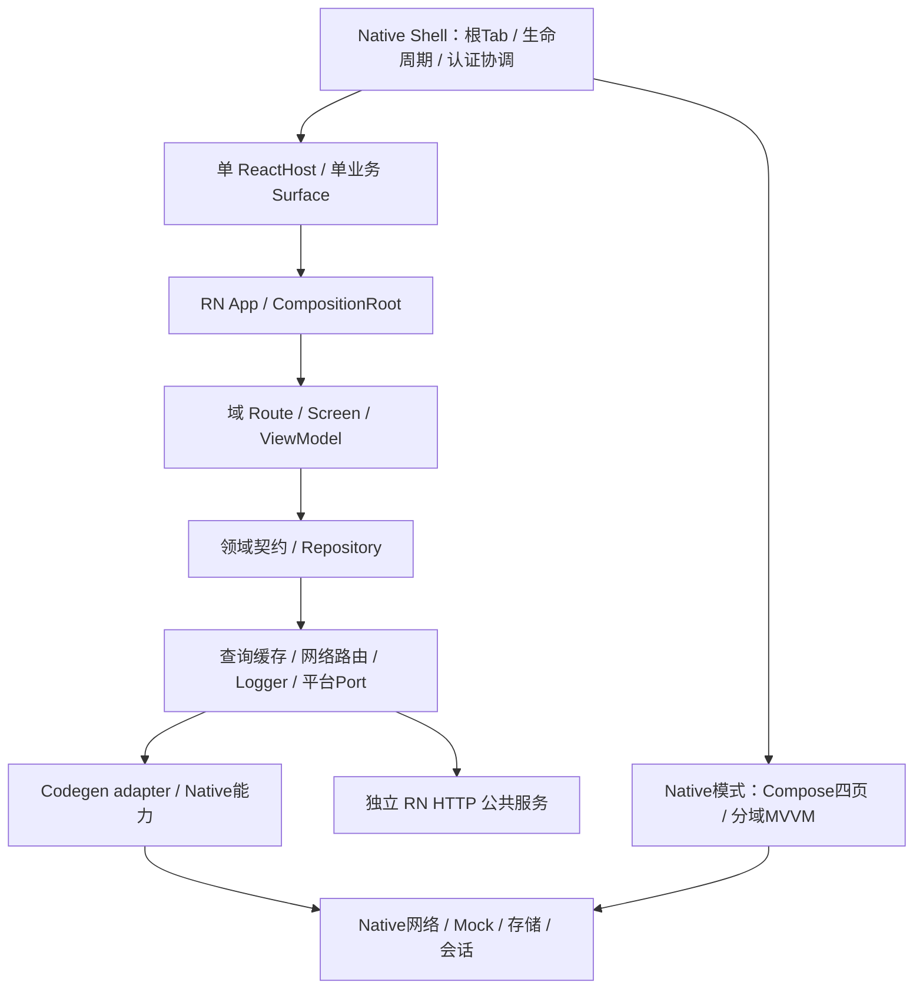

# EntryTask 项目设计方案

## 项目范围

EntryTask 是通过 React Native Community CLI 创建的银行业务教学工程，没有真实后端。Android 与 iOS 共用 RN 业务页：Native 负责应用宿主、认证、根 Tab、会话和受控平台能力；RN 负责四域业务页面及子页；Android Studio 构建提供 Native Compose 四根页。iOS已实现UIKit Shell、SwiftUI认证/四根页、CLI RN模式、五个TurboModule及平台网络/存储/Mock能力；详细架构、Android职责映射与验证边界见[iOS方案](iOS技术方案.md)。

需求来源为[原型需求](../requirements/01-prototype-requirements.md)、[API 与 Mock 需求](../requirements/02-api-mock-requirements.md)，首页具体视觉依据为 `prd/EntryTask UI PRD.docx` 与 `prd/UI原型/`。需求中规划的端点、页面和性能目标不等于已验收能力；实际展示和交互边界见[首页方案](首页与四Tab技术方案.md)。

## 总体架构

每进程只有一个 RN instance，不按 Tab、登录或页面创建新 runtime。Native 是根导航与会话权威，RN 不建立第二个根底栏、不复制银行凭证或账号持久库。两种页面模式共享契约和素材，不共享框架内的可变 ViewModel 状态。

## 分层与模块

| 所有者 | 当前职责 |
| --- | --- |
| `src/app` | 应用图、bootstrap、导航与生命周期组装 |
| `src/features` | home、wealth、member、profile 等业务域的 presentation/domain/data/di/public |
| `src/infrastructure` | 网络策略、双通路、RTK Query、客户端状态和独立日志 |
| `src/platform` | Port 与 Native Codegen 适配 |
| `src/shared` | 无跨域业务规则的复用 UI、主题、格式与素材 |
| Android `app` | Application、MainActivity、根宿主、Shell、Bridge 和资源组装 |
| `biz_user` / `biz_dashboard` | Native 认证与会话 / Compose 四根页 |
| `lib_base` / `lib_net` / `lib_storage` | 应用上下文与基础封装 / 网络与下载 / 偏好与 Room |
| `demo_engine` | 原型 API 本地 Mock 和按用户隔离的演示账本 |
| `specs` / `contracts` / `mock` | 薄传输规范 / 运行契约及 schema / 路由清单与分 API JSON |

View 只渲染及转发动作，VM 维护展示状态与流程，Domain 定义模型和能力，Data 实现数据访问，组合根构造依赖。复杂流程再引入 UseCase，不为简单转发机械增加空层。跨域只依赖公开契约，技术库不反向依赖业务 UI 或 RN。

## 启动与认证

AndroidX Startup 保存应用上下文；MainApplication 初始化日志、偏好、网络 Mock、RN 集成和认证预热观察。MainActivity onCreate 经 MainViewModel 读取 Native 会话；未认证时在 RESUMED 拉起 AuthActivity，不等待 RN 页面。

正常认证栈保留 singleTask MainActivity。认证成功写入 Native 内存会话，AuthActivity 设置结果并关闭自身，MainActivity 重读会话后发布 Shell 快照。RN 默认保护根页和子页，通过 Session Bridge 校准会话，公开 HelpCenter 例外；后续认证请求经 Host Bridge 发起。ACK 与认证结果分别处理，flowId 与 epoch 防止重入、取消和旧响应串线。

可选预热在 Native 认证首帧后启动同一个 ReactHost，只加载引擎及 Bundle，不创建业务 Surface、不查询业务数据；默认关闭。详细流程见[启动源码详解](../development/启动与登录全链路源码详解.md)、[认证方案](登录注册技术方案.md)和[预热测量方法](../development/rn-warmup-performance.md)。

## 网络、状态与资源

1. RN 每个 API 在 EndpointRegistry 显式选择 Native 或 RN HTTP；通路失败不自动切换。当前演示 API 走 Native Mock，独立 RN HTTP 仅用于明确配置的公开服务，不携带银行凭证。
2. Mock 精确匹配 method/path，按 API 使用 JSON 模板，后台随机延迟 1～3 秒并支持取消。未知请求拒绝，不回落公网。
3. contracts/mock 唯一源码由 Gradle 变体任务生成并打入 APK；运行时不访问开发机仓库。素材同样通过受控生成任务供 Native 使用。
4. RN 服务端资源由 RTK Query 缓存，slice 保存客户端状态，VM 输出展示投影。Native 页面使用受控 PageResource；两端均按用户 epoch 隔离旧响应。
5. Room 保存认证校验记录，普通偏好由 Native 存储能力管理；demo_engine 当前使用独立的按用户 scope 隔离的轻量偏好账本。并非全部业务事实已迁入 Room。

## 稳定性、性能与可观测性

请求、订阅、计时器和视图生命周期配对；切页、退出、runtime 销毁取消未完成工作。取消不是失败；刷新失败保留内容；写操作防重，结果不确定先查询确认，不自动重放。

主线程不做网络等待、数据库阻塞或密码派生。根页采用单纵向虚拟列表和稳定区域 key；轮播只在可见且活动时运行，图片与日志有界。性能结论需注明设备、构建变体、样本与测量口径，Debug 体验不能代表 Release 指标。

RN Logger 独立输出 Console，Native 使用 MLog，关键链路通过 flowId/requestId 关联。NativeTelemetry 失败不阻断业务，初始化失败仍可诊断。日志只允许安全阶段、耗时、错误码和关联编号，不输出密码、Token、Cookie、完整卡号或资产响应。

## 平台实施边界与交付

| 平台 | 当前范围 | 后续独立设计内容 |
| --- | --- | --- |
| RN | 四域页面、通用子页、Bridge 适配、双网络封装及状态/日志 | 完整业务深链路和细粒度缓存策略按需求扩展 |
| Android | 双模式宿主、Native认证、Compose根页、Room认证存储、Mock、进程内下载初版 | 下载可靠性、真实会话安全协议、正式发布基线 |
| iOS | 单Scene Shell、认证、五个桥接模块、GRDB、URLSession Mock、RN/SwiftUI双模式 | 真机/旧系统矩阵、性能基线、签名分发；不包含预热或下载 |

工程仍是演示系统，不声明真实银行认证安全、完整生产会话、后台持久下载或正式发布能力已落地。验证按改动覆盖静态检查、行为测试、原生构建、双模式设备主链路与资源产物；构建通过、设备通过、设计待实施分别报告。

- [RN 技术方案](前端RN技术方案.md)
- [Android 技术方案](Android%20技术方案.md)
- [iOS 技术方案](iOS技术方案.md)
- [文档导航](../README.md)
