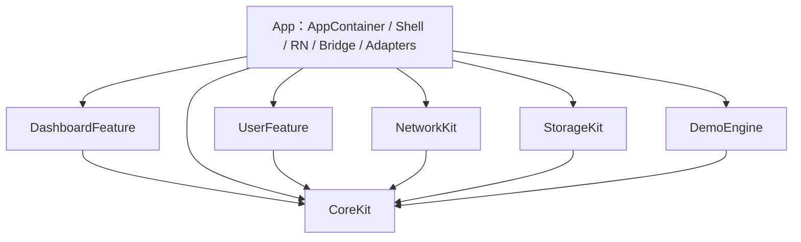
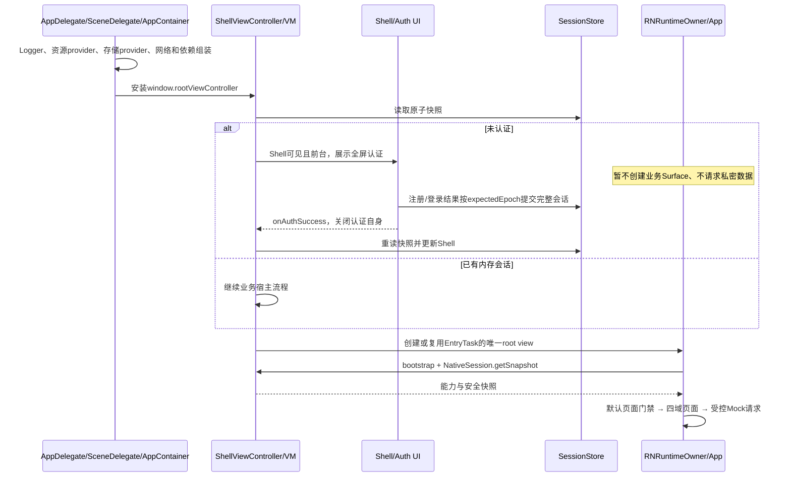

# iOS 技术方案

状态：首期核心链路已实现。本文维护当前架构及明确标出的待验证边界；运行命令、源码入口和验证范围见 [iOS README](../../ios/README.md)。模拟器功能通过不等于真机、旧系统、性能和分发验收完成。

依据：[总体设计](EtryTask%20项目设计方案.md)、[Android 方案](Android%20技术方案.md)、[RN 方案](前端RN技术方案.md)、[认证方案](登录注册技术方案.md)、[首页方案](首页与四Tab技术方案.md)，以及下文列出的当前源码和运行契约。本文直接维护有效方案，不保留旧方案和逐次修订记录。

## 1. 实施范围与对齐原则

iOS 提供 Native 应用外壳、四个根 Tab、登录注册、会话、单 RN 宿主、五个 TurboModule、网络、本地 Mock、存储及日志；复用已有 RN 四域页面和业务子页。CLI默认RN页面，Xcode默认SwiftUI Native四根页；共享Native Shell及平台能力。构建选择和Native MVVM详见[双模式指南](../development/ios-dashboard-modes.md)。

首期以 Android **RN 模式的行为**为对等基线。iOS增加DashboardFeature对齐Android的Native四根页职责；下载、引擎预热仍为独立扩展。iOS 平台采用 UIKit 宿主、SwiftUI 认证、Swift MVVM、URLSession 与 SQLite 封装，实现相同业务边界。

对齐的是状态归属、契约、数据及可观察行为，不要求 Swift 类名、数据库物理实现或平台返回方式逐字对应。当前工程没有后端，不设计虚构的真实登录服务、持久登录或自动刷新 Token。

| 必须对齐 | iOS 实施规则 |
| --- | --- |
| 单 RN instance | 每进程一个 factory/runtime、一个业务 Surface；Tab、认证、前后台不新建实例 |
| Native 会话权威 | RN 不保存账号库、Token、密码，也不决定用户 scope |
| Native 提前认证 | Shell 首次可展示时先检查会话，未登录直接展示 Native 认证，不等待 RN 首页 |
| RN 默认门禁 | 根页/子页默认登录，HelpCenter 公开；仍复用当前 RN 页面策略 |
| 注册即认证 | 注册通过网络 Mock 写库，成功建立完整内存会话，再关闭认证页 |
| 默认 Mock | 业务 API 精确匹配本地路由、读取随包 JSON，随机延迟 1～3 秒，可取消 |
| 双网络通路 | RN EndpointRegistry 明确选择通路；Native 失败不自动转 RN HTTP |
| 状态隔离 | epoch 隔离用户会话，revision 排序 Shell 快照，页面请求版本隔离迟到结果 |
| 可排障 | RN 独立 Console，Native 结构化日志；关键请求沿用 requestId/flowId |

## 2. 已核实的工程现状

| 项目 | 当前实现 |
| --- | --- |
| RN/React | RN 0.86.0 / React 19.2.3，保留版本与锁文件 |
| 生命周期 | AppDelegate创建进程图，单SceneDelegate连接窗口和Shell；禁用多Scene |
| 组件与入口 | EntryTask；Debug src/index，构建 ENTRY_FILE=src/index.js，Release main.jsbundle |
| 工程身份 | target/scheme EntryTask；原bundle ID保持不变 |
| 工具链 | 最低iOS 15.1、Swift语言模式5；本次编译使用Xcode 27 / Swift 6.4，旧系统需专项验证 |
| 模块 | App + 本地Package六个library；GRDB精确锁定7.8.0 |
| Bridge | 五个Codegen ObjC++ adapter，经factory delegate注入Swift facade |
| 存储/Mock | GRDB双数据库、受控typed偏好、专用URLProtocol和分API handler |
| 测试 | SwiftPM行为/网络集成测试，Xcode模块测试与认证/RN UI测试 |
| 窗口 | UIKit单窗口，SwiftUI认证，Native底栏与唯一RN child |

当前 [endpoints.json](../../contracts/api/endpoints.json) 有 **35 个 jsAllowed 端点**；[manifest.json](../../mock/manifest.json) 有 **37 条 HTTP Mock 路由**，包含 2 个 nativeOnly 登录/注册接口。退出是 Host 命令，不是第 38 个 HTTP API。数量只是当前清单核对结果；新增接口后以清单为准，不硬编码到业务逻辑。

## 3. 技术选型与依赖

| 职责 | 选型 | 决策理由与边界 |
| --- | --- | --- |
| Shell/容器 | UIKit UIViewController + 独立 UITabBar | 显式管理 child、safe area、认证覆盖与 RN native-stack |
| 认证 UI | SwiftUI + UIHostingController | 对等 Compose 的声明式表单及状态驱动；不重写 RN 银行业务页 |
| MVVM | ObservableObject / @Published private(set) + 明确 Action | 支持 iOS 15.1；不要求 iOS 17 Observation |
| 并发 | async/await、结构化 Task、MainActor、受控后台执行器 | 明确所有者与取消；actor 内也不能阻塞执行 KDF/同步磁盘 |
| Native 网络 | URLSession，专用 ephemeral 配置 | Foundation 能力足够；首期不再引入 Alamofire |
| 本地拦截 | 专用 session 的 URLProtocol | 对等 OkHttp interceptor；不全局拦截 RN/Metro |
| 数据库 | SQLite + GRDB，经 StorageKit 封装 | 对等 Room 的事务/唯一约束/升级职责；业务不直接写 SQL |
| 普通 typed 偏好 | 受控文件存储，串行原子替换 | Bridge 写成功需可确认，不能把 UserDefaults.set 返回当磁盘提交证明 |
| 日志 | OSLog + RN 独立 Logger | 首期满足控制台诊断，不强制新增文件日志或远程平台 |
| 工程模块 | 一个本地 Swift Package、按职责拆 target | 编译边界可检查；React/ObjC++ 留 app target 与 Pods 集成 |

GRDB **7.8.0** 通过 SwiftPM 精确锁定，应用与库保留 Swift 5 语言模式，使用 Swift 6 编译器。Package、Xcode workspace及CLI的project查询分别保留Package.resolved；不提交本地镜像配置或开发机缓存路径。
## 4. 模块架构与依赖方向

首期固定为 **七个主要实施单元：一个现有App target，加六个本地Swift Package library target**。一个本地Package统一管理CoreKit、UserFeature、NetworkKit、StorageKit、DemoEngine、DashboardFeature；目录分层不等于额外编译模块，测试target不计入业务模块数量。

Android工程和模块保持现状。iOS对应其职责划分，在本端明确契约、注入和Mock归属，不将Android重构作为前置条件。

| iOS实施单元 | Android职责对应 | 当前设计职责 | 禁止承担 |
| --- | --- | --- | --- |
| App（现有EntryTask target） | app | AppContainer、Shell、RNIntegration、五Bridge、跨模块适配和资源组装 | SQL、密码算法、签到/权益规则 |
| DashboardFeature | biz_dashboard | 四页领域模型、网络Repository、四域VM、区域资源与共用SwiftUI | 复制认证/账本、创建RN实例、维护另一套根Tab |
| CoreKit | lib_base | 基础值与错误、技术Port、取消标记与提交执行器、日志、通用UI；模块内分目录 | 账号规则、银行领域模型、万能ServiceLocator |
| UserFeature | biz_user | 认证公开契约、SessionStore、Auth VM/Repository、SwiftUI登录注册 | 直接操作DAO、处理Mock注册写库、创建RN实例 |
| NetworkKit | lib_net的通用网络职责 | URLSession、拦截接点、请求登记/取消/超时、传输错误 | 账号校验、Mock fixture路由、业务SQL |
| StorageKit | lib_storage | SQLite/GRDB封装、LocalDatabase、原子状态存储和typed偏好 | 判断登录成功、生成密码校验值、启动认证页面 |
| DemoEngine | demo_engine与现有lib_net中的认证Mock职责 | 认证及原型Mock、manifest/fixture、账号校验、纯业务状态转换 | 持有VC/RN、直接依赖数据库实现、公网回退 |

DashboardFeature对齐Android biz_dashboard的四根页职责，使用SwiftUI，各自维护展示状态，共用API/Mock/素材来源。Room和GRDB只承担平台持久化实现差异；Native会话、根Tab和业务事实的所有权不变。



图中箭头代表编译依赖；运行时调用经Port和组合根注入，不要求NetworkKit导入DemoEngine或UserFeature导入网络实现。六个library target不相互导入具体实现，不反向依赖App或React。

### 4.1 契约归属与跨模块适配

| 契约/组件 | 所属位置 | 消费方式 |
| --- | --- | --- |
| NetworkPort、传输DTO、资源协议 | CoreKit/Contracts | UserFeature、NetworkKit、DemoEngine及App按需使用；不包含银行凭证或DAO |
| SessionSnapshot、SessionPort、认证公开模型 | UserFeature/Public | App的Shell及Bridge注入后使用；NetworkKit/StorageKit不导入UserFeature |
| MockAccountStorage、DemoStatePort等模拟业务契约 | DemoEngine/Public | App内适配器实现，转调StorageKit公开能力，不把业务Port塞入通用网络库 |
| LocalDatabase、状态事务及typed存储能力 | StorageKit/Database、Preferences | App适配器和组合根使用；不暴露GRDB Database、任意SQL或表名 |
| 公共品牌UI、Logger及安全字段 | CoreKit/UI、CoreKit/Logging | UserFeature/App复用；Domain与Contracts目录不导入UI |
| 会话变化与Mock写入提交协调 | CoreKit/Foundation/CommitExecutor | 实现注入的提交Port，协调UserFeature和StorageKit；业务判定仍由各自模块承担 |

AppContainer创建依赖：UserFeature的AuthRepository接收NetworkPort，NetworkKit接收DemoEngine实现的拦截Port；DemoEngine的存储Port由App适配器连接StorageKit。于是注册写库仍发生在网络拦截链内，UserFeature不直接写库，NetworkKit不认识账号规则。

NetworkKit在请求执行时只接收由App会话适配器提供的不可变RequestContext和校验能力，不反查UserFeature单例。RequestContext包含必要的scope/epoch等Native内部上下文，不作为可被JS指定的身份参数。StorageKit只执行受控读写和事务，不读取SessionStore推断当前用户。

技术模块公开接口默认最小化；未公开实现保持internal。CoreKit的Contracts、Foundation、Logging、UI目录各有边界，禁止把跨域业务模型或所有工具都堆入其中。

### 4.2 目标目录

当前目录按实际职责创建，没有消费者的规划层不创建空壳：

```text
ios/
├── EntryTask/
│   ├── AppDelegate.swift
│   ├── App/                          AppContainer、SceneDelegate
│   ├── Adapters/                     AccountStorageAdapter、DemoStateAdapter
│   ├── Shell/Presentation/           ShellViewModel、ShellViewController
│   ├── RNIntegration/                RNRuntimeOwner、RNContainerViewController
│   └── NativeModules/                ETFactoryDelegate.mm、ETBridgeServices.swift
├── Packages/EntryModules/
│   ├── Package.swift                 六个library与GRDB依赖
│   ├── Sources/
│   │   ├── CoreKit/                  Contracts、Foundation、Logging、UI
│   │   ├── UserFeature/              Public、Data、Presentation
│   │   ├── NetworkKit/               Client、Interception
│   │   ├── StorageKit/               Database、Preferences
│   │   ├── DashboardFeature/         Domain、Data、Presentation、UI
│   │   └── DemoEngine/               Public、Routing、Auth、Prototype
│   └── Tests/EntryModulesTests/      行为与真实URLSession集成测试
├── EntryTaskUITests/                  认证到RN主链路
└── EntryTask.xcodeproj                App/模块测试/UI测试target与资源脚本

DerivedData/.../EntryTask.app/         contracts/mock生成产物，不提交平台源码副本
```

Shell、RNIntegration与NativeModules留在App内，React/C++/ObjC++经既有Pods集成。Swift Package中只有业务/技术库，不能为每个Tab创建framework或独立RN容器。

### 4.3 物理拆分的触发条件

首期不创建独立的UserAPI、NativeUI、TelemetryKit、PlatformContracts target，分别通过UserFeature/Public与CoreKit内部目录表达职责。只有出现实际跨模块消费者、独立发布/测试需求，或可测量的UI依赖扩散、构建成本时，再评估提取契约/UI/日志模块。

提取前需给出消费者、依赖图和公开API，证明不会引入循环或反向依赖；同步迁移调用方并验证构建。不能仅以“中大型项目”为由提前增加空模块，也不能靠公开所有类型解决依赖问题。

## 5. 状态所有权与线程模型

| 状态/对象 | 唯一所有者 | 执行边界 |
| --- | --- | --- |
| Native 内存会话、凭证、epoch | SessionStore | 同步短临界区；原子读取/比较并提交，凭证私有 |
| tabId/depth/revision | ShellViewModel | MainActor；VM/Bridge 只提交动作 |
| 认证展示状态/flow ID | ShellViewModel + ShellViewController | MainActor；窗口可见且前台时展示 |
| 表单 username/password/loading/authenticated/message | 每个 AuthViewModel | MainActor；独立登录/注册实例 |
| React factory/runtime/Surface | RNRuntimeOwner | 主线程组装；每进程唯一 |
| 请求 Task、终态、取消墓碑 | NetworkClient请求登记表 | 串行状态机；等待网络不占锁 |
| 会话变化与业务写入的提交顺序 | CommitExecutor | 专用串行提交执行器；主线程await，不同步等待 |
| 认证 SQL 和演示状态事务 | StorageKit 数据库执行器 | 专用后台队列/GRDB；事务内不 await |
| fixture/JSON 解析、密码派生 | 后台执行器，有界并发 | 禁止主线程和 URLSession delegate 队列长时间阻塞 |
| RN Query、分类/滚动、资产显隐 | 既有 RN 应用图 | 保留现有组装、epoch 与资源释放规则 |

SessionStore 采用受控锁封装的短同步操作，提供 snapshot、commitAuthentication(expectedEpoch)、logout。这样 Mock 写事务能同步确认 scope/epoch 并协调提交顺序。锁内不做 KDF、文件、数据库等待或跨 actor 调用。若使用 actor 替代，必须同时实现写事务与退出的串行提交协调，不能仅 await 一次快照后假定状态不再变化。

CommitExecutor按受理顺序执行认证会话提交、logout和Demo事务提交；这些写路径必须经过同一入口。事务任务执行前同步检查expectedEpoch/scope，校验和提交之间不穿插logout；已进入短事务的操作先完成，再执行退出。KDF和Mock延迟在提交队列外。SessionStore的锁只用于快照和内存修改，不包住数据库操作；提交协调器也不在事务内await。这样同时保证退出与写入的线性顺序，并避免持锁做IO。

会话更新完成后才回 MainActor 发布 Shell，避免会话锁与主线程互相等待。VM 不持有 UIViewController/View、NavController 或原始 NativeModule。SwiftUI 渲染函数不发网络、不写库、不处理返回导航。

## 6. 启动与唯一 RN 宿主

### 6.1 冷启动顺序



Application 没有 Android attachBaseContext/Startup 的直接等价阶段；初始化入口为 didFinishLaunchingWithOptions，SceneDelegate连接单窗口，展示时机由UIKit生命周期协调。数据库按需在后台打开，资源文件内容校验不阻塞首次 UI；资源错误经认证安全提示、Bridge错误信封或RN初始化错误页及Native日志报告。

ShellViewController 在认证覆盖期间保留，成功仅 dismiss 认证。进后台不创建 Shell/RN；进程被杀后重新建立进程对象及未认证会话，不能承诺 VC 或 runtime 永远存活。

### 6.2 RNRuntimeOwner

- 保留一个 RCTReactNativeFactory、delegate 和 RCTAppDependencyProvider；AppDelegate 不再用 startReactNative 直接替换 window 根控制器。
- 经 factory.rootViewFactory 创建 EntryTask root view，RNContainerViewController 使用 addChild/didMove 和 willMove/removeFromParent 配对管理；只创建一次并持续复用。
- 本地 RN 0.86 的 RCTRootViewFactory.h 提供 `viewWithModuleName:initialProperties:launchOptions:`。Swift 导入形式已通过当前工程编译确认，不手写另一套旧 RCTBridge/RCTRootView 初始化。
- 初始未认证时不挂载私密 Surface。程序性取消或无法展示认证后可挂载现有 RN 门禁以提供显式重试/HelpCenter；不能自动循环重拉登录。
- RN Reload使旧模块invalidate、取消请求并注销监听；factory不因Tab或认证重新创建。进程级会话与数据库不随 Reload 清空，模块 facade/Promise 不跨 runtime 复用。
- Bridge初始化失败由现有RN错误页提供显式重试；不自动销毁重建runtime。JS Bundle完全不可达时沿用RN开发错误界面，原生引擎崩溃兜底及无损恢复仍需专项设计。

### 6.3 预热与系统压力

首期按需启动引擎，预热默认关闭，先采集冷启动与登录返回数据。若实施预热，使用当前 RN rootViewFactory 的 `initializeReactHostWithLaunchOptions:bundleConfiguration:devMenuConfiguration:` 等已核实入口另做 PoC，仍不创建 Surface 或执行业务请求，不能用隐藏 RN 页面假装预热。

收到内存压力时释放可重建的模板/图片缓存，不删账号库、演示账本或共享 Host。后台暂停非必要订阅与轮播；不承诺 App 被系统终止时执行清理回调。首期采用单Scene单窗口架构，不启用多窗口。

## 7. Shell MVVM、根 Tab 与子页导航

ShellViewModel 的快照保持当前字段：

```json
{"tabId":1,"depth":0,"authenticated":false,"sessionEpoch":0,"revision":0}
```

- tabId 为 1～4，分别首页、财富、会员、我的；depth 为 0～20，**根页为 0**。每次实际快照变化递增 revision，sessionEpoch 由 SessionStore 管理。
- UIKit 独立 UITabBar 只发 selectTab，选中态由快照回写；不创建四个各带 RN root 的 tab controller。
- Native 选择 Tab 更新 ShellViewModel 并发 onHostEvent，RN 沿现有 ShellViewModel 选择页面；RN 跨 Tab 同样发送 Host command，不能先维护另一份根状态。
- 业务 push/pop 由 RN native-stack 管理，RN navigation 命令报告真实 depth。depth>0 或未认证时隐藏 Native 底栏，返回根页再显示。
- RN 侧滑取消必须保持实际栈深度，不能根据手势开始事件提前切底栏；实际 onStateChange 为准，恢复后可重发同深度快照校准。
- Shell 不额外包一层负责业务 push 的 UINavigationController；UIKit 不与 RN 同时消费同一个返回手势。

内容区上沿尊重状态栏安全区，根页下沿到 Native 底栏顶；子页释放底栏槽并处理 home indicator。结合当前 SafeAreaProvider 测试剩余 inset，不叠加两份顶部/底部 padding。Shell 通过 child 状态栏转发及 Info.plist 配置管理样式，认证有独立状态栏适配。

iOS 没有 Android 双击返回退出任务。登录全屏认证不提供返回业务首页的手势，注册返回登录；Home 手势和后台由系统处理，禁止调用 exit(0)。若未来增加主动取消入口，取消只能回门禁/公开帮助。

## 8. 登录注册 MVVM 与会话流程

### 8.1 UI、状态与生命周期

SwiftUI AuthFormContent 复用品牌区、外置标签、账号/密码输入、显隐、主按钮、切页入口和加载样式。Login/Register 分别持有 AuthViewModel；统一 onAuthSuccess 命名，不能把注册成功挂到语义错误的 onLoginSuccess。

AuthUiState 对齐 Android：username、password、isLoading、authenticated、message；动作包括修改输入、提交登录/注册、MessageShown。密码显隐为局部状态，默认隐藏，后台/提交/重建恢复隐藏。表单适配键盘、动态字体、滚动及 VoiceOver，失败使用轻量 Toast，不新增阻断错误弹窗。

提交前同步置 busy，加载或已成功时拒绝重复提交；Task 与 requestVersion 配对。切页清密码并取消该页等待，另一页不继承账号密码。成功事实保留在状态中，提示经 MessageShown 消费；只在当前可见且应用 active 时交付 Toast/onAuthSuccess，后台成功恢复后仍可观察。密码不进 SceneStorage、AppStorage、导航参数或数据库。

### 8.2 完整请求链

```text
SwiftUI → AuthAction → AuthViewModel → AuthRepository
 → NativeAuthService → NetworkPort / 专用URLSession
 → DemoURLProtocol → AuthMockHandler → MockAccountStore
 → DemoEngine.MockAccountStorage → App.AccountStorageAdapter
 → StorageKit.LocalDatabase → GRDB → auth_credentials
 → HTTP/JSON响应 → Repository校验 → SessionStore原子提交
 → VM.authenticated → onAuthSuccess → dismiss → Shell重读快照
```

注册写库发生在网络拦截链内。AuthRepository 只请求、解释结果和提交会话，不预写本地账号。替换真实服务时可替换 client/handler 配置，界面和 VM 无需改成另一条注册流程；真实认证协议、安全条件仍需独立接入。

登录/register 使用 manifest 的 method/path，表单编码与 Android UserService 一致；本地 API 不访问公网。响应分 API 模板，动态身份字段在 Native 注入；Repository 校验身份及非空凭证，提交前检查取消和 expectedEpoch。

### 8.3 认证展示协调

ShellViewModel以可选UUID authFlow表示当前认证请求，ShellViewController持有presentingFlow与authController。只在同一前台Shell可展示时present；重复 authenticate 合并，旧 dismiss completion 或迟到结果必须匹配当前 flow ID。UI completion 不是登录事实，成功/恢复后重新读取 SessionStore 并发布快照。

Host authenticate 返回 true 只表示命令已受理。后台或尚无宿主时返回 HOST_NOT_READY，不无限排队到任意窗口；恢复/显式重试重新受理。注销先递增 epoch、清凭证与 scope，再重置 depth=0、tabId=1 并发布 Shell，旧请求不得重新建立登录。

### 8.4 认证 Mock 与数据库语义

| 规则 | 实施要求 |
| --- | --- |
| 文件/表 | Application Support 下独立认证 SQLite 文件；表 auth_credentials，account_key 唯一，password_verifier 非空 |
| 账号 key | `mock_auth_v1.` + 归一用户名 UTF-8 的 SHA-256 小写hex |
| 归一化 | 对齐 Android Kotlin trim；大小写敏感，不额外 Unicode 归一化；以中英文、Emoji、空白向量验证，不直接假定Foundation trim语义一致 |
| 密码 | 原样参与派生，不 trim；长度边界按 UTF-16 code unit 对齐 Native Android（账号256、密码1024） |
| verifier | `v1:<algorithm>:120000:<saltHex>:<derivedHex>`，16字节随机盐、32字节输出；SHA256 写入，记录算法 |
| 算法对等 | CommonCrypto PBKDF2 + 安全随机数；固定向量验证 SHA256/SHA1 格式与非ASCII输入；读取并验证记录算法，不表示跨设备共享账号库 |
| 新注册 | 数据库唯一约束 INSERT OR IGNORE，准确解释新增行数，重复账号不覆盖原密码 |
| 错误 | 400/401安全凭据提示，409重复账号；存储失败不伪装成功，不退回偏好存储 |
| 数据生命周期 | 正常重启保留账号，内存会话重新认证；退出不删除账号；不自动清库或导入其他平台库 |

不保存明文用户名、密码或 Token；校验值采用常量时间比较。Room 与 GRDB 都不是加密容器，本期对等演示校验库不宣称是生产银行认证。首期不增加 Android 尚未实施的自动登录、刷新 Token 或 Keychain 凭证恢复。

取消等待不能撤回已提交注册事务。取消后再次注册可返回409，应允许用户登录确认；非幂等操作无契约不自动重放。

## 9. 五模块与协议兼容

[specs](../../specs/NativeHost.ts) 是方法签名权威，[runtime.json](../../contracts/bridge/runtime.json) 是运行协议权威。首期不修改公共签名、不另建 iOS 专用业务页面或状态实现。

| 模块 | 方法/事件 | 返回或职责 |
| --- | --- | --- |
| NativeHost | bootstrap、command、onHostEvent | 启动能力、Shell命令与裸Shell快照事件 |
| NativeSession | getSnapshot | authenticated、sessionEpoch，不含Token/scope |
| NativeNetwork | execute、cancel | httpStatus/bodyText，取消指定requestId |
| NativeStorage | read、write、remove | typed key能力，首期白名单assetVisibility |
| NativeTelemetry | emitBatch | 白名单事件批次受理与安全输出 |

### 9.1 信封、能力和事件

```json
{"outcome":"ok","data":true}
```

```json
{"outcome":"error","error":{"code":"AUTH_REQUIRED"}}
```

bootstrap 的 data 必须包含 protocolVersion、componentName、bootId、capabilities、shell；版本1.1、组件EntryTask。bootId 每进程生成，不在每次握手变动。能力与 Android 对齐：host.events、host.command、network.execute、storage.assetVisibility、session.snapshot、telemetry.emitBatch；只在实现可用时宣告，不能靠假能力让 RN 绕过初始化失败。

Session data 为 `{authenticated,sessionEpoch}`。Network data 为 `{httpStatus,bodyText}`，HTTP/业务失败仍保留 HTTP 响应，由现有 RN 网络层解释；仅传输、协议、取消等错误走 error 信封。Host ACK 的 data 必须为 true。

onHostEvent 直接发送 ShellSnapshot JSON 字符串，**不套 BridgeReply、不增加未经 RN 支持的事件 type 外壳**。订阅前后通过快照恢复，不积压无限事件；RN 当前以 revision/epoch 拒绝回退。刷新订阅期间丢事件时用 bootstrap/快照校准，不能伪造不存在的 Session 独立事件 API。

### 9.2 Codegen、注册与依赖注入

采用 `specs → Codegen ObjC++接口 → ETNative*Adapter(.mm) → @objc Swift Facade → Port`。ObjC++只做传输、事件与Promise适配，Swift承载逻辑；这一适配方式符合[RN 0.86 Swift 模块说明](https://reactnative.dev/docs/0.86/the-new-architecture/turbo-modules-with-swift)。

- 保留 package.json 的 name/type/jsSrcsDir/android 配置；iOS module provider 映射按本地 RN 0.86 Codegen 支持接入，不能手改生成头或 RCTModuleProviders。
- ETFactoryDelegate通过`getModuleClassFromName:`识别五个自有模块，再在`getModuleInstanceFromClass:`返回注入ETBridgeServices的adapter；未知模块回到super/dependencyProvider。RN 0.86模块管理器会重新按Class实例化，仅返回getModuleProvider对象不足以保证依赖注入。模块invalidate注销owner、取消任务和监听。
- 本地 RCTDefaultReactNativeFactoryDelegate/RCTTurboModuleManager 已有 provider 路径；具体 override 的 ObjC++ shim、生成 Spec 名称及事件基类在 I0 编译核实。Swift 无法表达 C++ 方法时留在 ObjC++，不硬写不可编译的纯 Swift override。
- provider映射与自定义工厂若同时使用，五个模块只指定一个实例创建所有者，避免生成provider先创建无依赖实例。禁止用UIApplication.shared或可变全局单例反查业务服务。
- adapter的owner绑定不能跨Reload复用；进程级facade和服务可以复用，但必须注销旧owner的任务与监听。RN回调和C++事件只在当前有效runtime触发。

### 9.3 并发、限额与终态

按 UTF-8 字节校验运行契约限额：请求65536、响应262144、事件8192、日志批次32768。Host命令按受理顺序串行处理，有界64条；网络最多32个登记任务。日志单批最多20条，去重窗口1000事件，单字符串安全裁剪160字符；限额在对应入口执行，需随运行契约一起调整；完整边界矩阵仍待补齐。

NetworkClient请求登记表原子登记requestId、URLSessionTask、deadline、取消原因与continuation；facade另外按模块owner跟踪Task及运行时有效性，Native上下文捕获scope/epoch。同ID重复返回 REQUEST_BUSY_OR_DUPLICATE，不覆盖原请求；只有原执行身份可以移除登记。cancel-before-register保留最多128条、30秒有效墓碑，单调时间计算过期。

UTF-8字节长度不使用Swift String.count或NSString.length代替。Network响应采用受控DataDelegate累计字节，超过上限立即停止接收并返回PAYLOAD_TOO_LARGE；不能先无界下载再检查最终字符串。

活跃runtime下Promise恰好完成一次；销毁时清监听、取消请求并释放resolver，禁止向失效JS回调。副作用事务已提交时不因runtime销毁回滚事实。取消与超时是不同原因，任务取消不转成网络失败，迟到响应按STALE_SESSION或丢弃规则处理。

## 10. 网络、本地拦截与业务 handler

### 10.1 受控网络层

NetworkKit 将 API ID、受控参数/JSON body 转为 URLRequest，Native 构造固定 `https://entrytask.invalid` 路由、X-Request-Id/X-Demo-Api/X-Demo-Scope；JS不能传任意host、凭证、用户scope或header。认证路由nativeOnly，JS调用必须ENDPOINT_NOT_ALLOWED。

URLSession使用ephemeral配置，关闭自动Cookie和系统URLCache；首期不另建一套Native查询缓存，保留现有RN RTK Query缓存权威。请求timeoutMs按端点配置，Native限制1000～10000ms；整体deadline、排队与Mock延迟一起计时，不能只设置单段URLSession timeout就认为总超时已控制。

不全局URLProtocol.registerClass，不定制全局RN网络配置，RN公开HTTP仍按EndpointRegistry走自己的通路。未知API或外部host在demo client本地拒绝，不回落到真实网络。[Apple protocolClasses](https://developer.apple.com/documentation/foundation/urlsessionconfiguration/protocolclasses)

### 10.2 DemoURLProtocol 与 handler

1. 专用session对HTTP/HTTPS都交给DemoURLProtocol判定；外部host也受控拒绝，避免未匹配请求穿透公网。
2. startLoading建立当前请求Task，读取manifest，精确匹配API ID、method、path，验证参数与exposure。
3. 后台可取消等待随机1000～3000ms，再读取模板及用户状态；Clock/Delay/Random可注入测试，不把真实RN HTTP加入延迟。
4. 认证分派AuthMockHandler；原型API分派PrototypeMockHandler及纯状态转换。每API fixture来自Bundle，handler只修改有业务意义的字段，不内联大段JSON。
5. 写操作在一个数据库事务中读取、验证并提交状态，提交后才构造成功响应；错误回滚，不把异常转换为空成功。
6. 回调经过串行DeliveryGate，didReceive → didLoad → finish或fail只选择一个终态；stopLoading关闭gate并取消Task/后续回调，不能只改Boolean而忽略排队回调。[Apple stopLoading](https://developer.apple.com/documentation/foundation/urlprotocol/stoploading())

URLProtocol实例只能持有自己的request context和受控服务引用，完成、失败、取消都断开Task/client闭包。专用配置通过AppContainer创建的不可变DemoRequestContext接入，首选URLProtocol request property携带上下文引用；NetworkKit在创建请求时附加，protocol取出后调用注入Port。该引用只存在Native请求，不进入HTTP header或JS；I0必须验证URLSession复制请求后属性仍可获取、上下文可释放及并行测试隔离，不用可变static handler临时兜底。

### 10.3 与 Android 原型行为对齐

handler以当前 manifest 的 handler字段为完整清单，分组实现，不只做首页fixture读取：

| 分组 | 行为要求 |
| --- | --- |
| 内容/目录/产品/资讯/活动 | 同模板、同过滤/分页/详情不存在语义；page从1，pageSize默认10、最大50 |
| 资产/账户/流水/统计 | 新注册演示用户资产为0，不继承视觉稿金额；空与0区分；金额按整数字符串 |
| 身份/财务概览 | profile.summary/detail/marketing/financialOverview形状与schema一致 |
| 签到/能量 | 上海业务日，返回真实最近七日calendar；连续第3/7天奖励30/100，7天循环，重复提交不再奖励 |
| 权益/已领 | 与当前Android一致的资格/fixture库存判断，重复领取返回已有记录，列表及统计一致 |
| 消息/角标 | readIds按用户保存，重复已读不重复扣计数，读取后各页查询一致 |
| 搜索/个人事项 | 使用相同模板、参数、分页与安全路由目标，不把搜索词写入日志 |

Android当前没有完整关系化银行库、全局库存系统、通用幂等服务或生产风控，iOS首期不把这些目标当“已对等前提”。纯CheckinLedger规则与Android逐向量验证；Date、ID和traceId允许平台生成，比较归一化结果与业务不变量。

## 11. 存储封装、事务与安全

### 11.1 数据分类

| 数据 | iOS方案 | 对齐与生命周期 |
| --- | --- | --- |
| 认证校验记录 | 独立SQLite认证库，auth_credentials | 对等Room LocalDatabase；退出不删、正常重启保留 |
| 原型用户账本 | 独立Demo SQLite库，demo_user_state(scope主键,state_json)；数据库版本由GRDB迁移表管理 | 对等Android按scope整体JSON提交，保持实际字段/规则，不新建十余张无消费者表 |
| typed非敏感偏好 | 隔离scope/key的原子文件Store | 首期只允许assetVisibility布尔值；不允许任意path/key |
| Token/当前会话 | Native内存SessionStore | 结束进程失效，不保存Keychain自动恢复 |
| 资产显隐UI状态 | 既有RN会话内状态 | epoch变化默认隐藏，不自动从Native偏好恢复 |
| 响应缓存 | 既有RN Query内存缓存 | 不额外新建Native磁盘查询缓存 |
| 只读模板 | App Bundle | 唯一来源contracts/mock，不能写回Bundle |

当前NativeStorage接口保留assetVisibility能力，但现有RN资产显隐只使用会话内状态；提供接口不等于恢复旧偏好的业务逻辑。首期实现 typed Port，不让其修改账号表或会话。

### 11.2 数据库封装

StorageKit暴露LocalDatabase(read/insertIfAbsent)和受控状态事务能力；App的DemoStateAdapter将其适配为DemoEngine的DemoStatePort。内部GRDB DatabaseQueue单writer即可满足当前演示写规模；并发读优化需实测后再引入DatabasePool。调用方不获取Database、SQL或任意表名。

schema版本与fixture版本分开管理。首次安装创建版本1及明确Migration登记；未来升级提供显式迁移和旧文件测试，不启用erase-on-schema-change，不在打开失败时删库。认证库、Demo库分开，读写只涉及各自事务，不虚构跨数据库原子事务。

Demo写入通过scope锁/提交协调，事务内读改写整份当前用户状态，避免并发签到、领取、消息已读丢更新。读取在事务/版本化快照内完成，写失败不回成功；响应校验epoch，绝不能把A用户结果返回B用户。退出与写入竞争以提交线性化顺序定义：提交前失效则拒绝，已完成提交则保留A用户事实并丢弃过期响应，绝不迁入B用户scope。

SQL事务内不做网络、KDF或await。KDF先后台计算，数据库唯一键作最终防重。取消发生在提交后保留事实，下一次读确认结果；不提供无限自动重试。

### 11.3 文件保护与边界

认证/Demo库及WAL/SHM、typed偏好存放Application Support的私有目录，配置文件保护与备份排除，实施时包含真实锁屏/解锁测试。受保护数据不可用返回安全存储错误，不回退明文、不自动重置。同步文件原子替换放后台队列，失败向调用方反馈。

首期不新增明文密码、Token或导出接口；Keychain仅在未来明确需要设备密钥/真实凭证时按独立安全设计接入。GRDB并不自动提供数据库加密，演示KDF参数也不视为生产银行安全基线。

## 12. 共享资源与 Xcode 构建链

输入只有根 `contracts/`、`mock/`，不在ios源码目录维护副本。`tools/prepare-ios-resources.cjs`先执行validate-resources，再暂存并替换目标.app内的两个资源目录，生成每个JSON的SHA-256索引`runtime-resources.index.json`。删除的源文件会从产物消失；校验失败阻断构建。

Xcode资源Build Phase声明脚本和两个源码目录为输入、索引为输出，并设置每次构建执行，以覆盖新增/删除JSON。通过RN `.xcode.env`解析Node，沿用RN Bundle/Hermes脚本与ENTRY_FILE；资源准备在签名前执行，不与Copy Bundle Resources重复维护。

Debug与Release均包含Mock和契约；Release包含main.jsbundle。ResourceProvider显式接收Bundle根URL，运行时不访问开发机目录或Metro fixture。验证需比较最终.app全部索引和源码摘要，并从空DerivedData生成Release；产物验证不等于完整无Metro设备回归。

原生认证品牌素材沿用受控工程资源；业务素材由RN现有Metro资源流程打包，不为iOS另生成一份四Tab素材目录。

## 13. 日志、错误与诊断

OSLog统一subsystem为`EntryTask`、category为`Native`，用结构化事件名区分启动、认证、网络与Bridge；module/apiId/requestId等白名单字段供关联。桥接批次采用与Android相同白名单字段和有限eventId去重；RN Console独立输出，Telemetry失败不递归投递、不阻塞核心操作。

| 阶段 | 必记安全信息 |
| --- | --- |
| App/Shell启动 | 阶段、耗时、错误码、bootId/flowId |
| bootstrap | 协议校验、资源读取阶段、成功/失败；不输出资源正文 |
| 认证 | requested/presented/completed/canceled、flow ID及epoch；不打印用户名密码 |
| 网络/Mock | apiId、requestId、transport、durationMs、HTTP/业务错误码 |
| 数据库 | open/read/write失败类别、schema版本、耗时；不打印verifier/state_json |
| runtime/前后台 | generation、绑定/释放/取消、前后台阶段 |

初始化Logger在模块握手之前可用。错误页展示安全错误码和诊断编号；设备Xcode Console、模拟器OSLog与RN DevTools各有明确入口。Release保留必要warn/error；文件日志/上传/崩溃平台作为独立增强，不宣称已接入。

## 14. 性能与稳定性验收

以Release内置Bundle、固定设备/系统和明确样本口径评估，不以Debug/Metro耗时当生产指标。

| 关注点 | 设计措施 | 必须收集的证据 |
| --- | --- | --- |
| 首次认证 | Native先呈现、延迟业务Surface与数据库打开 | App启动至认证首帧分段，主线程Time Profiler |
| 登录返回 | 单宿主复用、bootstrap与首个RN布局分开计时 | 认证成功→dismiss→Surface→RN首帧→数据ready |
| 请求等待 | Mock延迟独立记账，端点总deadline | 1～3秒人工等待与解析/DB/Bridge耗时分离 |
| 表单交互 | KDF/JSON/SQL后台化，SwiftUI状态轻量 | 输入/键盘/显隐帧抖动、主线程长任务 |
| 内存/泄漏 | child生命周期、Task闭包、模块事件配对 | 多轮认证/切Tab/进后台的Memory Graph与footprint趋势 |
| 竞态 | expectedEpoch、requestVersion、flow ID、一次终态 | 注入延迟的取消、退出重登、Reload及提交竞争测试 |

iOS footprint与Android PSS不直接横比。首次基线形成后再制定设备预算与性能回归阈值；本设计不预填未经测量的P95、FPS、内存上限或预热收益。

## 15. Android → iOS 源码职责映射

| Android当前入口 | iOS对应职责 |
| --- | --- |
| [MainApplication](../../android/app/src/main/java/com/entrytask/MainApplication.kt) / ShellGraph | AppDelegate / AppContainer；注入七个实施单元的依赖 |
| [MainActivity](../../android/app/src/main/java/com/entrytask/MainActivity.kt) / MainViewModel | ShellViewController / ShellViewModel |
| [DefaultShellRepository](../../android/app/src/main/java/com/entrytask/shell/data/DefaultShellRepository.kt) | ShellViewModel，MainActor状态权威 |
| [RootContentHostFragment](../../android/app/src/main/java/com/entrytask/shell/host/RootContentHostFragment.kt) / BaseFragment | RNContainerViewController / RNRuntimeOwner |
| [AuthActivity](../../android/biz_user/src/main/java/com/entry/biz/user/ui/AuthActivity.kt) / AuthNavHost / AuthRoute | ShellViewController / UIHostingController / AuthScreen |
| [UserViewModel](../../android/biz_user/src/main/java/com/entry/biz/user/viewmodel/UserViewModel.kt) / AuthFormContent | 独立AuthViewModel / 共用SwiftUI表单 |
| [UserRepository](../../android/biz_user/src/main/java/com/entry/biz/user/repository/UserRepository.kt) / UserAuthManager | UserFeature内AuthRepository实现 / SessionStore，App通过Public契约访问 |
| [MockAccountStore](../../android/lib_net/src/main/java/com/entry/lib/net/mock/MockAccountStore.kt) / RoomMockAccountStorage | DemoEngine/Auth内MockAccountStore / App.AccountStorageAdapter |
| [RoomStorage](../../android/lib_storage/src/main/java/com/entry/lib/stroage/room/RoomStorage.kt) | StorageKit LocalDatabase / GRDB |
| [PrototypeMockInterceptor](../../android/demo_engine/src/main/java/com/entry/demo/PrototypeMockInterceptor.kt) / CheckinLedger | DemoURLProtocol / DemoHandler / CheckinLedger纯转换 |
| [HostModule](../../android/app/src/main/java/com/entrytask/bridge/HostModule.kt) 及其余四模块 | 五个ObjC++ adapter + Swift facade |

Android启动、锁、Activity Result等框架机制不机械翻译成iOS API；对应职责和外部可观察结果必须能逐项说明。

## 16. 分阶段职责与验收

按可验证的纵向链路交付，每阶段完成后文档只反映有效状态，不追加冗余修改流水。以下全部为待执行任务。

| 阶段 | 工作与关键文件 | 依赖 | 退出条件 |
| --- | --- | --- | --- |
| I0 集成PoC | 核对Xcode/Ruby/Pods/锁、修正测试target引用；最小factory child、模块注入、URLProtocol隔离、GRDB固定版本与生成资源试验 | 当前源码/契约 | 可编译最小新架构集成；35/37清单一致；生成目录清空后仍有效；确认Swift/ObjC++边界 |
| I1 基础能力 | App+六个library的Package依赖；CoreKit日志/Port、UserFeature会话、ShellRepository、AppContainer | I0 | 依赖图符合第4节；单测覆盖会话/epoch、Shell revision、资源失败；无空target/全局服务查找 |
| I2 认证纵向链路 | StorageKit认证库、DemoEngine/Auth handler、App存储适配、NetworkKit拦截接点、UserFeature认证MVVM与Shell展示协调 | I1 | Native先认证；注册写后可登录；重启账号仍在；两表单隔离、失败Toast、取消/重入有效 |
| I3 五Bridge与宿主 | App内五Bridge与FactoryDelegate；NetworkKit请求登记、StorageKit typed偏好、CoreKit日志 | I1/I2 | 不改RN公共签名；模块可获取；取消/坏包/epoch/Reload测试通过；唯一Surface挂载 |
| I4 原型业务对等 | DemoEngine/Prototype全部handler、StorageKit状态事务及App适配、RN四Tab/子栈/安全区 | I3 | 现有RN四页和已落地子页跑通；与Android固定输入/Clock结果一致，非幂等无自动重放 |
| I5 稳定性与交付 | 模拟器/真机主链路、空目录Debug/Release构建、离线资源、日志和性能基线 | I4 | 对等矩阵有实际结果；已知限制明确；无数据清空、旧会话泄漏或缺资源 |

I0中基础能力可用Fake Port完成组件测试，但发布给RN的能力必须真实完成，不允许假bootstrap、JS fake NativeModule或UI绕过认证。首个可演示里程碑为I2认证链路，完整跨端里程碑为I4。

## 17. 对等测试与运行验证

| 用例组 | 必测行为 |
| --- | --- |
| 启动/认证协调 | 未登录Native先认证；Shell保留；重复命令合并；后台不能任意present；旧completion不影响新flow |
| 表单 | 登录失败后注册为空；返回清密码；重复提交防重；后台成功恢复；密码暂停隐藏 |
| 账号持久化 | 注册经URLSession拦截写库；错误密码/重复注册/DB失败；结束进程重新登录；不读取另一测试库 |
| 会话竞态 | A请求未完退出再登B；旧成功/旧401/旧写响应不回写B；取消后已提交事实可确认 |
| 协议 | 五模块签名、UTF-8限额、裸Shell事件、ACK true、缺资源、协议版本错误、nativeOnly拒绝 |
| 请求生命周期 | cancel先于execute、同ID重复、超时与取消区分、32并发上限、stopLoading/完成竞争、Reload清理 |
| 四页/导航 | Tab选中回写、根depth=0、子页隐藏底栏、侧滑取消、安全区/键盘/字体/VoiceOver |
| Mock状态 | 上海跨日、连续3/7奖励、断签/七日calendar、重复签到/领取/已读、分页/空/无资源 |
| 打包/性能 | 空DerivedData生成、源文件删除后产物删除、Debug/Release资源摘要、无Metro离线、内存趋势 |

测试使用Fake Clock/Delay/Random、临时数据库和独立scope，设备测试不卸载/清除用户演示账号。跨端黄金向量覆盖响应schema、HTTP/业务码、默认值、金额、分页和状态转换；不能只比较静态成功JSON。

依赖安装仅在实施阶段按需执行，保留已有锁文件，禁止pod update全量漂移。使用以下命令核实实际环境：

```sh
# 仓库根：依赖缺失时安装，保留package-lock/Gemfile.lock
npm ci
bundle install

# ios/：必要时安装Pods、核实真实scheme和destination
bundle exec pod install
xcodebuild -list -workspace EntryTask.xcworkspace
xcodebuild -showdestinations -workspace EntryTask.xcworkspace -scheme EntryTask
```

确认环境后根目录使用官方 `npx react-native run-ios`；Xcode打开EntryTask.xcworkspace，选择实际EntryTask scheme。Debug/Release build/test命令使用查询所得destination，scheme已接入实际模块测试及UI测试target。Archive、签名和分发在明确交付范围与环境后执行，不把模拟器build写成正式发布。

src/app/App.tsx初始化诊断已按平台区分：iOS提示Xcode与RN DevTools，Android保留设备日志命令；不改变业务VM、Port或协议。SafeArea、键盘、字体、SVG和native-stack在iOS设备实际验收，不能由共享TS代码可编译推断已对等。

涉及RN/共享契约改动时运行现有typecheck、lint、architecture:check、contracts:check及相关Jest；修改specs需同时验证Android Codegen/构建，保持已完成端可用。schema变更先contracts:generate，不修改生成校验器绕过错误。

## 18. 实现与验证边界

已在当前模拟器构建/运行链路确认：工具链与GRDB固定版本兼容；factory/root view创建与注入模块可编译；Codegen事件/失效生命周期；URLProtocol上下文隔离及stopLoading；Xcode脚本沙箱与资源依赖；测试target与实际destination。

本期固定边界：单窗口、Native认证与构建期选择的RN/SwiftUI四页、进程内会话、本地演示网络、无持久登录。后台持久下载、引擎预热、远程日志、全量关系化业务库、真实后端、iPad专属重设计及正式发布不混入首期依赖。

已实现七个实施单元、五个Bridge及全部清单路由的分派；不能将路由存在等同全部错误/竞态场景验收。SwiftPM 18项、Xcode 10项模块测试及Native/RN模式各2项UI测试覆盖核心行为，设备环境为iPhone 18 Pro / iOS 27模拟器。Debug/Release模拟器构建及81个运行时JSON、13张共用图片的路径/摘要核对通过；RN Release包含Hermes Bundle，Native无业务JS Bundle，同目录切换清理通过；真机、旧系统、完整无Metro业务回归、Reload/内存压力矩阵、性能基线与签名分发仍待验证。实际命令和范围见iOS README，不以规划验收矩阵冒充本次执行结果。
