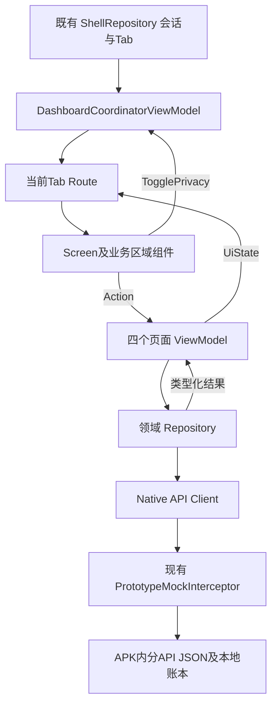

# EntryTask 主界面与四个 Tab 必做 UI 技术方案

> **2026-10-25 首页增量修订（以本条为准）**：根据用户反馈“Android Studio首页内容缺少太多”，首页恢复完整视觉稿的信息层级：第二服务宫格、快捷条、耀钻空间、财富精选分类/完整产品卡、特色单品、私行服务、尊享权益、投研和私行品牌入口；RN同步对齐。下文关于首页仅四区、首页停用product.list、首页可选区全部排除的描述保留为原16区域版本记录，已被本修订替代。其他三个Tab仍按原必做范围执行。浮动财富广场与真实交易/资讯详情不在本次增量范围，入口沿用DemoActionSheet。

数据与职责：home.content新增有界sections（banner/cards/menu/news），共享JSON为两端单一运营源；product.list沿用现有API，分页最多3条，分类默认all。Home VM管理分类、取消和会话隔离；RN仅在客户端Port保存选择，资源仍在RTK Query；Native使用PageResource保护迟到响应。两端复用菜单、营销卡、产品卡和品牌页尾，禁止为填满界面写死个人资产或收益。参考图中的资讯配图/私行卡片专用素材尚无独立资源，当前用已有图标/素材和近似色块呈现，不宣称像素级还原。


版本：V1.2 双端实施基线  
日期：2026-10-25  
状态：用户已于2026-10-25授权按方案编码；验证结果见实施记录

本方案按新版 PRD 的“必须”标记收敛范围，采用 **Android Jetpack Compose + MVVM/UDF、RN React + MVVM/UDF** 对齐主界面与四个根页。每个页面按业务区域组合，跨 Tab 复用视觉组件和共享状态，不再用一个通用营销卡及一个宽泛页面模型拼接所有内容。本文只定义方案、变更边界和验收条件，不代表这些设计已经实现。

**已确认范围：RN 和 Android 都对齐新版必做 UI。** CLI 继续进入 RN 页面，Android Studio 继续进入 Native 页面；两种实现执行同一份区域、数据、交互和视觉验收基线。Compose 适用于 Android Native，RN 使用 React Native 组件，不把 RN 页面嵌入 Compose 来代替双端实现。iOS 原生编码不在本轮范围；RN 共享页面不引入 Android 专属业务判断，不能据此宣称 iOS 宿主及原生能力已验收。

## 1 依据与范围裁决

### 1.1 输入资料

| 资料 | 用途 |
| --- | --- |
| [新版 UI PRD](../../prd/EntryTask%20UI%20PRD.docx) | 必做范围、Compose/MVVM/UDF、区域名称、隐私同步、页尾品牌和滚动状态要求 |
| [Home 视觉稿](../../prd/UI原型/Home.jpg) | 首页必要区域的配色、比例、间距与素材参考 |
| [Wealth 视觉稿](../../prd/UI原型/Wealth.jpg) | 资产摘要、行情条、服务宫格和品类切换参考 |
| [Member 视觉稿](../../prd/UI原型/Member.jpg) | 已登录 VIP 蓝卡、权益宫格、签到任务参考 |
| [Me 视觉稿](../../prd/UI原型/Me.jpg) | 身份统计、资产、月收支、账单及借款卡参考 |
| [已有双模式说明](../development/native-dashboard.md) | CLI/RN 与 IDE/Native 选择、现有模块及 Mock 打包方式 |
| 当前 `app`、`biz_dashboard`、`biz_user`、`demo_engine` 源码及共享契约 | 判断复用点和真实差距，不把旧验证结果作为新版验收证据 |

新版 Word PRD 的文字决定功能与范围，JPG 决定对应区域的视觉方向。长截图中的其他专区不能仅因可见就加入本次。四张 JPG 已移至 `prd/UI原型/`；后续资产来源记录使用新路径。

### 1.2 明确的方案决策

1. 新版要求替代上轮 Native XML 页面方案。Native 业务 UI 用自定义 Composable 组件；保留 View/Fragment 只为宿主互操作，不再新增 XML 业务页面。
2. 固定四个根 Tab：**首页、财富、会员、我的**，沿用现有 ID 1～4 和顺序。视觉稿第五个“借钱”Tab不增加。
3. MainActivity 继续 singleTask。冷启动先检查 Native 会话，未登录只显示认证过渡/门禁，登录成功才允许业务内容及其数据请求。
4. `AppFooterLogo` 是 Android 各页 `LazyColumn`、RN 各页主列表的最后一个内容项；固定在窗口底部的是根 Tab 栏。页尾 Logo 不悬浮、不覆盖卡片，也不和根 Tab 栏合并。
5. 会员页采用新版已登录 VIP 卡，不沿用旧的“欢迎登录”白卡。截图的 R5 是示例等级，不能把所有账户强制显示为 R5。
6. 只交付本表下列必做区域及其必要交互闭环。矩阵中列出的组件，只有被必做区域实际使用才实施，不提前创建空组件库。
7. 本轮不新增真实银行交易。签到是已有本地 Mock 写操作，应完成真实请求闭环；服务入口反馈与资金交易能力严格区分。

### 1.3 必做区域追踪表

Word 中共有 16 个标注“必须”的页面区域，其中页尾品牌在四页分别出现；不能把它们误计为 16 个互不相关的底层控件。

| 编号 | 页面 | 必做区域 | 实施组件 | 最小行为 |
| --- | --- | --- | --- | --- |
| H-01 | 首页 | 全局导航栏 | HomeTopBar | 扫码、搜索、消息红点、客服/头像入口可触达 |
| H-02 | 首页 | 资产/快捷金刚区 | QuickActionGrid → StandardGridMenu | 资产、账户、转账、信用卡四入口 |
| H-03 | 首页 | 营销通告轮播 | BannerCarousel | 多条切换、手动滑动、自动播放及暂停 |
| H-04 | 首页 | 品牌收尾 | AppFooterLogo | Logo、英文行名、标语随列表到达页尾 |
| W-01 | 财富 | 资产摘要 | AssetSummaryHeader → AssetPrivacyCard | 总资产、最新收益、全局显隐 |
| W-02 | 财富 | 市场解读轮播 | MarketTickerCarousel | 每 5 秒向上切换一条，单行裁剪 |
| W-03 | 财富 | 财富金刚区 | WealthServiceGrid → StandardGridMenu | 存款、理财、基金、私募等入口 |
| W-04 | 财富 | 品类过滤器 | CategoryTabRow | 选中状态、结果切换、加载/空/错误反馈 |
| W-05 | 财富 | 品牌收尾 | AppFooterLogo | 与其他页复用同一端内实现 |
| M-01 | 会员 | VIP 身份卡 | VipProfileCard | 等级、当前资产进度、权益入口 |
| M-02 | 会员 | 核心权益宫格 | MemberBenefitsGrid → StandardGridMenu | 能量值、生日礼、学习金、咖啡等菜单 |
| M-03 | 会员 | 任务/签到 | InteractiveTaskCard | 日期/进度、提交防重、结果可见 |
| M-04 | 会员 | 品牌收尾 | AppFooterLogo | 与其他页一致 |
| P-01 | 我的 | 个人名片及统计 | UserCardHeader → SummaryStatsRow | 昵称、低碳标签、五项统计 |
| P-02 | 我的 | 资产与收支 | AssetAndIncomeSection | 资产概览、月收支、信用卡账单、借款摘要及统一打码 |
| P-03 | 我的 | 品牌收尾 | AppFooterLogo | 与其他页一致 |

P-02 在 PRD 中名为 `AssetAndIncomeCard`，但视觉稿实际由数张独立卡组成。本方案将业务组合层称为 `AssetAndIncomeSection`，内部拆卡，避免一个组件承担四种结构；对需求编号仍保持一一对应。

### 1.4 不纳入本次的区域

| 页面 | 延后区域 |
| --- | --- |
| 首页 | 第二块财富品类宫格、快捷子菜单条、财富精选/特色产品流、私行增值服务、投研资讯、浮动财富广场 |
| 财富 | 安稳纯债完整专题、理财榜单、现金管理专区、投资必读等多维产品和资讯区 |
| 会员 | 能量值乐园、抽奖、兑换瀑布流、非必做的定制卡/书籍/等级营销拼图区 |
| 我的 | 市民服务、我的业务聚合、快捷转账、支付绑定、安全中心、网点服务面板 |
| 全局 | 新增资讯/活动/已领权益频道页面、第五个根 Tab、真实扫码/客服/转账/申卡/还款/授信 |

`CategoryTabRow` 必须有可观察的筛选结果，但不据此实现完整可选产品专区。建议只提供“当前分类 + 结果数量 + 最多三条轻量产品摘要”；其展示由独立 `CategoryResultPanel` 承担，不引入图表、榜单或完整 `FinancialProductCard`。此最小承载方式须人工确认。

未实现的菜单目标，统一通过 `DemoActionSheet` 展示服务名、演示边界和关闭操作，不使用无响应按钮，也不声称业务已完成。已有 RN 子页与路由保留，但不因本次根页改版扩展功能；必做入口默认采用双端一致的说明层。若要接入现有详情页，须在 R-04 明确入口白名单及双端行为，不以 RN 已有页面为由暗中扩大范围。扫码、客服等入口可交互，不等于本期实现相机或真人会话。

## 2 当前实现与新版目标的差距

| 当前源码证据 | 差距 | 方案处理 |
| --- | --- | --- |
| `RootContentHostFragment` 依据 BuildConfig 选择 RN 或 Native | 双模式已有，不能为新版重建第二个运行时 | 保留模式入口及安装身份 |
| `MainActivity` + `MainShellView` + XML 外壳 | 原计划延期的 Compose 阶段现在成为新版要求 | 单独迁移 Shell View 层，保留认证/导航事实源 |
| `biz_dashboard/ui/DashboardView.kt`、四份 XML | 区域与新版不同，会员仍有旧欢迎卡、营销拼图 | 以四个 Compose Screen 替代 Native 渲染路径 |
| `BankComponents.kt` | 营销卡复用过宽，身份卡、资产卡和权益不是同一种结构 | 复用视觉原语，业务区域分别封装 |
| `DashboardPage`、`DashboardViewModel` | 一份大模型同时容纳四页字段；切页重置过滤器，数据错误易扩大到整页 | 四页类型化状态/VM/Repository，公共数据单一所有者 |
| Native `revealAssets` 属于当前 Dashboard VM | 跨卡使用口径不足；还需覆盖 VIP、月收支、账单、额度 | Native 顶层会话内统一隐私状态 |
| Native 目前无 Logo、真实轮播/签到闭环 | 必做行为缺失 | 增加专用组件及完整最小流程 |
| `CheckinLedger`、`checkin.status/submit` 已存在 | 有真实本地账本，但 Native UI 尚未接入，日期格字段不足 | 复用账本，补必要响应投影，不在 UI 重建奖励规则 |
| RN 四个 Screen、ChannelHeader、ServiceGrid、CampaignCard、ChoiceRail | 已有分域和复用基础，但包含可选营销区，行情/会员身份等结构不符合新版 | 按16个区域重组四页，保留可复用原语及非本轮子页 |
| RN Home/Wealth 的产品资源、Member 的活动/领取/能量记录资源 | 根页仍可能订阅非必做内容；分类在局部组件中易随卸载重置 | 只激活必做资源，分类与滚动状态归客户端状态 Port |
| RN ShellViewModel 的资产偏好经 NativeStorage 持久化 | 与原稿 Native 会话内隐私建议不同；异步读写存在时序协调要求 | 双端统一隐私策略，行为变更明确列为 R-10，见第7节 |
| 现有 API 缺少月收支/信用卡账单及会员资产门槛字段 | 不能用固定 UI 数字补齐 | 按第 9 节扩展共享契约与 Mock |

当前工作区包含上轮未提交改动及PRD图片移动；实施在现有基线上增量完成，不回退这些变更。实际落点与验证见[双端实施记录](../development/新版四Tab实施记录.md)。

## 3 页面分区与布局方案

以下分区、内容顺序、字段语义及操作适用于 RN 和 Android 两种实现。第4.5节提供逐区对应关系；平台只在绘制、列表和生命周期适配上不同，不维护两份产品需求。

### 3.1 首页

```text
系统安全区（由宿主提供）
HomeTopBar
QuickActionGrid：4列
BannerCarousel：横向海报与指示点
AppFooterLogo：列表最后一项
固定根Tab栏（列表外）
```

- `HomeTopBar` 使用“左侧扫码按钮 + 中间搜索入口 + 右侧消息与头像”的布局；搜索框保留浅底、边框和默认提示词，不能把搜索词当大标题。
- 未读数量由统一通知状态提供；大于零显示红点/角标，无数据不伪造截图里的未读数。未知/请求失败与“零未读”区分。
- `QuickActionGrid` 只配置四项，不混入理财、基金等可选第二宫格。每个入口的图标、文案、目标由类型化菜单模型提供。
- `BannerCarousel` 使用可替换的局部海报素材和独立动态文字。不能将整张页面截图嵌进界面；图片若自带不可分割文字，应标记为静态运营海报，避免重复叠字。
- 去掉非必做区域后页长变短属于范围收敛，不保留原区域大小的空白占位。四区顺序固定，不为填满截图添加模块。

### 3.2 财富页

```text
AssetSummaryHeader：标题、总资产/最新收益与眼睛按钮
MarketTickerCarousel：固定单行、每5秒向上切换
WealthServiceGrid：通常5列，数据驱动行数
CategoryTabRow：4个品类
CategoryResultPanel：最小结果承载（评审项）
AppFooterLogo
```

- 资产数字与说明分别定义文字规格；眼睛为独立 48dp 点击区，不能使用占满一行的灰色按钮。
- 行情条的左侧“市场解读”、正文、右箭头对齐；只有正文参与垂直切换，组件高度不随文案变化。长正文单行省略，点击可在轻量说明层展示全文。
- 财富菜单与首页共享宫格内核，但图标样式、列数和数据不同，不采用“同一组件中判断当前 Tab 再写业务文案”。
- 分类选中装饰、文字粗细按视觉稿处理；连点只接受最新选择，先更新选中项，再显示对应加载态。失败保留当前选择和重试入口，不能把旧分类数据误标为新分类。
- PRD 的“信恋家族”、图稿/现有 fixture 的“信芯家族”存在用词差异，稳定业务 ID 暂沿用 `xin`，展示文案由评审冻结，不混用多种名字。

### 3.3 会员页

```text
VipProfileCard：蓝色会员身份、当前资产进度、全部权益入口
MemberBenefitsGrid：放在VIP视觉容器内的浅色权益区
SectionHeader：会员专属活动
InteractiveTaskCard：连续天数、签到按钮、7日状态和进度
AppFooterLogo
```

- VIP 外容器为业务区域组合，不将权益菜单画进一张位图。蓝色纹理/徽章是装饰素材，等级、资产、进度及菜单均为实时控件。
- `VipProfileCard` 与 `UserCardHeader` 共享头像/等级徽章原语，但两者结构、信息层级不同，保持独立业务组件。
- 权益宫格按视觉稿优先 4 列布局，六项自然分两行；通过 `StandardGridMenu` 复用等宽、角标、点击区域，不复用首页金色快捷图标的样式。
- 等级示例不作为业务事实。展示 Mock 返回的等级及门槛，明确演示口径；门槛未知时显示“进度暂不可用”，不能随意计算银行真实升级规则。
- 图稿进度的口径是“当前月日均金融资产”，不能直接拿资产总览的total冒充。会员进度DTO应明确metricCode、asOf、当前金额及下一门槛；演示采用何种口径由R-07冻结。
- 签到不是说明弹层：按钮提交现有 Native Mock，请求成功后日期格、连续天数、能量值均根据结果更新；失败允许重试且保留已知进度。
- 七日状态来自响应中的逐日记录，不靠连续天数猜测非连续历史，不直接写死截图日期“10.25”。

### 3.4 我的页

```text
UserCardHeader：头像/昵称、低碳标识、会员徽章、5列统计
AssetAndIncomeSection
  AssetPrivacyCard：资产总览/最新收益
  MonthlyCashflowCard：本月收入/支出与比例条
  CreditBillCard：未还金额、到期信息及动作入口
  LoanSummaryCard：演示产品额度/利率与动作入口
AppFooterLogo
```

- 五项统计通过 `SummaryStatsRow` 等宽排布，数字与标签逐列对齐；不能依赖拼接空格。
- `AssetAndIncomeSection` 只编排子卡和转发动作，不自行请求接口、不创建另一份隐私状态。
- 财富与我的使用同一份资产摘要来源；禁止两页分别填充不同的“总资产/最新收益”假数。
- 月收支为零时使用中性比例条，不除以零；无信用卡和“账单金额为零”是不同状态，无卡展示空账单说明。
- 借款额度按 Mock 字段明确“营销演示上限/尚未授信”，不能把 500,000 元示例标成用户已经获得的授信。
- 对卡片内资产、月收支、账单金额、借款金额统一打码；公开产品利率、统计数量、昵称不随资产眼睛按钮隐藏。权益进度中的金额和精确进度也受保护，见第 7 节。

## 4 组件封装与复用

### 4.1 封装规则

- **视觉原语**：无页面业务，负责间距、形状、字体和可访问性，例如 BankCard、MoneyText、Badge、EyeToggle。
- **跨页组件**：存在真实多处复用和一致语义，例如 StandardGridMenu、AssetPrivacyCard、SectionHeader、AppFooterLogo。
- **业务区域**：即使仅一页使用，只要包含独立布局、状态或交互，也封装为独立 Composable / React 组件，例如 VipProfileCard、InteractiveTaskCard、CreditBillCard。
- **Screen**：只按固定区域顺序组装，不在文件中展开每个角标/按钮/数字的绘制细节。

Android 的“自定义组件”指命名清晰、具有输入/输出契约的 Composable 函数，不是要求每个区域继承 Android View。Compose 中复用函数组合，避免把旧自定义 View 全部包成 AndroidView 后宣称完成 Compose 改造。

### 4.2 公共组件矩阵

| 组件 | 首页 | 财富 | 会员 | 我的 | 输入与职责 |
| --- | --- | --- | --- | --- | --- |
| BankTheme / BankCard | 是 | 是 | 是 | 是 | 统一视觉 token，不承载数据 |
| AppFooterLogo | 是 | 是 | 是 | 是 | 标准品牌资源、上下间距、单一无障碍描述 |
| StandardGridMenu / GridMenuItem | 快捷区 | 服务区 | 权益区 | 本期不加可选服务区 | 菜单、列数、视觉样式、点击回调 |
| SectionHeader | 必要时 | 分类结果区 | 任务区 | 各子卡 | 标题、副标题、可选更多按钮 |
| AssetPrivacyCard | 本期只有资产入口，不加资产卡 | 资产摘要 | 复用内部 MoneyText，不套整张资产卡 | 资产总览 | 资产模型、visible、切换/更多回调 |
| MoneyText / EyeToggle | 不显示金额 | 是 | VIP资产进度 | 是 | 统一打码与金额格式，组件本身不保存隐私 |
| MemberTierBadge / Avatar | 头像入口 | 无必需头像区 | VIP等级 | 用户名片 | 公共展示原语，按业务组合布局 |
| RegionState / InlineRetry | 是 | 是 | 是 | 是 | 首载、刷新、空、错误、重试 |
| DemoActionSheet | 必要入口 | 必要入口 | 非签到入口 | 非金融写操作入口 | 统一范围说明与关闭，不伪造结果 |

`MarketTickerCarousel` 是独立专用组件，财富页先实施。矩阵提及的首页通告栏若没有本轮必做数据位置，不额外插入首页。横向 Banner 与纵向 ticker 不做一个带大量 Boolean 的“万能轮播”。

### 4.3 业务组件边界

| 业务组件 | 可组合的公共组件 | 自己拥有的布局/交互 | 不允许承担 |
| --- | --- | --- | --- |
| HomeTopBar | IconAction、UnreadBadge、Avatar | 搜索框及四类入口的相对位置 | 查询未读、开启相机 |
| QuickActionGrid | StandardGridMenu | 4列/金色图标样式配置 | 硬编码账户数据 |
| AssetSummaryHeader | AssetPrivacyCard | 财富顶部排布 | 独立的显隐 Boolean |
| VipProfileCard | BankCard、MemberTierBadge、MoneyText、ProgressTrack | 蓝色身份、门槛说明、权益入口 | 计算真实等级规则 |
| MemberBenefitsGrid | StandardGridMenu | 蓝色权益图标、六项排布 | 自动领取权益 |
| InteractiveTaskCard | SectionHeader、TaskDayCell、SubmitButton、RegionState | 日期格与任务进度 | 决定奖励、写SP |
| UserCardHeader | Avatar、MemberTierBadge、SummaryStatsRow | 名片与五项统计 | 调用NativeModule |
| MonthlyCashflowCard | BankCard、MoneyText、RatioTrack | 两列收支和比例 | 从UI汇总不完整分页交易 |
| CreditBillCard | BankCard、MoneyText、ActionButton | 无卡/无账单/账单结构与动作 | 真实分期、还款 |
| LoanSummaryCard | BankCard、MoneyText | 营销上限、利率和说明 | 授信或提款 |

`FinancialProductCard` 在 PRD 复用矩阵中出现，但对应首页产品流/财富完整产品专区未标必须。本轮延后完整组件；如评审要求分类结果使用完整金融卡，则同步增加明确范围和验收，不悄悄加入。

### 4.4 组件契约示意

以下仅为设计接口，不是本轮新增源码。组件接收稳定的只读投影和动作回调；不得接收 Retrofit、Repository、Activity 或整份 AppState。

```kotlin
@Composable
fun AssetPrivacyCard(
    data: AssetSummaryUi,
    visible: Boolean,
    onToggleVisibility: () -> Unit,
    onOpenDetails: () -> Unit,
    modifier: Modifier = Modifier,
)

@Composable
fun StandardGridMenu(
    items: List<GridMenuItemUi>,
    columns: Int,
    style: GridMenuStyle,
    onItemClick: (String) -> Unit,
    modifier: Modifier = Modifier,
)

@Composable
fun InteractiveTaskCard(
    state: CheckinUiState,
    onSubmit: () -> Unit,
    onRetry: () -> Unit,
    modifier: Modifier = Modifier,
)
```

预览使用合成 UI 模型；组件不得为 Preview 创建 VM 或网络 client。按业务覆盖空、加载、错误、已签到、无账单、资产隐藏及大字体等状态。

### 4.5 RN 组件落点及双端对应

第1.3节的组件名是共同语义，Android 对应 Composable，RN 对应同名 React 函数组件。复用的是需求、字段、视觉 token 定义、资源及行为用例；不跨语言导入 UI 实现，也不让 Android 页面依赖 RN 运行时。

| 必做编号 | Android / RN 同语义组件 | RN 所有权与复用方式 |
| --- | --- | --- |
| H-01 | HomeTopBar | home/presentation/components；从 ChannelHeader 提取 IconAction、UnreadBadge 等公共原语，保留首页专属排布 |
| H-02 | QuickActionGrid | home 内组合 shared/ui/StandardGridMenu；现有 ServiceGrid 可演进为该内核 |
| H-03 | BannerCarousel | shared/ui；从 CampaignCard 复用适用的图片/圆角能力，新增分页及暂停行为 |
| H-04、W-05、M-04、P-03 | AppFooterLogo | shared/ui；四页使用同一组件，不以 DemoFootnote 替代品牌收尾 |
| W-01 | AssetSummaryHeader / AssetPrivacyCard | wealth 组合；资产卡内核放 shared/ui，接收金额投影及 visible |
| W-02 | MarketTickerCarousel | shared/ui；独立纵向单行组件，不能复用静态正文冒充轮播 |
| W-03 | WealthServiceGrid | wealth 组合公共宫格，列数/图标样式由输入决定 |
| W-04 | CategoryTabRow / CategoryResultPanel | wealth；ChoiceRail 仅复用适用的选中样式，分类动作经 VM |
| M-01 | VipProfileCard | member；组合 Avatar、MemberTierBadge、MoneyText、ProgressTrack |
| M-02 | MemberBenefitsGrid | member 组合公共宫格，不混入领取记录列表 |
| M-03 | InteractiveTaskCard | member；日期格/按钮可域内复用，签到业务在 VM/Repository |
| P-01 | UserCardHeader / SummaryStatsRow | profile；复用头像/徽章及等宽统计原语 |
| P-02 | AssetAndIncomeSection | profile 编排资产、月收支、账单、借款子卡，公共资产卡与财富共享 |

RN 的 MoneyText、EyeToggle、BankCard、RegionState、SectionHeader、DemoActionSheet 与 Android 执行同样的输入/输出边界。公共组件不导入 feature 私有类型，按最小展示 Props 建模；业务组件仍归各域。`theme.ts` 演进为统一 token 入口，不在四个 Screen 复制色值和间距。

RN Props 示例（设计接口，未实施）：

```ts
type AssetPrivacyCardProps = Readonly<{
  data: AssetSummaryUi;
  visible: boolean;
  onToggleVisibility: () => void;
  onOpenDetails: () => void;
}>;
```

组件不接收 NativeGateway、ResourceClient 或整份 Store。少量行内折叠等纯视觉状态可局部保存；全局隐私、分类选择和签到提交状态不分散保存在叶子组件。

## 5 模块与 MVVM UDF 架构

### 5.1 职责与目标目录

复用现有模块，不为四页创建四个 Gradle 模块，也不为本轮建立空的 lib_ui/lib_contract。

```text
android/app
  MainActivity / RootContentHostFragment              平台生命周期、模式选择与组装
  shell/presentation/compose/              RootTabBar、BottomChrome与Compose绑定
  shell/host/                              静态容器/恢复与ShellInsetsAdapter
  shell/domain + data + host/              既有Tab/会话/认证/返回状态机
  dashboard/di/                           Native页面图组装与平台Port适配

android/biz_dashboard
  domain/home|wealth|member|profile/       四域模型与Repository契约
  domain/shared/                          资产摘要、会员统计等确需共享的契约
  data/api/                               受控Native API client与DTO解析
  data/repository/                        页面Repository、共享摘要仓
  presentation/coordinator/               DashboardCoordinatorViewModel
  presentation/home|wealth|member|profile/ 各页Route、VM、UiState、Action
  ui/components/                          跨Tab Composable
  ui/theme/                               颜色、字体、间距、形状与素材映射

android/demo_engine                       既有Mock路由、签到账本及必要投影扩展
contracts/ + mock/                        单份运行时契约及分API数据
```

以上为拟实施目录，当前尚不是此结构。公开跨域共享契约位于 `domain/shared`，不互相导入另一个页面的私有 VM 或数据实现。`app` 只连接 UI 与能力，银行展示逻辑放在业务模块。

### 5.2 状态流与动作流

组件接收最小展示状态、向上发送动作，由状态所有者统一更新，符合Compose的UDF设计。[Android官方架构说明](https://developer.android.com/develop/ui/compose/architecture)。



- 根 Tab 选择仍只有 `ShellRepository.tabId` 一个事实源；Coordinator 投影它，不维护另一份独立 selectedTab。
- `DashboardCoordinatorViewModel` 管 Native 会话内全局隐私和当前活动页协调，不吞并四页业务数据。
- Home/Wealth/Member/Profile 各自 VM 维护页面 UiState 和操作。VM 不持有 Context、View、NavController、JSON 或 Activity。
- 四个页面VM在同一Native根Fragment的ViewModelStore中按稳定页面身份惰性创建，不在每次重组或根Tab切换时重建。激活/停用控制各页请求与订阅；UI层不为根Tab另建NavController。
- 页面 Route 生命周期感知收集 `StateFlow`，Screen 负责渲染和上报意图。一次点击进入 `onAction`，业务状态经 VM 更新再下行，禁止 UI 直接改 Repository/Store。
- 共享资产、会员统计及未读摘要由注入的同一 Repository 实例提供会话内资源快照，避免两页各自维护持久缓存。Native 不读 RN Redux/Query 缓存。
- UI 级 Toast/Snackbar 可用一次性效果；签到成功、已签到和奖励等业务结果必须进入可重新观察的状态，不能只发一次 Toast。

### 5.3 按区域加载

不沿用“某个异步请求失败就让所有区域一起失败”的整页聚合方式。UiState 中独立保留 `header`、`banner`、`assets`、`task` 等资源状态，采用结构化并发并隔离非取消错误。

- 首载失败：在对应区域展示错误/重试，不将未知资产显示为零。
- 刷新失败：保留旧数据并显示区域错误；非敏感静态页尾不随接口错误消失。
- 空列表：无可展示项时隐藏无意义容器或展示明确空态，保留顺序稳定。
- 取消：不展示“网络失败”，旧会话和旧分类响应不得回写。
- 根页切换：暂停离页的动画与轮询；共享已完成数据保留在当前会话的有界仓内，重进按刷新策略使用。
- 初次只加载选中 Tab 和必需共享摘要，不同时发起四页全量请求，不请求延后区域的 API。

### 5.4 RN 目录与依赖方向

保留现有 `src/` feature-first 工程、根 package.json 和官方 CLI 入口，不新增 rn 子工程或另一份 Store。以下为本次需要演进的职责，不要求机械创建所有空目录：

```text
src/app/CompositionRoot.ts             Surface应用图、端口及资源缓存组装
src/app/navigation/                   Native Shell投影、认证门禁、活动页绑定
src/features/{home,wealth,member,profile}/
  domain/                             展示所需领域模型、Repository/ClientState契约
  data/                               ResourceSource适配、DTO映射、写后失效
  presentation/                       Screen、VM、域内区域组件
  di/、public/                        工厂与跨域最小公开接口
src/shared/ui/                        真正跨域的组件、theme及视觉原语
src/infrastructure/state/             既有createAppStore / ResourceClient
src/infrastructure/network/           EndpointRegistry / TransportRouter
src/platform/ports/、platform/native/ Port / Codegen适配
```

`Route → VM → Domain Repository/ClientState Port → Data → ResourceClient/NetworkPort`。Domain 不依赖 React、Redux、Axios 或 NativeModule。Screen 只接状态/动作；app 或 Route 绑定活动状态和 VM 订阅。跨域通过 public，资产/身份共享契约可复用现有 services/public，不能为共享一张卡导入其他域的私有 VM。

### 5.5 RN 单一资源缓存与客户端状态

- 沿用 `createAppStore` 的 Redux Toolkit / RTK Query 与 `ResourceClient`。服务端资源只在 Query 缓存保存；VM 提供只读映射/选择器，不再复制整份响应到新 slice 或第二个资源仓。新增 Repository 是既有资源层的类型化适配，不是替代 Query 的缓存实现。
- 客户端 slice 管理按 sessionEpoch 分区的分类、四页滚动偏移及必要展示状态，通过 ClientState Port 注入 VM；Domain 不认识 Redux。全局隐私只由 Shell/隐私协调者维护，不能同时在 slice 与 Shell 各存一份。
- `createApplication` 保持当前挂载业务 Surface 的唯一应用图；Store/ApiService 不随切 Tab 或认证重建。`createChannels(epoch)` 的页面 VM 随会话建立并统一 dispose，只订阅当前活动页所需资源，不在 render 中构建依赖。
- Home 根页停用可选 products 订阅；Wealth 根页不加载 articles/完整专区，仅加载当前分类最小结果；Member 根页不预加载 activities、claims、energy.records 列表。资源工厂可保留供既有子页使用，创建 source 不等于应主动订阅。
- Profile 增加 financialOverview 的领域类型和 Repository/ResourceSource 适配。财富/我的以相同 API 参数与 epoch 共享 asset.summary 缓存；会员/我的统计在签到写后失效重取，不各自硬改余额。
- 初始加载、空、失败、刷新失败保留旧值与取消分开。分类查询以 category + epoch 为缓存键；VM 仅投影当前分类快照，旧请求完成也不能覆盖新选择。
- 会话失效先门禁、停止订阅/计时器并清 Query 与客户端会话状态，再接受新会话数据。不能只改 UI 的 authenticated 而留旧账户缓存可见。

### 5.6 RN 状态与动作闭环

```text
Native Shell事件(tabId/authenticated/sessionEpoch)
→ ShellViewModel → AuthenticationGate / 当前Route
→ 页面VM选择资源快照 → Screen → 区域组件
组件动作 → VM → 领域Repository / ClientState Port
→ ResourceClient → EndpointRegistry / TransportRouter
→ NativeTransport → Native Bridge → 同一Native网络Mock
→ schema校验与DTO映射 → Query缓存 → VM投影 → Screen
```

RN 继续保留默认受保护页面门禁；未登录经 HostPort 发 authenticate 命令，由 Native 协调登录、取消与重入，不能自行导航到 RN 登录页。HelpCenter 等现有明确公开页沿用访问策略。根 Tab 只使用 Native tabId，RN 不新增底部导航。

现有签到写操作位于 `createDocumentModel` 通用子页流程。本次应提取可复用的签到 Repository/Command，由 Member VM 和原子页共同调用；防重、幂等键、日期冲突与状态确认只实现一份。不能把通用 DocumentModel 整个塞入任务卡，也不能在卡片 onPress 中直接调用网络。

## 6 Compose Shell 与 RN 宿主的兼容

### 6.1 推荐最终形态

所有可见的 Native 主界面 UI（四页、根底栏、分割线和品牌）采用 Compose；**保留少量不含业务绘制的静态 XML 宿主容器**，沿用现有 Fragment 恢复时序。Compose架构不要求把平台承载槽也改成Composable，更不需要为替换外壳而重写认证状态机。

```text
MainActivity singleTask
  activity_home.xml（仅静态宿主结构，不含银行业务UI）
    R.id.fragmentContainer：稳定FrameLayout
      RootContentHostFragment，tag仍为 entrytask-root-hub
        RN模式：原ReactFragment / EntryTask Surface
        Native模式：ComposeView / NativeDashboardRoute
    bottomChrome：保留承载槽，内部ComposeView绘制RootTabBar及分割线
```

MainActivity仍在原有时机setContentView，使稳定容器在Fragment视图恢复前可用；ComposeView只负责绘制。RootTabBar订阅既有MainUiState并上报同一selectTab意图，替换BottomTabBar控件而非新增根导航。RN业务Screen按第3～5节同步改版；Compose Shell仍通过既有Shell事件驱动RN，不能绕过Bridge另建Tab状态。

不推荐本轮直接把根Fragment容器搬到`AndroidView.factory`：它的创建取决于Compose组合/测量时机，不能仅凭保留同一个ID就认定旧Fragment一定能及时恢复。若人工明确要求MainActivity完全setContent、连静态结构XML也移除，应另补容器就绪/恢复的技术样板和专项验证，不能把它当作必做UI的隐含前置条件。

### 6.2 必须保留的恢复约定

1. `RootContentFragmentFactory`在`super.onCreate`前配置，负责旧宿主类名恢复映射，并委托`RNScreensFragmentFactory`保留RN Screens恢复策略。
2. 容器继续使用`R.id.fragmentContainer`，外层`entrytask-root-hub`，内层`R.id.rn_content` / `entrytask-rn-root`；不使用临时生成ID替代恢复标识。
3. Fragment查找、复用/挂载仍由Activity平台适配器在生命周期允许且未保存状态时执行，不在Composable body或每次重组中`add/replace`。
4. Compose重组、切根Tab、认证往返均不创建第二个RootContentHostFragment或ReactHost。不通过state loss提交掩盖时序问题。
5. Native ComposeView使用`DisposeOnViewTreeLifecycleDestroyed`，底栏ComposeView随宿主View树生命周期清理；两处ComposeView设置不同的稳定资源ID以支持保存恢复。页面VM跨View重建保留，销毁Fragment时取消所属工作。该互操作和释放策略见[Android官方ComposeView说明](https://developer.android.com/develop/ui/compose/migrate/interoperability-apis/compose-in-views)。
6. 保留BuildConfig模式选择、包名`com.entrytask`、组件名`EntryTask`、入口`src/index.js`、RN插件和Codegen。
7. 切换APK模式可能遇到旧SavedState恢复。对现有Fragment按固定tag校验/复用，按当前构建渲染器恢复View；旧Native控件状态不作为新Compose业务数据来源，不用删除应用数据解决。

### 6.3 登录与返回

- MainActivity.onCreate 调用既有 VM 会话校验；Compose 初始状态仅认证过渡/门禁，不先绘制带业务数据的主页再跳登录。
- 登录成功以 Native 会话事实为准，AuthActivity 返回只作为通知。MainActivity 保持在栈中，恢复后启动当前页请求。
- 未认证时不创建需要用户 scope 的请求；会话变化立即遮罩/清空旧数据、取消请求、重置全局隐私。
- 认证取消/启动失败仍遵循既有协调状态，可挂载门禁但不能展示业务页。RN默认门禁保持不变。
- 返回沿用 IME → 当前内容/弹层 → 根 Tab → 首页双击退出；Native说明层优先关闭。登录/注册的返回规则不在本轮改写。

### 6.4 安全区责任

| 区域 | 唯一责任方 |
| --- | --- |
| 系统状态栏、刘海及左右安全区 | 从旧渲染器提取的ShellInsetsAdapter，为稳定宿主槽预留 |
| 根底栏设计高度 | RootTabBar Compose |
| 系统底部导航区 | ShellInsetsAdapter统一预留，Compose底栏不重复加padding |
| Native页内卡片/页尾间距 | 当前LazyColumn的设计padding |
| RN剩余安全区 | RN基于实际宿主视口的既有计算 |

将旧MainShellView中的Insets职责抽成唯一ShellInsetsAdapter；旧renderer退出时不同时再注册第二份监听。Native内容和Compose底栏不重复使用systemBarsPadding/navigationBarsPadding；若Material容器自带Insets，需要显式关闭重复部分。底栏隐藏时系统底部安全区仍由该适配器处理，不靠固定dp模拟系统栏高度。

## 7 全局隐私状态

### 7.1 所有者与作用域

Native四页共用 Coordinator 的一个 `assetsVisible` 状态，默认隐藏；页面/卡片没有自己的 `remember { mutableStateOf(...) }` 副本。会话变化或退出后立即恢复隐藏。

建议本轮 Native 偏好只保留在当前会话内，旋转屏幕由 VM 保留，不新增持久偏好。PRD只要求跨Tab同步，没有要求重启后继续可见。RN同步采用相同的会话内默认隐藏策略：由现有 ShellViewModel 演进为唯一隐私所有者，新根页不再恢复/写入持久 assetVisibility，相关旧调用一并收口。旧 NativeStorage 键保留，不删除用户数据；这是对既有RN持久偏好行为的明确调整，须按R-10人工确认后实施。切换眼睛先同步更新会话内状态，无异步写入才显示的延迟，也避免快速连点读取旧值。两种构建模式互斥，不要求同时运行的两套界面实时同步；无需增加Bridge签名。

若评审选择持久偏好，则双端都必须复用 NativeStorage 的既有用户scope键及统一Native适配，处理读取期间隐藏、旧epoch回调丢弃、连续写入串行与最终值一致；不能RN持久而Native临时。现有Bridge没有偏好广播，若未来需要同进程混用两套渲染器，再单列状态事件契约，不能声称当前已支持。

### 7.2 打码规则

| 数据 | 隐藏时 |
| --- | --- |
| 总资产、收益、收入、支出、账单金额、额度 | 统一 `******`，不保留可推断的位数 |
| VIP当前资产/目标金额 | 金额打码；精确进度隐藏为中性轨道，不继续暴露真实占比 |
| 等级、昵称、五项统计、公共产品利率 | 保留；不把所有数字一律隐藏 |
| 未知金额 | 可见时 `--`；隐藏时不暴露值；不能转成 `0.00` |
| 无卡/无账单等业务空态 | 保留空态说明，不伪造金额 |

隐私关闭时数字立即打码；动效只用于眼睛图标或非敏感容器，不能在切换到隐藏的过渡帧继续显示真值。TalkBack/测试 semantics 同步隐藏金额，不将完整值留在 contentDescription。后台遮罩/截图保护策略不在本次新增，但恢复与会话失效不能闪出旧账户数值。

## 8 列表 轮播与状态保持

### 8.1 四页滚动状态

列表状态通过Saver保存索引和偏移，只保存恢复所需的小型UI状态，不把页面响应塞入Bundle。[Android官方状态保存说明](https://developer.android.com/develop/ui/compose/state-saving)。

- 每个 Tab 独立 `LazyListState`；使用稳定 Tab ID 和 `SaveableStateHolder` 保存被切出组合的页面 UI 状态。只写 `rememberLazyListState()` 而不保存已离开组合的状态，不能保证切页恢复。
- Screen 中使用一个主 `LazyColumn`；少量宫格用普通行布局，不能嵌套同方向且无限高度的 Lazy 列表。
- 区域与条目使用稳定 key/contentType；不能以当前位置替代业务 ID。
- 分类状态归 Wealth VM，切 Tab 不重置；轮播页码、列表索引/偏移属于 UI 状态，不保存业务响应。
- 同进程旋转/Tab切换恢复位置；会话更换清除已保存的四页位置和敏感页面投影。新进程仍先认证，可安全回首页顶部，不从 SavedState 推断会话有效。

### 8.2 轮播运行条件

| 条件 | BannerCarousel | MarketTickerCarousel |
| --- | --- | --- |
| 数据数量0 | 区域空态/不占无意义高度 | 隐藏正文轮播，按区域状态处理 |
| 数据数量1 | 静态展示，不启动自动任务 | 静态单条，不启动循环 |
| 数据大于1 | 手势分页；自动间隔建议5秒，待评审 | 每5秒向上切换，PRD硬要求 |
| 非当前Tab、不可见、进入后台 | 暂停 | 暂停 |
| 用户拖动/触摸或说明层打开 | 暂停，结束后重新计时 | 暂停，结束后重新计时 |
| 数据列表变化 | 按稳定ID恢复/夹紧页码 | 按稳定ID恢复/夹紧索引 |

使用 Compose 当前兼容版本提供的 Pager/动画能力，不引入第三方轮播库。纵向 ticker 固定单行高度并裁剪，建议约220ms滑动；动效时长是设计默认值，不是PRD事实。减少动态效果时仍满足可切换，不强制屏幕阅读器每5秒播报。

周期任务由组件可见性、当前Tab和宿主生命周期共同控制。不得使用 GlobalScope、全局 Handler 常驻循环，不能每次重组重新创建计时器，也不能用5秒网络请求代替5秒切换本地已有内容。时间可注入，测试使用虚拟时钟。

### 8.3 RN 列表、可见性与动效适配

- 每页一个主 `FlatList`（区域条目以稳定 regionId 建模），页尾使用 `ListFooterComponent`。少量宫格用有界行布局，避免 ScrollView 包裹同向虚拟列表。按实测需要调整窗口，不把四个页面长树常驻来解决恢复问题。
- Tab 切换只挂载当前根页；页面 VM 和轻量客户端状态在会话内保留。记录各 Tab 的 offset，返回时在布局/内容尺寸就绪后恢复一次；数据变短夹紧、用户已拖动则不再强制恢复。宽度变化导致排版变化时以稳定区域锚点+区内偏移修正，不反复调用 scrollToOffset。新会话清除位置。
- 分类由 VM/ClientState Port 管理，不能继续仅用 WealthScreen 的局部 useState。滚动事件限频保存最终值，不在每个像素变化时广播全应用状态。
- Banner 优先使用已有 RN 核心横向 FlatList + 分页；ticker 使用 Animated 的 transform 在裁剪容器中向上切换。按当前依赖兼容性实施，不默认新增 Reanimated、Pager 或另一套手势原生库。
- 计时器统一受 `activeTab && AppState前台 && 区域可见 && 未交互/无遮挡` 控制。Route传活动状态，列表可见性回调提供区域可见性；依赖变化先清理旧timer/animation，卸载及认证失效重复清理安全。
- 数据按稳定ID恢复轮播项，屏幕宽度改变重算页宽和落点；减少动态效果时直接替换内容。读屏标签由当前项决定，不自动抢焦点。隐藏金额的 accessibilityLabel 同样不能携带原值。
- RN 新进程通过Native Bridge重新校准会话并从安全默认位置开始；同进程 Tab 往返及正常 Activity 配置恢复按应用图生命周期恢复。若 Surface 已被销毁重建，不假设 JS 内存仍在，应验证恢复边界并允许回顶部，禁止把账户响应塞入 Native SavedState 或新增持久查询缓存。

## 9 API 契约与本地 Mock

### 9.1 调用与复用

双端最终共用 `MainApplication.prototypeNetwork → PrototypeMockInterceptor`。Android经注入的Native API client调用；RN经`Repository → ResourceClient → EndpointRegistry → TransportRouter → NativeTransport → Native Bridge`调用。客户端通过受控 API ID 构造请求，响应必须经过本地网络拦截。UI/VM 不打开 JSON fixture。常规请求延迟随机1000～3000ms、后台执行、可取消，无公网兜底。

| 资源 | 现有API | 最小增补或使用方式 |
| --- | --- | --- |
| 首页入口/海报 | home.content | 仅消费quickServices/banners；补至少2条有效运营海报才能验收轮播 |
| 未读提示 | message.unread | 公共通知摘要仓，会话/前台刷新；不是每次组件重组请求 |
| 财富服务/分类/解读 | wealth.content | 保留现有market，兼容增加marketItems数组；不能用同一条复制多份伪造轮播 |
| 分类结果 | product.list | 复用category/page/pageSize，不要求完整专区 |
| 资产摘要 | asset.summary | 财富与我的共用；现有Mock新账户资产为0的规则不变 |
| VIP身份 | member.summary | 兼容增加tierName、演示门槛/进度所需字段，不硬编码R5 |
| 权益菜单 | member.content | 新增benefitEntries菜单数组，与现有benefits领取资源区分 |
| 签到 | checkin.status、checkin.submit | 增加七日记录/规则展示投影，复用既有账本和幂等语义 |
| 用户统计 | profile.summary | 昵称/低碳标识/会员徽章所需字段；统计不能写死截图数量 |
| 月收支/信用卡/借款摘要 | **拟新增** profile.financialOverview | 仅用于必做卡片，见下一节；当前不存在此API |

上述字段和接口均为待实施建议，不表示已修改contracts或API总数。实际路径和暴露策略以实施评审后的endpoint/manifest为准。

### 9.2 必要的数据模型增补

1. **会员等级**：等级号、等级名称、进度口径metricCode、统计日期asOf、当前金额、下一演示门槛和是否最高等级。金额使用统一 Money DTO；门槛来自fixture/handler，不在VM写真实银行规则。最高等级不除以零、不显示不存在的下一等级。
2. **会员权益菜单**：id、title、iconKey、badge、target。示例六项与视觉稿对齐；格子动作进入演示说明，不默认调用claim。
3. **签到投影**：businessDate、checkedToday、consecutiveDays、energy、awardedEnergy、alreadyChecked继续保留；新增calendar数组（固定7个日期和状态）及可展示的rewardRule说明。时间由Mock业务时钟统一提供。
4. **财务概览**：建议 `GET /api/profile/financial-overview`，数据包括month、monthlyIncome、monthlyExpense、creditBill、loanOffer、isDemo。无卡时 `hasCard=false`，余额和到期日允许null；营销额度标明 `marketingOnly`，不生成真实授信。
5. **类型边界**：日期明确业务时区，金额为十进制最小单位字符串+currency+minorUnit；UI展示格式独立于传输模型。缺省、null、零、空集合分别定义，不能靠空字符串全覆盖。

新增schema、fixture、manifest、endpoint、DTO、handler和校验器必须在同一变更中更新。字段扩展保留旧RN消费者依赖的字段，不改名删除现有market/summary字段。schema新增字段要描述类型和边界，不能仅依赖additionalProperties宽松接受。新增入口目标也须有显式动作语义，禁止传任意URL/方法给网络层。

### 9.3 签到闭环

```text
按钮点击
→ MemberAction.SubmitCheckin
→ VM：会话校验、防重复，状态Submitting
→ Repository：checkin.submit，携带businessDate与idempotencyKey
→ Native Mock：校验业务日期，按用户scope串行更新原有账本并提交
→ 响应给VM：当天状态、连续天数、奖励、能量与日期格
→ 更新可恢复UiState，刷新/失效共享会员统计
→ 我的页下次显示相同能量值
```

- 同一次提交重试保留幂等标识，不为双击创建多个写请求。无明确响应的写操作不自动重放，先查询status确认结果。
- 超时可能发生在账本已写之后；显示“结果待确认”，查询status后再决定是否可再次提交。
- 跨午夜日期冲突按现有 `BUSINESS_DATE_CHANGED` 重新加载状态，不能以客户端改日期绕过。
- 旧会话响应不得更新新账户。取消UI不保证服务端/本地账本未写，下一次进入必须重读状态。
- 当前账本第3/7日奖励30/100，其余日为0；新版图稿有“今日签到可得1能量值”的示意，文字PRD没有确认奖励规则。默认保留现有账本并展示一致规则，是否改规则列入评审，不仅改UI文案。

RN 通过签到 Repository 调用同一 apiId 和生成校验器；写后由资源层失效 checkin.status、member.summary、profile.summary 及受影响能量资源。若当前 ResourceClient 只能整组失效，先保证正确性，实施时按资源键增补精准失效并补行为测试；不在页面中手动拼新余额。Android更新其共享仓；两者均以同一Native账本为事实源，不尝试把Android仓与RN Query强行做成一套内存对象。

### 9.4 Mock与打包验收

新增财务fixture建议位于 `mock/profile/financialOverview/response.success.json`；七日状态由现有handler生成，而不是维护多份用户状态JSON。沿用已有生成任务，将contracts/mock打入APK；共享装饰资源也从单份源文件生成到build目录。

数据场景至少覆盖：正常、新账户零资产、无信用卡、未读为零/大于零、海报空/单/多、解读空/单/多、分类空、VIP最高等级/无门槛、已签到/未签到/重复提交/跨午夜、网络超时/取消/坏数据。视觉评审可使用明确标记的演示数据集，不污染用户已有SP账本。

## 10 视觉规范与资源

### 10.1 必做区域视觉基线

建立同一份视觉token规范，Android `BankTheme` 与 RN `theme.ts` 映射该规范，统一颜色、字号、行高、字重、间距、圆角、卡片背景与图标尺寸；不直接采用Material默认紫色、灰按钮和大圆角替代银行原型。

| Token类 | 方案初始建议 | 评审与验收方式 |
| --- | --- | --- |
| 页面/暖色头部 | 浅灰内容底、暖米色首页/财富顶部 | 对应原型区域并排核对，不以单一纯色铺满全页 |
| 品牌/强调色 | 品牌红、金色点缀；VIP蓝色独立业务色 | 正式色值由设计标注/素材冻结 |
| 横向页边距 | 12～16dp | 按360/390/412dp布局检查 |
| 卡片间距/圆角 | 8～12dp间距、8～12dp圆角 | 统一token，局部原型有明确差异时单独业务样式 |
| 点击区 | 至少48dp | 图标可小，触摸范围不能跟着缩小 |
| 字体 | 标题/金额/说明分别定义样式 | 不用所有标题同一大字号；支持至少1.3倍字体 |

以上是待视觉评审冻结的设计起点，不是对JPG精确测量后的结论。以JPG宽度归一化比较区域内比例，不能把长截图总高度直接当某台手机的视口高度。少做模块后页长不同，不作为视觉偏差。

### 10.2 素材清单

| 素材 | 现状与处理 |
| --- | --- |
| 标准银行Logo、英文行名、标语 | 现有通用线条首页图标不能替代。优先正式透明素材；演示阶段可从新版授权图稿提取局部，记录清晰度限制，需人工验收 |
| 蓝色VIP背景/等级徽章/六个权益图标 | 上轮素材主要来自旧稿，不足以直接复用；按新版补齐并用稳定assetKey管理 |
| 海报至少两条 | 复用适合新版的素材，按宽高比裁剪，不拉伸关键图文 |
| 扫码/消息/搜索/眼睛图标 | Android矢量/Compose绘制，RN复用现有react-native-svg能力，不能用Unicode占位符替代正式图标 |
| 头像/低碳标签 | 局部素材与动态昵称分离；不能把截图真实姓名当当前用户 |

源素材单份维护，RN以静态可解析的assetKey→require映射加载同一源素材，避免动态路径require；Android生成资源继续使用声明输入/输出的AGP任务，不在src/main/res手工保留PNG副本。该方案不指定新增图片生成服务或依赖。缺素材须在视觉样板阶段标记，不能带占位emoji宣称完成标准Logo和VIP视觉验收。

## 11 性能 稳定性与诊断

- 两端只渲染当前Tab；Android离页状态用SaveableStateHolder/VM保存，RN用会话客户端状态及VM保存，不常驻四个长页面及其动画。
- 地方性宫格行数有界；分类结果最多三条。图标和图片按控件目标尺寸加载，共享本地静态资源，不在主线程读取/解码大图。
- Repository保留当前会话的有界数据、合并同资源并发请求；不新增磁盘查询缓存。会话变化清除快照及订阅。
- Android `collectAsStateWithLifecycle`在Route层使用，叶子组件只接收所需字段。组件不可因重组请求网络/注册监听。
- RN按区域选择稳定快照、订阅最小字段；避免每次投影制造大对象及全Store重渲染。JS线程不解析整份截图或同步格式化无界数据；金额格式化集中封装为精度安全工具，不将最小单位字符串直接转Number计算。
- 对点击、取消、刷新、提交、页面可见性及会话变化记录阶段日志。Android采用MLog，RN沿用独立Logger（Console输出及有界Native sink，初始化失败也可诊断），使用flowId/requestId、apiId、tabId、阶段、错误码、耗时等白名单字段；禁止打印金额、昵称、响应体、凭证或完整UiState。
- 轮播诊断只记录启停/异常，不每帧或每5秒全量上报内容。动画时间和Mock日期时钟可替换，便于确定性测试。
- 不承诺未测量的帧率/首屏毫秒目标。验收记录设备、变体、刷新率和数据规模；Debug/模拟器体验不作为生产性能结论。

## 12 现有代码的复用与替换计划

| 现有部分 | 计划 |
| --- | --- |
| MainViewModel、ShellRepository、认证状态机、ForegroundHostConnection | 复用；仅提供必要的Compose平台适配，不重写已验证业务语义 |
| XML MainShellView / BottomTabBar | 将绘制层替换成Compose底栏；提取唯一Insets适配，保留静态宿主容器及状态/点击契约 |
| RootContentHostFragment、BaseFragment的RN挂载路径 | 保留注册名、tag和单实例；Native视图分支改ComposeView |
| DashboardView及四份Native业务XML | 新版Compose验收后退出Native渲染路径，任务内清理不再使用的专用文件；不删除其他页面使用的布局 |
| BankComponents里的通用绘制素材/asset映射 | 可作为资源参考；不直接把旧View包装成新版业务组件 |
| DashboardViewModel / DashboardPage / MockDashboardRepository | 按四域拆分；复用可取消请求、DTO格式化、会话校验思路，不保留万能状态/整页一锅失败模式 |
| PrototypeMockInterceptor / CheckinLedger / RuntimeAssetsTask / DashboardArtTask | 复用并扩展必做字段及资源；保持旧用户数据和API兼容 |
| RN四个Screen及VM/DI | 重组为必做区域；停用可选根页订阅，增加类型化财务资源与签到命令、会话客户端状态，保留现有子页 |
| RN shared/ui与ShellViewModel | 沉淀第4.5节公共组件、调整隐私策略；保留单Store/单Surface及认证门禁 |
| 认证Compose页面/iOS原生 | 登录注册视觉本轮不重写；iOS原生对等实施延期，不宣称iOS已通过集成验收 |

Native业务组件应留在biz_dashboard，共享纯样式先在该模块沉淀。没有其他模块的实际消费者前，不将整套银行业务组件搬进lib_base，也不新增没有职责的BaseScreen/万能Manager。

Compose依赖只在app和biz_dashboard按直接使用声明，参考现有biz_user的Kotlin Compose插件和工程解析结果。实施前核实Compose BOM、runtime、foundation、Material3、lifecycle的实际解析图，再选择兼容API。不能因为本方案写了Pager就顺带升级RN、Kotlin、AGP或引入Accompanist等额外库。

## 13 分阶段实施与退出条件

**用户已授权按方案实施。各阶段采用下表退出条件；构建通过、设备验证与最终视觉验收分别记录。**

| 阶段 | 交付内容 | 退出条件 |
| --- | --- | --- |
| S0 需求与样板冻结 | 16项必做清单、未实现入口边界、token、Logo/VIP/海报素材、字段定义 | 第15节关键决定确认；四页必做分区样板人工通过 |
| S1 双端组件及宿主适配 | Android/RN基础样式、宫格/隐私/页尾/区域状态；RN客户端状态Port；静态Fragment槽复用、Compose根底栏 | Native/RN两模式均可启动，认证往返、重建、Insets无回归 |
| S2 双端首页及财富 | 两端必做首页、真实轮播、资产摘要、ticker、分类最小结果及共享协议 | 5秒ticker、离页暂停、分类竞态及全局隐私验收 |
| S3 双端会员 | 两端VIP、权益宫格、签到/日期/共享能量闭环及共用Native账本 | 成功/失败/重复/跨午夜/重进均真实一致 |
| S4 双端我的 | 两端名片统计、月收支、账单、借款摘要及financialOverview契约 | 跨Tab资产/能量一致，空态与隐私完整 |
| S5 联合验收及清理 | 视觉对照、资源/构建验证、无用旧Native渲染清理、文档更新 | 下表全部通过，人工UI验收后才认定新版交付 |

每阶段同时交付RN与Android对应区域、契约及测试，不以一端完成代替阶段退出；视觉评审分别截取两种模式同一数据场景对照。可以按阶段建立可review变更，不同时保留可切换的新旧两套Native业务状态。阶段中间的静态Preview不能代替网络、状态和宿主验收；不把整页固定JPG作为临时“完成效果”。

## 14 验收与测试矩阵

| 维度 | 必须检查 |
| --- | --- |
| 范围 | 16项在RN和Android各有落点；延后区域不夹带；根Tab仍为4个 |
| 视觉 | 必做区域顺序/比例/色彩/字体/图标/Logo一致；无窄卡竖排、数字溢出、空洞占位；不宣称整张长图像素级还原 |
| 登录 | 冷启动未登录不闪业务数据、不发私有请求；MainActivity在认证期间保持；成功回原首页 |
| Shell | CLI加载单RN Surface，IDE/Native展示Compose；Activity重建、Tab切换无重复Fragment/重复底栏 |
| 隐私 | 财富与我的即时同步；VIP金额/进度、月收支、账单、额度及semantics无遗漏；切会话重置隐藏 |
| 滚动 | 每Tab单独滚动并恢复；分类保持；旋转不丢位置；切会话不复用旧账户状态 |
| 轮播 | 空/单/多、5秒向上、拖动、后台/离页/离屏暂停、索引变化与减少动态效果 |
| 签到 | 防双击、已签到、超时后确认、取消、重复请求、业务跨日、连续天数和我的能量同步 |
| 数据 | 零资产、无卡、无账单、null与0区分、坏数据/网络错误/区域重试、旧响应隔离 |
| 可访问性 | 48dp点击区、选中语义、隐藏数值不被读出、1.0/1.3倍字体、360/390/412dp至少三档宽度 |
| 资源与构建 | 空生成目录Debug构建，Debug/Release实际APK含新图片/JSON；RN Metro/离线Bundle均能解析图片与contracts，响应fixture仍由Native打包加载 |
| 双端一致性 | 同一账户/Mock场景对照16区，字段、打码、菜单边界、奖励和错误语义一致；分别记录截图/视频，不能只验Native |
| RN边界 | 单应用图/Store，反复Tab切换无重复订阅或timer；Query写后失效正确，默认门禁经Bridge拉起Native认证，JS及Native关联日志可见 |

未来实施时按改动选择命令，执行前核对实际tasks和工作目录。预计包含：

```sh
# 仓库根：双端实施必须执行RN检查；schema变化时生成并检查校验器
npm run contracts:generate
npm run contracts:check
npm run typecheck
npm run lint
npm run architecture:check
npm test -- --runInBand

# android目录：按实际测试归属选择
./gradlew :app:testDebugUnitTest :biz_dashboard:testDebugUnitTest :app:assembleDebug :biz_dashboard:lintDebug
./gradlew :app:assembleRelease

# 仓库根：官方CLI入口真实运行，不用修改源码常量绕过
npx react-native run-android
```

现有NativeDashboardTest依赖XML控件查找，迁移后应改用Compose semantics与测试规则，保留“认证、四Tab、资产显隐、无ReactFragment”等业务断言；不能保留无效findViewById断言而声称验收。RN宿主用例继续验证稳定Fragment和真实RN内容。

RN新增VM/资源行为测试使用Fake Port，覆盖分类竞态、会话隔离、签到结果确认和失效；组件测试覆盖隐藏数值的读屏标签、轮播启停及区域错误，不用大规模快照替代行为断言。入口/Metro/资源映射变更另执行`npm run bundle:android`及离线Bundle核对。

新增Compose行为测试依赖在实施阶段明确加入对应模块，并记录用途/版本。重点测试跨页状态、取消竞态、轮播生命周期和签到幂等，不为纯静态文案生成镜像测试。既有账号设备仍使用assembleDebugAndroidTest、adb install -r及直接am instrument，避免connected任务卸载应用；不清SP获得“通过”。

实际执行命令和结果记录于[实施记录](../development/新版四Tab实施记录.md)，不得用历史验证替代本次结果。

## 15 人工评审决定表

R-01已明确确认；用户随后要求按本文coding，本轮据此采用其余事项的推荐默认。R-05正式Logo/蓝色VIP装饰仍有素材质量与视觉人工验收边界，不把现有线稿等同正式品牌素材。分类显示沿用fixture的“信芯家族”“私募”，保留稳定业务ID。

| 编号 | 需决定事项 | 推荐默认 | 影响 |
| --- | --- | --- | --- |
| R-01 已确认 | 本轮平台范围 | **RN和Android均对齐新版16项必做UI** | CLI→RN、IDE→Native，双端分别验收；iOS原生延期 |
| R-02 | Compose与宿主互操作边界 | 所有可见Native UI用Compose，保留不含业务UI的静态XML宿主槽 | 覆盖旧业务XML方案；若要求MainActivity完全setContent，另加容器恢复样板评审 |
| R-03 | 分类过滤结果承载 | 最多三条轻量摘要和结果状态，不实现完整可选专区 | 决定是否必须增加完整FinancialProductCard |
| R-04 | 非签到入口的深度 | 双端统一范围说明层，无新增业务子页/真实交易；既有RN子页保留 | 如需消息列表、权益领取、还款等闭环，应单列增量需求 |
| R-05 | 品牌与VIP素材 | 提供标准Logo/必要局部素材；演示裁取需按清晰度验收 | 素材未冻结不能认定视觉已完成 |
| R-06 | 签到奖励 | 默认保留现有第3/7日30/100规则，文案一致；不擅自加每日1能量 | 若改奖励，须同时修改账本、Mock协议、测试及用户已有状态兼容说明 |
| R-07 | VIP等级与门槛 | 使用Mock返回的演示等级，不强制R5；明确月日均资产等进度口径及演示门槛 | 决定VIP文案、进度和最高等级显示 |
| R-08 | 首页自动轮播间隔 | 建议5秒；财富ticker固定5秒已明确 | 只影响海报默认行为，不能把建议误称PRD硬要求 |
| R-09 | 分类与服务文案差异 | 冻结“信恋/信芯家族”“私募/私行”等显示词，业务ID兼容 | 避免三端/fixture/UI各写一套名称 |
| R-10 | 隐私持久化 | RN/Native均仅会话内同步，重进程/换会话默认隐藏；RN停止恢复旧持久偏好但保留旧键 | 明确改变既有RN行为；若选择持久则双端统一复用NativeStorage用户scope键，见第7节 |

2026-10-25用户授权实施。任何超出必做范围的交易或新频道仍需增量需求，不因本次授权扩展。

### 本次修订记录

2026-10-25，V1.1：根据用户“RN和Android都对齐新版必做UI”的确认，补充RN逐区组件、MVVM/Query缓存边界、列表与动效生命周期、签到共享命令、隐私策略差异及双端阶段/验收。仅修订设计文档，未改业务源码、契约、依赖或构建配置。

2026-10-25，V1.2：进入双端编码；采用推荐默认，增加真实实施与验证入口。
