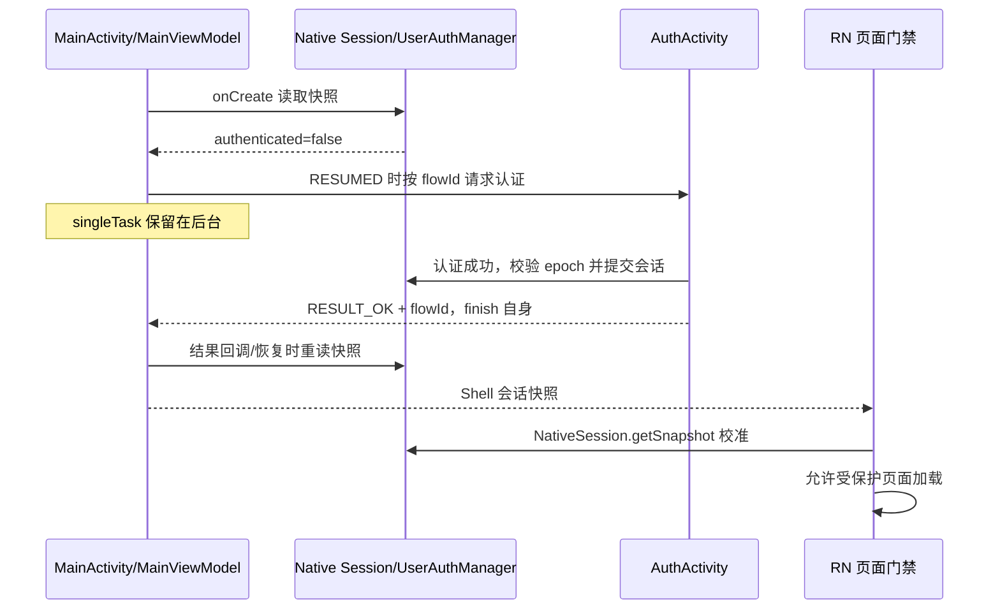

# 登录注册技术方案

## 范围与职责

Android `biz_user` 提供 Native Compose 登录注册；RN 通过受控 Bridge 查询会话并请求 Native 认证，不保存银行凭证。当前没有真实后端，注册与登录仍发送 Retrofit 请求，由 Native MockInterceptor 本地终止并访问 Room。iOS 对等认证能力待实施。

账号持久化、页面表单和登录会话是三种独立状态：Room 记录账号校验值；UserViewModel 保存当前表单；UserAuthManager 保存进程内会话。进程结束后账号保留，会话需要重新建立，不能通过数据库里存在账号推断已登录。

## 分层和组装

| 层 | 当前类/文件 | 职责 |
| --- | --- | --- |
| 平台宿主 | `AuthActivity` | Compose 入口、Activity Result、返回/键盘/整任务退出 |
| 导航与绑定 | `AuthNavHost`、`AuthRoute` | 独立导航条目 VM、状态收集、Toast、成功回调与生命周期 |
| 纯 UI | `AuthFormContent` | 标签、输入、密码显隐、加载、按钮及 Preview |
| VM/契约 | `UserViewModel`、`AuthUiState`、`AuthUiIntent` | 只读状态、输入、校验、防重、请求取消与安全提示 |
| 领域 | `AuthRepository`、`AuthenticatedUser`、`AuthRejectedException` | 无 UI 的认证契约与安全结果 |
| 数据 | `UserRepository`、`UserService` | Retrofit 请求、业务结果解释、会话提交 |
| Native 会话 | `UserAuthManager` | 原子快照、epoch、用户 scope、内存凭证 |
| Mock / 存储 | `MockInterceptor`、`MockAccountStore`、`RoomMockAccountStorage`、`CredentialStore` | 模拟服务端业务、派生校验值、原子持久化 |

`AuthGraph` 构造 Repository 与 ViewModel.Factory。VM 是普通 AndroidX ViewModel，依赖领域接口，不持有 Activity、NavController、DAO 或 Compose 对象。登录注册各自使用 NavBackStackEntry 的 VM，复用类型和表单，不共享输入内容。

## 启动与跨端认证



Native 提前认证不等待 RN 首页挂载。后续 RN 根页及子页默认保护，HelpCenter 是公开例外；失去认证时通过 Host command 请求 Native 登录。Bridge 接受命令的 ACK 只说明命令已接收，不代表登录成功。

MainViewModel 维护 Requested/InFlight/Failed/Canceled/Idle 等认证协调状态；flowId 关联启动与结果，重复请求合并，迟到取消结果不得取消新流程。程序性取消或展示失败后允许公开帮助及显式重试，不在 onResume 无限重拉登录。

MainActivity 生命周期由系统管理；正常认证不主动 finish MainActivity。进程被系统回收仍需通过恢复路径重新确认会话，不能承诺 Activity 对象永远存活。

## 状态、事件与副作用

`AuthUiState` 包含 username、password、isLoading、authenticated、message。输入及提交由 AuthUiIntent 进入 VM；状态只读暴露。

- 提交前校验非空；提交中或 authenticated 后拒绝重复提交。拦截器还有用户名/密码长度上限作为边界校验。
- requestJob 配合 requestVersion 取消、隔离旧表单结果；CancellationException 继续传播，不转为失败 Toast。
- 成功设置 authenticated=true 并清空密码；成功作为状态保留，避免后台成功时一次性事件无人接收。
- AuthRoute 的 UI 使用 collectAsStateWithLifecycle；提示和导航在 RESUMED 收集。message 经 MessageShown 确认消费，onAuthSuccess 每次 Route 绑定只交付一次。
- 页面离开取消请求，清空密码、loading 和提示，保留该条目的用户名及成功事实。密码不进入 SavedState、Bundle 或日志。

表单密码显隐为局部呈现状态，默认隐藏，暂停或提交时重新隐藏。控件在加载/成功后禁用；容器支持滚动、IME、安全区和最大宽度。视觉细节见[认证 UI 说明](../ui/登录注册UI实现说明.md)。

## 注册与登录数据流

```text
AuthFormContent → AuthUiIntent → UserViewModel
  → AuthRepository / UserRepository
  → UserService POST api/user/register 或 api/user/login
  → OkHttp / MockInterceptor（精确 method/path，后台可取消延迟）
  → MockAccountStore → MockAccountStorage Port
  → app 的 RoomMockAccountStorage → lib_storage CredentialStore → Room
  → JSON 模板响应 → Retrofit → Repository 提交会话 → VM 成功状态
```

注册在 Mock 拦截器内完成唯一性检查与持久化，写入完成才返回成功。`insertIfAbsent` 使用数据库唯一键和事务保护并发注册；同名账号返回冲突，不覆盖原密码。存储异常返回失败，不假装注册成功。页面与 Repository 不直接写账号库。

登录通过同一 MockAccountStore 读取同一份 Room 校验记录。用户名 trim 后形成稳定哈希 key，密码按输入原样校验，不 trim。记录由随机盐和 PBKDF2 派生，采用常量时间比较；Room 不保存明文用户名、密码或 Token。认证响应来自分 API JSON 模板，敏感动态字段只在 Native 内部使用。

UserRepository 校验返回身份和必要凭证，在协程仍活动且预期 epoch 未变化时调用原子会话提交；向 VM 返回不含 Token 的 AuthenticatedUser。会话建立同时更新 Native 用户 scope 与 epoch。退出或用户切换使旧认证结果失效。

400/401 对应登录凭据错误等安全提示，409 表示账号冲突；超时、IO 和其他错误分别归一。不要将响应体、异常原文或账号存在性以外的私密数据直接展示或打印。

## 取消、返回与结果不确定

| 情况 | 当前处理 |
| --- | --- |
| 登录切注册 | 创建独立条目 VM；登录密码清空，注册表单不继承账号密码 |
| 注册返回 | 取消/清理注册表单，返回登录 |
| 登录根页返回 | 先收键盘；随后两秒内双击清会话并 finishAffinity 退出整个任务，不回到未认证首页 |
| 表单请求中离开 | 取消 Job、递增请求版本；旧响应不回写新状态 |
| 认证期间退出/切用户 | epoch 校验阻止旧响应重新建立会话 |
| 注册提交后取消 | 取消不能撤回已经提交的 Room 事务；再次注册可能冲突，可使用该账号登录确认，禁止自动重放 |
| 后台返回成功 | 成功事实在状态中，恢复 RESUMED 后交付宿主 |

## 存储、安全与日志

认证数据库为 `entrytask_auth.db`，表 `auth_credentials`，版本 1；封装只暴露 CredentialStore。普通偏好仍由 StorageManager 管理，与账号库、内存会话分离。数据库升级必须显式迁移，不清数据或破坏式重建。完整字段与封装见[Room 认证存储设计](../development/Room认证存储设计.md)。

关键日志记录阶段、错误码、耗时、flowId/requestId；RN 保留独立 Console 诊断。禁止打印用户名表单、密码、Token、完整响应及校验记录。当前本地认证仅适用于演示；真实服务需单独确定后端协议、会话恢复、凭证安全存储、刷新、撤销与发布策略，不能只替换 URL 即上线。

## 验证入口

- VM：独立表单、重复提交、失败恢复、取消、后台成功与 epoch 竞态。
- Mock/Room：注册写后可读、重复注册不覆盖、错误密码、数据库异常、结束进程后再次登录。
- 宿主：提前认证、singleTask 重入、迟到取消、成功返回、登录双击退出、RN 默认门禁及公开 HelpCenter。
- 设备测试使用隔离测试数据库；已有账号设备采用 assembleDebugAndroidTest、覆盖安装和直接 instrumentation，避免卸载目标应用。

源码逐步学习见[登录注册新手指南](../development/登录注册功能新手指南.md)；完整启动链路见[启动源码详解](../development/启动与登录全链路源码详解.md)。本文不保存执行流水。
