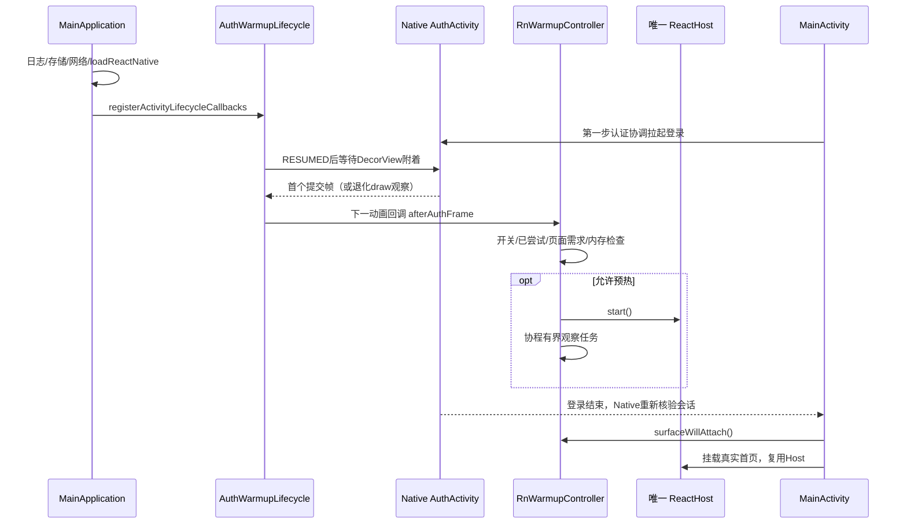

# RN 引擎预热实施全过程与变更记录

记录日期：2026-10-21。对应任务：第二步“RN 引擎预热并验证性能”。

实现基线为 `4518d2c`（第一步：Native 提前认证、RN 默认页面门禁及取消/重入协调），第二步完成提交为 `85af06c9876dd16213e6b0f5ebb35aa4b733661e`，提交说明为“RN 引擎预热”，共18个文件、677行新增、12行删除。本文是该实现与实验的补充记录，不属于该提交原有内容。

本文中的“决策依据”记录可复核的源码事实、工程取舍、实验反馈与优化假设。构建、设备测试和采样均来自第二步执行记录；编写本文时重新核对提交、源码及保留的临时实验产物，没有重新执行这些构建或实验。临时文件可能被系统清理，长期追踪以提交、本文数值摘要与可复现工具为准。

**交付结论：预热能力已实现，默认关闭。** Release 模拟器实验观察到首页返回耗时中位数小幅下降，但范围重叠、样本少，同时认证阶段进程 PSS 增加，尚不足以认定存在稳定收益。保留构建开关，继续在真机评估。

相关入口：[性能报告与复现](rn-warmup-performance.md)、[架构决策](../adr/012-rn-engine-warmup.md)、[完整启动与登录链路](启动与登录全链路源码详解.md)。

## 1. 需求、假设与边界

第一步已让 MainActivity 在加载首页之前检查 Native 会话，未登录先启动 AuthActivity；RN 默认页面仍通过 Bridge 校验会话并协调登录。这避免必须先加载 RN 页面才能拉起登录。

第二步要验证的假设是：用户在 Native 登录界面停留时，提前初始化同一个 RN 引擎，能否减少登录返回首页的等待，同时不影响登录首帧、认证正确性和宿主稳定性。

实施约束如下：

- 每进程仍只有一个 ReactHost/RN instance；真实首页继续复用它。
- 预热只调用引擎启动，不挂载 ReactFragment/Surface，不提前创建业务图、VM或执行首页 API。
- MainActivity 保留 XML、MVVM、singleTask 及原有认证协调；不将本步扩大为 Compose 改造。
- 保持 `src/index.js`、`EntryTask`、`com.entrytask`、Codegen 与官方 CLI 约定。
- Native-only 首页路径仍可用；低内存时可以跳过可选预热。
- 已开始的引擎属于进程，不因为登录取消或 Activity 暂停而销毁。
- 普通 Native Mock 仍按原方案随机延迟1～3秒；不修改延迟来制造性能改善。
- iOS 本步未实施；共享 Bridge 签名、契约和 Mock 资源没有变更。

## 2. 源码核查与方案选择

### 2.1 修改前核查

先检查 Git 状态与根、Android、RN 协作规则，再阅读 MainApplication、MainActivity、HomeFragment、认证 Activity、宿主协调以及入口组装代码。重点确认：当前 Host 的所有权、认证后何时挂载根 Fragment、入口求值是否提前创建业务依赖，以及恢复 Fragment 的路径。

同时检查安装版本 RN 的 `ReactHost`、`ReactHostImpl`、`DefaultReactHost`、`TaskInterface` 实现与 Android 帧提交接口，得到以下设计依据：

| 核查事实 | 对方案的影响 |
| --- | --- |
| 已存在进程级懒加载 `MainApplication.reactHost` | 直接复用 `reactHost.start()`，不构造另一个 Host |
| 默认 Release Host 异常回调会抛出异常 | 无 Surface 的可选预热需要窄范围异常隔离；页面接管后保留原异常语义 |
| RN 公开 TaskInterface 没有本方案所需的 continuation 接口 | 采用协程25ms间隔观察，30秒上限，不在主线程等待任务完成 |
| 公开 start 任务完成与 JS 队列完成不是同一时点 | `READY` 只能描述该任务，不作为 JS、bootstrap、首页就绪的证明 |
| `onActivityResumed` 可能发生在 DecorView 附着前 | 先观察附着，再判定硬件绘制并注册帧回调 |
| API29以上硬件绘制可观察 FrameCommit | 将它作为认证帧提交的时点；旧API/软件绘制明确退化语义 |
| RN 入口注册与 App 挂载可分离 | 增加入口回归测试，保证预热不启动业务图和 Native 握手 |

RN 实现可在依赖安装后从 `node_modules/react-native/ReactAndroid/src/main/java/com/facebook/react/` 下的同名类复核。这里只读取框架源码，没有修改依赖或生成文件。

### 2.2 方案比较与取舍

| 候选方案 | 评估结果与选择依据 |
| --- | --- |
| Application.onCreate 直接启动引擎 | 可能与 Native 启动和登录首帧争抢资源，本步不选 |
| MainActivity.onCreate 立即启动 | 仍早于认证可见帧，无法优先保护登录首帧，本步不选 |
| 登录页后面提前挂载 RN 首页 | 会引入业务图、订阅、数据请求及页面生命周期工作，超出引擎预热边界 |
| 登录帧提交后，下一动画回调启动现有 Host | 选定：触发点可解释、能复用唯一 Host、能独立开关验证 |
| 创建专用预热 Host | 违反单 instance 约束，不采用 |
| 登录取消即销毁引擎 | 共享资源可能正被真实页面接管，不采用 |
| 只比较 Debug/Metro 体验 | 受开发服务、调试与 Bundle 传输影响，仅用于功能排障；正式比较使用 Release 内置 Bundle |

这项优化只是把部分工作前移，并没有消除引擎启动成本。是否默认开启，需要同时考虑首页收益、认证输入流畅性与内存成本，而不是只看引擎是否 READY。

## 3. 最终实现与方法调用链



### 3.1 Application 组装

[MainApplication.kt](../../android/app/src/main/java/com/entrytask/MainApplication.kt)：

1. 创建进程级 `CoroutineScope(SupervisorJob() + Dispatchers.Main.immediate)`，承载启动任务观察。
2. 懒加载 `rnWarmup`，注入开关、时钟、日志、实际启动引擎的适配函数。
3. 适配函数调用现有 `reactHost.start()`，把公开任务状态映射为 `READY/FAILED/CANCELED`；未完成返回空状态。
4. `onCreate()` 保留既有日志、存储、网络和 `loadReactNative(this)`，随后注册认证生命周期观察器。注册观察器本身不会调用 `reactHost.start()`。
5. 回调先检查 `HomeFragment.usesReactNative()`；Native-only 路径不预热。
6. 判断 `ActivityManager.isLowRamDevice` 与进程已观察到的内存压力，传给控制器。
7. `onLowMemory`、`onTrimMemory` 记录压力；`TRIM_MEMORY_UI_HIDDEN` 只表示后台，不计为内存不足。标记在该进程内保持，不主动销毁已启动的引擎。

### 3.2 登录首帧与生命周期适配

[AuthWarmupLifecycle.kt](../../android/app/src/main/java/com/entrytask/shell/runtime/AuthWarmupLifecycle.kt)：

1. `onActivityCreated` 仅为 AuthActivity 记录首次创建时刻。
2. `onActivityResumed` 为当前认证 Activity 建立 `FrameRegistration`；重复注册先关闭旧对象。
3. `FrameRegistration.start()`：DecorView 已附着则注册，否则用附着监听延后注册。
4. `register()`：API29以上且硬件加速，注册 FrameCommitCallback；否则使用 OnDrawListener，并在 traversal 后切回主线程。
5. 帧回调记录当时的 `elapsedRealtime()`；涉及状态和 View 的操作统一切回主线程。
6. `schedule()` 防止重复观察，记录帧时间，再通过 `postOnAnimation` 在下一动画回调触发预热。
7. `onActivityPaused/onActivityDestroyed → close()`：撤销附着监听、绘制监听、帧提交回调和未执行的预热 Runnable；已排队回调也检查 `closed`。
8. `AuthFrameTiming` 只保存首次创建、首次帧时间与硬件提交标记，数据有界，不记录账号表单。

硬件帧提交表示提交到交换链，不代表物理屏幕已经显示；退化路径只保证观察到 draw traversal 后调度，不能称为同等的硬件首帧证据。

### 3.3 纯控制器与状态语义

[RnWarmupController.kt](../../android/app/src/main/java/com/entrytask/shell/runtime/RnWarmupController.kt) 不持有 Activity、View 或 ReactHost，只接收适配函数，便于独立验证。

| 条件/事件 | 处理和后续语义 |
| --- | --- |
| 开关关闭、已尝试启动、真实 Surface 已请求 | `afterAuthFrame()` 返回，不发起推测性启动 |
| 尚未启动且低内存 | 发布 `SKIPPED_MEMORY`，不调用引擎；不设置 attempted，后续回调可再次评估 |
| 允许启动 | 先设置 attempted，发布 RUNNING，再启动引擎；每进程最多实际预热启动一次 |
| 任务完成 | 发布 READY、FAILED 或 CANCELED，附开始/结束时间 |
| 观察满30秒 | 发布 TIMED_OUT，只停止观察，不销毁 Host，不自动重试 |
| 协程取消 | 发布 CANCELED 并继续传播取消；登录取消本身不取消进程 scope |
| 普通 Exception | 发布 FAILED；不把所有 Throwable/OOM 当作可恢复失败 |
| `surfaceWillAttach()` | 记录真实页面需求，阻止之后再启动预热，同时结束预热专属异常隔离范围 |

READY 表示 RN 公开 start 任务完成，实例初始化、Bundle 已调度；不表示 JS 求值全部完成、业务依赖构建完成、Bridge bootstrap 完成或页面绘制完成。RN 框架会在 JS 队列上继续执行相关工作，不能用 READY 替代端到端指标。

### 3.4 真实页面接管与失败隔离

[MainActivity.kt](../../android/app/src/main/java/com/entrytask/MainActivity.kt) 的 `bindRootHost()` 在创建或复用 HomeFragment 之前调用 `surfaceWillAttach()`。另外 `onCreate()` 在设置布局后检查框架是否已恢复根 Fragment；存在则立即标记真实页面需求，避免恢复路径仍被当成“无 Surface 预热”。

`MainApplication.reactHost` 的异常回调只有在 `attempted && !surfaceRequested` 时隔离可选预热异常，记录 `RN_PRELOAD_FAILED` 和异常类名。真实页面接管后重新抛出，保持原宿主错误语义。控制器不自行实现引擎销毁/重建，由 RN 框架处理失败实例；这不构成对所有故障可恢复的承诺。

日志使用独立 Native `MLog`、tag `EntryTask.RNStartup`，记录阶段、耗时和错误码，不依赖 RN 业务图初始化成功。Release 保持现有 WARN 等级，因此普通 running/ready 信息不一定出现在 Release Logcat；正式测试通过 instrumentation 返回数值，不能以缺少 INFO 日志判断预热没执行。

## 4. 实施过程与调整记录

以下按处理阶段记录，没有为中间状态创建额外 Git 提交；可追踪的最终代码是 `4518d2c..85af06c`。

| 阶段 | 执行动作 | 发现与调整 |
| --- | --- | --- |
| P01 基线核查 | 检查状态、规则、宿主/认证/RN入口/框架任务实现 | 明确引擎预热与页面预挂载的边界 |
| P02 核心实现 | 新建控制器和生命周期适配，接入现有 Host | 加入一次启动、低内存跳过、有界观察、异常隔离和 Surface 接管 |
| P03 生命周期校正 | 审查首帧回调 | 修正 RESUMED 时 Decor 尚未附着的问题；帧时间取实际回调时刻，预热仍在下一动画回调 |
| P04 自动验证 | 增加 Native 控制器测试、RN入口测试 | 防止重复启动、失败重试、超时销毁和业务图提前创建 |
| P05 实验工具 | 构建 Release A/B 与专用 instrumentation | 专用性能源码显式加入，不混入普通设备测试；从目标 app 的控制器读取开关，避免测试 APK 常量内联污染分组 |
| P06 预实验 | Accessibility 查询首页可见状态 | 查询涉及跨进程/空闲等待，观测时点不适合精确首页帧比较；停止该轮，修改测量工具 |
| P07 正式3秒场景 | 应用内检查布局，再观察下一提交帧；5对样本 | 保留4个返回时仍 RUNNING 的预热样本，没有只选 READY 样本 |
| P08 补充8秒场景 | 固定8000ms目标停留，独立3对样本 | 记录 actualDwellMs；全部预热任务READY，但首页收益仍小且波动重叠 |
| P09 默认策略 | 综合时间、内存和环境限制 | 将预热默认值定为false，保留显式启用能力 |
| P10 功能回归与收尾 | 开启预热运行认证/宿主回归、官方CLI两种配置 | 最后补充恢复 Fragment 的真实需求标记并定向复验；装回默认 Debug 配置，更新设计与说明 |

预实验测量方法的变化是**测量修正**，不是应用本身的优化收益；无法从这些数据单独量化 Accessibility/RPC 等待占用了多少毫秒。

## 5. 执行命令、输出与产物

以下记录有效命令及其用途。没有日志保留完整参数的步骤只记录可核实动作，不补造终端记录。构建耗时受缓存和机器负载影响，仅描述工程验证，不是应用启动耗时。

### 5.1 基线与 RN 检查（仓库根目录）

```sh
git status --short
adb devices -l
curl -s http://localhost:8081/status
npm run typecheck
npm run lint
npm run architecture:check
npm test -- --runInBand --watchman=false
npx prettier --write __tests__/infrastructure/entryWarmup.test.ts
PYTHONPYCACHEPREFIX=/tmp/entrytask-python-cache python3 -m py_compile tools/benchmark-rn-warmup.py
git diff --check
```

Metro 已运行，状态返回 `packager-status:running`。typecheck、lint、架构检查通过；Jest 9套/26项通过。Watchman 受本机状态目录权限限制，采用 Jest 的 `--watchman=false`，没有跳过失败用例。Python 工具语法检查通过。

### 5.2 Debug 基础构建（android 目录）

```sh
./gradlew :app:testDebugUnitTest :app:generateCodegenArtifactsFromSchema :app:assembleDebug :app:lintDebug -PreactNativeArchitectures=arm64-v8a --max-workers=2
```

输出 `BUILD SUCCESSFUL in 2m 31s`；408 tasks，161 executed、247 up-to-date。用于验证实现、Codegen、Debug 编译和 Lint，不产生性能收益结论。

### 5.3 构建与保存 Release A/B（android 目录）

```sh
./gradlew :app:assembleRelease -PentrytaskTestBuildType=release -PentrytaskRnWarmup=false -PreactNativeArchitectures=arm64-v8a --max-workers=2
cp app/build/outputs/apk/release/app-release.apk /tmp/entrytask-warmup-baseline.apk
./gradlew :app:assembleRelease :app:assembleReleaseAndroidTest -PentrytaskTestBuildType=release -PentrytaskPerformanceTests=true -PentrytaskRnWarmup=true -PreactNativeArchitectures=arm64-v8a --max-workers=2
cp app/build/outputs/apk/release/app-release.apk /tmp/entrytask-warmup-enabled.apk
```

关闭组初次构建3m38s，375 tasks（310执行）；最终同源基线重建15s（8执行、367 up-to-date）。开启组及测试包构建39s，403 tasks（43执行、360 up-to-date）。每次先另存，避免被下一次构建覆盖。

修改测量方法、增加停留参数后，分别重新构建测试包：

```sh
./gradlew :app:assembleReleaseAndroidTest -PentrytaskTestBuildType=release -PentrytaskPerformanceTests=true -PentrytaskRnWarmup=true -PreactNativeArchitectures=arm64-v8a --max-workers=2
```

保留的三次测试包构建记录分别为3s、3s、2s，均成功。检查两份采样 APK 均包含 `assets/index.android.bundle`、43个 Mock 资源文件、36个契约文件。本步未修改资源打包逻辑，这项检查用于确认 Release 实验没有因缺 Bundle/Mock 失真。

### 5.4 采样命令

预实验以 `--runs 5` 启动，输出到 `/tmp/entrytask-warmup-results.json`，中途停止，实际临时 JSON 保留5个完成样本；没有完成5对。停止针对本次采样进程，没有清空应用数据。

正式3秒场景在仓库根目录执行：

```sh
python3 tools/benchmark-rn-warmup.py --serial emulator-5554 --baseline-apk /tmp/entrytask-warmup-baseline.apk --warmup-apk /tmp/entrytask-warmup-enabled.apk --test-apk android/app/build/outputs/apk/androidTest/release/app-release-androidTest.apk --runs 5 --output /tmp/entrytask-warmup-frame-results.json
```

补充8秒场景执行时位于 android 目录：

```sh
python3 ../tools/benchmark-rn-warmup.py --serial emulator-5554 --baseline-apk /tmp/entrytask-warmup-baseline.apk --warmup-apk /tmp/entrytask-warmup-enabled.apk --test-apk app/build/outputs/apk/androidTest/release/app-release-androidTest.apk --runs 3 --dwell-ms 8000 --output /tmp/entrytask-warmup-long-results.json
```

工具内部的关键命令如下（大写 APK 参数表示对应实际路径；当前版本显式传停留参数，早期3秒版本采用用例默认值）：

```sh
adb -s emulator-5554 install -r TEST_APK
adb -s emulator-5554 shell am force-stop com.entrytask
adb -s emulator-5554 install -r CANDIDATE_APK
adb -s emulator-5554 shell am instrument -w -r -e warmupDwellMs 3000 -e class com.entrytask.shell.RnWarmupPerformanceTest com.entrytask.test/androidx.test.runner.AndroidJUnitRunner
```

首次安装测试 APK，之后每个样本 force-stop 目标应用、覆盖安装对应组 APK、启动独立 instrumentation。奇数轮先关后开，偶数轮先开后关。工具检查唯一 `warmupSample`、`OK (1 test)`、无测试失败且开关匹配，每个样本完成立即写 JSON；未使用卸载或 `pm clear`。

### 5.5 开启预热的功能回归（android 目录）

```sh
./gradlew :app:testDebugUnitTest :biz_user:testDebugUnitTest :app:generateCodegenArtifactsFromSchema :app:lintDebug :app:connectedDebugAndroidTest -PentrytaskRnWarmup=true -Pandroid.testInstrumentationRunnerArguments.class=com.entrytask.shell.StartupAuthenticationTest,com.entrytask.shell.ShellHostTest -PreactNativeArchitectures=arm64-v8a --max-workers=2
```

3m51s成功，441 tasks（55执行、386 up-to-date）；app 22项、biz_user 5项单元测试通过；设备认证/宿主6项通过。

最后增加恢复 Fragment 需求标记后执行：

```sh
./gradlew :app:testDebugUnitTest :app:lintDebug :app:connectedDebugAndroidTest -PentrytaskRnWarmup=true -Pandroid.testInstrumentationRunnerArguments.class=com.entrytask.shell.ShellHostTest#xmlRootTagIsReusedAfterActivityRestoration -PreactNativeArchitectures=arm64-v8a --max-workers=2
```

1m9s成功，436 tasks（22执行、414 up-to-date）；定向恢复用例1项通过。这是上述用例的复验，不应累计为第7个不同的功能用例。当前本地设备测试 XML 可能只保留最后定向结果，完整6项以当次回归记录为准。

### 5.6 官方 CLI 与默认配置恢复（仓库根目录）

```sh
npx react-native run-android --no-packager --active-arch-only --extra-params=-PentrytaskRnWarmup=true
npx react-native run-android --no-packager --active-arch-only
rg 'RN_WARMUP_ENABLED' android/app/build/generated/source/buildConfig/debug/com/entrytask/BuildConfig.java
adb -s emulator-5554 logcat -d -s EntryTask.RNStartup EntryTask.MainActivity
```

两次均完成构建、安装、启动；Gradle 分别9s、20s。Metro 已运行，因此使用 `--no-packager`，`--active-arch-only` 限定本次设备 ABI，并未替换官方 CLI 启动方式。最后生成字段核实为 `RN_WARMUP_ENABLED = false`。

开启 Debug 时观察顺序为：Native 检查未登录 → shell创建/恢复 → 发起登录 → warmup.running → warmup.ready；一次 READY 观察耗时5366ms。这是 Debug + Metro 环境中的公开任务时长，不能与 Release 端到端首页指标混算，也不能说业务页面在5366ms就绪。

### 5.7 执行偏差与处理

| 现象 | 处理 | 是否应用缺陷 |
| --- | --- | --- |
| 曾在根目录执行 `./gradlew`，exit127 | 切换 android 目录执行同一任务 | 否，命令工作目录错误 |
| Python 默认编译缓存写到沙箱外被拒绝 | 指定 `/tmp/entrytask-python-cache` 后语法检查通过 | 否，工具缓存权限限制 |
| Gradle daemon metaspace/弃用接口警告 | 构建成功；未为消除警告扩大修改 JVM 或升级依赖 | 非本次性能收益依据 |
| Accessibility 观察引入等待因素 | 停止预实验，改用应用内布局与下一帧提交 | 测量方案问题，正式数据单独采集 |

## 6. 性能实验口径

环境：Pixel_10 Android17/API37 模拟器、arm64-v8a、Hermes、Release 内置 Bundle。保持原有 R8 关闭配置及演示签名。宿主共享负载，未控制 OS 页缓存、温度及其他进程；每个样本是新目标进程，不代表 OS 缓存冷态或生产发布认证。

| 字段 | 起止/含义 | 不能代表的内容 |
| --- | --- | --- |
| launchToAuthFrameMs | instrumentation 已创建 Application 后，请求 MainActivity到认证帧提交 | 包含Application初始化的完整冷启动 |
| authCreateToFrameMs | AuthActivity创建到认证帧提交 | 预热收益：该帧发生在预热之前 |
| dwellMs | 认证帧之后的目标停留，固定3000或8000ms | 精确实际停留；还有主线程检查和PSS采样开销 |
| actualDwellMs | 认证帧到提交内存会话/关闭认证前的时刻差 | 3秒旧版本没有采集，不能补造 |
| returnToHomeFrameMs | 提交内存会话/请求关闭认证，到首页“搜索”已布局后下一提交帧 | 物理显示、TTI、首页数据全部加载完成 |
| authPssKb | 登录返回前 `Debug.getMemoryInfo().totalPss`，单位KiB | 引擎独占内存、峰值内存；它包含测试工具开销 |
| warmupDurationMs | 控制器开始到公开start任务终态的观察时长 | JS全部求值或页面渲染时长；有25ms观察粒度 |

测试以25ms间隔检查状态，最长30秒；Native 认证提交使用测试内存会话，不进行账号输入、密码计算或登录 Mock 请求。真实 RN 首页仍走原有 bootstrap、门禁及 Native Mock，但首页帧观测不等待所有业务数据就绪。工具观察到“搜索”布局后主动请求一帧并记录提交，所以是包含观察/调度开销的上界代理。

固定停留后即返回，不等待 READY 再放行；否则会选择性美化预热组。3秒与8秒是两种用户停留假设，分别统计，不混合。AB/BA降低固定顺序偏差，不能消除缓存与系统负载影响。

## 7. 数据与结论

### 7.1 预实验：仅记录测量调整背景

保留文件中共5个已完成样本；首页字段当时为 `returnToHomeObservedMs`，与正式 Frame 字段不同，因此全部不纳入正式统计，也不按数值大小选择性剔除。

| 轮次 | 预热 | 认证帧ms | 首页观测ms | PSS KiB | 任务阶段 |
| --- | --- | --- | --- | --- | --- |
| 1 | 关 | 7629 | 8817 | 64584 | IDLE |
| 1 | 开 | 8854 | 8499 | 69046 | READY |
| 2 | 开 | 8488 | 5625 | 63884 | RUNNING |
| 2 | 关 | 8624 | 5683 | 60364 | IDLE |
| 3 | 关 | 9575 | 7147 | 60941 | IDLE |

### 7.2 正式采样：全部16个成功样本

所有样本 `debug=false`、`hardwareFrameCommit=true`；无失败/跳过，不删除离群值。PSS为进程总KiB。下表的样本顺序保留AB/BA执行顺序。

| 停留目标ms | 轮次 | 预热 | 认证帧ms | 首页帧ms | PSS KiB | 返回时阶段 | 实际停留ms | 任务完成ms |
| --- | --- | --- | --- | --- | --- | --- | --- | --- |
| 3000 | 1 | 关 | 7491 | 6551 | 64995 | IDLE | 未采集 | — |
| 3000 | 1 | 开 | 9592 | 7305 | 67463 | RUNNING | 未采集 | — |
| 3000 | 2 | 开 | 8814 | 5722 | 68818 | RUNNING | 未采集 | — |
| 3000 | 2 | 关 | 8268 | 6009 | 64449 | IDLE | 未采集 | — |
| 3000 | 3 | 关 | 8318 | 8424 | 64656 | IDLE | 未采集 | — |
| 3000 | 3 | 开 | 6666 | 5524 | 74250 | RUNNING | 未采集 | — |
| 3000 | 4 | 开 | 9870 | 8607 | 71240 | RUNNING | 未采集 | — |
| 3000 | 4 | 关 | 7714 | 6181 | 61545 | IDLE | 未采集 | — |
| 3000 | 5 | 关 | 8532 | 5936 | 60581 | IDLE | 未采集 | — |
| 3000 | 5 | 开 | 7648 | 5755 | 73353 | READY | 未采集 | 2211 |
| 8000 | 1 | 关 | 8689 | 3576 | 64659 | IDLE | 8045 | — |
| 8000 | 1 | 开 | 7697 | 5771 | 69496 | READY | 8052 | 2194 |
| 8000 | 2 | 开 | 7471 | 4685 | 69782 | READY | 8096 | 2075 |
| 8000 | 2 | 关 | 7754 | 7253 | 57201 | IDLE | 8078 | — |
| 8000 | 3 | 关 | 8802 | 5140 | 64666 | IDLE | 8059 | — |
| 8000 | 3 | 开 | 7711 | 4945 | 73331 | READY | 8072 | 3570 |

### 7.3 分组汇总与解释

| 场景/指标 | 关：中位数（最小～最大） | 开：中位数（最小～最大） |
| --- | --- | --- |
| 3秒，每组5次；认证帧ms | 8268（7491～8532） | 8814（6666～9870） |
| 3秒：首页帧ms | 6181（5936～8424） | 5755（5524～8607） |
| 3秒：PSS MiB | 62.9（59.2～63.5） | 69.6（65.9～72.5） |
| 8秒，每组3次；认证帧ms | 8689（7754～8802） | 7697（7471～7711） |
| 8秒：首页帧ms | 5140（3576～7253） | 4945（4685～5771） |
| 8秒：PSS MiB | 63.1（55.9～63.2） | 68.1（67.9～71.6） |

计算方式：首页相对下降比例为 `(关闭中位数－开启中位数) / 关闭中位数`；MiB为KiB除以1024。

- 3秒：首页中位数减少426ms，约6.9%；PSS中位数增加6791KiB，约6.6MiB。预热组只有1/5返回时READY，其余4/5仍RUNNING。
- 8秒：首页中位数减少195ms，约3.8%；PSS中位数增加5123KiB，约5.0MiB。3/3返回时READY，任务完成2075～3570ms；实际停留8045～8096ms。
- 两个场景首页范围都明显重叠；8秒READY比例提高但收益仍小，说明公开任务完成不能单独解释全部首页等待。
- 认证帧在预热开始之前，组间差异不能归因为预热。这些差异也提示环境噪声较大。
- 样本量不足以给出稳定的p95、统计显著性或跨设备结论。当前数据支持继续评估，而非默认启用或承诺节省固定时长。

最终保留 `entrytaskRnWarmup=false`。若以后启用，仍需证明输入帧质量和低端机稳定性可接受；不能仅因功能用例通过而判定性能优化成功。

## 8. 逐文件代码变更说明

下列相对路径均相对于仓库根目录；状态以第二步提交相对第一步为准。

| 文件 | 状态 | 主要变更/方法 | 原因与影响 |
| --- | --- | --- | --- |
| `android/app/src/main/java/com/entrytask/shell/runtime/RnWarmupController.kt` | 新增 | afterAuthFrame、surfaceWillAttach、handlesPreloadException；WarmupHandle/Phase/Snapshot | 把启动策略与Android/RN具体类分离；一次启动、有界异步观察、低内存跳过与可测状态 |
| `android/app/src/main/java/com/entrytask/shell/runtime/AuthWarmupLifecycle.kt` | 新增 | ActivityLifecycleCallbacks、FrameRegistration、AuthFrameTiming | 认证首帧后触发，处理附着/线程/暂停清理；有界诊断数据 |
| `android/app/src/main/java/com/entrytask/MainApplication.kt` | 修改 | runtimeScope、rnWarmup、reactHost异常适配、onCreate注册、内存回调 | 在组装根复用唯一Host；日志与内存策略不依赖RN业务初始化 |
| `android/app/src/main/java/com/entrytask/MainActivity.kt` | 修改 | onCreate恢复检查、bindRootHost前置需求标记 | 真实页面接管后禁止推测启动与预热错误隔离；保留原认证/MVVM/XML结构 |
| `android/app/src/main/java/com/entrytask/home/HomeFragment.kt` | 修改 | companion usesReactNative() | 对外只读查询已有Native-only开关，不改变开关默认路径 |
| `android/app/build.gradle` | 修改 | RN_WARMUP_ENABLED、testBuildType、条件benchmark源集 | 同变体A/B、默认关闭；性能测试不影响日常设备回归，无新增产品flavor |
| `android/app/src/test/java/com/entrytask/shell/RnWarmupControllerTest.kt` | 新增 | 5项控制器行为测试 | 一次启动、禁用/已有页面、低内存、失败隔离、超时不重试/不销毁 |
| `android/app/src/benchmark/java/com/entrytask/shell/RnWarmupPerformanceTest.kt` | 新增 | coldLoginToHomeSample、await | 新进程/固定停留、首页未预挂载断言、帧与PSS采样、同Host校验 |
| `__tests__/infrastructure/entryWarmup.test.ts` | 新增 | 实际入口求值回归 | 只注册EntryTask，不创建业务图、不触发Native bootstrap/session/log握手 |
| `tools/benchmark-rn-warmup.py` | 新增 | main、adb调用适配、AB/BA循环、JSON与中位数 | 自动覆盖安装和新进程采样，校验分组与结果；每次落盘便于追踪 |

没有修改 RN 生产页面/VM/Repository、认证 Bridge 协议、网络通路、共享 Mock、iOS、依赖锁文件或包名；RN侧本步新增的是入口回归测试。测试内存会话用于排除真实认证输入和网络的影响，不是产品登录流程的新实现。

### 8.1 配套文档变更（另外8个文件）

| 文件 | 第二步变更说明 |
| --- | --- |
| `android/README.md` | 补充可选预热、默认关闭及验证入口 |
| `src/README.md` | 说明预热只加载引擎/入口，业务图在App挂载后创建 |
| `docs/adr/011-required-native-authentication.md` | 与第二步预热边界关联，保持提前认证决策 |
| `docs/adr/012-rn-engine-warmup.md` | 新增预热时点、生命周期、异常、开关及默认策略决策 |
| `docs/design/Android 技术方案.md` | 补充引擎预热与验证的技术约束 |
| `docs/design/前端RN技术方案.md` | 补充入口求值与业务挂载分离的协作要求 |
| `docs/development/启动与登录全链路源码详解.md` | 更新引擎预热与认证后Surface加载的调用链 |
| `docs/development/rn-warmup-performance.md` | 新增实验口径、复现、全部正式样本、结论及限制 |

本次文档任务新增本文，并在性能报告与预热ADR增加本文链接，修正性能报告样本表排版及预实验描述；没有再修改实现代码。

## 9. 验证覆盖与仍未验证的风险

| 验证层 | 第二步结果 | 证明范围 |
| --- | --- | --- |
| RN静态检查/架构检查 | 通过 | 类型、Lint与现有脚本覆盖的导入边界 |
| Jest | 9套26项通过 | 包含新增入口回归，不等于所有第三方模块求值无副作用 |
| Native单元测试 | app22项、biz_user5项通过 | 包含新增5项预热控制器测试 |
| Codegen/构建/Lint | Debug/Release及Debug Lint通过 | 当前环境、arm64-v8a及实际任务覆盖范围 |
| 开启预热的认证/宿主设备回归 | 6项通过，恢复用例另复验1次 | 已有取消、重入、宿主恢复等用例在开启预热时未回归 |
| Release性能采样 | 正式16项成功，未跳过 | API37模拟器、两种固定停留、内存会话及当前观测代理 |
| 官方CLI | 开启和默认关闭均启动，最后恢复默认关闭 | 官方入口与安装约定一致 |

尚未完成：真机、多ABI、低端机、认证真实输入过程帧抖动、峰值内存、长时间后台、系统回收后的完整跨进程恢复、iOS对等实现。现有测试不能证明 Native fatal/OOM 可恢复，也不能证明超时后的RN一定能恢复正常页面。

性能采样之后，仅补充了恢复 Fragment 的真实页面需求标记；冷启动性能用例没有命中该恢复分支。表中性能属于当时采样的APK，不应直接当作最终提交重新构建包的性能认证。后续候选包应重新采样。

## 10. 后续优化方案（待实施）

| 优先级 | 方案/待验证假设 | 执行与验收方向 |
| --- | --- | --- |
| P0 测量分段 | 当前start READY不能解释首页全部延迟 | 分别标记Native认证帧、start任务、JS执行阶段、App挂载、bootstrap、首页布局/帧、数据就绪；只记录白名单字段与关联编号，避免观测改变热路径 |
| P0 真机对照 | 模拟器负载可能掩盖或放大收益 | 至少覆盖低/中/高档真机，相同Release候选包、ABI和数据；预先约定重复次数、异常处理和收益阈值，保留失败/慢样本，观察分布而非只看中位数 |
| P0 输入与内存 | 前移CPU工作可能影响输入，PSS增加可能触发回收 | 使用Perfetto/系统帧指标评估登录输入掉帧、CPU竞争、峰值PSS及后台恢复；只有收益稳定且资源预算可接受才考虑默认开启 |
| P1 JS入口成本 | 即使不挂业务图，模块import仍可能有求值成本 | 通过分析工具定位真实热点，再按需延后非必要模块初始化；保留入口测试，新增针对实际副作用的回归，不盲目拆分所有import |
| P1 首页关键路径 | 登录返回的耗时可能主要在Surface/bootstrap/渲染 | 根据分段证据优化关键路径、渲染或依赖创建；保持认证在先，不通过未经授权预取账户数据换取表面收益 |
| P1 预热时机 | 首帧下一回调不一定适合所有设备与输入行为 | 有帧与CPU证据后比较更晚触发/条件触发；不得以任意固定延时替代生命周期与需求接管，也不重新创建runtime |
| P2 诊断完善 | Release INFO被过滤，不便直接观测普通阶段 | 如有产品需求，设计有界、脱敏、可控采样的诊断通道；不直接提升全量日志等级或打印认证/网络body |
| P2 稳定性专项 | 当前自动测试覆盖不足以评价低内存与跨进程恢复 | 补齐真实系统压力、后台回收、取消后重入与异常注入；区分观察超时、任务失败、真实页面故障 |

这些是后续工作方向，不属于本次已完成优化。是否引入新的JS marker、trace工具或运行时开关，需要单独评估公开API兼容性、性能开销与权限边界。

## 11. 复查与追踪方法

查看第二步完整差异：

```sh
git show --stat 85af06c
git diff 4518d2c 85af06c -- android/app/src/main/java/com/entrytask
git diff 4518d2c 85af06c -- android/app/build.gradle __tests__/infrastructure/entryWarmup.test.ts tools/benchmark-rn-warmup.py
```

默认根目录命令仍为 `npx react-native run-android`。显式评估预热使用 `npx react-native run-android --extra-params=-PentrytaskRnWarmup=true`；撤销后重新执行默认命令。开关属于构建配置，不从外部Intent、账号或持久化设置读取。重做性能实验请使用第5节的独立Release APK和测试工具，不用Debug数值替代。

采样APK SHA-256：

- baseline：`4b333735ee2896556cc97fd490cfe7962f2d1d4130f70e23d9d46e23b568ea6e`
- enabled：`9f7c24d777a53076beb2e2d5c336976fd7b42772707d9ca64f37ac5fff373ecb`

原临时产物命名如下，便于本机仍保留时复核；不把APK、原始设备日志或账号资料提交仓库：

| 产物 | 临时文件名 |
| --- | --- |
| 预实验/正式3秒/补充8秒数值 | `/tmp/entrytask-warmup-results.json`、`entrytask-warmup-frame-results.json`、`entrytask-warmup-long-results.json`（后两项也在/tmp） |
| 构建记录 | `entrytask-warmup-debug.log`、`entrytask-warmup-baseline-build.log`、`entrytask-warmup-baseline-final.log`、`entrytask-warmup-enabled-build.log` |
| 测试包构建记录 | `entrytask-warmup-benchmark-build.log`、`entrytask-warmup-frame-test-build.log`、`entrytask-warmup-long-test-build.log` |
| 实验控制台记录 | `entrytask-warmup-benchmark.log`、`entrytask-warmup-frame-benchmark.log`、`entrytask-warmup-long-benchmark.log` |
| 功能/恢复/CLI记录 | `entrytask-warmup-regression.log`、`entrytask-warmup-restoration.log`、`entrytask-warmup-cli-enabled.log`、`entrytask-warmup-cli-default.log` |

以上log也位于/tmp，仅作执行证据索引；本文保留了关键输出与全部正式数值，不要求读者依赖临时目录才能理解方案。
