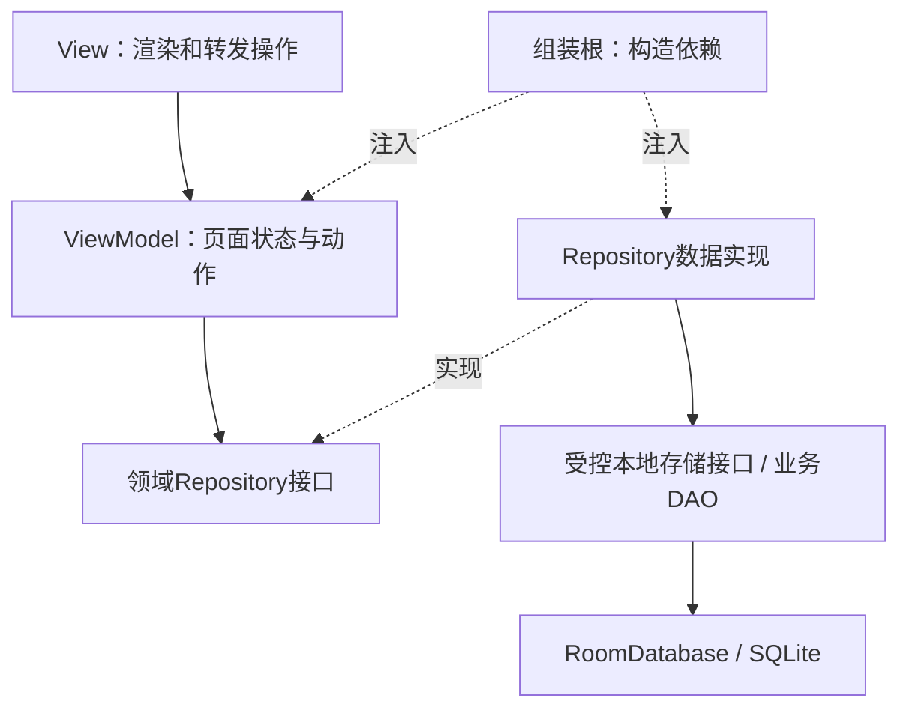
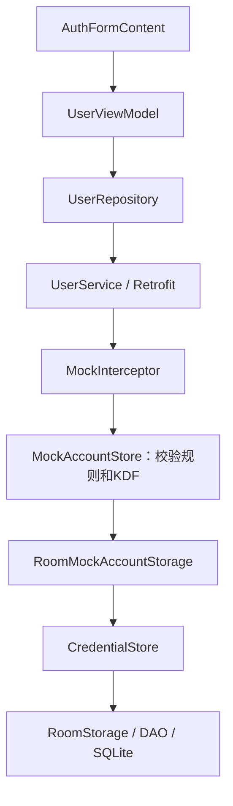

# Room 新手使用指南：从基础到业务接入

适用对象：刚接触 Kotlin、Android 数据库和分层架构的开发者。

本文以 EntryTask 当前源码为主线：先理解 Room，再读懂 `lib_storage` 的封装，最后学习怎样为新业务设计持久化。**“当前实现”都附有源码链接；“教学示例”只写在文档中，未新增业务、表或数据库，也没有作为独立示例工程编译验收。**

版本基线为 Room 2.7.2、Kotlin 2.1.20、KSP 2.1.20-1.0.32，以工程依赖为准；教学代码使用本工程 Room 2.x API。

## 阅读路线

| 阶段 | 阅读内容 | 应能回答的问题 |
| --- | --- | --- |
| 入门 | 第1～4节：数据、SQL、Room、构建 | 数据存在哪里？Entity和DAO是什么？ |
| 读源码 | 第5～8节：本工程封装、线程、事务 | 谁创建数据库？为什么不让页面访问DAO？ |
| 接业务 | 第9～11节：接入模式、收藏示例、生命周期 | 新功能的数据放哪层？怎样与VM连接？ |
| 维护 | 第12～16节：迁移、排障、测试、性能、练习 | 升级如何保留旧数据？怎样验证正确？ |

只想快速定位实现，可以先看 [lib_storage README](../../android/lib_storage/README.md)；需要理解当前认证接入，阅读 [认证存储设计](Room认证存储设计.md)。

## 1. 为什么需要数据库

### 1.1 先区分“内存”和“持久化”

```kotlin
var authenticated = false
```

这个变量属于当前进程。关闭页面不一定清除进程变量，但结束进程后，变量不能替你保留上一次的值。

持久化是将数据提交到应用私有文件等存储介质，下次启动仍可读取。Room 管理的 SQLite 数据库也是文件。正常重启保留文件；卸载、清除应用数据或主动删库则可能丢失数据。

本工程有两个独立事实：

| 事实 | 当前权威位置 | 重启后 |
| --- | --- | --- |
| 账号已注册，以及怎样校验密码 | Room认证数据库 | 账号记录保留 |
| 当前用户是否已登录 | `UserAuthManager`内存会话 | 重新登录 |

因此，“账号已经存数据库”不表示“下次启动自动登录”。是否允许自动登录，需要另外设计会话恢复协议，不能用“表里有一条记录”推断。

### 1.2 不同数据应选不同工具

| 数据 | 常见选择 | EntryTask里的约束 |
| --- | --- | --- |
| 当前页加载状态、选中Tab | 内存状态、ViewModel等 | 不为临时UI状态建账号表 |
| 少量主题/开关偏好 | 偏好存储，例如SP或DataStore | 当前普通偏好仍使用已有SP，未整体迁移 |
| 多条记录、按条件查询、唯一性及事务 | SQLite / Room | 认证校验记录使用Room |
| 图片、文档、下载文件 | 文件存储及必要的元数据 | 不默认将大文件塞进数据库列 |
| 真实服务端账号、资产、交易事实 | 后端服务 | 当前无后端，客户端Mock只是教学环境 |

不要因为项目接入了 Room，就把每个 JSON、每个页面状态都再复制到数据库。是否需要离线、谁是数据权威、能否过期、如何清理，必须先由业务需求决定。

## 2. 数据库、表和 SQL 的最小知识

### 2.1 可以把数据库理解为一组有规则的表

| 概念 | 意义 | 当前例子 |
| --- | --- | --- |
| Database，数据库 | 一组表与版本的管理边界 | `entrytask_auth.db` |
| Table，表 | 同类记录的集合 | `auth_credentials` |
| Row，行 | 一条完整记录 | 一个账号的校验记录 |
| Column，列 | 记录的某个属性 | `account_key`、`password_verifier` |
| Primary key，主键 | 唯一定位一行 | `account_key` |
| Schema，结构 | 表名、列、类型、约束、索引等定义 | 版本1的schema JSON |
| Transaction，事务 | 将一组数据库操作作为一个提交单元 | 批量唯一插入校验记录 |

当前认证表可以简化为：

```text
account_key（主键）                  password_verifier
mock_auth_v1.<用户名哈希A>           v1:<算法>:<次数>:<盐>:<校验值>
mock_auth_v1.<用户名哈希B>           v1:<算法>:<次数>:<盐>:<校验值>
```

这里使用占位文本解释结构，不能把占位值当成可登录的账号或测试密码。真实表不保存明文用户名、密码或Token。

### 2.2 CRUD 是什么

CRUD表示四类基本操作：Create新增、Read查询、Update更新、Delete删除。

以下 SQL 仅以**教学收藏表**说明语法，不在认证表上执行：

```sql
-- 新增一条记录
INSERT INTO favorites(scope, product_id, title, updated_at)
VALUES ('training_scope', 'p001', '教学产品', 1000);

-- 按账号范围查询
SELECT product_id, title
FROM favorites
WHERE scope = 'training_scope'
ORDER BY updated_at DESC;

-- 只更新目标行，WHERE不能漏
UPDATE favorites
SET title = '新的教学标题'
WHERE scope = 'training_scope' AND product_id = 'p001';

-- 只删除目标行，WHERE不能漏
DELETE FROM favorites
WHERE scope = 'training_scope' AND product_id = 'p001';
```

`WHERE`表示条件，`AND`表示条件同时满足，`ORDER BY`决定排序，`DESC`表示降序。没有明确排序时，不应依赖数据库返回行的先后顺序。

### 2.3 Kotlin 中几个容易卡住的符号

| 写法 | 含义 |
| --- | --- |
| `data class` | 以数据为主的类，自动生成常用比较/复制能力 |
| `val` | 引用只读；不代表引用内部的所有对象都不可变 |
| `String?` | 字符串可能为null，例如查询不到账号 |
| `List<Long>` | 一组Long整数，本工程用于接收批量插入结果 |
| `Set<String>` | 不重复的字符串集合，本工程用于返回真正新增的主键 |
| `interface` | 约定方法，由实现类完成具体工作 |
| `internal` | 在当前Kotlin模块内可见，不是“对整个工程公开” |
| `@Entity`等注解 | 给编译工具的声明，参与生成或校验代码 |
| `suspend` | 挂起函数，可在协程中调用；不是任意代码自动切后台的保证 |
| `Flow<T>` | 随时间产生多个值的数据流，例如收藏列表变化 |

如果 Kotlin 仍不熟悉，可先读 [登录注册功能新手指南](登录注册功能新手指南.md) 中的语法与MVVM部分。

## 3. Room 是什么，做哪些工作

SQLite 是实际执行 SQL、管理数据库文件的引擎。Room 位于应用代码与 SQLite 之间，利用注解和编译生成代码完成映射、访问及部分校验。它不会替你决定业务规则、登录结果或网络缓存策略。[官方 Room 2.x 说明](https://developer.android.com/training/data-storage/room/v2)。


### 3.1 三个核心角色

| 角色 | 回答的问题 | 当前源码 |
| --- | --- | --- |
| Entity | 一行数据长什么样？ | [CredentialEntity](../../android/lib_storage/src/main/java/com/entry/lib/stroage/room/CredentialEntity.kt) |
| DAO | 允许执行哪些查询/写入？ | [CredentialDao](../../android/lib_storage/src/main/java/com/entry/lib/stroage/room/CredentialDao.kt) |
| RoomDatabase | 包含哪些表？版本是多少？从哪里拿DAO？ | [StorageDatabase](../../android/lib_storage/src/main/java/com/entry/lib/stroage/room/StorageDatabase.kt) |

Entity不是ViewModel，DAO不是Repository，RoomDatabase也不是Application。将它们各自的职责分开，后面增加业务才不会让一个类承担所有工作。

### 3.2 Room 与 KSP 分别做什么

| 阶段 | 执行内容 | 是否在手机上发生 |
| --- | --- | --- |
| 编译阶段 | KSP读取注解；Room compiler生成DAO/数据库实现并校验SQL映射 | 否，发生在Gradle构建 |
| 运行阶段 | Room runtime创建实例、打开数据库、执行实际SQL | 是 |

因此：

- 接入runtime却忘记compiler/KSP，可能编译或运行时找不到生成实现。
- 修改Entity不等于升级了用户设备上的旧表；还需要版本迁移。
- `StorageDatabase_Impl`一类文件由工具生成，不能手改来修复业务。
- `schemas/.../1.json`是版本结构快照，应纳入版本管理；它不是账号响应fixture，也不含注册用户数据。

## 4. 本工程怎样配置 Room

本节是**当前实现**，不是要求重新复制一遍配置。

### 4.1 编译插件与依赖

根 [android/build.gradle](../../android/build.gradle) 提供匹配当前Kotlin版本的KSP插件：

```groovy
classpath("com.google.devtools.ksp:symbol-processing-gradle-plugin:2.1.20-1.0.32")
```

[lib_storage/build.gradle.kts](../../android/lib_storage/build.gradle.kts)应用插件与依赖：

```kotlin
plugins {
    id("com.android.library")
    id("org.jetbrains.kotlin.android")
    id("com.google.devtools.ksp")
}

// 以下是与Room有关的配置摘录，其他Android配置仍需保留。
dependencies {
    implementation("androidx.room:room-runtime:2.7.2")
    ksp("androidx.room:room-compiler:2.7.2")
}

ksp {
    arg("room.schemaLocation", "$projectDir/schemas")
}
```

`implementation`为运行时及编译依赖；`ksp`为注解处理依赖。不要把compiler当普通运行库引入，也不要同时复制一套KAPT配置。

### 4.2 怎么判断生成是否正常

在 `android/` 执行：

```sh
./gradlew :lib_storage:compileDebugKotlin
```

核对生成任务是否成功，以及 [版本1 schema](../../android/lib_storage/schemas/com.entry.lib.stroage.room.StorageDatabase/1.json) 是否与Entity一致。生成实现位于 `lib_storage/build/` 下，具体子目录由工具决定。

本工程尚未增加官方Room Gradle插件，schema导出通过KSP参数完成。不要把别处的 `room { schemaDirectory(...) }` 原样添加而不接插件，也不要认为文档中出现的目标配置已自动落地。

## 5. 逐个读懂当前封装

### 5.1 Entity：描述认证表

当前 [CredentialEntity](../../android/lib_storage/src/main/java/com/entry/lib/stroage/room/CredentialEntity.kt)：

```kotlin
@Entity(tableName = "auth_credentials")
internal data class CredentialEntity(
    @PrimaryKey @ColumnInfo(name = "account_key") val accountKey: String,
    @ColumnInfo(name = "password_verifier") val passwordVerifier: String,
)
```

逐项解释：

1. `tableName`是SQLite表名，不要求与Kotlin类名相同。
2. `@PrimaryKey`令账号索引唯一；相同账号不能插入两行。
3. `@ColumnInfo`固定SQL列名，Kotlin属性可以保持camelCase。
4. 两个属性都是非空`String`，对应当前schema中的`TEXT NOT NULL`。
5. Entity标记`internal`，调用模块不应依赖表结构来组织UI。

`accountKey`由规范化用户名计算哈希而来，`passwordVerifier`保存带盐和参数的校验记录。哈希不是加密：不能把这套演示认证视为生产银行认证，也不能把Room视为自动加密数据库。

### 5.2 DAO：把可执行SQL列成明确的方法

当前 [CredentialDao](../../android/lib_storage/src/main/java/com/entry/lib/stroage/room/CredentialDao.kt)：

```kotlin
@Dao
internal interface CredentialDao {
    @Query("SELECT password_verifier FROM auth_credentials WHERE account_key = :key LIMIT 1")
    fun read(key: String): String?

    @Insert(onConflict = OnConflictStrategy.IGNORE)
    fun insertIfAbsent(records: List<CredentialEntity>): List<Long>
}
```

查询中的 `:key` 绑定方法参数，避免将用户输入拼接成SQL字符串。查不到记录时返回null，这与数据库异常不同：空结果不应伪装成“存储坏了”，存储坏了也不应当作“账号不存在”。

批量插入返回每条记录的插入结果。当前采用`IGNORE`，被忽略的条目返回`-1`，封装层据此判断真正新增了哪些账号。[Room冲突策略参考](https://developer.android.com/reference/androidx/room/OnConflictStrategy)。

DAO中没有“密码正确吗”“注册成功跳哪里”等方法。这些属于认证与页面流程，而不是SQL访问职责。

### 5.3 Database：固定表集合和版本

当前 [StorageDatabase](../../android/lib_storage/src/main/java/com/entry/lib/stroage/room/StorageDatabase.kt)：

```kotlin
@Database(entities = [CredentialEntity::class], version = 1, exportSchema = true)
internal abstract class StorageDatabase : RoomDatabase() {
    abstract fun credentials(): CredentialDao
}
```

`entities`列出该数据库管理的表；`version`是数据库结构版本，和APK版本号不是同一个概念；`exportSchema`要求导出结构快照。

只在项目中新建一个Entity文件，不会自动给当前数据库加表。还必须调整`entities`、版本和升级路径。

### 5.4 Port：对外说明“能做什么”

当前 [CredentialStore](../../android/lib_storage/src/main/java/com/entry/lib/stroage/room/CredentialStore.kt)：

```kotlin
interface CredentialStore {
    fun read(accountKey: String): String?
    fun insertIfAbsent(records: Map<String, String>): Set<String>
}
```

Port在这里就是一个能力接口。调用方知道“按索引读取、整批创建且不覆盖”，不必知道DAO、Room注解或SQLite连接。

它还有两个实际作用：

- 单测可注入内存替身，专门模拟写入失败，不依赖Android设备。
- 修改持久化内部实现时，不需要让登录UI跟着修改SQL。

接口没有暴露任意SQL、文件路径、`clearAll()`或所有校验记录导出能力。暴露越少，误删和越界访问越容易控制。

### 5.5 Facade：把创建、转换和事务收拢起来

[RoomStorage](../../android/lib_storage/src/main/java/com/entry/lib/stroage/room/RoomStorage.kt)是封装入口。Facade可以理解为“给调用方的一扇小门”。

它的批量写入过程是：

```text
Map<主键,校验记录>
  → 检查参数
  → 转成List<CredentialEntity>
  → runInTransaction
  → DAO插入并返回每条结果
  → 过滤-1
  → 返回真正新增主键Set
```

因此调用方可以直接判断：

```kotlin
val created = key in credentials.insertIfAbsent(mapOf(key to verifier))
```

这里`created=false`表示未新增，例如主键已存在；不是“数据库异常被吞掉”。异常仍向上抛出，由认证边界映射为失败。

### 5.6 谁创建数据库，谁负责关闭

当前 [MainApplication](../../android/app/src/main/java/com/entrytask/MainApplication.kt)持有：

```kotlin
private val authDatabase by lazy { RoomStorage.open(this) }
```

必须理解三个细节：

- **`RoomStorage.open()`本身不是单例函数。**每次调用都可能构造一个实例；本工程依靠Application只持有一次来复用。
- **`lazy`不保证后台执行。**初始化发生在第一次访问它的线程；当前由OkHttp认证请求首次访问，所以运行在后台。
- 进程级实例不随登录页、Tab或Fragment关闭而关闭。独立测试实例通过`use {}`在结束时关闭；不能让仍被其他请求使用的数据库提前关闭。

使用`applicationContext`是为了不让进程级数据库持有Activity。`build()`构造访问对象，实际建表/版本检查发生在数据库打开过程中；不要将“保存lazy属性”误解为启动时已完成所有迁移。

## 6. 架构：DAO、Repository、VM各管什么

### 6.1 普通业务的推荐依赖方向



箭头表示调用或依赖，不代表数据只能单向流动。查询结果或Flow会沿接口返回到VM，VM再生产UI状态。

| 层 | 可以做 | 不应做 |
| --- | --- | --- |
| View | 显示列表/加载/错误，发出收藏动作 | 打开数据库、写SQL、决定账号身份 |
| VM | 处理动作、提交防重、生产状态、绑定页面生命周期 | 持有Activity/DAO、直接打开数据库 |
| Domain契约 | 定义业务模型及Repository能力 | 导入Room注解或Android Context |
| Repository实现 | 映射Entity与业务模型，协调数据源 | 显示Toast、直接跳转页面 |
| DAO/Store | 查询、写入、事务和局部映射 | 依赖VM、RN或业务UI |
| 组装根 | 创建实例并注入依赖 | 在组装代码中实现密码算法、银行规则 |

Entity面向“数据库怎么存”，领域模型面向“业务怎么理解”，UiState面向“页面怎么显示”。三者可能有相似字段，但不必永远是同一个类。

### 6.2 为什么当前认证多一条拦截器链

本工程没有真实后端，认证Mock暂时扮演“模拟后台”。账号写入应发生在收到注册请求后，因此数据路径是：



不能据此总结成“所有Room访问都必须经过网络”。本地收藏、草稿等真正的本地业务可通过Repository访问本地Store；当前账号必须走拦截器，是为了遵守模拟后台边界。

接真实后端时，UI/VM仍通过请求与响应获取认证结果。应替换Mock执行环境，不在客户端保留另一套权威账号库与真实服务端抢着判断密码。

### 6.3 组件放哪个模块

| 内容 | 当前或建议归属 | 原因 |
| --- | --- | --- |
| Room构建、认证技术校验表、受控Store | 当前`lib_storage` | 不包含银行业务规则 |
| 网络侧Mock账号规则、持久化Port | 当前`lib_net/mock` | 通过持久化Port注入存储实现 |
| 两侧接口适配、Room原子写入接线 | 当前`app/storage` | 组装技术能力，不在app新增DAO/密码算法 |
| 用户ViewModel/Repository/认证UI | `biz_user` | 用户业务所有权 |
| 新业务的Entity/DAO、数据映射 | 先按业务数据所有权决定 | 不把所有业务表都塞进基础库 |
| 完整模拟后台的会员/账本表 | 依总体方案归`demo_engine`等实际所有者 | 当前完整Demo数据库仍是后续目标 |

新增表之前，先判断是否属于同一事务、同一保留期限、同一清理边界。不要让“清公开缓存”连账号数据库一起删掉。

## 7. 线程、suspend和Flow：怎样选

### 7.1 当前为什么有同步接口

`CredentialDao.read()`和`CredentialStore.read()`都是同步函数。它们适配同步执行的OkHttp拦截器，真实调用由Retrofit/OkHttp安排在后台。

下面只是展示**调用现有Store的协程写法**，需要在已有协程作用域中执行：

```kotlin
val record = withContext(Dispatchers.IO) {
    credentials.read(accountKey)
}
```

这段代码需要`kotlinx.coroutines.Dispatchers`、`kotlinx.coroutines.withContext`。不要直接放进Compose函数体，也不要为每次操作创建不受管理的线程。

Room默认限制主线程数据库访问；不要用`allowMainThreadQueries()`消除错误。应修正调用线程和生命周期。[官方异步查询说明](https://developer.android.com/training/data-storage/room/async-queries)。

### 7.2 普通业务适合的三种形态

| 需求 | DAO形态 | 特点 |
| --- | --- | --- |
| 查一次详情/执行一次写入 | `suspend fun ...` | Room支持的挂起DAO由Room调度数据库操作 |
| 页面持续观察本地列表 | `fun observe(...): Flow<List<...>>` | 订阅后读取，相关表变化时重新查询 |
| 同步后台拦截器访问 | 当前同步`fun` | 调用方必须明确保证后台线程 |

不要把任意同步DAO包进一个`suspend fun`就认为完成切线程。自写的挂起包装函数仍需为阻塞操作安排IO线程；Room编译器支持的挂起DAO与普通包装函数不同。

也不要为了调用挂起DAO而在UI主线程`runBlocking`。`runBlocking`会阻塞调用线程，不是性能优化。

### 7.3 Flow不是“每条记录变动一条通知”

观察查询通常在相关表失效后重查，更新不匹配当前筛选的其他行，也可能使查询重新执行；不要假定只有结果真正变化才收到值。需要时在结果流使用`distinctUntilChanged()`减少相同结果向下传播。[官方可观察查询说明](https://developer.android.com/training/data-storage/room/async-queries)。

UI层采用项目已有生命周期感知收集方式。Native Compose可从VM状态使用`collectAsStateWithLifecycle()`；列表关闭后应释放订阅。没有理由将同一份结果同时保存在DAO观察、Repository私有缓存、VM可变列表和另一个全局Store中。

## 8. 事务、唯一性和重复操作

### 8.1 为什么不能只“先查再写”

```text
请求A：发现不存在
请求B：也发现不存在
请求A：尝试插入
请求B：也尝试插入
```

如果表没有唯一约束，两个请求都可能写入。页面按钮禁用和进程锁可以减少竞争，但不能替代数据库约束。

当前`account_key`是主键，底层保证唯一；`RoomMockAccountStorage.create`根据真正新增的主键判断结果。即使不同数据库连接同时尝试插入，也不会覆盖原密码。

### 8.2 IGNORE、REPLACE、Upsert不是同一种语义

| 策略 | 大致含义 | 合适的思考方式 |
| --- | --- | --- |
| `ABORT` | 发生相应约束冲突时报错 | 不允许重复就让调用方处理 |
| `IGNORE` | 对适用冲突跳过该条，保留已有记录 | 注册不能覆盖原密码，或重复导入保持已有值 |
| `REPLACE` | SQLite对适用唯一性冲突可能删除冲突行再插入 | 不要将它当作“无副作用更新” |
| `@Upsert` | 按主键存在与否插入或更新 | 明确允许更新的资料/缓存，不适用于“重复注册保留原密码” |

冲突策略并非处理所有错误。例如外键失败不能一概靠`IGNORE`跳过。具体边界见 [SQLite冲突处理](https://www.sqlite.org/lang_conflict.html) 和 [Room Upsert参考](https://developer.android.com/reference/androidx/room/Upsert)。

本项目选择`IGNORE`并不等于每张表都应该使用它。先把“重复请求究竟要新增、保持不变、更新还是拒绝”讲清楚，再选策略。

### 8.3 一次事务保证什么

以CredentialStore批量插入为例：一批记录写入时，若后续SQL抛出未被吞掉的失败，整批应回滚；不应让调用方得到“失败”却留下该事务前半批新增记录。

当前封装采用`runInTransaction`包住批量DAO操作和结果计算。Room也会为其生成的插入方法安排事务；外层显式边界让封装自己的提交语义清晰。不要理解为“不手动包事务的每个DAO都没有事务”。[Room事务参考](https://developer.android.com/reference/androidx/room/Transaction)。

事务应短小：不要在其中等待网络、执行1～3秒Mock延迟、处理图片或派生密码。它保障数据库边界内的提交关系，不会把网络、SP和UI也变成同一事务。[SQLite事务说明](https://www.sqlite.org/lang_transaction.html)。

### 8.4 数据库提交与页面等待是两件事

用户点返回或取消请求时，数据库可能已经提交。

- 页面应停止等待、取消订阅，并拒绝旧页面/旧会话结果回写。
- 不能据此认定已提交账号不存在，也不能无条件重放非幂等写操作。
- 本工程认证结果仍由`UserRepository`核对取消和会话epoch后，再建立内存会话。

Room不负责解决全部业务幂等性。签到、转账类流程还需要业务唯一键、结果确认和服务端协议；本工程当前没有真实转账能力。

## 9. 新业务接入前，先决定属于哪种模式

| 模式 | 数据权威 | 典型数据流 | 在本工程中的选择 |
| --- | --- | --- | --- |
| 真正本地业务 | 本地数据库 | View→VM→Repository→本地Store | 收藏/草稿等需求明确后可采用 |
| 本地模拟后台 | Mock账本/数据库 | View→VM→网络→Mock handler→Store | 当前注册登录采用此模式 |
| 在线读取，允许缓存 | 真实API；本地是有策略的缓存 | Repository协调网络/缓存 | 需另定义TTL、过期、错误和清理；当前未实施 |
| 离线优先同步 | 本地投影加明确同步协议 | 本地写入/Outbox/同步/冲突合并 | 复杂度较高，不能只加Room就声称实现 |

接入顺序建议：

1. 写清楚业务事实和数据权威。
2. 定义记录唯一键、用户scope、时间与字段类型。
3. 画出读写数据流和失败语义。
4. 定义业务Repository或本地Store接口。
5. 决定Entity/DAO归属和数据库事务边界。
6. 在组装根注入，接上VM状态及生命周期。
7. 再补迁移、失败/竞态测试、日志和调试入口。

金额字段不要随意用Float/Double保存精确值，应按工程金额契约使用最小单位整数或明确的小数字符串。索引与排序应依据真实查询设计，不能给所有字段机械加索引。

## 10. 一个本地收藏业务的教学示例

**本节全部为扩展示例，未落地到工程。**它用于说明普通业务接入模式，不是让你修改当前认证库。示例依赖Room 2.x与协程Flow；代码按不同文件/职责拆分，省略包名，不能将所有块不加区分地粘进一个文件。

例子只保存“某个Native账号scope收藏了某产品”及展示标题，不实现银行API、跨端同步、完整页面、自动登录或产品查询缓存。产品公开详情仍应来自原有数据链路。

### 10.1 Entity：联合主键保证账号隔离

```kotlin
import androidx.room.ColumnInfo
import androidx.room.Entity
import androidx.room.Index

@Entity(
    tableName = "favorites",
    primaryKeys = ["scope", "product_id"],
    indices = [Index(value = ["scope", "updated_at"])],
)
data class FavoriteEntity(
    val scope: String,
    @ColumnInfo(name = "product_id") val productId: String,
    val title: String,
    @ColumnInfo(name = "updated_at") val updatedAt: Long,
)
```

为什么主键是两列：同一产品可分别被账号A和账号B收藏，同一账号内则不能重复。scope应由Native会话提供，不能由RN或输入框任意传入。

这个索引用于以scope筛选并按更新时间读取的场景，但是否足以支撑全部排序、实际是否被采用，还需检查查询计划与数据规模。增加索引也有写入和空间成本。

### 10.2 DAO：明确查询、插入、更新、删除

```kotlin
import androidx.room.Dao
import androidx.room.Insert
import androidx.room.OnConflictStrategy
import androidx.room.Query
import kotlinx.coroutines.flow.Flow

@Dao
interface FavoriteDao {
    @Query("""
        SELECT * FROM favorites
        WHERE scope = :scope
        ORDER BY updated_at DESC, product_id ASC
    """)
    fun observe(scope: String): Flow<List<FavoriteEntity>>

    @Query("""
        SELECT * FROM favorites
        WHERE scope = :scope AND product_id = :productId LIMIT 1
    """)
    suspend fun find(scope: String, productId: String): FavoriteEntity?

    @Insert(onConflict = OnConflictStrategy.IGNORE)
    suspend fun insert(item: FavoriteEntity): Long

    @Query("""
        UPDATE favorites SET title = :title, updated_at = :updatedAt
        WHERE scope = :scope AND product_id = :productId
    """)
    suspend fun rename(scope: String, productId: String, title: String, updatedAt: Long): Int

    @Query("DELETE FROM favorites WHERE scope = :scope AND product_id = :productId")
    suspend fun delete(scope: String, productId: String): Int
}
```

更新/删除返回受影响行数：`0`可能表示记录不存在，`1`表示影响一行。它不是异常返回码。DAO只操作指定scope，不提供跨账号的无条件删除。

示例观察方法一次返回该scope全部收藏，仅适合小规模入门练习。大列表应增加分页/限制，不能拿这一段直接承诺中大型数据量性能。

### 10.3 Database：单独的练习边界

```kotlin
import androidx.room.Database
import androidx.room.RoomDatabase

@Database(entities = [FavoriteEntity::class], version = 1, exportSchema = true)
abstract class FavoriteDatabase : RoomDatabase() {
    abstract fun favorites(): FavoriteDao
}
```

练习时可在隔离的训练代码中构造：

```kotlin
val trainingDatabase = Room.databaseBuilder(
    applicationContext,
    FavoriteDatabase::class.java,
    "entrytask_favorites_training.db",
).build()
```

这里需要`androidx.room.Room`。实例由训练组装根持有，不在按钮或列表item中创建。实际接入现有项目之前，应按业务模块所有权选择同库/分库；不能为了练习给正式`entrytask_auth.db`悄悄加表。

### 10.4 Domain：业务不需要认识Entity

```kotlin
import kotlinx.coroutines.flow.Flow

data class Favorite(val productId: String, val title: String)

interface FavoriteRepository {
    fun observe(): Flow<List<Favorite>>
    suspend fun add(item: Favorite): Boolean
    suspend fun rename(productId: String, title: String): Boolean
    suspend fun remove(productId: String): Boolean
}
```

`add=false`在此示例中明确表示“已存在，没有新增”；存储异常仍抛出。业务接口不暴露Context、SQL或Room注解。

### 10.5 Data：实现Repository并完成模型映射

```kotlin
import kotlinx.coroutines.flow.Flow
import kotlinx.coroutines.flow.distinctUntilChanged
import kotlinx.coroutines.flow.map

class RoomFavoriteRepository(
    private val dao: FavoriteDao,
    private val scope: String,
    private val now: () -> Long = System::currentTimeMillis,
) : FavoriteRepository {
    init { require(scope.isNotBlank()) }

    override fun observe(): Flow<List<Favorite>> = dao.observe(scope)
        .map { rows -> rows.map { Favorite(it.productId, it.title) } }
        .distinctUntilChanged()

    override suspend fun add(item: Favorite): Boolean {
        require(item.productId.isNotBlank() && item.title.isNotBlank())
        return dao.insert(FavoriteEntity(scope, item.productId, item.title, now())) != -1L
    }

    override suspend fun rename(productId: String, title: String): Boolean {
        require(productId.isNotBlank() && title.isNotBlank())
        return dao.rename(scope, productId, title, now()) > 0
    }

    override suspend fun remove(productId: String): Boolean {
        require(productId.isNotBlank())
        return dao.delete(scope, productId) > 0
    }
}
```

这个Repository实例绑定一个不可变scope；切账号要释放旧页面/VM并重新组装，不能在同一对象里随手改scope。`now`通过构造参数注入，测试可以固定时间，避免断言依赖真实时钟。

这个普通本地业务使用了自己的业务DAO，不代表可以把当前认证DAO改成public。若DAO/Repository实现位于独立Android模块，可用模块内`internal`继续隐藏具体表，再由模块工厂只导出Repository接口。

### 10.6 与ViewModel、Compose如何衔接

以下是**只读订阅片段**，不是带完整提交/重试功能的页面：

```kotlin
import androidx.lifecycle.ViewModel
import androidx.lifecycle.viewModelScope
import kotlinx.coroutines.flow.SharingStarted
import kotlinx.coroutines.flow.stateIn

class FavoriteViewModel(repository: FavoriteRepository) : ViewModel() {
    val items = repository.observe().stateIn(
        scope = viewModelScope,
        started = SharingStarted.WhileSubscribed(5_000),
        initialValue = emptyList(),
    )
}
```

`stateIn`将数据流转成持有当前值的StateFlow；这里的5000毫秒是停止订阅的宽限时间示例，不是查询超时或缓存TTL。

实际页面需要把它扩展为Loading/Ready/Empty/Error状态：这个简化片段将初始值设为空列表，不能区分“尚未加载”和“确实为空”，也尚未处理观察异常，因此不能直接作为正式页面交付。

完整业务接入应做到：

- VM将观察异常映射成安全UiState，提供重新订阅/重试动作；取消异常继续向上抛出。
- 写动作在`viewModelScope`等受管理作用域执行，必要时防重；失败保留已有列表，展示可理解的错误。
- 页面通过`collectAsStateWithLifecycle()`读取VM状态，只发动作，不调用DAO。
- 提交成功后由Room观察结果更新列表，不再手动维护另一套同内容列表。
- 组装根通过Factory或当前项目的注入方式向VM传入Repository；不让VM自己打开数据库。

对照本工程真实认证页面，可读 [UserViewModel](../../android/biz_user/src/main/java/com/entry/biz/user/viewmodel/UserViewModel.kt) 与 [UserRepository](../../android/biz_user/src/main/java/com/entry/biz/user/repository/UserRepository.kt)，理解状态、提交防重和会话结果的处理；不要把认证请求流程直接复制为收藏数据库流程。

## 11. RN、缓存和会话边界

### 11.1 RN不能直接拿DAO

当前RN不读取账号库或校验值。若未来产品要求RN使用某个Native本地业务能力，应增加受控契约：

```text
RN View → RN VM → RN Repository / Port
       → 受控Native Bridge
       → Native业务Repository → 本地Store → Room
```

Bridge只暴露业务所需的动作和经过裁剪的结果；不能提供任意SQL、任意表名、账号库导出或任意scope读写。签名变化需按工程规则同步Codegen、Native实现与测试，本指南不新增Bridge。

### 11.2 不要顺手再建RN持久查询缓存

当前RN服务端资源由RTK Query管理，Native持有凭据/持久账户权威。不能在RN复制凭据，也不能仅因Room可用就把现有产品查询再持久化成第二套无策略缓存。

确有离线需求时，先定义谁是权威、允许多旧、如何按账号隔离、退出如何清理、错误如何处理，再形成单一缓存策略。演示响应仍走Native网络Mock，不能直接从RN读取fixture冒充请求。

### 11.3 切账号时不仅要换查询条件

1. 取消旧请求、观察和提交等待。
2. 清理旧VM/UI投影与会话缓存。
3. 用新的Native scope创建业务实例。
4. 对迟到响应核对epoch/页面所有者，再决定是否更新UI。

SQL加scope能保护查询范围，但不能替代页面生命周期和迟到响应隔离。数据库里有旧账号记录本身正常；将旧账号结果显示到新账号页面才是错误。

## 12. 数据库版本与结构升级

### 12.1 三种情况

| 情况 | 应做什么 | 当前状态 |
| --- | --- | --- |
| 首次安装、没有数据库 | Room按当前schema建表 | 当前版本1已实现 |
| 已有Room旧库，结构变化 | 升版本并提供升级路径 | 本工程尚无1→2实际升级 |

SQL Migration 根据数据库版本管理表结构与数据转换，不能只修改Entity而忽略用户设备上的已有数据库。

### 12.2 一个1→2升级教学例子

**仅为教学，不修改当前版本1。**假设以后真要给认证表增加默认值为0的`created_at`整型列：

```kotlin
// Entity也必须同步增加：
@ColumnInfo(name = "created_at", defaultValue = "0")
val createdAt: Long = 0
```

迁移使用本工程Room 2.x的Android兼容API示例：

```kotlin
import androidx.room.migration.Migration
import androidx.sqlite.db.SupportSQLiteDatabase

val MIGRATION_1_2 = object : Migration(1, 2) {
    override fun migrate(db: SupportSQLiteDatabase) {
        db.execSQL("ALTER TABLE auth_credentials ADD COLUMN created_at INTEGER NOT NULL DEFAULT 0")
    }
}
```

还必须将`@Database`改为`version=2`、在builder注册`.addMigrations(MIGRATION_1_2)`、生成并保存2.json，以及增加从真实版本1文件升级的测试。上面的`0`表示旧记录时间未知，不能伪称历史注册时间。[Room 2.x Migration API](https://developer.android.com/reference/androidx/room/migration/Migration)。

不要将Kotlin属性默认值与SQLite列默认值混为一谈：前者影响对象构造，后者影响旧表升级/SQL插入；本例用`defaultValue`明确对齐schema。

### 12.3 当前数据库升级边界

当前认证库schema为版本1，结构升级需在lib_storage注册显式Migration；app适配层不负责擅自删库重建。

### 12.4 升级前的检查顺序

1. 明确每个受支持旧版本的结构和数据语义。
2. 确定新增字段如何处理旧记录，重命名/拆表如何保留数据。
3. 修改Entity与版本，新增并注册Migration。
4. 生成新schema；保留历史版本文件。
5. 使用旧版本数据库升级，核对旧记录、默认值、索引及约束。
6. 验证多版本完整升级路径，不只测试新装。

本工程认证库禁止用`fallbackToDestructiveMigration()`、清应用数据或删库来掩盖升级失败。当前实际仍为版本1；本节教学SQL没有执行。

## 13. 调试：怎样看到数据，怎样定位失败

### 13.1 Database Inspector

在支持Database Inspector的设备/模拟器运行可调试应用后，打开Android Studio的App Inspection/Database Inspector，选择本应用进程。菜单位置可能随IDE版本变化，见 [官方调试说明](https://developer.android.com/studio/inspect/database)。

本工程账号库是按需打开的：**只启动Application但未发起认证请求，库尚未打开或尚未建文件都可能是正常现象。**先完成一次受控测试认证，再检查数据库状态。

优先在隔离测试数据库上练习：

```sql
-- 只看结构，不输出校验记录
PRAGMA table_info(auth_credentials);

-- 确认测试库内是否有记录，不展示敏感字段
SELECT COUNT(*) FROM auth_credentials;
```

不要在正式演示账号库随手改密码校验值，也不要将整表导出、截图或加入日志。数据库文件、`-wal`、`-shm`可能共同参与当前状态；不要只复制打开中的主文件就认为备份一致。需要导出时先使用明确的一致性方案，并使用测试数据。

### 13.2 常见问题

| 现象 | 常见原因 | 排查方向 |
| --- | --- | --- |
| 找不到`..._Impl` | KSP/compiler配置或生成任务失败 | 看构建中最早的错误，核对依赖与生成任务，不手写实现 |
| 主线程访问异常 | View或VM直接调用同步DAO/Store | 修正调用线程；不要打开主线程查询开关 |
| 表/列不存在 | 数据库版本、Entity、实际文件不一致 | 对照schema和Migration，确认装的是新APK |
| Room不能验证结构 | 实际表与声明schema不同 | 检查旧版本与默认值，不删库绕过 |
| 插入没有新增 | 唯一键冲突触发IGNORE | 查看返回值和业务语义，不直接报网络失败 |
| 重启后未登录 | 会话仍是内存机制 | 先区分登录态与账号记录是否丢失 |
| 账号“丢失” | 文件名/scope变更、测试清理、卸载或迁移失败 | 先核对路径与数据流，不重复注册覆盖现场 |
| 页面未更新 | 未订阅Flow、观察已取消、条件不匹配、VM仍持有旧scope | 沿Repository→VM→UI逐层检查 |
| 进程锁仍防不住重复 | 不同连接/不同调用路径绕开进程锁 | 使用数据库唯一约束和明确事务 |

### 13.3 日志记录什么

本工程使用MLog。认证请求具有requestId；适合记录阶段、错误类别、耗时和关联编号。日志不包含校验记录或密码。

不输出密码、Token、用户名、账号hash索引、校验值、SQL参数、完整请求体或个人资产响应。不要为了排查Room打开全量SQL参数日志。初始化失败也要能从Native日志看到，不依赖RN初始化成功。

## 14. 测试：哪些只能靠真实数据库验证

### 14.1 三层验证

| 测试层 | 使用什么 | 主要验证 |
| --- | --- | --- |
| JVM单测 | Fake Store、Fake Repository | 失败恢复、调用顺序、业务结果、迟到响应 |
| Android数据库测试 | 隔离Room/SQLite文件 | SQL、主键、事务回滚、线程限制、真实持久化 |
| 请求/业务集成测试 | Retrofit→Mock→Room→Repository | 注册登录是否经过正确执行边界、返回码和重启读取 |

Fake能模拟写入失败，但不能证明真正的SQL执行正确；只测新安装，也不能证明旧版本升级成功。

### 14.2 当前可阅读的测试

| 测试文件 | 学习重点 |
| --- | --- |
| [RoomMockAccountStorageTest](../../android/app/src/test/java/com/entrytask/storage/RoomMockAccountStorageTest.kt) | 写入失败传播及重试、唯一键不覆盖、拒绝无效key |
| [RoomStorageTest](../../android/app/src/androidTest/java/com/entrytask/storage/RoomStorageTest.kt) | 双连接、批量回滚、主线程限制、认证适配持久化 |
| [AuthPersistenceTest](../../android/app/src/androidTest/java/com/entrytask/auth/AuthPersistenceTest.kt) | seed/verify独立进程，注册、错误密码、正确登录、重复注册 |
| [MockAccountStoreTest](../../android/lib_net/src/test/java/com/entry/lib/net/mock/MockAccountStoreTest.kt) | 密码逐字校验、多账号、重复注册、写入失败 |

`RoomStorageTest`用触发器使批量写入中途失败，再检查前面新增的行是否回滚。这比只断言“正常插入能查到”更能验证事务边界。

### 14.3 如何执行

在 `android/`：

```sh
# 普通单测，不要求连接设备
./gradlew :app:testDebugUnitTest :lib_net:testDebugUnitTest :biz_user:testDebugUnitTest

# 构建实际应用和设备测试APK；Native路径示例
./gradlew :app:assembleDebug :app:assembleDebugAndroidTest -PentrytaskUiMode=native
```

确认`adb devices -l`列出的目标，再将下面`<serial>`替换为实际serial。设备上有演示账号时使用保留安装：

```sh
adb -s <serial> install -r app/build/outputs/apk/debug/app-debug.apk
adb -s <serial> install -r app/build/outputs/apk/androidTest/debug/app-debug-androidTest.apk
adb -s <serial> shell am instrument -w -e class com.entrytask.storage.RoomStorageTest com.entrytask.test/androidx.test.runner.AndroidJUnitRunner
```

这些路径以`android/`为工作目录。不要在有用户数据的设备直接使用可能卸载应用的connected测试，也不要清除应用数据来准备测试。

分进程认证执行`AuthPersistenceTest`的`authPhase=seed`，成功后再在新的instrumentation调用中运行`authPhase=verify`；具体步骤见[登录注册指南](登录注册功能新手指南.md#184-怎样验证真正结束进程后仍能登录)。seed故意保留测试库，verify才清理测试库；若中断，先确认文件属于测试再处理。

测试结论以当前构建和实际执行输出为准。

## 15. 性能与稳定性从哪些地方开始

| 做法 | 目的与限制 |
| --- | --- |
| 同一数据库由明确的长生命周期所有者复用 | 避免每页/每行创建实例；不表示整个应用只能有一个业务数据库文件 |
| 依据查询设计主键和索引 | 减少不必要扫描；结合查询计划验证，索引也会增加写入成本 |
| 大列表分页、有界批次 | 避免一次加载无界记录；明确排序和分页一致性 |
| 只查询需要的列 | 减少无用映射与内存占用，不为简单场景提前造复杂投影层 |
| 保持短事务 | 不持有数据库写入资源等待网络、Mock延迟或密码计算 |
| 观察与页面生命周期配对 | 防止后台页面持续查询、重复订阅和旧账号数据回写 |
| 区分空结果、冲突、取消与异常 | 避免数据损坏被解释为“没账号”，或取消被当作失败重试 |
| 资源按用途隔离 | 公开缓存可以过期，账号和用户草稿不能被同一个清理按钮误删 |

不要为了让页面看起来快而跳过提交、先返回注册成功，或者吞掉所有异常返回空列表。性能结论要注明设备、变体、数据规模和测量方式；本指南没有给出性能达标承诺。

## 16. 练习与自查

### 16.1 建议按这个顺序动手

| 步骤 | 练习 | 完成标准 |
| --- | --- | --- |
| 1 | 只读本工程五个Room文件和schema | 能解释每个字段/方法归属 |
| 2 | 在隔离训练代码中做收藏CRUD | 查不到返回null，更新/删除能解释影响行数 |
| 3 | 重复插入同一联合主键 | 能观察IGNORE返回值，旧记录未被替换 |
| 4 | 增加Repository和Fake | 业务层不依赖Room，能够模拟存储异常 |
| 5 | 接上VM和只读页面 | 生命周期内观察，加载/空/错状态明确 |
| 6 | 做受控写入动作 | 防重、失败不丢已有列表，结果由查询投影更新 |
| 7 | 用旧版本训练数据库做1→2升级 | 旧记录保留，新默认值正确，schema一致 |
| 8 | 模拟切账号与迟到响应 | scope正确，旧数据不显示到新账号 |

练习不能使用正式认证库、修改用户账号或通过删除数据绕过错误。当前本文没有新增收藏业务、数据库版本2或新的RN能力。

### 16.2 提交前自查

- 数据权威、用户scope、唯一键、重复操作语义是否明确？
- Entity/DAO是否留在正确所有者，Domain是否被Room或Context污染？
- View/VM是否直接访问数据库，是否在主线程做同步SQL？
- 事务是否短小，异常是否传播，已提交结果是否与页面取消正确分离？
- 是否需要迁移，是否保留旧schema，是否测过真实旧库？
- 日志与测试是否暴露账号、校验值或清理正式数据？
- 是否误把教学片段、Mock能力或历史测试结果描述成已完成的生产功能？

## 17. 源码阅读索引与参考

推荐从上往下阅读：

| 顺序 | 文件 | 关注点 |
| --- | --- | --- |
| 1 | [CredentialEntity](../../android/lib_storage/src/main/java/com/entry/lib/stroage/room/CredentialEntity.kt) | 表、列、主键 |
| 2 | [CredentialDao](../../android/lib_storage/src/main/java/com/entry/lib/stroage/room/CredentialDao.kt) | 参数绑定与冲突策略 |
| 3 | [StorageDatabase](../../android/lib_storage/src/main/java/com/entry/lib/stroage/room/StorageDatabase.kt) | 表集合、版本、schema |
| 4 | [CredentialStore](../../android/lib_storage/src/main/java/com/entry/lib/stroage/room/CredentialStore.kt) | 对外能力边界 |
| 5 | [RoomStorage](../../android/lib_storage/src/main/java/com/entry/lib/stroage/room/RoomStorage.kt) | 构建、事务、结果映射 |
| 6 | [RoomMockAccountStorage](../../android/app/src/main/java/com/entrytask/storage/RoomMockAccountStorage.kt) | 适配与跨介质提交顺序 |
| 7 | [认证存储设计](Room认证存储设计.md) | 数据边界、封装与一致性 |
| 8 | [MockAccountStore](../../android/lib_net/src/main/java/com/entry/lib/net/mock/MockAccountStore.kt) | 密码规则、优先级、认证判定 |
| 9 | [MainApplication](../../android/app/src/main/java/com/entrytask/MainApplication.kt) | 单实例所有者与依赖注入 |
| 10 | [MockInterceptor](../../android/lib_net/src/main/java/com/entry/lib/net/MockInterceptor.kt) | 请求边界、模板响应和错误映射 |

工程决策见 [ADR-015](../adr/015-room-auth-credential-storage.md)。官方技术参考已在对应主题附近链接；尤其要区分本工程Room 2.x的包/API与官方站点其他版本示例。
