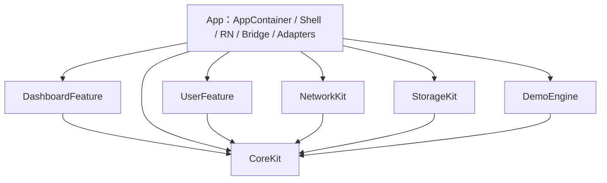
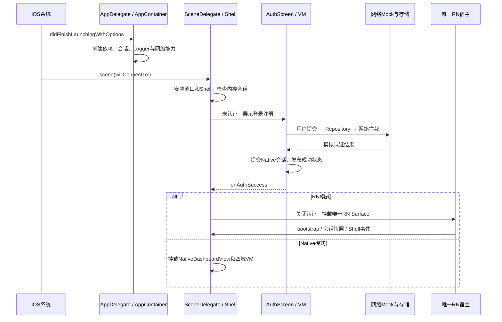

# iOS 基础与调试新手指南

适用读者：没有 iOS、Swift 或 Xcode 开发经验，希望能运行、阅读和调试 EntryTask 的新人。没有 Kotlin、React Native 基础也可以从头阅读。

本文结合**当前仓库源码**说明操作，不把示例代码当作工程里已经实现的功能。Xcode 不同版本的菜单名称和按钮位置可能变化，优先按功能名称寻找；快捷键可在菜单右侧或 Xcode Settings 的 Key Bindings 中确认。

建议使用顺序：先完成第 1～5 节的首次运行，再通过第 6～8 节读代码，最后按第 9～12 节亲手查看日志、打断点、定位一次问题。第 13～16 节用于继续练习和查阅。

## 先明确当前界面分工

**四个根 Tab 始终由 Native UIKit 实现**：`ShellViewController`创建`UITabBar`，`ShellViewModel`持有根导航状态。页面模式只决定Tab内部内容：Xcode默认SwiftUI四页，官方CLI默认单RN Surface中的四域页面；登录注册在两种模式下都是Native SwiftUI。不要将“RN页面模式”理解为“RN实现根底栏”。

刚接触Xcode、找不到磁盘里的App/SceneDelegate或四页源码时，先读[《Xcode使用与工程结构入门》](iOS-Xcode使用与工程结构入门.md)。其中按当前工程分组提供逐文件位置表，并解释Native Implementation与Package Dependencies。

## 阅读导航

- [1. 先认识几个名词](#1-先认识几个名词)
- [2. 准备开发环境](#2-准备开发环境)
- [3. 认识 Xcode 界面](#3-认识-xcode-界面)
- [4. 第一次运行工程](#4-第一次运行工程)
- [5. 认识工程文件和模块](#5-认识工程文件和模块)
- [6. 从启动入口读到登录成功](#6-从启动入口读到登录成功)
- [7. Swift 语言入门](#7-swift-语言入门)
- [8. 理解 SwiftUI 和 MVVM](#8-理解-swiftui-和-mvvm)
- [9. 查看日志](#9-查看日志)
- [10. 使用断点与 LLDB](#10-使用断点与-lldb)
- [11. 按实例调试登录和 RN 页面](#11-按实例调试登录和-rn-页面)
- [12. 常见问题排查](#12-常见问题排查)
- [13. 测试预览与性能工具](#13-测试预览与性能工具)
- [14. 日常修改与验证](#14-日常修改与验证)
- [15. 新手练习路线](#15-新手练习路线)
- [16. 继续阅读](#16-继续阅读)

## 1. 先认识几个名词

| 名词 | 可以怎样理解 | 本项目中是什么 |
| --- | --- | --- |
| iOS | iPhone 使用的操作系统 | 应用运行的平台 |
| Xcode | Apple 提供的开发工具，包含编辑器、编译、运行和调试能力 | 打开 iOS workspace，运行和调试原生代码 |
| Swift | 编写 iOS 代码的语言 | 登录、宿主、网络、存储等主要使用它 |
| UIKit | 通过视图和控制器组织界面的系统框架 | 窗口、首页宿主、原生底栏和 RN 容器 |
| SwiftUI | 通过“状态描述界面”的系统框架 | 登录注册，以及Xcode默认Native四根页 |
| React Native，简称 RN | 用 React/TypeScript 开发移动业务界面的框架 | CLI模式的首页、财富、会员、我的及业务子页 |
| Simulator | 在 Mac 上模拟 iPhone 等设备的应用 | 第一阶段使用它运行，不急于准备真机签名 |
| SDK | 编译某个平台应用需要的系统接口和工具 | Xcode 携带的 iOS SDK |
| Runtime | 运行环境 | 模拟器需要对应系统 runtime；RN 也有自己的 JS runtime，二者不同 |
| Build | 把源代码编译、链接、组装成应用 | 成功后还需要安装、启动，才算运行起来 |
| Debug / Release | 开发调试配置 / 优化配置 | 新人先用 Debug；Release 用于检查优化和打包行为 |
| Bundle | 应用安装包中的文件集合 | 包含原生程序和资源；RN Release另包含JS Bundle |
| Bridge / TurboModule | RN 调用原生能力的受控接口 | RN 请求会话、网络、存储和宿主操作的通道 |

本工程是无真实后端的教学银行应用。Mock 是“本地模拟服务行为”：请求仍经过原生网络层，再被本地拦截并读取分 API JSON；不是 RN 页面直接打开 JSON 文件。

不要把“Native”理解为“整个页面都由 SwiftUI 实现”。本项目当前界面分工为：

```text
一个 iOS 应用
├── UIKit：窗口、宿主控制器、四个根 Tab
├── SwiftUI：登录、注册
└── 构建期二选一：CLI默认单RN Surface；Xcode默认SwiftUI四根页
```

## 2. 准备开发环境

### 2.1 需要安装什么

| 工具 | 用途 | 本仓库的约束 |
| --- | --- | --- |
| 完整 Xcode | 编译、可视化编辑、Simulator、调试器 | 只有 Command Line Tools 不等于完整 Xcode |
| iOS Simulator runtime | 提供某个系统版本的模拟运行环境 | 设备列表中至少有一个可用的 iPhone Simulator |
| Node.js / npm | 安装 RN 依赖、运行 Metro | package.json 要求 Node >=22.11 |
| Ruby / Bundler | 按 Gemfile 管理 CocoaPods 等 Ruby 工具 | 使用仓库 Gemfile / Gemfile.lock，不自行全量升级 |
| CocoaPods | 集成 RN 及其原生依赖 | 在 ios/ 下通过 bundle exec pod install 使用 |
| SwiftPM | 管理 Swift Package | 随 Swift/Xcode 提供；GRDB 固定为 7.8.0 |

当前 App 最低系统配置为 iOS 15.1，Swift 语言模式为 5；本地 Package 要求 Swift tools 6.0。**语言模式、编译器版本、SDK 版本、模拟器系统版本是不同概念**：代码按 Swift 5 规则编译，不代表只需要 Swift 5 编译器。最低系统配置存在，也不代表所有旧系统已经完成设备验收。

### 2.2 先检查，再安装依赖

从 [Apple 的 Xcode 页面](https://developer.apple.com/xcode/)进入官方下载渠道，安装与本机 macOS 及工程工具链要求兼容的完整 Xcode。不要只安装 Command Line Tools 后就认为 Simulator 和 IDE 已齐备。

在 Mac 的 Terminal 或编辑器终端执行以下只读命令。`sh` 表示代码块中的内容是 shell 命令，不要把这个单词一起复制。

```sh
# 任意目录：检查当前工具链
xcode-select -p
xcodebuild -version
xcrun swift --version
node --version
npm --version
ruby --version
bundle --version
```

`xcode-select -p` 应指向你实际安装的 Xcode 开发目录。若指向 CommandLineTools，先在 Xcode Settings → Locations 找到 Command Line Tools，选择实际 Xcode；涉及系统全局工具链切换时，先确认不会影响其他项目。

首次打开 Xcode，按提示完成许可和必要组件安装。在 Xcode Settings 中寻找 Platforms / Components 等系统组件入口，下载需要的 iOS Simulator runtime；再查找或创建模拟器。旧版入口常见于 Window → Devices and Simulators；新版也可能集中在 Device Hub。Apple 的 [Xcode 说明](https://developer.apple.com/xcode/)介绍了 Device Hub，操作时以当前版本的设备管理入口为准。

如果终端输出 `command not found`，说明对应工具未安装或未进入 PATH。不要直接复制陌生的 sudo 安装命令；先确认缺的是 Node、Ruby、Bundler，还是完整 Xcode。

### 2.3 本项目为什么有两种原生依赖管理

CocoaPods 管理 RN、Hermes、React Native Screens、SVG 等原生依赖；SwiftPM 管理本地 EntryModules 和它使用的 GRDB。它们在同一个 Xcode workspace 中参与构建。

第一次运行需要访问依赖源。解析依赖失败和业务源码编译错误是两类问题。不要通过删除 Podfile.lock / Package.resolved、升级所有包或修改 Pods 源码来绕过解析错误。

## 3. 认识 Xcode 界面

### 3.1 打开哪个文件

打开仓库中的 [EntryTask.xcworkspace](../../ios/EntryTask.xcworkspace/contents.xcworkspacedata) 所在 workspace：

```sh
# 仓库根目录
open ios/EntryTask.xcworkspace
```

这个 Markdown 链接用于查看 workspace 的组成文件，真正进入 Xcode 时应打开 **EntryTask.xcworkspace** 目录包。

`.xcodeproj` 描述应用自身的 target 和构建配置；`.xcworkspace` 把应用工程、Pods 等协作内容放在一起。本项目日常开发使用 workspace，避免出现只打开应用工程而看不到依赖的情况。

### 3.2 五个常用区域

```text
┌─────────────────────────────────────────────────────┐
│ 顶部工具栏：Run / Stop、Scheme、运行设备、构建进度       │
├──────────────┬─────────────────────┬────────────────┤
│ 左侧导航区    │ 中间编辑区           │ 右侧检查器       │
│ 文件 / 搜索   │ Swift、配置、源码    │ 文件属性、帮助   │
│ 错误 / 测试   │                     │                │
├──────────────┴─────────────────────┴────────────────┤
│ 底部调试区：变量、调用栈相关操作、Console / LLDB          │
└─────────────────────────────────────────────────────┘
```

不必一次认识所有按钮，先会使用下面这些功能：

| 功能 | 使用场景 | 常见入口或默认快捷键 |
| --- | --- | --- |
| Project Navigator | 找文件 | 左侧文件图标，⌘1 |
| Find Navigator | 搜索整个工作区 | ⌘⇧F；限制在自己的源码，避免大量 Pods 结果 |
| Open Quickly | 按名称快速打开文件 | ⌘⇧O，输入 AuthViewModel |
| Issue Navigator | 看错误和警告 | ⌘5，优先看本次构建的第一个有效错误 |
| Test Navigator | 选测试、运行单个测试 | ⌘6 |
| Debug Navigator | 暂停时看线程、调用栈等 | ⌘7 |
| Breakpoint Navigator | 管理已有断点 | ⌘8 |
| Report Navigator | 看构建、测试完整报告 | ⌘9 |
| Quick Help | 看类型或方法说明 | 按住 Option 点击符号，或打开右侧 Quick Help |
| Jump to Definition | 跳到定义 | 编辑器上下文菜单中选择对应功能 |
| Build | 只构建 | Product → Build，⌘B |
| Run | 构建、安装、启动并连接调试器 | Product → Run，⌘R |
| Stop | 停止当前调试运行 | Product → Stop，⌘. |
| Test | 执行当前 scheme 的测试 | Product → Test，⌘U |

其中 ⌘ 是 Command，⇧ 是 Shift。功能键 F6 等可能需要配合 Fn；不确定时直接使用菜单或调试工具栏按钮。

### 3.3 Scheme、Target、运行设备的区别

- **Target**：这次要产出什么，例如 EntryTask.app、测试包或一个库。
- **Scheme**：这次怎样构建、运行、测试这些 target，可以理解为一套执行安排。
- **Run Destination**：应用在哪台设备上运行，例如某个 iPhone Simulator。
- **Build Configuration**：用 Debug 还是 Release 等配置编译。

本项目新手日常选择 **EntryTask scheme + 可用 iPhone Simulator + Debug**。`Any iOS Device` 等通用设备项适合构建，不是一台可以直接交互运行的模拟器。

Apple 的[构建与运行说明](https://help.apple.com/xcode/mac/current/en.lproj/devdc0193470.html)给出了选择 scheme、destination 和运行的标准操作。

## 4. 第一次运行工程

### 4.1 安装仓库依赖

先在终端进入**仓库根目录**，也就是能看到 package.json、Gemfile、src/、ios/ 的目录。可先执行 `pwd` 确认位置。

```sh
# 仓库根目录，首次或依赖缺失时执行
npm ci
bundle install

# 切到 iOS 目录，按锁文件安装原生依赖
cd ios
bundle exec pod install

# 回到仓库根目录
cd ..
```

看到安装成功后再运行；如果第一步已经失败，先解决依赖问题，不要继续叠加后面的错误。纯文档或普通 Swift 文案修改不需要反复安装依赖。

### 4.2 推荐先用“Metro + Xcode”运行

**终端 A：启动 Metro。** Metro 为 Debug 应用提供 JS 代码。

```sh
# 仓库根目录
npm start
```

保持这个终端运行。如果已有 Metro 正在使用 8081，复用它，并确认它服务的是当前仓库；不要重复启动，也不要随意结束其他人的进程。

**Xcode：运行原生应用。**

1. 打开 ios/EntryTask.xcworkspace，等待索引和 Swift Package 解析结束。
2. 顶部选择 EntryTask scheme 和实际存在的 iPhone Simulator。
3. 在 Product → Scheme → Edit Scheme 中，确认 Run 使用 Debug；需要断点时勾选 Debug executable。
4. 点击 Run 或按 ⌘R。
5. 如果失败，先到 Report / Issue Navigator 看依赖或编译错误；构建成功后观察模拟器。

应用本次启动的预期结果：先显示原生登录页。新安装没有账号，使用**专门的演示账号**注册；成功后关闭认证页，进入当前模式首页，底部是 Native 四个 Tab。普通 Mock 等待 1～3 秒属于产品模拟行为。

登录前没有业务首页，不代表引擎加载失败：当前设计就是先认证，认证成功后才创建所选模式的业务内容。

关闭进程再运行会重新要求登录，因为会话只保存在内存；注册账号保存在数据库，可以再次登录。点击 Xcode Stop 结束进程，与“把应用切到后台”不是同一操作。

### 4.3 也可以使用官方 CLI

```sh
# 仓库根目录
npx react-native run-ios

# 已有 Metro 时，按需使用
npx react-native run-ios --no-packager
```

多个设备时先用 `xcrun simctl list devices available` 看实际名称，再按 CLI 帮助选择 `--simulator` 或 `--udid`：

```sh
npx react-native run-ios --help
```

CLI和Xcode共用Shell，构建参数决定使用RN还是SwiftUI四页。详见[双模式指南](ios-dashboard-modes.md)。本项目已对缺少独立Simulator.app的Xcode安装增加Debug模拟器兼容路径：官方构建器配合CoreSimulator安装启动；完整环境仍走官方run-ios。Release/真机/交互式选择按标准CLI环境处理。

### 4.4 构建期选择页面模式

Xcode直接Run默认Native，无需Metro；根目录npx react-native run-ios默认RN。模式写入Info.plist的EntryTaskPageMode，切换后重新构建安装，不能只Reload JS。显式参数ENTRYTASK_PAGE_MODE=rn或native优先；不在代码中手改Tab开关，不使用UserDefaults保存模式。

### 4.5 真机运行：在模拟器之后学习

连接并信任设备，在 Xcode 的 Device Hub / Devices and Simulators 等设备管理入口确认设备可用；按系统提示开启所需的 Developer Mode。然后选择实际 iPhone，在应用 target 的 Signing & Capabilities 配置自己的开发 Team 和有效签名。

不要为了临时运行修改并提交项目 Bundle Identifier、团队身份或证书。Debug 真机还需要能访问 Mac 的 Metro：检查设备与 Mac 网络、Mac 防火墙及 RN 开发服务器配置；真机上的 localhost 指向手机自身，不是 Mac。

真机签名、系统支持和 Metro 连通性分别检查。模拟器构建通过，不代表真机已经通过。

## 5. 认识工程文件和模块

### 5.1 先认识这些文件

| 路径 | 内容 | 新人何时会碰到 |
| --- | --- | --- |
| [AppDelegate.swift](../../ios/EntryTask/AppDelegate.swift) | 进程启动入口，创建组合根 | 排查“应用有没有启动” |
| [SceneDelegate.swift](../../ios/EntryTask/App/SceneDelegate.swift) | 连接当前窗口 | 排查“为什么没有界面” |
| [Info.plist](../../ios/EntryTask/Info.plist) | 应用系统配置、Scene、方向等 | 了解系统如何连接应用；不随意修改 |
| [project.pbxproj](../../ios/EntryTask.xcodeproj/project.pbxproj) | target、源码引用、构建步骤等工程配置 | 在 Xcode 修改设置时可能变化；不要盲目手改 |
| [EntryTask.xcscheme](../../ios/EntryTask.xcodeproj/xcshareddata/xcschemes/EntryTask.xcscheme) | 共享 scheme | 了解 Run / Test 使用哪些 target |
| [Podfile](../../ios/Podfile) / [Podfile.lock](../../ios/Podfile.lock) | Pods 声明 / 已解析版本 | 原生依赖安装 |
| [Package.swift](../../ios/Packages/EntryModules/Package.swift) | 六个 Swift 库及 GRDB 依赖 | 理解模块编译边界 |
| [Package.resolved](../../ios/EntryTask.xcworkspace/xcshareddata/swiftpm/Package.resolved) | Xcode workspace 的 SwiftPM 版本锁定 | 依赖解析与版本检查 |
| [specs/](../../specs) | 五个 TurboModule 的 TS 传输接口 | RN 与 Native 协作时阅读 |
| [contracts/](../../contracts) / [mock/](../../mock) | 运行契约、API 描述、分 API JSON | 查某个请求应该返回什么 |
| [prepare-ios-resources.cjs](../../tools/prepare-ios-resources.cjs) | 把共享 JSON 校验后打入应用 | 排查安装包缺资源 |

Pods/、DerivedData、SwiftPM 的 .build 是依赖或生成目录。**阅读它们可以帮助理解，功能修改应回到仓库自己的源码**；不要把生成接口手改后当作解决方案。

### 5.2 七个实施单元

| 单元 | 职责 | 入门阅读入口 |
| --- | --- | --- |
| App target | 组装依赖、窗口、Shell、RN 宿主、桥接 | [AppContainer](../../ios/EntryTask/App/AppContainer.swift) |
| CoreKit | 技术协议、公共错误、日志、通用 UI、提交协调 | [Ports](../../ios/Packages/EntryModules/Sources/CoreKit/Contracts/Ports.swift) |
| UserFeature | 会话、认证 Repository、VM、SwiftUI 表单 | [AuthViewModel](../../ios/Packages/EntryModules/Sources/UserFeature/Presentation/AuthViewModel.swift) |
| NetworkKit | 网络请求登记、超时、取消、专用 URLSession | [NetworkClient](../../ios/Packages/EntryModules/Sources/NetworkKit/Client/NetworkClient.swift) |
| StorageKit | SQLite/GRDB、事务、受控偏好 | [LocalDatabase](../../ios/Packages/EntryModules/Sources/StorageKit/Database/LocalDatabase.swift) |
| DashboardFeature | Native四页领域、Repository、VM、SwiftUI共用组件 | [RootPageViewModels](../../ios/Packages/EntryModules/Sources/DashboardFeature/Presentation/RootPageViewModels.swift) |
| DemoEngine | 模拟服务行为、认证校验、签到等状态规则 | [DemoHandler](../../ios/Packages/EntryModules/Sources/DemoEngine/Routing/DemoHandler.swift) |

AppContainer 就像“接线处”：它创建对象，并通过构造参数把对象交给需要它的地方。比如认证 Repository 使用 NetworkPort，不直接创建具体网络客户端；App 决定提供哪个实现。这样测试时也能提供可控的替身。



箭头表示模块依赖。运行时可以通过 App 注入的协议协作，不表示所有模块都要互相 import。

### 5.3 新增文件放哪里

先判断职责，再放文件。认证页面属于 UserFeature，通用网络控制属于 NetworkKit，宿主与 React 适配留在 App。不要因为某个类“在登录时用到”就把所有网络、数据库代码都放进登录页面。

App target 新增文件时，检查 File Inspector 的 Target Membership 或 Build Phases → Compile Sources，确认文件真的参与目标编译。Swift Package 的 Swift 文件一般按 Sources/TargetName/ 目录归属自动参与该 target，不要再重复加入 App target。

磁盘里有文件、Xcode 左侧能看到文件、文件参与正确 target 的编译，是三件不同的事。

## 6. 从启动入口读到登录成功

### 6.1 启动不是从 AuthScreen 开始



### 6.2 按这些方法顺序阅读

| 顺序 | 类与方法 | 负责的事情 |
| --- | --- | --- |
| 1 | AppDelegate.application(_:didFinishLaunchingWithOptions:) | 创建 AppContainer，不直接把 RN 设置成整个窗口根页面 |
| 2 | SceneDelegate.scene(_:willConnectTo:options:) → AppDelegate.makeWindow(for:) | 创建窗口，把 ShellViewController 放到根位置 |
| 3 | [ShellViewController](../../ios/EntryTask/Shell/Presentation/ShellViewController.swift).viewDidAppear / resume | 读取会话，首次未认证时请求认证 |
| 4 | ShellViewController.presentAuthenticationIfNeeded | 确认可见和前台，用 UIHostingController 展示 SwiftUI 表单 |
| 5 | AuthViewModel.submit | 校验输入、防重提交、调用 Repository，发布状态 |
| 6 | [NetworkAuthRepository](../../ios/Packages/EntryModules/Sources/UserFeature/Data/NetworkAuthRepository.swift).authenticate / request | 发起原生认证请求，处理结果并按 epoch 提交会话 |
| 7 | NetworkClient.execute → [DemoURLProtocol](../../ios/Packages/EntryModules/Sources/NetworkKit/Interception/DemoURLProtocol.swift).startLoading | 专用 URLSession 请求进入本地拦截 |
| 8 | DemoHandler.handle / process / authenticate | 随机等待后处理注册或登录；通过账号存储读写数据库 |
| 9 | [MockAccountStore](../../ios/Packages/EntryModules/Sources/DemoEngine/Auth/MockAccountStore.swift).register / verify | 账号键和密码校验值处理；不保存明文密码 |
| 10 | AuthScreen.deliver → ShellViewController.finishAuthentication | 确认前台和成功事实，关闭认证；不会销毁 Shell |
| 11（仅RN模式） | ShellViewController.render → [RNRuntimeOwner](../../ios/EntryTask/RNIntegration/RNRuntimeOwner.swift).rootView | 只创建一次业务根视图，之后持续复用 |
| 12（仅RN模式） | [ETBridgeServices](../../ios/EntryTask/NativeModules/ETBridgeServices.swift).perform / run | 受理 RN 调用，提供 bootstrap、会话、网络等能力 |

Native模式在第10步后走`ShellViewController.render → NativeDashboardView → DashboardCoordinator.update → 当前页VM.activate/refresh → NetworkDashboardRepository → NetworkClient`，不经过第11、12步。两种模式的`UITabBarDelegate → ShellViewModel.selectTab`根Tab路径相同。

`viewDidLoad` 通常用于一次性的视图创建；`viewDidAppear` 在控制器显示后调用，之后再出现也可能重复调用；当前 Shell 因此还需要 didStart 和认证 flow 的防重协调。不要把任何一个“出现回调”理解成整个进程只执行一次。

**epoch** 是会话代数。例如退出登录后代数增加，旧请求即使返回，也不能覆盖新会话。**flowId / requestId** 是排障关联编号，不是用户身份或登录凭证。

## 7. Swift 语言入门

本节示例用于学习，除明确标注的源码片段外，不要求粘进工程。可在 Xcode 的 Playground（如果当前版本提供该入口）或单独练习文件中尝试；不要为了运行语法例子修改应用入口。

### 7.1 import、let、var 和基本类型

```swift
import Foundation                 // 使用系统基础能力

let title: String = "首页"        // 常量：初始化后不再赋值
var selectedTab: Int = 1           // 变量：允许再次赋值
let isLoading = false             // 编译器推断为 Bool
let scale: Double = 1.5
selectedTab = 2
```

`String` 是字符串，`Int` 是整数，`Bool` 只有 true/false，`Double` 是浮点数。冒号后面是类型；有明确初始值时经常可以省略类型。

优先使用 let；需要改变时才用 var。`let viewModel = ...` 固定的是这个引用，**不代表 class 对象内部状态永远不能改变**。

### 7.2 字符串、数组和字典

```swift
let page = "财富"
let message = "当前页面：\(page)"    // 字符串插值
let tabs: [String] = ["首页", "财富", "会员", "我的"]
let first = tabs.first              // String?，数组可能为空
let values: [String: Bool] = ["loading": false]
let loading = values["loading"] ?? false

for tab in tabs {
    _ = tab                        // 学习循环，不输出个人业务数据
}
```

数组 `[String]` 的元素都是 String；字典 `[String: Bool]` 的键是 String、值是 Bool。字典查询可能找不到键，因此返回可选值。数组下标越界会崩溃；不要把不可信索引直接用于下标。

Swift 的 String.count 表示字符数量，不等于 UTF-8 字节数。Bridge 的字节限制应看 `text.utf8.count`；与 Android 对齐的部分长度规则使用 UTF-16，不能混用。

### 7.3 Optional：为什么经常看到问号

```swift
var message: String? = nil          // 可以没有值
message = "操作完成"

if let text = message {
    _ = text                       // 在这个分支内，text 是确定存在的 String
}
let shown = message ?? "暂无提示"    // 没值时使用默认值
```

`String?` 表示“可能是一个 String，也可能没有值”。`nil` 表示没有值。`?` 不表示程序已经出错。

`object?.method()` 表示对象存在时才调用，称为可选链。`value!` 是强制解包：你向编译器承诺它一定有值，实际为 nil 就崩溃。不要用不断加 `!` 的方式消除编译错误。[Swift 官方基础章节](https://docs.swift.org/swift-book/LanguageGuide/TheBasics.html)可用于进一步学习类型和 Optional。

### 7.4 if、guard 和提前返回

```swift
func canSubmit(isLoading: Bool, name: String) -> Bool {
    guard !isLoading else { return false }
    if name.isEmpty { return false }
    return true
}
```

`!isLoading` 是布尔取反，与 Optional 后面的强制解包 `value!` 不同。`guard 条件 else { ... }` 表示条件必须满足，否则离开当前作用域。

项目中这句：

```swift
guard let self, self.version == current, !Task.isCancelled else { return }
```

可以拆成三件事：对象还存在；这仍然是当前页面版本的请求；任务没有被取消。任何一项不满足就不再更新页面。

### 7.5 函数、参数标签、返回值

```swift
func caption(for tab: Int) -> String {
    return tab == 1 ? "首页" : "其他页面"
}
let text = caption(for: 1)

func select(_ tab: Int) {           // 下划线表示调用处省略参数标签
    _ = tab
}
select(2)
```

`func` 定义函数，`-> String` 指返回 String。Swift 调用常保留参数标签，使业务含义更清楚；例如 `commit(username:token:expectedEpoch:)`。没有返回值时通常省略 `-> Void`。

`condition ? a : b` 是三元表达式：条件成立选择 a，否则选择 b。

### 7.6 struct、class 和 init

```swift
struct PageState {
    var isLoading = false
}
var a = PageState()
var b = a
b.isLoading = true                  // a 不随 b 的修改而改变

final class PageCounter {
    var count: Int
    init(count: Int) { self.count = count }
}
let firstCounter = PageCounter(count: 0)
let secondCounter = firstCounter
secondCounter.count = 1             // 两个引用指向同一对象
```

struct 是值类型，赋值使用值语义；class 是引用类型，多个变量可引用同一对象。状态快照常用 struct，持有生命周期和依赖的 VM/服务常用 class。`final` 表示不允许继续继承这个类。

`init` 是初始化方法。`self.count` 指对象自己的属性，右侧 count 是方法参数。

### 7.7 protocol 和依赖注入

```swift
protocol PageTitleProviding {
    func title() -> String
}
struct FixedTitleProvider: PageTitleProviding {
    func title() -> String { "首页" }
}
```

protocol 描述“需要具备哪些能力”，实现类型负责“具体怎样做”。项目的 NetworkPort、SessionPort、AuthRepository 都属于这种能力约定。

AppContainer 把符合协议的对象交给消费者，就是依赖注入。它不是某个特殊语法，也不一定需要第三方框架。

### 7.8 enum 与 switch

```swift
enum LoadingPhase {
    case idle
    case loading
    case failed(code: String)
}

func label(_ phase: LoadingPhase) -> String {
    switch phase {
    case .idle: return "等待操作"
    case .loading: return "加载中"
    case .failed(let code): return "失败：\(code)"
    }
}
```

enum 适合表达有限的状态；关联值可以携带该状态所需信息。示例用于解释语法，当前 AuthUiState 实际使用多个属性，不要据此认为工程已经使用 LoadingPhase。

### 7.9 闭包：把一段操作当作参数

```swift
let onFinished: () -> Void = {
    // 操作完成后执行这里
}
onFinished()
```

`() -> Void` 是“不接收参数、不返回有意义值”的函数类型。项目的 `onAuthSuccess: () -> Void` 就表示成功后调用的动作。

SwiftUI 中常见的尾随闭包：

```swift
Button("登录") {
    // 用户点击时执行
}
```

如果闭包在方法返回后还要被保存和调用，参数声明可能带 `@escaping`。闭包中的 `$0`、`$1` 是省略命名时的第一个、第二个参数，不是 SwiftUI Binding 的同一套语法。

### 7.10 错误：throws、try、do/catch

```swift
enum DemoError: Error { case unavailable }

func loadTitle() throws -> String {
    throw DemoError.unavailable
}

do {
    let title = try loadTitle()
    _ = title
} catch {
    // 把失败转成页面能理解的状态或安全提示
}
```

`throws` 表示函数可能抛出错误；调用时用 try，并决定在哪里处理。`try?` 把失败变成 nil，容易隐藏原因；`try!` 遇到错误会崩溃。不要为了“先跑起来”吞掉关键存储或认证错误。

`defer { ... }` 把清理操作安排到当前作用域退出时执行，常用于成对释放锁或移除请求登记；它不表示“以后某个任意时刻再执行”。

### 7.11 async、await、Task 和取消

```swift
func waitForDemo() async throws {
    try await Task.sleep(nanoseconds: 100_000_000) // 约 0.1 秒，可取消地挂起
}

let task = Task {
    do {
        try await waitForDemo()
        try Task.checkCancellation()
    } catch is CancellationError {
        // 取消是独立的结果，不必显示网络失败
    } catch {
        // 处理其他错误
    }
}
task.cancel()
```

async 表示函数能够异步挂起；await 表示这里可能需要等待。**await 不等于新建后台线程，也不保证后面的代码一定在后台执行。** Task 可能继承所在位置的 actor 隔离；需要理解调用方和被调用函数的隔离规则。

cancel() 是发出取消信号，不是强制杀线程，也不会自动撤回已提交的数据库事务。请求和页面要配对清理，并在合适位置检查取消与旧版本结果。

项目代码中的 Task 多数由 VM 或 Bridge 显式保存并在离开/invalidate 时取消；不要因为看到了 Task 就假定它天然与页面生命周期绑定。[Swift 并发文档](https://docs.swift.org/swift-book/LanguageGuide/Concurrency.html)解释了异步、actor 和取消的基本规则。

### 7.12 @MainActor、Sendable 和主线程

`@MainActor` 为一组状态和操作提供主 actor 隔离，适合 UI 状态及 UIKit 展示。AuthViewModel 和 ShellViewModel 都使用它。

主 actor 上也能写出阻塞代码。同步磁盘、数据库、复杂 JSON 处理、密码派生放到主 actor 中，仍可能卡界面；给方法加 async 也不会自动解决。

`Sendable` 表示类型可以安全地跨并发隔离边界传递。`@unchecked Sendable` 表示由作者手动保证线程安全；项目少量使用时依赖锁保护，不是让编译器“别报错”的通用开关。新人先理解，不要随意给新类型加它。

### 7.13 public、private、private(set) 与模块

```swift
public private(set) var isLoading = false
```

public 表示对其他模块公开；private 限制在更小的作用域；private(set) 表示外面可以读，但不能直接写。没有修饰符时通常是 internal，即当前模块内部可用。

当前 VM 的 `@Published public private(set) var state` 要求外部通过 username、password、submit 等动作修改状态，不绕过 VM 直接写属性。

### 7.14 weak self 与对象释放

class 对象通常通过自动引用计数 ARC 管理生命周期。两个对象互相强持有，或者对象持有闭包、闭包又强持有对象，可能形成循环引用。

`[weak self]` 让闭包不强持有该对象，因此闭包执行时 self 可能已经不存在；接下来用 `guard let self` 安全处理。它只能解决相应的引用关系，不能自动取消网络、释放订阅或修复全部内存泄漏。

`deinit` 在对象释放时执行。不要承诺应用被系统杀死时一定执行 deinit；业务数据应在正确的提交点持久化，而不是靠进程结束清理。

### 7.15 泛型、类型转换和条件编译

| 写法 | 含义 | 项目中的用途 |
| --- | --- | --- |
| `func perform<T>(...) -> T` | 泛型；T 可代表不同返回类型 | 共用提交执行器，不为每种结果复制一套实现 |
| `value as? String` | 尝试转换，失败得到 nil | 解析受控 JSON 的字段 |
| `value as! String` | 强制转换，失败崩溃 | 只适用于已证明的不变量；外部输入不能照搬 |
| `typealias JSONObject = [String: Any]` | 类型别名 | 薄传输层使用；不代表业务层应该全用 Any |
| `#if DEBUG` | 编译条件，不是普通运行时 if | Debug 的 Metro 入口、测试隔离开关 |
| `#if canImport(UIKit)` | 环境允许导入 UIKit 时编译该段 | 同一 Package 在 macOS 测试时排除 iOS UI |
| `@objc` / `NSObject` | 与 Objective-C 互操作 | Swift facade 被 ObjC++ adapter 调用 |

`.mm` 是 Objective-C++ 源文件。本项目为了接入 RN Codegen 的 C++/Objective-C 接口使用它；新人不需要先学完 C++ 才能理解 Swift 认证业务。

## 8. 理解 SwiftUI 和 MVVM

### 8.1 状态驱动界面

以下是独立的语法示例，不是现有业务页面：

```swift
import SwiftUI

struct CounterExample: View {
    @State private var count = 0

    var body: some View {
        VStack(spacing: 12) {
            Text("点击次数：\(count)")
            Button("加一") { count += 1 }
        }
        .padding(24)
    }
}
```

View 描述当前状态应该显示什么；修改 count 后，SwiftUI 更新相应界面。`body` 可能被重复计算，所以不要在 body 中创建业务网络请求、写数据库或改变全局导航。

`some View` 表示返回某个确定的 View 类型，但调用者不需要知道具体组合类型。`VStack` 纵向排列，`HStack` 横向排列，`ZStack` 叠放；`.padding`、`.background` 等修饰符逐步组成界面，顺序可能影响效果。

UIKit 常创建 UIView，再配置约束、更新其属性；SwiftUI 主要描述状态下的视图结构。项目用 UIHostingController 把 SwiftUI 认证放进 UIKit 宿主，两者可以协作，不要求整个应用统一重写。

### 8.2 属性包装器速查

| 写法 | 作用 | 当前例子 |
| --- | --- | --- |
| `@State` | View 自己拥有的局部状态 | 是否显示密码、当前是注册还是登录 |
| `@StateObject` | 在该 View 身份下拥有并保持 ObservableObject 生命周期 | AuthScreen 的 login、register VM |
| `@ObservedObject` | 观察外部提供的对象，通常不负责创建它 | 常见用法；当前纯 AuthFormContent 不接收 VM |
| `@Published` | 对象属性变化可被观察 | AuthViewModel.state |
| `@Binding` / `Binding(...)` | 用读写通道连接状态与输入控件 | TextField 读取 state.username，写入转发 onUsername |
| `@FocusState` | 管理输入焦点 | 用户名输入后切到密码 |

`$count` 通常表示拿到状态对应的 Binding；与闭包中 `$0` 的“第一个参数”不同。Binding 也不是复制一份状态。

### 8.3 当前登录 UI 的三层

```text
AuthScreen：持有两份独立 VM，切换登录/注册，观察成功和前后台
    ↓ state + actions
AuthFormContent：组合共用表单，只渲染状态、转发事件
    ↓ 用户动作
AuthViewModel：输入校验、防重、异步请求、错误/成功状态
    ↓ 协议调用
AuthRepository / NetworkAuthRepository：请求与会话提交
```

`AuthFormContent` 是定义在 AuthScreen.swift 中的 private struct，不是另一个同名文件。它接收状态值和回调，密码显隐/焦点等纯 UI 状态留在 View；账号校验、数据库、网络不放进去。

### 8.4 用点击登录解释 MVVM

- 用户输入：TextField 的 Binding 调用 VM.username / password。
- 用户点击：按钮触发 VM.submit，VM 同步设置 isLoading，防止重复提交。
- 网络处理：Repository 通过 Port 请求；拦截器负责模拟服务与账号库读写。
- 结果回来：VM 更新 authenticated 或 message；界面按新状态显示。
- 页面成功：AuthScreen 在合适生命周期交付 onAuthSuccess，Shell 负责关闭认证。

View 管呈现，VM 管视图状态和动作，Repository 管数据访问；并非把所有代码从 View 搬进一个巨大的 VM 就叫 MVVM。

### 8.5 Native四页也按MVVM阅读

入口为DashboardFeature/UI/NativeDashboardView.swift，接收组合根创建的DashboardCoordinator。Shell拥有根Tab权威；Coordinator只投影tab/epoch/前台状态，决定哪个VM活跃。Home、Wealth、Member、Profile分别持有自己的资源；PageResource管理加载、错误、取消和代次。NetworkDashboardRepository经NetworkPort调用现有Mock，不从View读取JSON。BankComponents、BankCarousels沉淀共性，四页只组合区域。资产显隐是当前会话共享状态，退出复位；滚动位置按Tab保留，换会话重建。

Native页面用Xcode调试，RN页面用RN DevTools；两种模式认证和Mock方法仍是同一套。

## 9. 查看日志

### 9.1 先判断要看哪一种

| 位置 | 适合看什么 | 不应期待什么 |
| --- | --- | --- |
| Xcode Build / Report | 编译、链接、脚本、测试报告 | 不等于完整应用运行日志 |
| Xcode Debug Console / OSLog | Swift、ObjC++、Native 启动/认证/请求/桥接 | 不保证包含全部 JS console |
| RN DevTools Console | JS/TS、RN Logger、组件和状态相关诊断 | 不代替 Swift/ObjC++ 调试 |
| Metro 终端 | 开发服务器、打包错误和连接情况 | 没有 JS 日志不代表 JS 没运行 |

这是排查“终端没有日志”的第一步。RN 官方也明确区分 [RN DevTools 和原生调试工具](https://reactnative.dev/docs/0.86/react-native-devtools)。

### 9.2 在 Xcode 看 Native 日志

1. 用 Xcode Run 启动 Debug 应用，确认调试会话连接的是当前 EntryTask。
2. 显示底部 Debug Area / Console；入口通常在 View → Debug Area。
3. 若没有内容，先清空过滤条件，确认没有只显示某一种输出；再搜索事件名。
4. 重新启动或操作一次，观察 `application.starting`、`auth.requested`、`request.started` 等事件。

本项目 [AppLogger](../../ios/Packages/EntryModules/Sources/CoreKit/Logging/AppLogger.swift) 使用 OSLog：subsystem 为 EntryTask，category 为 Native。Debug 的普通事件用 notice，错误用 error；Release 普通事件级别不同，且系统保留行为也有差异，不能假定所有历史日志永久可查。

App 若由 CLI 或桌面启动、没有自动连接 Xcode，可使用 Debug → Attach to Process，选择实际 EntryTask；需要观察首次启动时，也可查看当前版本提供的“按进程名等待启动”附加选项。附加后才能按对应进程调试，重新 Build 不等于自动连接已经运行的那个进程。

### 9.3 通过终端看模拟器 OSLog

```sh
# 任意目录：先确认模拟器
xcrun simctl list devices booted

# 一个 booted 设备时，持续查看之后产生的日志；Ctrl+C 结束查看
xcrun simctl spawn booted log stream --level debug --style compact \
  --predicate 'subsystem == "EntryTask"'

# 查询近期已被系统保留的日志
xcrun simctl spawn booted log show --last 5m --info --debug --style compact \
  --predicate 'subsystem == "EntryTask"'
```

多个 booted 设备时，把 booted 换成上一步看到的实际 UDID。UDID 是模拟器标识，不是项目固定配置，不提交进源码。

真机日志可通过 Xcode 的设备入口和 macOS Console 查看实际连接设备，simctl 命令只面向模拟器。

### 9.4 看 RN 日志和 JS 断点

保持 Metro 运行，登录到 RN 页面后，在 Metro 终端按 `j` 打开 RN DevTools。Console 看 JS 日志；Sources 找 TS/JS 文件并添加断点；Components 看 React 组件。连接是否成功取决于应用、开发服务器和当前 Debug 会话。

当前演示 API 经 NativeNetwork → URLSession → 本地 URLProtocol。不要把 DevTools Network 面板里“没有这个请求”等同于请求没发出：这一原生自定义通道应结合 RN Transport 日志、Native requestId 和 Xcode 断点检查。

### 9.5 如何添加一条合规日志

下面是本项目已支持的 Logger 调用方式，放在合适原生调用点时需先 `import CoreKit`：

```swift
AppLogger.log("auth.requested", ["pageId": "login"])
AppLogger.log("request.started", ["apiId": "home.content", "requestId": requestID])
AppLogger.log("bridge.failed", ["module": "NativeHost", "code": "HOST_NOT_READY"], error: true)
```

第二行假设当前作用域已有 requestID。只记录阶段、API ID、错误码、耗时、关联编号等白名单字段。不要打印 username/password、Token、Cookie、完整请求/响应、资产或卡号；`print(state)`、`po state` 也可能一次暴露整个表单。断点动作和截图同样避免记录这些值。

## 10. 使用断点与 LLDB

断点让程序停在一行代码附近，以便观察当前状态、调用路径和分支。原生断点在 Xcode 设置，JS 断点在 RN DevTools 设置；两个调试器不会自动变成一条可以一直 Step Into 的跨端调用栈。

### 10.1 第一个断点

1. 打开 AuthViewModel.swift，找到 `submit()`。
2. 在第一条可执行 guard 或设置 isLoading 的行号旁点击，出现断点标记。
3. 用 Xcode Run 运行 Debug 应用，在登录界面点击登录。
4. 命中后模拟器暂时不响应操作是正常的：程序被你暂停了。
5. 观察高亮行、变量区和调用栈，点击 Continue 才会继续。

断点一般停在该行执行之前；不是该行所有状态都已改变。声明、注释或没有生成可执行指令的行不一定能设置有效断点。

### 10.2 四个执行按钮

| 操作 | 含义 | 适合场景 |
| --- | --- | --- |
| Continue | 继续到下一个断点或结束 | 已确认本处正常，去看下一阶段 |
| Step Over | 执行当前行，通常不进入普通被调函数 | 观察状态随行变化 |
| Step Into | 尝试进入当前调用 | 想看自己的同步方法内部 |
| Step Out | 运行到当前函数返回 | 已了解当前函数，回到调用方 |

默认键位常见为 F6 / F7 / F8 对应 Over / Into / Out；直接看调试工具栏提示更稳妥。经过 await 后可能在其他任务/线程继续，内联和优化也会改变单步体验，不能要求始终像同步程序一样逐行前进。

Apple 的[断点说明](https://developer.apple.com/documentation/xcode/setting-breakpoints-to-pause-your-running-app)介绍了断点以及不暂停程序的日志动作；[执行控制说明](https://help.apple.com/xcode/mac/current/en.lproj/dev2f7e98457.html)解释了暂停和单步工具。

### 10.3 看变量和调用栈

变量区优先查看非敏感字段：isLoading、authenticated、version、current、tabId、depth、sessionEpoch、revision。展开大型对象前先确认是否包含凭证或业务数据。

调用栈显示“经过哪些函数到达这里”。点击属于自己代码的栈帧，检查该帧的局部变量；不要只盯最后一层系统库。异步调用可能拆成多个任务帧，不一定能看到完整的同步式上游链路。

在底部 Console 的 `(lldb)` 提示符后，可以输入：

```text
bt                              # 当前线程的调用栈
thread backtrace all            # 所有线程的调用栈，卡顿时辅助观察
frame variable current version  # 查看当前帧确实存在的局部变量
p self.state.isLoading          # 在 AuthViewModel.submit 合适停点查看布尔值
p self.state.authenticated      # 仅查看认证标志，不展开整个 state
continue                        # 继续执行
```

上面 `#` 后是解释，实际输入可只输入左侧命令。变量必须在当前作用域且尚未被优化掉；`self` 是弱可选引用时表达式也要相应调整。`p` 常用于求值，`po` 用于对象描述；表达式求值可能执行代码，**不要在 LLDB 里调用 submit、logout、register 或数据库写入来“看看结果”**。

### 10.4 条件断点和日志断点

右键断点 → Edit Breakpoint，按需设置 Condition。例子：在 NativeNetwork 分支内、已声明 api 的位置使用 `api == "home.content"`，只观察这个 API。

若只想知道是否经过某行，可添加 Debugger Command / Log Message 动作，并选择自动继续。例如在 AuthViewModel.submit 中记录 `p self.state.isLoading`。这类断点保存在本地开发设置中，方便临时诊断，不要求为了调试到处加 print。

条件和动作都必须引用该停点可见的变量。不要将密码或整个输入对象设置为断点日志。

### 10.5 错误断点、异常断点和符号断点

在 Breakpoint Navigator 的新增菜单中，按需要选择：

- Swift Error Breakpoint：观察 Swift 抛错位置。正常的业务错误、取消也可能触发，命中不等于崩溃。
- Exception Breakpoint：常用于 Objective-C 异常；不能当作所有 Swift 错误和所有崩溃的统一入口。
- Symbolic Breakpoint：按函数/符号名称暂停，适合没有方便源码行号的情况，留到熟悉后使用。

崩溃时区分：Swift throw 被 catch 处理、fatalError/precondition 失败、Optional 强制解包、Objective-C 异常、非法内存访问。这些问题的定位方式不同。

### 10.6 断点不命中，按这个顺序检查

1. 当前实际运行的是 Debug 吗？Scheme Run 的 Debug executable 是否开启？
2. 调试器连接的是这台设备上的这个进程吗？CLI 启动后可能尚未 Attach。
3. 这条路径真的执行了吗？Native模式不会创建RN宿主；RN模式未认证时尚未挂载业务Surface，这两种情况下首页Bridge断点都可能不命中。
4. 改完 Swift 后重新构建了吗？Fast Refresh 只处理 JS，不替你重编译 Swift。
5. 文件是否属于正确 target？是否在看 Pods 或旧生成文件，而运行的是另一个实现？
6. 所有断点是否被整体禁用？断点标记是否未解析、行号是否没有可执行代码？
7. 最后才考虑优化、符号或缓存问题；保留首个错误，不先清空所有构建缓存。

## 11. 按实例调试登录和 RN 页面

本章认证实验适用于两种模式；实验三仅适用于RN模式。Xcode默认Native模式的四页调试从DashboardFeature的VM与Repository入手，不等待Bridge调用。

### 11.1 实验一：空输入为什么不发网络

在 AuthViewModel.submit 的输入校验前、NetworkClient.execute 首行各设一个断点。保持账号密码为空，点击登录。

预期：submit 命中，校验产生“账号或密码不能为空”的 message；网络断点不命中。这里“没有请求日志”是正确行为，不是日志能力失效。

继续执行后界面出现 Toast。想知道提示如何被消费，查看 AuthFormContent.presentMessage 和 VM.consumeMessage；不要只改 Toast 文案来掩盖数据问题。

### 11.2 实验二：注册与重新登录

使用专门的本地测试账号，按下表跟踪。不要一次打开所有系统库断点；确认一个阶段后禁用该断点再向下走。

| 停点 | 检查什么 | 说明 |
| --- | --- | --- |
| AuthViewModel.submit | registration、isLoading、version | 是否提交到正确表单，是否防重 |
| NetworkAuthRepository.request | api、context.epoch | 登录走 auth.login，注册走 auth.register |
| NetworkClient.execute | apiID、requestID，后续请求登记分支 | 请求是否进入原生网络；不展开 body |
| DemoHandler.authenticate | registration、后续 code | 是否进入正确的模拟服务逻辑 |
| LocalDatabase.insertCredential / credential | 方法是否进入、结果是否成功 | 注册写入与登录读取，不打印校验值 |
| SessionStore.commit | expectedEpoch、是否接受提交 | 认证成功事实由 Native 会话确认 |
| AuthScreen.deliver | delivered、应用是否 active | 成功是否可以在当前前台界面交付 |
| ShellViewController.finishAuthentication / render | flow 是否匹配、是否已有 childHost | 关闭认证并复用唯一宿主 |

注册写库是在网络 Mock 内发生，VM 不直接操作数据库。停止应用，再次 Run，用刚注册的测试账号登录，应读取同一账号库；如果重新注册相同账号，预期是重复账号提示，不是覆盖旧密码。

断点会改变时间行为。停在异步网络中超过 deadline，可能出现 TIMEOUT；先移除/禁用该断点再复现正常时序，不能用暂停状态下的耗时评价请求性能。

### 11.3 实验三：RN 首页显示“原生能力暂不可用”

先区分两条链路：

```text
原生认证：SwiftUI → Auth VM → Native Repository → Native 网络
RN 初始化：JS App → NativeHost adapter → ETBridgeServices → bootstrap
```

原生登录成功，并不自动证明五个 RN 模块注册正确。

1. 在 RN 错误页记录安全错误码和诊断编号，在 RN DevTools 看初始化日志。
2. 在 [ETFactoryDelegate.mm](../../ios/EntryTask/NativeModules/ETFactoryDelegate.mm) 的 getModuleClassFromName / getModuleInstanceFromClass 看五模块是否被识别并注入。
3. 在 ETBridgeServices.perform / run 的 NativeHost bootstrap 分支看请求是否到达。
4. 检查 protocolVersion、组件名、contracts/bridge/runtime.json 是否从应用 Bundle 正常读取。
5. 若 Native 返回成功，再到 RN DevTools 的 Sources 看 JS 的校验和状态处理。

同样使用 requestId / flowId 串联两端；不要为了让页面显示而在 JS 伪造模块、关闭 Codegen，或创建第二个 RN instance。

### 11.4 实验四：点击会员签到后没有变化

RN模式在NativeNetwork分支筛选checkin.status/checkin.submit；Native模式从MemberPageViewModel.submit进入NetworkDashboardRepository.submit。两条路径均汇合到NetworkClient，继续到DemoHandler.dispatch的checkin分支和DemoStateAdapter.transaction，观察安全requestId。

检查：是否登录、请求 context 是否仍有效、日期是否符合业务要求、写事务是否完成、返回是否被当前模式的活动页面接受。重复签到应读取已有事实，不应反复增加奖励。

按钮或加载状态异常时，RN模式用RN DevTools，Native模式在MemberPageViewModel/PageResource中检查状态；Native Mock/数据库事务问题统一用Xcode。UI 改动不等于数据库变更，数据库提交成功也不等于旧页面一定可以接受迟到响应。

## 12. 常见问题排查

| 现象 | 优先检查 | 下一步 |
| --- | --- | --- |
| 找不到运行设备 | 完整 Xcode、Simulator runtime、实际设备列表 | Settings 的组件、Device Hub / Devices and Simulators；不要固定复制别人的设备名称 |
| CLI 报 Simulator.app 不存在 | 检查项目CLI扩展是否加载、Debug模拟器兼容路径是否适用 | 不编辑依赖包；Release/真机等按完整工具链排查 |
| Swift Package 一直解析或 clone 失败 | 网络、官方依赖源、锁文件版本 | 保存首个解析错误；不提交临时本机镜像 |
| 五个 Missing package product 同时出现 | Report 中 Resolve Packages 的第一条失败；GRDB 和 SQLiteLib 子模块是否下载成功 | 先修复依赖解析，再 Resolve Package Versions；见 [iOS README](../../ios/README.md#xcode-提示-missing-package-product) |
| No such module / 依赖找不到 | 是否打开 workspace、Pods 安装是否成功、文件属于哪个 target | 区分第三方模块缺失与自己的 import 边界错误 |
| Build failed | Report Navigator 本次构建首个有效 error | failed 是汇总，不是根因；看是编译、链接还是脚本阶段 |
| Build succeeded，但没有窗口 | Scene 配置、SceneDelegate、makeWindow、Shell | 在启动三处打断点，确认窗口实际连接 |
| 登录成功后 RN 红屏或 Bundle 无法加载 | Metro、Debug src/index、模拟器/真机网络 | 打开 RN DevTools，确认应用连到当前仓库的 Metro |
| Xcode Console 没日志 | 进程附加、过滤条件、日志级别、操作是否真正执行 | 再用 simctl log stream 验证 Native；JS 到 DevTools 查看 |
| 未登录也没看到业务请求 | 当前是否只展示认证 | 登录前不挂载 RN 业务 Surface 属于设计行为 |
| 登录后重启又需要登录 | 内存会话是否按设计失效 | 使用原账号再次登录；不要把密码存入偏好做自动登录 |
| 切注册时出现另一页的输入 | 是否分别使用 login/register VM，切页是否 leave | 对照 AuthScreen 和表单隔离测试 |
| 请求每次等 1～3 秒 | 是否 Native Mock 演示请求 | 属于人工延迟；不要拿它当真实服务性能 |
| 存储失败后仍提示成功 | 错误是否被 try? 吞掉、事务结果是否被忽略 | 看错误映射和提交点，不删除数据库 |
| 资源改了却还是旧内容 | 是否修改根 mock/、是否重新构建安装 | JSON 在 Native Bundle 中，RN Fast Refresh 不会重打原生资源 |
| SwiftUI 没有预览内容 | 当前文件是否真的声明 Preview、依赖是否编译、所选设备是否支持 | 先看 Canvas 诊断；不要仅凭注释判断已有预览 |

### 12.1 如何看构建错误

在 Report Navigator 选择本次 Build，展开失败步骤：

- Compile Swift / CompileC：源码、类型、访问权限、头文件等问题。
- Link：实现未链接、重复符号、库/架构不匹配等问题。
- Run Script：查看具体脚本及其第一条错误，例如资源校验、Node 不存在、RN Bundle 失败。
- Signing：证书、Team、设备、描述文件问题；与 Swift 业务语法是不同方向。

不要把最后一句 `Command ... failed with a nonzero exit code` 当作全部错误。向同事反馈时附上它前面的**首个具体错误**与失败步骤，而不是只有“编译失败”。

### 12.2 缓存问题如何处理

先确认入口、依赖、target、实际安装版本都正确，再考虑 Product → Clean Build Folder。对需要验证干净产物的任务，优先使用新的 DerivedData 路径，而不是清除整个开发环境。

不要把删除 Pods、node_modules、账号库、卸载应用或模拟器 Erase All Content and Settings 作为第一步。后两者会影响演示账号和业务数据，不能为了排障悄悄执行。

## 13. 测试预览与性能工具

### 13.1 测试和手动运行有什么区别

手动 Run 后按一次按钮，只说明这一次操作的表现。测试把预期固定下来，可以重复检查错误、取消、重复操作和状态规则。

当前 [ArchitectureBehaviorTests](../../ios/Packages/EntryModules/Tests/EntryModulesTests/ArchitectureBehaviorTests.swift) 覆盖账号库、防重、会话、取消、签到等行为；[NetworkIntegrationTests](../../ios/Packages/EntryModules/Tests/EntryModulesTests/NetworkIntegrationTests.swift) 使用真实 URLSession → URLProtocol → Mock → SQLite；[AuthenticationUITests](../../ios/EntryTaskUITests/AuthenticationUITests.swift) 操作模拟器界面。

在 Xcode Test Navigator 点击测试旁的运行按钮可执行单项；⌘U 运行 scheme 当前选定测试。首次测试可能先构建依赖和测试 runner，需要等待。

设备 UI 测试使用仅 Debug 有效的隔离目录，避免清空正式演示账号库。Xcode 模块测试与 macOS SwiftPM 测试集合有所不同，不能只看到某次测试数量就判断另一次漏测。

```sh
# ios/ 目录：先查当前可用的 destination
xcodebuild -showdestinations -workspace EntryTask.xcworkspace -scheme EntryTask
```

以下命令中的 `<实际设备名称>` 是占位符，替换后执行，不要原样复制：

```sh
# ios/ 目录
xcodebuild -workspace EntryTask.xcworkspace -scheme EntryTask \
  -configuration Debug -destination 'platform=iOS Simulator,name=<实际设备名称>' test
```

纯 Swift Package 测试：

```sh
# 仓库根目录开始
cd ios/Packages/EntryModules
swift test
```

看最终测试汇总，而不只看 Build succeeded。超时、环境失败和断言失败都要区分，不能通过跳过失败用例获得“全部通过”。本节命令是操作说明，本文编写期间不重新执行安装、构建或设备测试。

### 13.2 SwiftUI Preview：先理解能力和当前范围

Preview 用于快速查看某个 SwiftUI View；它不是运行整个应用，也不能证明 Bridge、认证、数据库都正常。

当前 AuthFormContent 为纯状态与动作输入，具备设计独立预览的条件；**当前 AuthScreen.swift 没有 #Preview 或 PreviewProvider 声明**，打开 Canvas 不会自动出现完整登录页预览。不要把“组件注释提到预览”当作预览已经实现。

下面是独立示例，与本项目业务无关：

```swift
import SwiftUI

struct GreetingExample: View {
    var body: some View { Text("欢迎学习 iOS").padding() }
}

struct GreetingExample_Previews: PreviewProvider {
    static var previews: some View { GreetingExample() }
}
```

在具备相应编译和预览支持的 Xcode 中，可打开 Editor → Canvas，查看 Resume / Refresh 和诊断提示。使用旧式 PreviewProvider 示例，是为了不要求项目为学习示例引入新的系统宏可用性条件；以后使用 #Preview 时仍需核对工具链和部署条件。

真实业务预览应提供纯示例状态、空动作或测试替身，不创建真实 AppContainer、不注册账号、不发网络、不写正式数据库。

### 13.3 UI 看不见或布局不对

UIKit 宿主可通过 Debug View Hierarchy 检查视图尺寸、遮挡关系、child containment 和安全区；SwiftUI 组件可用预览观察局部布局，RN 页面优先用 RN DevTools Components 检查组件状态。

View Hierarchy 并不等于能以 SwiftUI/RN 源组件的方式完整展开所有内部结构。先弄清问题属于 UIKit 的容器尺寸，还是业务 UI 的布局，不在三层同时随意加 padding。

### 13.4 认识性能和稳定性工具

| 工具/能力 | 可以解决什么问题 | 使用边界 |
| --- | --- | --- |
| Main Thread Checker | 发现部分 UI API 的线程使用问题 | 不是所有线程问题都能检查 |
| Thread Sanitizer | 辅助发现支持环境下的数据竞争 | 支持范围/开销因平台而异，不凭开启就认为线程安全 |
| Address Sanitizer | 辅助发现部分内存访问问题 | 有运行开销，不等于内存泄漏检查 |
| Memory Graph | 查对象之间的持有关系和疑似循环引用 | 结合对象应该何时释放判断 |
| Instruments Time Profiler | 看 CPU 时间花在什么调用上 | 长时间停断点后的耗时不能拿来做基线 |
| Instruments Allocations / Leaks | 分析原生分配趋势或泄漏线索 | JS 内存还需结合 RN 工具 |

这些诊断通常在 Scheme → Edit Scheme → Run → Diagnostics 或 Product → Profile 等入口查找。一次只打开与问题相关的诊断能力，记录设备、系统、Debug/Release 和操作步骤；不把 Debug 或带诊断工具的耗时当成最终生产性能。

新人第一阶段只需会：遇到卡顿先确认没有停在断点；看主线程调用栈；检查是否做了同步磁盘、KDF 等阻塞工作。深入优化再使用专项工具。

## 14. 日常修改与验证

### 14.1 修改之后要不要重新构建

| 修改 | 通常需要的动作 |
| --- | --- |
| RN 的 TS/JS 页面 | Metro / Fast Refresh；按影响做 RN 检查 |
| Swift、ObjC++、原生配置 | 重新 Build / Run，JS Reload 不能替代 |
| mock/、contracts/ 的 Native 运行资源 | 校验资源后重新构建安装，确认 Bundle 内容 |
| Swift Package 依赖 | 检查声明、锁文件、解析与受影响测试 |
| RN 新增原生依赖或 Codegen 接口变化 | 按工程规范同步 Pods / Codegen / 各端实现和验证 |
| Markdown 文档 | 检查路径、链接和 diff，不需要启动应用 |

### 14.2 最小的工作习惯

1. 修改前看 git status，识别已有改动；阅读根和 iOS AGENTS.md。
2. 一次解决一个明确问题，先确认涉及哪个模块、哪种页面技术。
3. 使用专门的本地演示账号，日志、断点动作和截图不输出敏感字段。
4. 先跑相关行为测试，再按风险做构建、设备操作和资源核对。
5. 检查 diff，保留锁文件，不混入本机路径、日志、凭证或生成目录。
6. 反馈时说明“代码改了什么、做了哪些检查、哪些没有验证”。

项目可用的静态检查入口：

```sh
# 仓库根目录，按修改范围选择
node tools/check-ios-architecture.cjs
npm run contracts:check
git diff --check
```

涉及 RN 时还需按 RN 规范执行 typecheck、lint、architecture:check 和相关 Jest；接口跨端变更也要检查 Android。普通 iOS 业务修改不顺带重构 Android。

### 14.3 怎样向同事提交一个可排查的问题

建议提供以下信息：

```text
环境：Xcode / iOS系统 / 模拟器或真机 / Debug或Release
入口：Xcode Run 或 RN CLI，实际scheme与设备
步骤：启动 → 注册或登录 → 切换哪个Tab → 点击什么
预期：应该出现什么
实际：看到什么；是否每次出现
证据：首个错误码、事件名、脱敏requestId/flowId、相关方法停点
检查：Native还是JS先出现异常；哪些测试通过；哪些尚未验证
```

不要只提供“没反应”“没有日志”或整个敏感请求包。最有用的是能让别人重复的步骤，以及异常发生在哪个边界。

## 15. 新手练习路线

每次练习都先用独立学习改动，验证后保留必要修改或自行清理自己的练习，不覆盖其他人的工作。

| 阶段 | 练习 | 完成标准 |
| --- | --- | --- |
| 第一步 | 打开 workspace，用模拟器运行 | 能解释 Scheme、Target、设备和 Metro 分别是什么 |
| 第二步 | 空输入点击登录，观察 Toast | 知道为何此时没有网络请求 |
| 第三步 | 找到 AuthViewModel.submit，设置断点 | 能暂停、看 isLoading、单步、继续 |
| 第四步 | 用测试账号注册，再停止进程重新登录 | 能解释持久账号与内存会话的区别 |
| 第五步 | 找到某次 request.started / mock.completed | 能通过 requestId 串起 Native 请求 |
| 第六步 | 修改一个纯 UI 文案并重新运行 | 知道 Swift 修改需要原生构建，TS 修改走 RN 路径 |
| 第七步 | 运行一条现有行为测试并阅读断言 | 能说明测试要保护什么行为 |
| 第八步 | 画出登录成功到 RN 首页的数据流 | 能指出 View、VM、Repository、Mock、数据库和 Shell 的职责 |

完成这些练习后，再考虑独立添加页面、API 或公共组件。先熟悉一条完整链路，比一开始同时研究所有 RN/C++/数据库细节更容易形成判断。

## 16. 继续阅读

- [Xcode使用与工程结构入门](iOS-Xcode使用与工程结构入门.md)：截图区域、磁盘到工程树映射、定位文件与配置。

工程资料：

- [iOS README](../../ios/README.md)：当前模块、命令、实现及验证边界。
- [iOS 技术方案](../design/iOS技术方案.md)：架构决策、契约和稳定性要求。
- [iOS AGENTS.md](../../ios/AGENTS.md)：本仓库的协作和代码约束。
- [总体设计](../design/EtryTask%20项目设计方案.md)、[RN README](../../src/README.md)：跨端分工与 RN 业务结构。

官方参考（用于继续学习；工程实际配置仍以源码和锁文件为准）：

- [Apple：Xcode 调试区域](https://help.apple.com/xcode/mac/current/en.lproj/devda5478599.html)。
- [Apple：诊断应用运行问题](https://developer.apple.com/documentation/xcode/diagnosing-and-resolving-bugs-in-your-running-app)。
- [Swift：语言手册入口](https://docs.swift.org/swift-book/)。
- [React Native 0.86：调试基础](https://reactnative.dev/docs/0.86/debugging)。

本指南不把语法示例、预览能力介绍或历史构建记录当作本次重新验证的证据；最新交付范围以 iOS README 及实际检查结果为准。
