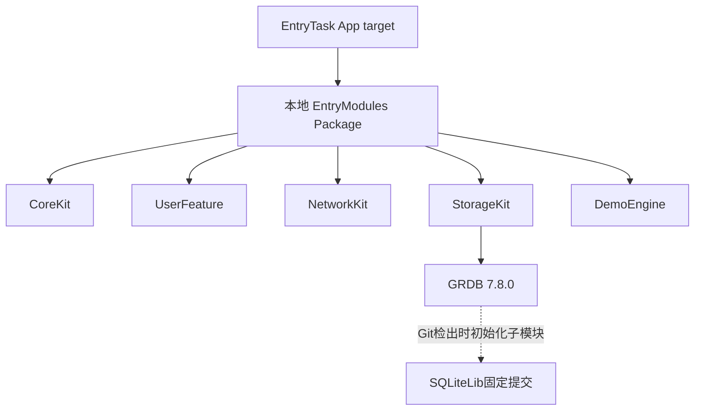

# iOS 编译失败处理记录：五个 Missing package product

记录日期：2026-10-28。适用工程：EntryTask iOS workspace。

本记录整理本次已经发生的故障、分析证据、处理命令和修复后操作。它与长期架构方案分开维护，不将临时排障流程写入 AGENTS.md。

**结论：五个产品缺失来自同一条依赖解析失败链路。** Xcode 下载 GRDB 及其 SQLiteLib Git 子模块时遇到网络错误，Package Graph 未完整解析，连带报告本地五个产品缺失。补齐并核验锁定提交的依赖缓存后，标准 workspace 解析成功，默认 DerivedData 下的 iPhone 18 Pro Debug 构建成功。

本次没有修改业务代码、Package 版本、模块划分或用户数据；没有通过删除 Codegen、跳过子模块或更换网络/存储实现消除错误。

## 1. 故障现象与影响

用户双击 `ios/EntryTask.xcworkspace`，在 Xcode 选择 EntryTask 和 iPhone 18 Pro，点击 Run，界面显示 Build Failed，并报告：

```text
Missing package product 'CoreKit'
Missing package product 'UserFeature'
Missing package product 'NetworkKit'
Missing package product 'StorageKit'
Missing package product 'DemoEngine'
```

这些是**依赖产品解析阶段的错误**，此时应用尚未完成构建，不应按“登录、页面或 RN 运行异常”处理。

五个名称都是 [EntryModules/Package.swift](../../ios/Packages/EntryModules/Package.swift) 对外提供的 library product；它们不是五个需要分别下载的第三方包。

## 2. 问题分析与证据

### 2.1 实际依赖关系



SQLiteLib 在这里是 GRDB 仓库的 **Git 子模块**，不是本项目额外声明的 Swift Package。当前 GRDB SwiftPM 产品使用系统 SQLite 的链接方式；Git 检出仍会初始化仓库声明的子模块。不能因为应用没有直接使用 SQLiteCustom 产品，就假定下载阶段不会涉及它。

### 2.2 先排除本地工程声明丢失

检查了以下文件：

| 文件 | 检查结果 |
| --- | --- |
| [project.pbxproj](../../ios/EntryTask.xcodeproj/project.pbxproj) | 存在 XCLocalSwiftPackageReference，relativePath 为 Packages/EntryModules |
| [Package.swift](../../ios/Packages/EntryModules/Package.swift) | 五个 product/target 均存在，名称与 App 引用一致 |
| [workspace 组成文件](../../ios/EntryTask.xcworkspace/contents.xcworkspacedata) | 包含 EntryTask.xcodeproj 和 Pods/Pods.xcodeproj |
| [workspace Package.resolved](../../ios/EntryTask.xcworkspace/xcshareddata/swiftpm/Package.resolved) | GRDB 固定为 7.8.0，指向官方源和固定提交 |

因此，没有直接删除、重建五个产品，也没有修改本地 Package 路径来试错。随后转向 Package 解析的第一条实际失败。

### 2.3 Xcode 原始日志中的第一层根因

读取本次 Xcode Build / Package 的 `.xcactivitylog` 后，发现五条 Missing package product 之前还有：

```text
Failed to resolve package dependencies
fatal: unable to access 'https://github.com/groue/GRDB.swift.git/':
Failed to connect to github.com port 443 after 75004 ms:
Couldn't connect to server
```

这个证据说明：界面里的五条产品缺失是连带结果，首先失败的是第三方依赖下载。

### 2.4 标准命令复现出的第二层根因

之后执行标准 workspace 依赖解析。GRDB 本体可以使用已有缓存，但在初始化子模块时失败：

```text
Checking out 7.8.0 of package ‘GRDB.swift’
Couldn’t update repository submodules:
Submodule 'SQLiteCustom/src'
(https://github.com/swiftlyfalling/SQLiteLib.git)
registered for path 'SQLiteCustom/src'

fatal: unable to access 'https://github.com/swiftlyfalling/SQLiteLib.git/':
Error in the HTTP2 framing layer

Failed to connect to github.com port 443 after 75003 ms:
Couldn't connect to server

Failed to clone 'SQLiteCustom/src' a second time, aborting
xcodebuild: error: Could not resolve package dependencies
```

必须同时处理本体和子模块的完整检出，不能只确认 GRDB 目录存在。

### 2.5 为什么此前构建通过，直接点击 Run 仍会失败

此前实施验证使用过独立 DerivedData / SwiftPM 缓存，以及针对该受限网络环境的临时解析配置。它们证明了源码可以构建，但**没有证明 Xcode 默认目录中的依赖也已经准备完整**。

本次直接打开 workspace 使用默认依赖目录，重新遇到 GitHub 下载失败。验证遗漏是没有覆盖这条常规入口，而不是能够从此前构建结果推断用户操作有误。

## 3. 处理步骤与实际命令

### 3.1 命令记录约定

- 未标注时，工程命令在仓库根执行；xcodebuild 命令在 `ios/` 执行。
- 下文 `/tmp/entrytask-...` 是当次临时文件名，可能被系统清理，不作为长期交付依赖。
- 用户目录、默认 DerivedData 的随机哈希使用占位符代替，避免把本机路径变成团队配置。
- 命令按实际操作整理，路径变量用于替代当次绝对路径；占位符不能原样复制运行。
- 日志仅保留与依赖有关的必要片段，未把完整设备日志、签名信息或本机环境提交进仓库。

### 3.2 检查工作区与工程引用

```sh
# 仓库根
git status --short
cat ios/Packages/EntryModules/Package.swift
rg -n -A12 -B5 'XCLocalSwiftPackageReference|XCSwiftPackageProductDependency|packageReferences|relativePath|productName' \
   ios/EntryTask.xcodeproj/project.pbxproj
cat ios/EntryTask.xcworkspace/contents.xcworkspacedata
cat ios/EntryTask.xcworkspace/xcshareddata/swiftpm/Package.resolved
```

同时阅读根及 iOS AGENTS.md，保护此前尚未提交的源码和文档，不重置工作区。

### 3.3 使用标准 workspace 解析复现

```sh
# ios/ 目录
xcodebuild -resolvePackageDependencies \
  -workspace EntryTask.xcworkspace \
  -scheme EntryTask \
  > /tmp/entrytask-ios-standard-resolve.log 2>&1
```

观察日志：

```sh
cat /tmp/entrytask-ios-standard-resolve.log
```

实际结果：在 SQLiteCustom/src 子模块下载阶段失败，未解析成功。

排查过程中还通过 `ps -Ao pid,ppid,etime,command` 查看本次 xcodebuild 的子进程，确认等待发生在 `git submodule update --init --recursive` 和 SQLiteLib 的 clone，避免把网络等待当作 Swift 编译卡住。进程编号只对当时有效，不记录为可复用配置。

### 3.4 读取 IDE 的压缩活动日志

先定位日志：

```sh
# 任意目录；HOME仅用于读取用户目录
rg --files "$HOME/Library/Developer/Xcode/DerivedData" \
  | rg 'EntryTask-.*/Logs/(Build|Package)/.*\.xcactivitylog$'
```

本次使用 Python 的 `gzip.decompress` 解压活动日志，再提取可读字符串。下面是相同方法的单文件整理版本；将路径替换为本次错误对应的日志：

```python
import gzip
import re
from pathlib import Path

log = Path("<实际的.xcactivitylog路径>")
data = gzip.decompress(log.read_bytes())
for item in re.findall(rb"[ -~]{12,}", data):
    if any(word in item.lower() for word in [
        b"failed to", b"could not", b"error:", b"missing package"
    ]):
        print(item.decode())
```

这只是定位必要英文诊断的辅助手段，不是完整的 Xcode 日志格式解析器。普通使用者优先在 Report Navigator 展开 Resolve Packages 和失败步骤查看。

### 3.5 确认版本与子模块精确提交

本次先从实际检出的 GRDB 仓库确认 HEAD 和 gitlink：

```sh
# 替换为当前工作区的真实检出目录
GRDB_CHECKOUT="<默认DerivedData>/EntryTask-<工作区哈希>/SourcePackages/checkouts/GRDB.swift"

git -C "$GRDB_CHECKOUT" rev-parse HEAD
git -C "$GRDB_CHECKOUT" ls-tree HEAD SQLiteCustom/src
cat "$GRDB_CHECKOUT/.gitmodules"
```

实际核对结果：

| 对象 | 固定值 |
| --- | --- |
| GRDB 版本 | 7.8.0 |
| GRDB 提交 | `18497b68fdbb3a09528d260a0a0e1e7e61c8c53d` |
| SQLiteCustom/src gitlink | `69395d1f72e61f37cf2e5164c054d85c80d5481c` |
| SQLiteLib 文件树 | `cf3cbe68c1292dc4008c70dc9c7a2feceb075ad7` |

这样确定恢复的是锁定版本要求的内容，而不是任意最新 SQLiteLib。

### 3.6 从官方接口下载可核验资料

Git clone 通道失败时，当次仍能访问 GitHub API 与 codeload。实际下载命令如下，文件均进入临时目录：

```sh
curl -L --fail --connect-timeout 10 --max-time 40 \
  -o /tmp/entrytask-sqlitelib-commit.json \
  https://api.github.com/repos/swiftlyfalling/SQLiteLib/git/commits/69395d1f72e61f37cf2e5164c054d85c80d5481c

curl -L --fail --connect-timeout 10 --max-time 90 \
  -o /tmp/entrytask-sqlitelib.tar.gz \
  https://codeload.github.com/swiftlyfalling/SQLiteLib/tar.gz/69395d1f72e61f37cf2e5164c054d85c80d5481c

curl -L --fail --connect-timeout 10 --max-time 40 \
  -o /tmp/entrytask-sqlitelib-tree.json \
  'https://api.github.com/repos/swiftlyfalling/SQLiteLib/git/trees/cf3cbe68c1292dc4008c70dc9c7a2feceb075ad7?recursive=1'
```

`--fail` 让 HTTP 错误产生失败退出码；连接和总时长上限避免无限等待。此次成功不代表这些域名在所有网络环境都可访问。

### 3.7 核验归档并准备固定提交缓存

当次创建并运行临时 Python 核验脚本：

```sh
python3 /tmp/entrytask_verify_sqlite_cache.py
```

脚本的实际完整内容保留在本记录[附录 A](#附录-a-当次-sqlitelib-缓存核验脚本)，不要求以后仍能找到这个临时文件。

核验内容：

1. 归档解压至独立临时目录，不放入业务源码。
2. 建立临时 Git 对象库，对比官方 tree 中每个 blob 的路径、文件模式和对象哈希。
3. 确认递归 tree 没有截断，构建出的根 tree 与官方值相同。
4. 利用官方 API 返回的 payload 和签名字段还原 commit 对象，确认哈希与 GRDB 要求的 gitlink 一致。
5. 标记这是固定提交的浅缓存，不虚构缺失的父提交历史。

实际输出：

```text
Verified official SQLiteLib: 2241 blobs;
tree cf3cbe68c1292dc4008c70dc9c7a2feceb075ad7
commit 69395d1f72e61f37cf2e5164c054d85c80d5481c
```

官方递归 tree 共 2313 个条目，其中 2241 个 blob，没有嵌套 Git 子模块。这里的核验基于官方 HTTPS 来源、Git 内容哈希以及 API 返回信息；**脚本没有另行执行本地 PGP 信任链验证**，不应把它描述为独立的离线签名审计。

### 3.8 安装到本工作区实际使用的依赖缓存

先确认：没有仍在修改同一检出目录的解析进程；GRDB HEAD 符合上表；目标 SQLiteCustom/src 是本次失败留下的空目录。不要覆盖其他工程或已有改动。

实际 Git 操作按以下方式整理，`GRDB_CHECKOUT` 为第 3.5 节确认的当前目录：

```sh
git clone --no-hardlinks /tmp/entrytask-sqlitelib-verified \
  "$GRDB_CHECKOUT/SQLiteCustom/src"

git -C "$GRDB_CHECKOUT/SQLiteCustom/src" remote set-url origin \
  https://github.com/swiftlyfalling/SQLiteLib.git

git -C "$GRDB_CHECKOUT" submodule absorbgitdirs SQLiteCustom/src

git -C "$GRDB_CHECKOUT" submodule update --init --recursive

git -C "$GRDB_CHECKOUT" status --porcelain
```

每一步成功后才继续下一步；本次终端执行时使用 `&&` 连接，前一步失败就停止。

各操作的含义：

| 操作 | 目的 |
| --- | --- |
| clone --no-hardlinks | 从已核验的临时固定提交复制完整对象，避免最终缓存依赖临时硬链接 |
| remote set-url | 把子模块 origin 保持为官方地址，不留下临时文件 URL |
| submodule absorbgitdirs | 使用标准 Git 命令把嵌入的 Git 目录整理为子模块结构 |
| submodule update | 按父仓库记录的精确提交完成正常子模块检出，未设置跳过 |
| status --porcelain | 确认恢复后父仓库工作树干净，没有源码差异 |

实际输出包含子模块 Git 目录迁移信息，最终 status 没有输出。本次是**依赖安装/缓存恢复**，没有通过编辑依赖源码来改变功能，也没有修改全局 Git 配置。

这段属于维护者执行的网络受限恢复路径。日常操作应先恢复依赖源网络并正常解析；不要求新人每次构建都手动操作 DerivedData。

## 4. 修复后的实际执行与结果

### 4.1 重新执行标准依赖解析

```sh
# ios/ 目录
xcodebuild -resolvePackageDependencies \
  -workspace EntryTask.xcworkspace \
  -scheme EntryTask \
  > /tmp/entrytask-ios-standard-resolve-fixed.log 2>&1
```

实际成功输出（本机项目绝对路径已省略）：

```text
Resolved source packages:
  GRDB: https://github.com/groue/GRDB.swift.git @ 7.8.0
  EntryModules: <当前仓库>/ios/Packages/EntryModules @ local

resolved source packages: GRDB, EntryModules
```

检查 Xcode 默认 SourcePackages/workspace-state.json 时，也已出现本地 EntryModules 和 GRDB 的解析状态。该文件是本机构建缓存，不提交到仓库，不将其手工写成成功状态。

### 4.2 查询当前可用 destination

```sh
# ios/ 目录
xcodebuild -showdestinations \
  -workspace EntryTask.xcworkspace \
  -scheme EntryTask \
  > /tmp/entrytask-ios-current-destinations.log 2>&1
```

本次确认存在 iPhone 18 Pro / iOS 27.0 / arm64 Simulator。没有把本机 UDID 写成团队固定配置；其他机器应重新查询实际设备。

### 4.3 使用默认目录执行标准 Debug 构建

```sh
# ios/ 目录
xcodebuild \
  -workspace EntryTask.xcworkspace \
  -scheme EntryTask \
  -configuration Debug \
  -destination 'platform=iOS Simulator,name=iPhone 18 Pro' \
  build > /tmp/entrytask-ios-standard-build.log 2>&1
```

此处设备名称是**本次实际使用的值**，换机器需按查询结果替换。

这条命令没有使用：

- 自定义 `-derivedDataPath` 或 `-clonedSourcePackagesDirPath`。
- 临时 SwiftPM mirror、Git URL 映射或 `GIT_CONFIG_*` 环境变量。
- `-skipPackageUpdates` 或跳过子模块的设置。
- `CODE_SIGNING_ALLOWED=NO` 等替代默认模拟器签名的参数。

因此，本次覆盖了此前遗漏的默认构建目录和标准解析路径。命令行 build 与 Xcode 使用同一 workspace/工程配置，但它本身不等于已经点击 IDE Run 完成安装和交互。

### 4.4 构建证据

实际日志确认：

```text
Resolved source packages:
  EntryModules: <当前仓库>/ios/Packages/EntryModules @ local
  GRDB: https://github.com/groue/GRDB.swift.git @ 7.8.0

... Swift模块编译、应用链接 ...
iOS runtime resources: 81 JSON files
... CodeSign ...
Signing Identity: "Sign to Run Locally"

** BUILD SUCCEEDED **
```

五个产品正常参与构建，未再出现五条 Missing package product。仍存在 RN/Hermes 脚本因未声明输出而每次执行等 warning/note，它们没有导致此次构建失败；不为消除提示随意修改 Pods 或删脚本。

### 4.5 同步文档检查

当次还执行了：

```sh
# 仓库根
node tools/check-ios-architecture.cjs
git diff --check
```

结果通过；相关文档本地链接和目录锚点检查也通过。保留 Package.resolved 中 GRDB 的官方 URL、7.8.0 和固定提交，没有依赖版本漂移。

## 5. 修复后在 Xcode 中怎样操作

以下是提供给用户继续运行的步骤，**本次没有通过 GUI 实际点击确认**，不能写成“已在 IDE 成功运行到首页”。

1. 打开 `ios/EntryTask.xcworkspace`，不要改为只打开 xcodeproj。
2. 在 File → Packages → Resolve Package Versions 中重新解析（菜单名称以当前版本为准），等待完成。不要选择全量升级版本。
3. 顶部选择 EntryTask scheme、Debug 和实际 iPhone Simulator。
4. 点击 Run，或按 ⌘R。若仍显示旧的解析错误，先关闭并重新打开当前 workspace，再解析和运行。
5. 构建通过后观察是否安装、启动。需要 RN Debug 业务页时，在仓库根独立终端运行 `npm start`，已有正确 Metro 时复用它。
6. 应用启动后先进行 Native 认证；认证成功后才加载当前 RN 业务页。进入首页后再检查 Tab、Mock 请求和日志。

说明：本次处理没有实现 iOS 的“CLI 使用 RN、Xcode 使用 Native 四页”双模式。依赖修复和页面模式需求属于不同工作，不能用本次构建通过宣称双模式已完成。

如果 Run 之后才出现 Metro 连通、签名或页面问题，按新的第一条具体错误继续排查，不把所有后续问题归到本次五产品解析错误。

## 6. 交付范围与未验证项

| 项目 | 本次结果 |
| --- | --- |
| 本地五个 Package product 引用检查 | 有效，未修改产品声明 |
| IDE 原始依赖失败定位 | 确认 GRDB GitHub 超时 |
| 标准解析复现 | 确认 SQLiteLib 子模块下载失败 |
| 官方固定提交恢复与内容核验 | 完成；2241 blobs、tree、commit 一致 |
| 默认 workspace 依赖解析 | 成功 |
| 默认 DerivedData 的 Debug Simulator build | 成功，使用正常本地模拟器签名 |
| 资源生成步骤 | 构建日志报告 81 个 JSON；本次未再次逐项比较其摘要 |
| 模块边界与文档检查 | 通过 |
| IDE 点击 Run、实际安装及页面交互 | 本次未执行，已提供操作步骤 |
| 本次重新执行单测/UI测试/Release/真机 | 未执行；故障定位为依赖准备问题，不复用历史结果冒充本次验证 |
| 任意新机器、空全局缓存、持续网络连通性 | 未证明；仍需依赖源可达或经过核验的缓存 |

源代码层面没有为这个故障改动 Swift、ObjC++、Package.swift、模块名称、应用身份或 Android。排障完成时更新了 [iOS README](../../ios/README.md#xcode-提示-missing-package-product) 和 [iOS 新手指南](iOS基础与调试新手指南.md)；本文件在随后单独补录。

工作区中已有的 iOS 实施改动并不全部属于本次排障。审查时不能只看总 git diff，就把此前新增模块等变更归为“修复这五个错误所做的修改”。

## 7. 复发时的最短排查路线

```text
五个产品同时缺失
  → 看 Resolve Packages 的第一条失败
  → 本地路径/清单有问题：修真实引用
  → 依赖下载失败：检查GRDB与SQLiteLib网络/检出
  → 解析成功后，标准默认目录构建
  → IDE重新解析并Run
  → 构建、安装、启动、交互分别确认
```

不要先删除锁文件、重建五个模块、升级 GRDB、清空所有缓存或卸载应用。这些操作没有解决已确认的网络根因，还可能引入更多下载或数据问题。

这次缓存恢复让本机可以按锁定版本构建，**没有修复外部网络本身**。清理缓存、换机器或新增依赖后仍可能需要下载，应先保证官方依赖源可达；不能依赖一个长期存在的 `/tmp` 目录，也不提交个人镜像配置作为团队方案。

## 附录 A 当次 SQLiteLib 缓存核验脚本

以下保留当次临时脚本内容，便于理解核验过程。它依赖第 3.6 节下载的三个文件，只针对本次固定官方提交；不是通用的依赖下载工具或团队必跑构建步骤。

```python
import json,tarfile,subprocess,hashlib
from pathlib import Path
root=Path('/tmp/entrytask-sqlitelib-verified')
root.mkdir(exist_ok=True)
with tarfile.open('/tmp/entrytask-sqlitelib.tar.gz') as archive:
 for member in archive.getmembers():
  parts=Path(member.name).parts[1:]
  if not parts:continue
  assert '..' not in parts
  member.name=str(Path(*parts))
  archive.extract(member,root)
def git(*args,input=None):
 return subprocess.check_output(['git','-C',str(root),*args],input=input).decode().strip()
if not (root/'.git').exists():git('init','--quiet')
git('-c','core.autocrlf=false','add','-f','.')
m=json.load(open('/tmp/entrytask-sqlitelib-commit.json'))
t=json.load(open('/tmp/entrytask-sqlitelib-tree.json'))
assert not t['truncated']
indexed={line.split('\t',1)[1]:line.split()[:2] for line in git('ls-files','--stage').splitlines()}
expected={e['path']:[e['mode'],e['sha']] for e in t['tree'] if e['type']=='blob'}
assert indexed==expected,[(p,indexed.get(p),v) for p,v in expected.items() if indexed.get(p)!=v][:8]
assert git('write-tree')==m['tree']['sha']
headers,body=m['verification']['payload'].split('\n\n',1)
found=None
for signature in [m['verification']['signature'],m['verification']['signature'].rstrip('\n')]:
 for end in ['', '\n']:
  raw=(headers+'\ngpgsig '+signature.replace('\n','\n ')+'\n\n'+body+end).encode()
  digest=hashlib.sha1(f'commit {len(raw)}\0'.encode()+raw).hexdigest()
  if digest==m['sha']:found=raw
assert found is not None,'Official signed commit hash mismatch'
assert git('hash-object','-w','-t','commit','--stdin',input=found)==m['sha']
git('update-ref','refs/heads/verified',m['sha'])
git('symbolic-ref','HEAD','refs/heads/verified')
(root/'.git/shallow').write_text(m['sha']+'\n')
print('Verified official SQLiteLib:',len(expected),'blobs; tree',m['tree']['sha'],'commit',m['sha'])
```
