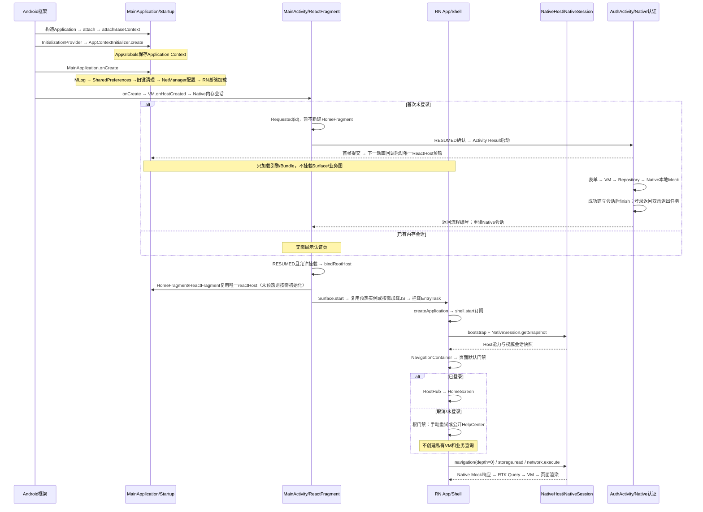

# EntryTask 启动与登录全链路源码详解

核对日期：2026-10-21。范围：当前 Android + RN 源码，默认 `HomeFragment.USE_REACT_NATIVE=true`，从冷启动到登录成功、首页请求及后续会话变化。本文是源码调用链说明，不是设备时序实测，不将技术方案中的待实施能力当成现有实现。

代码链接指向实际源码文件，关键改造方法标注本次核对的起始行；其他表格可按类和方法搜索定位。`node_modules/` 的框架代码需 `npm ci` 后存在，`android/app/build/generated/` 的 Codegen/入口代码需原生构建后生成，均不能手工维护。Android 框架步骤已对照本机 SDK 36 源码，不在仓库虚构一个 attachBaseContext 实现。

## 1. 先明确几个关键结论

| 问题 | 当前实际行为 | 对应代码 |
| --- | --- | --- |
| 是否在 attachBaseContext 初始化业务？ | 否。MainApplication 直接继承 Application，没有 override attachBaseContext；只经过框架默认的 Context 绑定 | [MainApplication](../../android/app/src/main/java/com/entrytask/MainApplication.kt) |
| 谁最先初始化 AppGlobals？ | lib_base Manifest 注册的 Startup Provider，在 Application.onCreate 前调用 AppContextInitializer.create | [Startup Provider注册](../../android/lib_base/src/main/AndroidManifest.xml)、[AppContextInitializer.create](../../android/lib_base/src/main/java/com/entry/lib/base/AppContextInitializer.kt) |
| loadReactNative 是否等于加载首页？ | 否。先初始化 SoLoader/新架构入口；认证首帧后可预热唯一引擎/Bundle；ReactFragment后续创建Surface并挂载组件，最后通过页面门禁才创建业务首页 | [生成的loadReactNative入口](../../android/app/build/generated/autolinking/src/main/java/com/facebook/react/ReactNativeApplicationEntryPoint.java)、[RN ReactFragment.onCreateView](../../node_modules/react-native/ReactAndroid/src/main/java/com/facebook/react/ReactFragment.kt)、[AppNavigator认证分支](../../src/app/navigation/AppNavigator.tsx) |
| 谁判断登录？ | MainActivity.onCreate 先通过 MainViewModel/Repository 读取 Native 内存会话；RN 挂载后再经 Session Bridge 校准，按集中页面策略门禁 | [application.bootstrap](../../src/app/CompositionRoot.ts)、[NativeGateway.session](../../src/platform/native/NativeGateway.ts)、[SessionModule.getSnapshot](../../android/app/src/main/java/com/entrytask/bridge/SessionModule.kt)、[AppNavigator认证分支](../../src/app/navigation/AppNavigator.tsx) |
| 打开登录页是否跨端？ | 首次否，由 MainActivity/VM 提前打开；后续 RN 受保护页是：RN → HostPort/NativeGateway → NativeHost TurboModule → HostModule → ShellBridgeAdapter → ForegroundHostConnection → MainViewModel → Activity Result → AuthActivity | [ShellViewModel.command · L83](../../src/app/navigation/ShellViewModel.ts#L83)、[HostModule.command · L43](../../android/app/src/main/java/com/entrytask/bridge/HostModule.kt#L43)、[MainViewModel.requestAuthentication](../../android/app/src/main/java/com/entrytask/shell/presentation/MainViewModel.kt) |
| 输入账号密码后是否再走 RN Bridge？ | 否。登录表单、VM、Repository、Retrofit 和本地认证 Mock 都在 Android；凭证不经过 RN | [LoginRoute](../../android/biz_user/src/main/java/com/entry/biz/user/ui/LoginScreen.kt)、[UserViewModel.login](../../android/biz_user/src/main/java/com/entry/biz/user/viewmodel/UserViewModel.kt)、[UserRepository.login](../../android/biz_user/src/main/java/com/entry/biz/user/repository/UserRepository.kt)、[UserService认证接口](../../android/biz_user/src/main/java/com/entry/biz/user/network/UserService.kt) |
| 谁通知 RN 登录成功？ | AuthActivity setResult 后只关闭自己；MainActivity 的 Activity Result 回调及 onResume 重读会话并发布 Shell 快照，NativeHost.onHostEvent 跨端通知 RN | [AuthActivity.onCreate及成功回调](../../android/biz_user/src/main/java/com/entry/biz/user/ui/AuthActivity.kt)、[MainActivity.onResume](../../android/app/src/main/java/com/entrytask/MainActivity.kt)、[DefaultShellRepository.refreshSession · L29](../../android/app/src/main/java/com/entrytask/shell/data/DefaultShellRepository.kt#L29)、[NativeGateway.observeShell · L95](../../src/platform/native/NativeGateway.ts#L95) |
| 是否销毁/重建 MainActivity、RN Host？ | 正常认证往返均保留；没有成功后 startActivity(MainActivity) 或创建第二个 Host | [MainActivity的Activity Result启动](../../android/app/src/main/java/com/entrytask/MainActivity.kt)、[MainApplication.reactHost · L22](../../android/app/src/main/java/com/entrytask/MainApplication.kt#L22) |

“RN 根组件已挂载”“bootstrap 已完成”“用户已登录”“首页数据已加载”是四个不同阶段；`App.phase='ready'` 只表示启动握手/会话查询完成，不代表已登录。

## 2. 冷启动总时序



图中只表达依赖先后。Fragment transaction 的 `commit()`、RN runtime/Bundle、React effect、Promise 和事件均包含异步调度；不能把图理解为某个 Android 生命周期回调一定先于每条 JS 日志。MainActivity 首次 onResume 可能早于 RN 订阅，bootstrap 返回完整快照用于补齐；认证返回后的 publish 则用于推送变化。

## 3. 安装包与入口：运行前必须已成立的条件

| 步骤 | 执行方/方法 | 做了什么 | 代码 |
| --- | --- | --- | --- |
| P01 | Manifest 合并 | 安装身份为 com.entrytask，Application 为 .MainApplication，Launcher 为 singleTask MainActivity；AuthActivity 是非 exported Activity | [Application/Activity注册](../../android/app/src/main/AndroidManifest.xml) |
| P02 | RN Gradle / Metro | Android Bundle 入口 src/index.js；开发 Host 请求 src/index，Metro保留根目录解析 | [Android Bundle入口](../../android/app/build.gradle)、[MainApplication.reactHost · L22](../../android/app/src/main/java/com/entrytask/MainApplication.kt#L22)、[Metro配置](../../metro.config.js) |
| P03 | Codegen | package.json 从 specs/ 生成 Java/JNI 传输接口；RN 与 Native 模块名必须一致 | [Codegen配置](../../package.json)、[NativeHost.Spec](../../specs/NativeHost.ts)、[NativeSession.Spec](../../specs/NativeSession.ts) |
| P04 | 资源生产任务 | validateRuntimeResources → prepare&lt;Variant&gt;RuntimeResources → merge&lt;Variant&gt;Assets，contracts/mock进入APK | [运行时资源打包任务](../../android/app/build.gradle) |

这些是构建步骤，不是在 attachBaseContext 中执行。Debug 需要 Metro 提供 JS；当前 release 由 Gradle 打包 JS Bundle。contracts/mock 是 APK assets，不由 Metro 在运行时传给 Android。

## 4. Application：从 attachBaseContext 到 onCreate

### A01：框架创建 Application 并绑定 Context

Android 框架链为 `ActivityThread.handleBindApplication → LoadedApk.makeApplicationInner → Instrumentation.newApplication → Application.attach → attachBaseContext`。SDK 36 中 Instrumentation.newApplication 调用 `app.attach(context)`，Application.attach 再调用 attachBaseContext。工程选用的类由 [Application/Activity注册](../../android/app/src/main/AndroidManifest.xml) 指定；[MainApplication](../../android/app/src/main/java/com/entrytask/MainApplication.kt) 没有 override 此方法，因此此阶段没有项目自定义的日志、存储、网络、会话检查或 RN 页面加载。

构造 MainApplication 时会建立 shellGraph、reactHost、prototypeNetwork 三个 Kotlin lazy 属性的持有器，但不会立即执行 `reactHost`、`prototypeNetwork` 的构造 lambda。它们的首次求值见后文。框架入口可对照 [Application API](https://developer.android.com/reference/android/app/Application)；SDK 源码位置为 `android/app/Instrumentation.java:newApplication` 和 `android/app/Application.java:attach`。

### A02：Startup Provider 初始化应用信息代理

在正常应用进程绑定过程中，框架安装 ContentProvider，之后才调用 Application.onCreate。Application API 明确区分了 ContentProvider 与其他组件的初始化时点；Startup 的发现与依赖调用机制见 [Android Startup 文档](https://developer.android.com/topic/libraries/app-startup)。

| 顺序 | 方法/配置 | 当前动作 | 代码 |
| --- | --- | --- | --- |
| A02.1 | lib_base Manifest provider/meta-data | `${applicationId}.androidx-startup` 注册 AppContextInitializer | [Startup Provider注册](../../android/lib_base/src/main/AndroidManifest.xml) |
| A02.2 | InitializationProvider.onCreate / AppInitializer | 框架库发现Initializer并解析dependencies；本项目返回空依赖列表 | [Initializer.dependencies](../../android/lib_base/src/main/java/com/entry/lib/base/AppContextInitializer.kt) |
| A02.3 | AppContextInitializer.create | 取 context.applicationContext，调用 AppGlobals.initialize，返回该Context | [AppContextInitializer.create](../../android/lib_base/src/main/java/com/entry/lib/base/AppContextInitializer.kt) |
| A02.4 | AppGlobals.initialize | 保存Context；后续 context getter 检查是否初始化，applicationId/isDebug 按需读取宿主信息 | [AppGlobals.initialize](../../android/lib_base/src/main/java/com/entry/lib/base/AppGlobals.kt)、[AppGlobals.context](../../android/lib_base/src/main/java/com/entry/lib/base/AppGlobals.kt) |

这里尚未执行 MainApplication 的 MLog.init；Initializer 注释提到的日志/MMKV“可以初始化”不是实际调用。当前 Startup 只注入 Context，不读取账号，不检查登录，也不创建 RN Host。其他依赖可能另有 Startup Initializer，本文不假定无依赖的 Initializer 之间存在固定顺序。

### A03～A08：MainApplication.onCreate 内的确定顺序

执行于 Android 主线程；以下顺序是当前方法体的显式顺序。

| 步骤 | 调用 | 初始化/副作用 | 此时尚未发生 | 代码 |
| --- | --- | --- | --- | --- |
| A03 | super.onCreate | 进入Application生命周期 | 无项目业务启动 | [MainApplication.onCreate](../../android/app/src/main/java/com/entrytask/MainApplication.kt) |
| A04 | MLog.init | 根据宿主BuildConfig.DEBUG设置日志等级，随后写 application.started | 尚未创建RN Logger | [MainApplication.onCreate](../../android/app/src/main/java/com/entrytask/MainApplication.kt)、[MLog.init](../../android/lib_base/src/main/java/com/entry/lib/log/MLog.kt) |
| A05 | StorageManager.init(this) | 保存 app_default_pref 的 SharedPreferences 句柄 | 没有初始化MMKV/DataStore/Room；源码“初始化MMKV”注释与实现不符 | [StorageManager.init](../../android/lib_storage/src/main/java/com/entry/lib/stroage/StorageManager.kt) |
| A06 | getSharedPreferences(...).edit().remove(...).apply | 仅删除 key_token 旧会话键；保留mock_reg/mock_db账号供认证后台迁移，apply的磁盘写入异步 | 不读取Token恢复登录；不是清空所有账号数据 | [MainApplication.onCreate](../../android/app/src/main/java/com/entrytask/MainApplication.kt) |
| A07 | NetManager.initMock | 将 baseUrl 设为 https://entrytask.invalid/ | 没有执行Retrofit请求；lazy的OkHttp/Retrofit还未必构造 | [NetManager.initMock](../../android/lib_net/src/main/java/com/entry/lib/net/NetManager.kt) |
| A08 | loadReactNative(this) | 生成入口调用SoLoader.init；按BuildConfig加载新架构入口/可选edge-to-edge开关 | 不会在这里调用项目AppRegistry或直接显示HomeScreen | [MainApplication.onCreate](../../android/app/src/main/java/com/entrytask/MainApplication.kt)、[生成的loadReactNative入口](../../android/app/build/generated/autolinking/src/main/java/com/facebook/react/ReactNativeApplicationEntryPoint.java) |

A09：`MainApplication.onCreate` 在 `loadReactNative` 后注册 [AuthWarmupLifecycle](../../android/app/src/main/java/com/entrytask/shell/runtime/AuthWarmupLifecycle.kt)。这里只登记生命周期观察，不创建ReactHost；当前预热默认关闭，可用entrytaskRnWarmup=true显式启用。认证DecorView附着后监听首帧提交，下一动画回调才调用唯一Host.start；Native-only、低内存、已有Surface请求或本进程已尝试时不再启动。详细异步步骤和失败边界见 [ADR-012](../adr/012-rn-engine-warmup.md)。

UserAuthManager 是 Kotlin object，首次被访问时才建立对象；默认登录标记为 false、epoch=0，不从 SharedPreferences 自动恢复会话。实际首次访问由 ShellGraph 构造 DefaultShellRepository 时读取安全会话引发，不等同于 Application.onCreate 中有显式会话初始化步骤。代码：[UserAuthManager内存状态](../../android/biz_user/src/main/java/com/entry/biz/user/manager/UserAuthManager.kt)。

## 5. XML Shell、MVVM与RN Surface挂载

| 步骤 | 类/方法 | 动作、恢复与状态 | 代码 |
| --- | --- | --- | --- |
| B01 | MainActivity.onCreate | 在 super 前安装 RNScreensFragmentFactory；读取旧 root_tab；setContentView 加载 XML，调用 VM.onHostCreated 先校验会话并配置系统栏；首次游客只请求认证，不新建根片段 | [MainActivity.onCreate](../../android/app/src/main/java/com/entrytask/MainActivity.kt)、[MainActivity.bindRootHost](../../android/app/src/main/java/com/entrytask/MainActivity.kt) |
| B02 | MainApplication.shellGraph → ShellGraph | lazy 创建 UserAuthSessionAdapter、DefaultShellRepository、ForegroundHostConnection、ShellBridgeAdapter；不创建 Activity 或 RN Host | [MainApplication.shellGraph · L14](../../android/app/src/main/java/com/entrytask/MainApplication.kt#L14)、[ShellGraph · L9](../../android/app/src/main/java/com/entrytask/shell/di/ShellGraph.kt#L9) |
| B03 | MainActivity.viewModel factory → MainViewModel.init | createSavedStateHandle；仅在新 key 缺失时迁移旧 root_tab；Repository.restoreSelection 优先同进程已有选择，新进程游客回首页；保存非敏感 Tab、首次检查标记、认证 UI 阶段及流程编号 | [MainActivity.viewModel](../../android/app/src/main/java/com/entrytask/MainActivity.kt)、[MainViewModel.init](../../android/app/src/main/java/com/entrytask/shell/presentation/MainViewModel.kt)、[restoreSelection · L41](../../android/app/src/main/java/com/entrytask/shell/data/DefaultShellRepository.kt#L41) |
| B04 | MainActivity收集 → MainShellView.render | STARTED 区间收集 MainUiState，render 只设置底栏外观和整组显隐；点击只回调 VM。XML 宿主预留系统安全区，RN 按实际裁剪视口计算剩余 Insets | [MainActivity.onCreate](../../android/app/src/main/java/com/entrytask/MainActivity.kt)、[MainShellView](../../android/app/src/main/java/com/entrytask/shell/presentation/MainShellView.kt)、[XML布局](../../android/app/src/main/res/layout/activity_home.xml) |
| B05 | MainActivity.bindRootHost | 在 RESUMED 允许挂载时投递主线程任务，并复查会话协调状态及 isStateSaved；按 entrytask-root-hub 查找已有 HomeFragment，缺失才添加到 R.id.fragmentContainer；绑定 Activity/View 作用域 HostFragmentHandle，销毁清理。沿用旧 XML tag，无 Compose 自动tag迁移 | [bindRootHost](../../android/app/src/main/java/com/entrytask/MainActivity.kt)、[HostFragmentHandle](../../android/app/src/main/java/com/entrytask/shell/host/HostFragmentHandle.kt) |
| B06 | HomeFragment.getComponentName → BaseFragment.onCreateView | RN 模式返回 EntryTask，以 R.id.rn_content 创建 FrameLayout；Native-only 模式走原文本布局 | [HomeFragment](../../android/app/src/main/java/com/entrytask/home/HomeFragment.kt)、[BaseFragment.onCreateView](../../android/app/src/main/java/com/entrytask/base/BaseFragment.kt) |
| B07 | BaseFragment.onViewCreated → mountReactFragment | 先查 entrytask-rn-root，存在则复用；否则创建一个 ReactFragment 并 commit 到稳定容器 | [BaseFragment.onViewCreated](../../android/app/src/main/java/com/entrytask/base/BaseFragment.kt)、[mountReactFragment](../../android/app/src/main/java/com/entrytask/base/BaseFragment.kt) |
| B08 | ReactFragment.onCreate → MainApplication.reactHost | RN 取得 ReactApplication.reactHost 并构造 ReactDelegate；未预热时Application lazy getDefaultReactHost组装PackageList/EntryTaskPackage；已经预热则直接复用同一个Host | [ReactFragment.onCreate](../../node_modules/react-native/ReactAndroid/src/main/java/com/facebook/react/ReactFragment.kt)、[MainApplication.reactHost · L22](../../android/app/src/main/java/com/entrytask/MainApplication.kt#L22) |
| B09 | ReactFragment.onCreateView → ReactDelegate.loadApp | 新架构路径创建 Surface 并 start，RootView 被挂入 Android；未预热时Debug加载Metro、Release加载包内Bundle；已预热直接复用引擎与已调度的Bundle | [ReactFragment.onCreateView](../../node_modules/react-native/ReactAndroid/src/main/java/com/facebook/react/ReactFragment.kt)、[ReactDelegate.loadApp](../../node_modules/react-native/ReactAndroid/src/main/java/com/facebook/react/ReactDelegate.kt) |
| B10 | MainActivity.onResume / onPause | RESUMED 期间绑定 VM 的认证动作；onHostResumed 重读 Native 会话并强制发布。暂停立即解除前台端点，不自动重开认证 | [MainActivity.onResume](../../android/app/src/main/java/com/entrytask/MainActivity.kt)、[MainViewModel.onHostResumed](../../android/app/src/main/java/com/entrytask/shell/presentation/MainViewModel.kt) |
| B11 | ReactFragment.onResume/onPause | RN 框架转发 ReactDelegate 的 host 生命周期；认证覆盖只 pause，普通往返不卸载 RN App | [ReactFragment.onResume](../../node_modules/react-native/ReactAndroid/src/main/java/com/facebook/react/ReactFragment.kt) |

onCreate 先创建 XML 容器并取得 MainViewModel，onHostCreated 读取 Native 会话、记录首次检查并生成 Requested；RESUMED 收集器启动认证。首次未认证时没有新增 HomeFragment，不依赖 Metro。结果返回或启动失败后，canAttachContent 放行挂载；已有会话也直接放行。UI 收集器通过 decorView.post 避开 FragmentManager 正在派发生命周期的事务窗口，执行前再次确认 RESUMED、最新状态和未保存 Fragment 状态。

系统恢复的 Fragment 可在 super.onCreate/onStart 期间自动恢复，早于项目延迟挂载判断，不能宣称任何恢复路径都完全没有 RN 初始化；RN 页面边界仍负责阻止私有模型和数据查询。**ReactHost 属于进程，Surface 属于宿主视图；Tab/普通认证不替换已有宿主，Activity 重建仍可能重建 Surface。** 第二步增加登录首帧后的引擎/Bundle预热，不挂载Surface或业务图，见 [预热调用链与性能](rn-warmup-performance.md)。

## 6. TurboModule 如何连到 app/bridge 下的实现

这套跨端调用是当前 RN 新架构 TurboModule/Codegen 通路，文中“Bridge”是平台能力边界的通称，不表示工程又创建了旧架构 RCTBridge。

```text
RN platform/native/modules.ts
  → specs/NativeHost.ts / NativeSession.ts
  → TurboModuleRegistry.get('NativeHost' / 'NativeSession')
  → RN生成的JSI/JNI方法绑定
  → EntryTaskPackage.getModule(name, reactContext)
  → app/bridge/HostModule 或 SessionModule
  → Android具体能力 / Promise统一JSON信封
```

| 层 | 作用 | 对应代码 |
| --- | --- | --- |
| 模块清单 | MainApplication把EntryTaskPackage放入PackageList | [MainApplication.reactHost · L22](../../android/app/src/main/java/com/entrytask/MainApplication.kt#L22) |
| Native工厂 | getModule按模块名创建实现；getReactModuleInfoProvider标注TurboModule信息 | [EntryTaskPackage.getModule](../../android/app/src/main/java/com/entrytask/bridge/EntryTaskPackage.kt)、[EntryTaskPackage模块信息](../../android/app/src/main/java/com/entrytask/bridge/EntryTaskPackage.kt) |
| TS签名 | Host的bootstrap/command/EventEmitter，Session的getSnapshot | [NativeHost.Spec](../../specs/NativeHost.ts)、[NativeSession.Spec](../../specs/NativeSession.ts) |
| RN能力适配 | modules.ts集中导入specs；业务页面不直接访问原始NativeModule | [平台Codegen模块集中导入](../../src/platform/native/modules.ts) |
| 生成绑定 | NativeHostSpec/NativeSessionSpec定义方法、模块名及事件发射；JNI将方法调用接到实现 | [生成的NativeHostSpec](../../android/app/build/generated/source/codegen/java/com/entrytask/specs/NativeHostSpec.java)、[生成的NativeSessionSpec](../../android/app/build/generated/source/codegen/java/com/entrytask/specs/NativeSessionSpec.java)、[生成的JSI/JNI绑定](../../android/app/build/generated/source/codegen/jni/EntryTaskSpecs-generated.cpp) |
| 平台调用与解码 | NativeGateway编码参数、等待Promise、decodeReply验证信封和data形状 | [NativeGateway.command · L115](../../src/platform/native/NativeGateway.ts#L115)、[NativeGateway.decodeReply](../../src/platform/native/NativeGateway.ts) |
| Native返回 | BridgeReply.ok/error产生稳定JSON字符串，不返回原始异常对象 | [BridgeReply](../../android/app/src/main/java/com/entrytask/bridge/BridgeReply.kt) |

注册Package不等于Application.onCreate中已经new五个模块。模块依赖在JS import求值/TurboModule解析时被取得；当前 modules.ts 会导入多份spec，不能把每个模块的首次创建时间简单等同于第一次业务execute。模块构造与方法执行是不同阶段。

## 7. JS 入口、应用图和启动握手

| 步骤 | RN类/方法 | 动作与跨端情况 | 代码 |
| --- | --- | --- | --- |
| C01 | src/index.js模块求值 | import App及其依赖；AppRegistry.registerComponent注册EntryTask。import时的specs解析属于前述模块解析，注册本身不进行登录 | [JS注册入口](../../src/index.js) |
| C02 | App() → useState(createApplication) | 根组件每次Surface挂载创建一份应用图；phase初始loading，先显示准备态。不是每次render重建应用图 | [RN App](../../src/app/App.tsx) |
| C03 | createApplication | 构造Logger并setSink到nativeGateway.emitLogs；构造双Transport/Router、Store、RTK Query、ResourceClient和ShellViewModel | [createApplication](../../src/app/CompositionRoot.ts)、[createAppStore/baseQuery](../../src/infrastructure/state/createAppStore.ts)、[ResourceClient.source/open](../../src/infrastructure/state/ResourceClient.ts) |
| C04 | App.useEffect | createId生成flowId；调用application.bootstrap，成功设置phase=ready，失败归一错误并显示诊断码/重试按钮 | [RN App](../../src/app/App.tsx) |
| C05 | bootstrap → shell.start | 先订阅NativeHost.onHostEvent，再拉快照；订阅是跨端事件注册，不是HTTP请求 | [application.bootstrap](../../src/app/CompositionRoot.ts)、[ShellViewModel.start](../../src/app/navigation/ShellViewModel.ts)、[NativeGateway.observeShell · L95](../../src/platform/native/NativeGateway.ts#L95) |
| C06 | NativeGateway.bootstrap | JSON.stringify协议版本/flowId，经Host TurboModule跨端调用 | [NativeGateway.bootstrap](../../src/platform/native/NativeGateway.ts) |
| C07 | HostModule.bootstrap | Native读取APK contracts/bridge/runtime.json，校验协议；构造bootId、capabilities和ShellBridgeAdapter.snapshot；通过Promise返回 | [HostModule.bootstrap · L81](../../android/app/src/main/java/com/entrytask/bridge/HostModule.kt#L81)、[ShellBridgeAdapter.snapshot · L37](../../android/app/src/main/java/com/entrytask/bridge/ShellBridgeAdapter.kt#L37)、[运行时Bridge契约](../../contracts/bridge/runtime.json) |
| C08 | decodeReply → shell.accept | 验证protocolVersion、componentName和Shell字段；revision或sessionEpoch回退的快照被拒绝 | [NativeGateway.decodeReply](../../src/platform/native/NativeGateway.ts)、[Host响应校验](../../src/platform/native/NativeGateway.ts)、[ShellViewModel.accept · L35](../../src/app/navigation/ShellViewModel.ts#L35) |
| C09 | NativeGateway.session | 再调用NativeSession.getSnapshot('{}')，这是独立的RN→Native登录态查询 | [NativeGateway.session](../../src/platform/native/NativeGateway.ts) |
| C10 | SessionModule.getSnapshot | UserAuthManager.sessionSnapshot在同一锁内读取登录布尔值和epoch；只返回安全字段，不读取密码/Token给RN | [SessionModule.getSnapshot](../../android/app/src/main/java/com/entrytask/bridge/SessionModule.kt)、[UserAuthManager.sessionSnapshot](../../android/biz_user/src/main/java/com/entry/biz/user/manager/UserAuthManager.kt) |
| C11 | shell.acceptSession | Session不含Shell revision，按epoch判定新旧，只更新authenticated/sessionEpoch，不覆盖Tab/depth/revision | [ShellViewModel.acceptSession · L75](../../src/app/navigation/ShellViewModel.ts#L75) |
| C12 | bootstrap返回 → App.phase=ready | 写session.snapshot.checked/bootstrap.completed日志；App开始渲染AppNavigator，仍需检查authenticated | [application.bootstrap](../../src/app/CompositionRoot.ts)、[RN App](../../src/app/App.tsx) |

C03 仅构造查询封装，不代表已请求首页API；真正订阅在登录后RootHub/HomeScreen激活资源时发生。Logger连接Native sink早于Host握手，RN Console可独立输出；日志批量emitBatch也是跨端调用，但属于旁路诊断，不作为登录前置成功条件。代码：[Logger.setSink](../../src/infrastructure/logging/Logger.ts)、[NativeGateway.emitLogs](../../src/platform/native/NativeGateway.ts)、[TelemetryModule.emitBatch](../../android/app/src/main/java/com/entrytask/bridge/TelemetryModule.kt)。

两次读取的职责不同：Host bootstrap获得协议/能力/外壳快照，Session Bridge显式获得Native认证快照。它们不是两个登录存储，也不是轮询两次后才算登录。竞态例子：Session返回前已收到退出epoch=2事件，则迟到的authenticated=true/epoch=1必须被acceptSession忽略。

若bootstrap已返回有效的内存会话，C08的ShellViewModel.accept就可能先发起资产显隐偏好读取；它与C09的Session查询可交错，偏好读取失败默认隐藏资产，不作为登录失败或阻断启动的条件。初次未登录不会进行这次受保护偏好读取。

## 8. 未登录分支：RN如何请求Native登录

| 步骤 | 方法 | 实际动作 | 代码 |
| --- | --- | --- | --- |
| D01 | AppNavigator → AuthenticationGate | 导航始终存在；RootRoute 未认证显示手动门禁，DetailRoute 在创建业务模型前按 routeAccess 默认鉴权，子页门禁 effect 请求一次；仅 helpCenter 公开 | [AppNavigator](../../src/app/navigation/AppNavigator.tsx)、[AuthenticationGate](../../src/app/navigation/AuthenticationGate.tsx)、[页面策略](../../src/app/navigation/routeAccess.ts) |
| D02 | ShellViewModel.command → NativeGateway.command | HostPort 编码 {type:'authenticate'}，调用 NativeHost.command，验证统一信封 | [ShellViewModel.command · L83](../../src/app/navigation/ShellViewModel.ts#L83)、[NativeGateway.command · L115](../../src/platform/native/NativeGateway.ts#L115) |
| D03 | HostModule.command → ShellBridgeAdapter.decode | 容量64的单消费者队列按受理顺序处理；Default 线程检查字节长度、解析类型化命令，队列满返回 HOST_COMMAND_BUSY；整数/范围严格校验。只记录命令名，不输出载荷 | [HostModule.command · L43](../../android/app/src/main/java/com/entrytask/bridge/HostModule.kt#L43)、[ShellBridgeAdapter.decode · L14](../../android/app/src/main/java/com/entrytask/bridge/ShellBridgeAdapter.kt#L14) |
| D04 | Main.immediate → ShellBridgeAdapter.execute | 重读 Native 会话；已经认证只重发快照，否则要求 ForegroundHostConnection.authenticate | [ShellBridgeAdapter.execute · L25](../../android/app/src/main/java/com/entrytask/bridge/ShellBridgeAdapter.kt#L25) |
| D05 | ForegroundHostConnection.authenticate → MainViewModel.requestAuthentication | 已存在认证流程则直接合并，即使登录覆盖导致前台端点解绑；其他没有 RESUMED 端点的请求返回 HOST_NOT_READY；VM 再读会话，合并 Requested/InFlight 重复请求，写 Requested(id) | [ForegroundHostConnection.authenticate](../../android/app/src/main/java/com/entrytask/shell/host/ForegroundHostConnection.kt)、[MainViewModel.requestAuthentication](../../android/app/src/main/java/com/entrytask/shell/presentation/MainViewModel.kt) |
| D06 | Activity repeatOnLifecycle(RESUMED) | 收集 Requested；authenticationStarted(id) 原子确认一次，转 InFlight，然后 Activity Result launcher 启动 AuthActivity | [MainActivity认证收集](../../android/app/src/main/java/com/entrytask/MainActivity.kt)、[authenticationStarted](../../android/app/src/main/java/com/entrytask/shell/presentation/MainViewModel.kt) |
| D07 | 启动失败 | Activity 捕获启动异常，authenticationFailed 仅复位匹配 id，允许下一次请求；输出安全异常类型 | [authenticationFailed](../../android/app/src/main/java/com/entrytask/shell/presentation/MainViewModel.kt) |
| D08 | HostModule Promise ACK | 返回受理结果，不悬挂到输入密码，也不证明登录成功；实际展示是生命周期协调的独立副作用 | [HostModule.command · L43](../../android/app/src/main/java/com/entrytask/bridge/HostModule.kt#L43) |

登录态查询、RN 页面门禁、Native表单认证、Network/Storage独立鉴权是不同层。`UserAuthManager.isLogin()` 只返回布尔值，不会自行跳转。认证栈为 `[MainActivity, AuthActivity]`，首页只是暂停/停止，不 finish；XML 内容槽始终保留，首次认证返回后再创建 RN 内容。前台端点持有的回调在 onPause 解绑，旧 Activity 的迟到解绑不能影响新实例。

## 9. Native登录UI、VM、Repository和本地网络

### E01～E05：创建认证页和接收表单动作

| 步骤 | 类/方法 | 动作 | 代码 |
| --- | --- | --- | --- |
| E01 | AuthActivity.onCreate | 注册Back回调，构造UserRepository(userService)、VM Factory 后 setContent，不在 Activity 作用域取得表单 VM | [AuthActivity.onCreate及成功回调](../../android/biz_user/src/main/java/com/entry/biz/user/ui/AuthActivity.kt) |
| E02 | 顶层userService lazy → NetManager.create | AuthActivity构造Repository时首次取得UserService，触发Retrofit/OkHttp lazy初始化；仅创建client/proxy，不立即登录 | [userService lazy](../../android/biz_user/src/main/java/com/entry/biz/user/network/UserService.kt)、[NetManager.create](../../android/lib_net/src/main/java/com/entry/lib/net/NetManager.kt)、[NetManager.okHttpClient lazy](../../android/lib_net/src/main/java/com/entry/lib/net/NetManager.kt)、[NetManager.retrofit lazy](../../android/lib_net/src/main/java/com/entry/lib/net/NetManager.kt) |
| E03 | AuthNavHost | Compose NavHost默认login；切register仍在同一AuthActivity中导航，但以各自NavBackStackEntry取得独立UserViewModel，输入和事件不共享 | [AuthNavHost](../../android/biz_user/src/main/java/com/entry/biz/user/ui/navigation/AuthNavGraph.kt) |
| E04 | LoginRoute → ComposableScreen | 收集只读uiState并传入onIntent；通过LaunchedEffect收集uiEffect处理Toast/导航 | [LoginRoute](../../android/biz_user/src/main/java/com/entry/biz/user/ui/LoginScreen.kt)、[ComposableScreen](../../android/lib_base/src/main/java/com/entry/lib/base/mvvm/ui/ComposableScreen.kt)、[BaseViewModel.uiEffect Channel](../../android/lib_base/src/main/java/com/entry/lib/base/mvvm/viewmodel/BaseViewModel.kt) |
| E05 | LoginScreenContent | 输入发UpdateUsername/UpdatePassword；登录按钮发SubmitLogin → UserViewModel.handleIntent | [LoginScreen输入事件](../../android/biz_user/src/main/java/com/entry/biz/user/ui/LoginScreen.kt)、[登录按钮SubmitLogin](../../android/biz_user/src/main/java/com/entry/biz/user/ui/LoginScreen.kt)、[UserViewModel.handleIntent](../../android/biz_user/src/main/java/com/entry/biz/user/viewmodel/UserViewModel.kt) |

当前StateFlow收集使用STARTED生命周期；uiEffect则由LaunchedEffect内collect，并非同一套repeatOnLifecycle策略。NavigateToMain是Channel上的一次性效果，不是持久化认证任务状态。此处说明当前实现，不把方案中计划的状态恢复机制描述为已落地。

### E06～E12：登录请求与会话提交（全程Android内部）

| 步骤 | 类/方法 | 校验/线程/数据流 | 代码 |
| --- | --- | --- | --- |
| E06 | UserViewModel.login | login委托submit；同步置loading防重复，空表单拦截；viewModelScope调用repository.login，按请求版本处理结果 | [UserViewModel.login](../../android/biz_user/src/main/java/com/entry/biz/user/viewmodel/UserViewModel.kt) |
| E07 | UserRepository.login | 调用UserService.login，等待ApiResponse；此时尚未建立会话 | [UserRepository.login](../../android/biz_user/src/main/java/com/entry/biz/user/repository/UserRepository.kt) |
| E08 | UserService.login | Retrofit suspend + @FormUrlEncoded POST api/user/login，账号密码是Native表单参数 | [UserService认证接口](../../android/biz_user/src/main/java/com/entry/biz/user/network/UserService.kt) |
| E09 | NetManager.okHttpClient | 认证client安装lib_net MockInterceptor，retry关闭，连接/读写10s、整Call30s；Retrofit异步请求在OkHttp worker执行拦截器 | [NetManager.okHttpClient lazy](../../android/lib_net/src/main/java/com/entry/lib/net/NetManager.kt) |
| E10 | MockInterceptor.intercept | 按manifest精确method/path匹配；extractParams读取表单，本地后台等待1000～3000ms；MockAccountStore迁移/读取SP并验证密码校验值，按分API模板构造Response，本地终止不出网 | [认证MockInterceptor.intercept](../../android/lib_net/src/main/java/com/entry/lib/net/MockInterceptor.kt)、[MockInterceptor.extractParams](../../android/lib_net/src/main/java/com/entry/lib/net/MockInterceptor.kt)、[MockInterceptor.buildResponse](../../android/lib_net/src/main/java/com/entry/lib/net/MockInterceptor.kt) |
| E11 | UserRepository.login | 业务code=200且data非空才读取user；token非空并由establishSession进一步检查，失败抛异常，成功返回User | [UserRepository.login](../../android/biz_user/src/main/java/com/entry/biz/user/repository/UserRepository.kt)、[UserAuthManager.establishSession](../../android/biz_user/src/main/java/com/entry/biz/user/manager/UserAuthManager.kt) |
| E12 | UserAuthManager.establishSession | synchronized内生成username哈希scope、保存内存credential、置authenticated=true并递增epoch；不是只设置Boolean | [UserAuthManager.establishSession](../../android/biz_user/src/main/java/com/entry/biz/user/manager/UserAuthManager.kt) |

这里**没有RN→Native Bridge再次调用**：RN只发起了展示认证页，表单和认证网络完全由Native完成。当前认证Mock使用SharedPreferences保存逐账号的加盐校验值，token为演示值；登录/注册由manifest指向分API JSON模板，动态字段通过JSONObject注入；普通延迟1000～3000ms。它仍与RN业务专用PrototypeMockInterceptor分离，迁移与边界见 [认证返回与账号持久化修复](认证返回与账号持久化修复.md)。

### E13～E15：成功关闭认证页

| 步骤 | 调用链 | 动作 | 代码 |
| --- | --- | --- | --- |
| E13 | Repository成功 → UserViewModel.login | 清空本页密码，sendEffect(NavigateToMain)，仅当前请求的finally恢复isLoading | [UserViewModel.login](../../android/biz_user/src/main/java/com/entry/biz/user/viewmodel/UserViewModel.kt)、[BaseViewModel.sendEffect](../../android/lib_base/src/main/java/com/entry/lib/base/mvvm/viewmodel/BaseViewModel.kt) |
| E14 | BaseViewModel Channel → ComposableScreen → LoginRoute | LoginRoute处理NavigateToMain并调用onLoginSuccess；AuthNavHost继续转给Activity | [BaseViewModel.uiEffect Channel](../../android/lib_base/src/main/java/com/entry/lib/base/mvvm/viewmodel/BaseViewModel.kt)、[ComposableScreen](../../android/lib_base/src/main/java/com/entry/lib/base/mvvm/ui/ComposableScreen.kt)、[LoginRoute](../../android/biz_user/src/main/java/com/entry/biz/user/ui/LoginScreen.kt)、[AuthNavHost](../../android/biz_user/src/main/java/com/entry/biz/user/ui/navigation/AuthNavGraph.kt) |
| E15 | AuthActivity onLoginSuccess lambda | 记录成功，setResult(RESULT_OK, result)回传流程编号并finish当前认证页；不创建MainActivity，不销毁/重建ReactHost，也不向RN传token | [AuthActivity.onCreate及成功回调](../../android/biz_user/src/main/java/com/entry/biz/user/ui/AuthActivity.kt) |

“会话已提交”先于“导航效果被消费”。会话在UserAuthManager内，UI返回由Channel效果驱动；登录成功后若UI恢复异常，应分别核对Native快照与效果消费，不能把command ACK当成成功证据。

## 10. 认证返回、Shell事件与RN业务首页

| 步骤 | 类/方法 | 动作 | 代码 |
| --- | --- | --- | --- |
| F01 | AuthActivity成功回调 | Native 会话已提交后 setResult(RESULT_OK)/finish，仅关闭自己；取消则 RESULT_CANCELED；两者均回传流程编号。都不启动新的 MainActivity | [AuthActivity成功回调](../../android/biz_user/src/main/java/com/entry/biz/user/ui/AuthActivity.kt) |
| F02 | MainActivity Activity Result → authenticationReturned | 重读 NativeSessionPort 并强制发布；成功回 Idle，取消为 Canceled。流程编号不匹配时忽略；singleTask 系统清除可能返回空 data，先消费被替换认证的旧取消通知，不撤销新流程。RESULT_OK 只是返回通知，不凭 resultCode 写 authenticated=true | [Activity Result回调](../../android/app/src/main/java/com/entrytask/MainActivity.kt)、[authenticationReturned](../../android/app/src/main/java/com/entrytask/shell/presentation/MainViewModel.kt) |
| F03 | onResume → DefaultShellRepository.refreshSession | 恢复时再次同步会话；原子读 UserAuthManager authenticated/epoch，拒绝旧 epoch，必要时重置首页/depth；revision 由 Repository 单独管理 | [refreshSession · L29](../../android/app/src/main/java/com/entrytask/shell/data/DefaultShellRepository.kt#L29)、[UserAuthSessionAdapter.current](../../android/app/src/main/java/com/entrytask/shell/data/UserAuthSessionAdapter.kt) |
| F04 | StateFlow → HostModule → emitOnHostEvent | 模块 Main 协程独立订阅，不依赖 XML UI 的收集状态；runtime 有效且事件回调安装后发快照，invalidate 取消作用域 | [HostModule事件订阅 · L28](../../android/app/src/main/java/com/entrytask/bridge/HostModule.kt#L28)、[HostModule.invalidate · L114](../../android/app/src/main/java/com/entrytask/bridge/HostModule.kt#L114) |
| F05 | NativeGateway.observeShell → RN ShellViewModel.accept | 验证字段、拒绝旧 revision/epoch；新 epoch 清旧查询并默认隐藏资产，另起受控存储读取偏好 | [NativeGateway.observeShell · L95](../../src/platform/native/NativeGateway.ts#L95)、[ShellViewModel.accept · L35](../../src/app/navigation/ShellViewModel.ts#L35) |
| F06 | XML UI / AppNavigator | MainShellView 按 UiState 显示根底栏；已认证的 RootRoute/DetailRoute 放行业务模型；NavigationContainer 不因游客态卸载，同一 Surface 的 application 图继续使用 | [MainUiState.bottomBarVisible](../../android/app/src/main/java/com/entrytask/shell/presentation/MainViewModel.kt)、[AppNavigator](../../src/app/navigation/AppNavigator.tsx) |
| F07 | NavigationContainer onReady/onStateChange | 通过原 HostPort 上报实际栈深度；ShellBridgeAdapter 导航命令只更新 Repository，重复同值不发事件 | [AppNavigator深度上报](../../src/app/navigation/AppNavigator.tsx)、[ShellBridgeAdapter.execute · L25](../../android/app/src/main/java/com/entrytask/bridge/ShellBridgeAdapter.kt#L25) |
| F08 | RootHub → createChannels → HomeScreen | 按 sessionEpoch 创建业务域资源，访问过的 Tab 懒挂载，活动页 useResource 激活查询。不是组件直接 Axios | [RootHub](../../src/app/navigation/AppNavigator.tsx)、[createChannels](../../src/app/CompositionRoot.ts)、[HomeScreen](../../src/features/home/presentation/HomeScreen.tsx) |

结果回调、onResume、Native事件、RN渲染可能跨帧交错；两个明确恢复点可以发布不同 revision，但相同普通命令不会无限回环。取消返回后会话仍未认证、门禁保留并可显式重试，不在每次恢复无条件再弹认证。

### 返回、Tab与重建

XML 点击经 MainViewModel.selectTab 修改唯一 Repository，再由 StateFlow 驱动两端。Native 底栏不保存独立选中态。参见 [MainShellView](../../android/app/src/main/java/com/entrytask/shell/presentation/MainShellView.kt)、[BottomTabBar](../../android/lib_base/src/main/java/com/entry/lib/ui/BottomTabBar.kt)。

返回顺序是 IME → HostFragmentHandle.dispatchBack → 当前 ReactFragment.onBackPressed；RN 未消费再回调 MainActivity.invokeDefaultOnBackPressed。RootBackPolicy 对 depth>0 仅重同步，其他根 Tab 回首页，首页使用单调时钟的 500ms 双击窗口。RN 收到不一致快照会按实际导航栈纠正 depth，不直接退出。代码：[MainActivity返回入口](../../android/app/src/main/java/com/entrytask/MainActivity.kt)、[HostFragmentHandle.dispatchBack · L11](../../android/app/src/main/java/com/entrytask/shell/host/HostFragmentHandle.kt#L11)、[RootBackPolicy.decide · L9](../../android/app/src/main/java/com/entrytask/shell/domain/RootBackPolicy.kt#L9)、[RN深度纠正](../../src/app/navigation/AppNavigator.tsx)。

配置变化使用 ViewModel/SavedStateHandle、Activity Result 与官方 Fragment 状态恢复。singleTask 的 onNewIntent → onNewEntry 记录被替换的在途结果、重读会话并建立新请求；新进程内存会话为 false，回门禁，不恢复私有子页。代码：[MainActivity.onNewIntent](../../android/app/src/main/java/com/entrytask/MainActivity.kt)。

## 11. 首页首批请求：再次跨端，但与认证client不同

```text
HomeScreen / useResource
  → HomePageViewModel.content/products
  → ResourceSource.open / RTK Query initiate
  → createAppStore.baseQuery
  → TransportRouter.execute → EndpointRegistry.resolve
  → NativeTransport.execute → NativeNetwork.execute（跨端）
  → NetworkModule.execute → MainApplication.prototypeNetwork（首次lazy构建）
  → PrototypeMockInterceptor.intercept → APK中分API JSON
  → onResponse → BridgeReply → Promise
  → Router校验HTTP/业务码/响应Schema → RTK Query缓存
  → ResourceViewModel订阅更新 → HomeScreen重新渲染
```

| 步骤 | 关键实现 | 代码 |
| --- | --- | --- |
| G01 | 首页工厂绑定home.content与product.list，创建资源源，不在工厂直接请求 | [createHomePageViewModel](../../src/features/home/di/createHomePageViewModel.ts) |
| G02 | source.open触发RTK Query initiate；scope/epoch纳入缓存隔离 | [ResourceClient.source/open](../../src/infrastructure/state/ResourceClient.ts) |
| G03 | baseQuery把请求与AbortSignal交给Router；Router解析接口策略并分配requestId/flowId/spanId | [createAppStore/baseQuery](../../src/infrastructure/state/createAppStore.ts)、[TransportRouter.execute](../../src/infrastructure/network/TransportRouter.ts)、[EndpointRegistry.resolve](../../src/infrastructure/network/EndpointRegistry.ts) |
| G04 | NativeTransport编码请求并调用模块，监听Abort以调用cancel | [NativeTransport.execute](../../src/infrastructure/network/transports/NativeTransport.ts)、[NetworkModule.execute](../../android/app/src/main/java/com/entrytask/bridge/NetworkModule.kt) |
| G05 | NetworkModule验证apiId/exposure、认证、长度和参数，构造受控URL并捕获epoch，交给prototypeNetwork.newCall/enqueue | [NetworkModule.execute](../../android/app/src/main/java/com/entrytask/bridge/NetworkModule.kt) |
| G06 | prototypeNetwork首次构造独立OkHttpClient；PrototypeMockInterceptor后台延迟1000～3000ms，按apiId/manifest读取APK fixture与本地演示状态 | [MainApplication.prototypeNetwork](../../android/app/src/main/java/com/entrytask/MainApplication.kt)、[PrototypeMockInterceptor.intercept](../../android/demo_engine/src/main/java/com/entry/demo/PrototypeMockInterceptor.kt) |
| G07 | Native onResponse检查请求epoch未过期及响应大小，返回httpStatus/bodyText；Router验证Schema后返回data | [NetworkModule.onResponse](../../android/app/src/main/java/com/entrytask/bridge/NetworkModule.kt)、[TransportRouter.execute](../../src/infrastructure/network/TransportRouter.ts) |
| G08 | RTK Query store变化 → ResourceViewModel.update → useSyncExternalStore →页面刷新；停用页面释放订阅，最后消费者取消请求 | [ResourceViewModel.update](../../src/shared/presentation/ResourceViewModel.ts)、[useResource](../../src/shared/presentation/useResource.ts)、[ResourceClient.source/open](../../src/infrastructure/state/ResourceClient.ts) |

Native Network/Storage仍独立鉴权；RN门禁不能代替这些边界。RN HTTP通路虽然存在，但当前首页演示API明确选择nativeMock，失败不切换Axios通路。

## 12. 注册、取消、失败、退出与恢复分支

| 场景 | 当前完整处理 | 代码入口 |
| --- | --- | --- |
| 转到注册 | AuthNavHost navigate('register')，RegisterRoute收集注册页自己的VM，初次进入为空表单；离页清密码并取消本页请求；SubmitRegister → register → UserRepository.register → UserService.register → Native认证Mock | [AuthNavHost](../../android/biz_user/src/main/java/com/entry/biz/user/ui/navigation/AuthNavGraph.kt)、[RegisterRoute](../../android/biz_user/src/main/java/com/entry/biz/user/ui/RegisterScreen.kt)、[UserViewModel.register](../../android/biz_user/src/main/java/com/entry/biz/user/viewmodel/UserViewModel.kt)、[UserRepository.register](../../android/biz_user/src/main/java/com/entry/biz/user/repository/UserRepository.kt)、[UserService认证接口](../../android/biz_user/src/main/java/com/entry/biz/user/network/UserService.kt)、[认证MockInterceptor.intercept](../../android/lib_net/src/main/java/com/entry/lib/net/MockInterceptor.kt) |
| 注册成功 | Native Mock写注册数据并返回User/token；Repository调用同一establishSession；VM发Toast和NavigateToMain；RegisterRoute → onRegisterSuccess → Activity.finish，随后走F链路 | [UserViewModel.register](../../android/biz_user/src/main/java/com/entry/biz/user/viewmodel/UserViewModel.kt)、[UserRepository.register](../../android/biz_user/src/main/java/com/entry/biz/user/repository/UserRepository.kt)、[RegisterRoute](../../android/biz_user/src/main/java/com/entry/biz/user/ui/RegisterScreen.kt)、[UserAuthManager.establishSession](../../android/biz_user/src/main/java/com/entry/biz/user/manager/UserAuthManager.kt) |
| 空表单/认证失败 | VM空值本地拦截或Repository业务异常；ShowToast并恢复loading，留在认证页，不放行业务导航 | [UserViewModel.login](../../android/biz_user/src/main/java/com/entry/biz/user/viewmodel/UserViewModel.kt)、[UserRepository.login](../../android/biz_user/src/main/java/com/entry/biz/user/repository/UserRepository.kt) |
| 返回取消 | 登录根页Back先收键盘；无IME时首次提示，2秒内再次返回退出整个任务，不恢复首页；注册页系统返回登录。系统/程序性取消仍交由MainActivity门禁协调，不循环弹认证 | [AuthActivity.onCreate及成功回调](../../android/biz_user/src/main/java/com/entry/biz/user/ui/AuthActivity.kt)、[MainActivity.onResume](../../android/app/src/main/java/com/entrytask/MainActivity.kt)、[AuthenticationGate](../../src/app/navigation/AuthenticationGate.tsx)、[页面策略](../../src/app/navigation/routeAccess.ts) |
| 无宿主/后台展示失败 | HostModule返回HOST_NOT_READY等；Shell.command记失败，门禁可显式重试；无自动队列 | [HostModule.command · L43](../../android/app/src/main/java/com/entrytask/bridge/HostModule.kt#L43)、[ShellViewModel.command · L83](../../src/app/navigation/ShellViewModel.ts#L83) |
| bootstrap资源/协议失败 | HostModule返回HOST_RESOURCE_MISSING/INVALID或PROTOCOL_VERSION_MISMATCH；App留初始化错误页，尚未进入认证门禁 | [HostModule.bootstrap · L81](../../android/app/src/main/java/com/entrytask/bridge/HostModule.kt#L81)、[NativeGateway.decodeReply](../../src/platform/native/NativeGateway.ts)、[RN App](../../src/app/App.tsx) |
| 退出登录 | 设置页发logout Host命令；ShellBridgeAdapter → Repository → Native清credential/scope并递增epoch，Repository 原子重置 depth=0、tabId=1 并发布事件；RN清查询/卸载私有业务、重置根门禁；已认证的受保护页面失去会话时请求认证一次，取消后的根门禁只提供手动重试；公开帮助页保留 | [设置页退出登录](../../src/app/navigation/AppNavigator.tsx)、[ShellBridgeAdapter.execute · L25](../../android/app/src/main/java/com/entrytask/bridge/ShellBridgeAdapter.kt#L25)、[UserAuthManager.logout](../../android/biz_user/src/main/java/com/entry/biz/user/manager/UserAuthManager.kt)、[ShellViewModel.accept · L35](../../src/app/navigation/ShellViewModel.ts#L35) |
| 后台回前台 | 同进程内存会话保留；MainActivity.onResume发布快照，不无条件弹登录页 | [MainActivity.onResume](../../android/app/src/main/java/com/entrytask/MainActivity.kt)、[UserAuthManager内存状态](../../android/biz_user/src/main/java/com/entry/biz/user/manager/UserAuthManager.kt) |
| RN重挂载/Reload | 再建该Surface的应用图并bootstrap，重新读Native会话；有效则跳过认证。不能把JS state重置误认为Native已退出 | [RN App](../../src/app/App.tsx)、[application.bootstrap](../../src/app/CompositionRoot.ts) |
| 进程终止重启 | UserAuthManager内存状态归初始false；账号记录保留并在下次登录时经Native拦截器校验，但登录会话不从磁盘恢复，重新执行门禁 | [UserAuthManager内存状态](../../android/biz_user/src/main/java/com/entry/biz/user/manager/UserAuthManager.kt)、[MainApplication.onCreate](../../android/app/src/main/java/com/entrytask/MainApplication.kt)、[NativeGateway.session](../../src/platform/native/NativeGateway.ts) |
| Native-only调试模式 | HomeFragment返回null，BaseFragment渲染Native文本，不运行RN启动图/门禁；不是当前RN业务登录验收路径 | [HomeFragment.getComponentName](../../android/app/src/main/java/com/entrytask/home/HomeFragment.kt)、[BaseFragment.onCreateView](../../android/app/src/main/java/com/entrytask/base/BaseFragment.kt) |

认证页活动期间再次从外部启动singleTask首页可能影响其上层Activity；当前 onNewIntent → onNewEntry 会记录待消费的旧取消结果并建立新请求；系统清除认证页返回空data时也不能撤销新请求。完整跨进程认证任务恢复仍未专项验收。登录过程不主动finish MainActivity，但系统仍可回收Activity/进程，不能承诺对象永远存活。

当前注册Mock按规范化用户名哈希保存独立SP校验记录；同名注册409，不覆盖原密码或其他账号，完整旧mock_reg/mock_db键对在认证后台原子迁移。注册成功同样先提交Native会话，再关闭认证页，和“注册成功先返回登录再手动登录”的历史说明不同。

### 生命周期清理与登录往返的区别

| 时点 | 当前清理动作 | 对应代码 |
| --- | --- | --- |
| 认证页覆盖首页 | ReactFragment.onPause转发host pause；不因此卸载整个RN App或dispose应用图 | [ReactFragment.onPause](../../node_modules/react-native/ReactAndroid/src/main/java/com/facebook/react/ReactFragment.kt) |
| 认证成功/取消 | finish AuthActivity，原MainActivity继续使用，已有RN App复用、尚未创建则延迟挂载；各表单VM随对应导航entry移除或认证Activity销毁清理viewModelScope；离页即清密码 | [AuthActivity回调](../../android/biz_user/src/main/java/com/entry/biz/user/ui/AuthActivity.kt)、[UserViewModel.login](../../android/biz_user/src/main/java/com/entry/biz/user/viewmodel/UserViewModel.kt) |
| 退出会话、业务树卸载 | RootHub effect调用channels.dispose；资源VM释放订阅/查询句柄，不销毁进程ReactHost | [RootHub清理](../../src/app/navigation/AppNavigator.tsx)、[业务域dispose](../../src/app/CompositionRoot.ts) |
| RN App根组件真正卸载 | effect调用application.dispose，解除Shell事件订阅，重置查询Store，清理Logger | [App卸载清理](../../src/app/App.tsx)、[应用图dispose](../../src/app/CompositionRoot.ts)、[Shell.dispose](../../src/app/navigation/ShellViewModel.ts) |
| ReactFragment销毁 | RN框架onHostDestroy/unloadApp停止Surface；与普通onPause不同，进程Host属性仍由Application持有 | [ReactFragment.onDestroy](../../node_modules/react-native/ReactAndroid/src/main/java/com/facebook/react/ReactFragment.kt)、[ReactDelegate.unloadApp](../../node_modules/react-native/ReactAndroid/src/main/java/com/facebook/react/ReactDelegate.kt) |
| Native模块被runtime invalidate | Host取消模块协程和Shell监听；Network取消Call并清表；Storage关闭IO执行器 | [HostModule.invalidate · L114](../../android/app/src/main/java/com/entrytask/bridge/HostModule.kt#L114)、[NetworkModule.invalidate](../../android/app/src/main/java/com/entrytask/bridge/NetworkModule.kt)、[StorageModule.invalidate](../../android/app/src/main/java/com/entrytask/bridge/StorageModule.kt) |

是否触发ReactFragment销毁、模块invalidate由真实宿主/runtime生命周期决定；它们不是每次登录成功时必经的步骤。

## 13. 初始化与线程核对表

| 能力 | 首次初始化/读取时点 | 执行位置/线程特点 | 是否等待登录 |
| --- | --- | --- | --- |
| AppGlobals | Startup Provider调用Initializer | Android主线程，保存applicationContext | 否 |
| MLog | MainApplication.onCreate | Android主线程配置；级别影响日志可见性 | 否 |
| StorageManager | MainApplication.onCreate | SharedPreferences句柄；apply磁盘写异步 | 否 |
| Native认证NetManager | onCreate仅改baseUrl；AuthActivity取得userService才触发client/proxy lazy | 构造发生在调用方；Retrofit请求拦截在OkHttp worker | 构造否，请求为认证本身 |
| RN基础库 | Application.loadReactNative | 主线程入口，SoLoader/新架构配置 | 否 |
| ReactHost | 认证首帧后的预热，或后续ReactFragment按需读取Application.reactHost | lazy构造单个宿主，runtime/Bundle由框架调度 | 引擎不等成功，Surface仍等首次认证返回 |
| RN App/Store/Logger | 根组件首次挂载 | JS运行环境；不是Android主线程UI代码 | 否 |
| NativeModule方法 | 通过TurboModule调度 | 不假定所有方法均在UI线程；Host显式切UI、网络enqueue、Storage专用IO | 按能力鉴权 |
| UserAuthManager | 首次object访问 | 内存状态；会话提交/快照有同步锁 | 初始未认证 |
| 四域业务资源/首批查询 | 页面门禁放行后RootHub/HomeScreen激活 | JS订阅 → 跨端网络 → OkHttp后台 | 是 |
| prototypeNetwork | 第一次NetworkModule.execute触发属性读取 | 专用Native客户端lazy；Mock等待在OkHttp线程 | 当前业务入口是 |
| DownloadManager | 启动链没有引用/调用 | 下载是单独进程内能力，不会在Application启动自动下载 | 不在本启动链 |

依据分别为A、B、C、E、F、G步骤的代码链接。没有实际测量耗时，不能由“lazy”或“后台线程”推断整体启动已达性能目标。

## 14. 对照日志与断点定位

| 检查点 | 现有日志/状态 | 最适合的断点 |
| --- | --- | --- |
| Provider是否执行 | 当前无专属启动日志；此时MLog尚未配置 | [AppContextInitializer.create](../../android/lib_base/src/main/java/com/entry/lib/base/AppContextInitializer.kt)、[AppGlobals.initialize](../../android/lib_base/src/main/java/com/entry/lib/base/AppGlobals.kt) |
| Application是否完成基础配置 | application.started（其后的存储/网络/RN加载仍可能失败） | [MainApplication.onCreate](../../android/app/src/main/java/com/entrytask/MainApplication.kt) |
| RN是否开始启动握手 | RN bootstrap.started，Native bootstrap.started/completed | [application.bootstrap](../../src/app/CompositionRoot.ts)、[HostModule.bootstrap · L81](../../android/app/src/main/java/com/entrytask/bridge/HostModule.kt#L81) |
| 是否读到真实Native登录态 | session.snapshot.completed；RN session.snapshot.checked | [SessionModule.getSnapshot](../../android/app/src/main/java/com/entrytask/bridge/SessionModule.kt)、[ShellViewModel.acceptSession · L75](../../src/app/navigation/ShellViewModel.ts#L75) |
| 是否触发跨端展示登录 | authentication.required/requested、command.started、host.command.received | [AuthenticationGate](../../src/app/navigation/AuthenticationGate.tsx)、[页面策略](../../src/app/navigation/routeAccess.ts)、[HostModule.command · L43](../../android/app/src/main/java/com/entrytask/bridge/HostModule.kt#L43) |
| Native是否实际执行展示 | authentication.launch.started；AuthActivity创建 | [MainViewModel.requestAuthentication](../../android/app/src/main/java/com/entrytask/shell/presentation/MainViewModel.kt)、[AuthActivity.onCreate及成功回调](../../android/biz_user/src/main/java/com/entry/biz/user/ui/AuthActivity.kt) |
| 是否会话提交而非仅命令成功 | 登录成功后sessionEpoch变化；MainActivity恢复并发布快照 | [UserAuthManager.establishSession](../../android/biz_user/src/main/java/com/entry/biz/user/manager/UserAuthManager.kt)、[MainActivity.onResume](../../android/app/src/main/java/com/entrytask/MainActivity.kt)、[ShellViewModel.accept · L35](../../src/app/navigation/ShellViewModel.ts#L35) |
| 是否已进入首页数据阶段 | request.started、EntryTask.Mock request.completed、request.completed | [TransportRouter.execute](../../src/infrastructure/network/TransportRouter.ts)、[PrototypeMockInterceptor.intercept](../../android/demo_engine/src/main/java/com/entry/demo/PrototypeMockInterceptor.kt) |

在仓库根目录用 `npm run logs:android`，Metro按 `j` 查看RN DevTools；Android Studio关注EntryTask.Bridge、EntryTask.Auth、EntryTask.RN、ReactNativeJS及现有AuthActivity/UserViewModel标签。Release的MLog门槛为WARN，因此INFO/DEBUG阶段日志可能不输出，不能据此判断方法未执行。

启动bootstrap的flowId用于握手关联，请求的requestId用于网络关联；当前认证命令和Native表单链路尚无完整独立authFlowId。不要把跨阶段日志时间相邻当成严格的单流程因果证据。

## 15. 源码现状与本说明的边界

1. Native认证Mock已改为分API模板及SP加盐校验记录，迁移完整旧键对后删除其明文；日志不输出账号和载荷。目标Room/Keystore、完整生产认证仍未实施，不能把演示校验库作为后端认证。证据：[认证MockInterceptor.intercept](../../android/lib_net/src/main/java/com/entry/lib/net/MockInterceptor.kt)。
2. 当前VM仍通过Channel发导航效果；表单已按导航entry隔离，离页取消并清密码，CancellationException继续抛出；完整认证结果状态恢复与统一SessionCoordinator仍需专项实施。证据：[UserViewModel.login](../../android/biz_user/src/main/java/com/entry/biz/user/viewmodel/UserViewModel.kt)、[BaseViewModel.uiEffect Channel](../../android/lib_base/src/main/java/com/entry/lib/base/mvvm/viewmodel/BaseViewModel.kt)。
3. MainActivity在Activity Result回调、onResume和singleTask重入时主动重读并发布认证快照；不是SessionModule持续监听登录，也不是轮询SP。当前没有独立Session事件模块，HostModule订阅统一Shell StateFlow。证据：[SessionModule.getSnapshot](../../android/app/src/main/java/com/entrytask/bridge/SessionModule.kt)、[MainActivity.onResume](../../android/app/src/main/java/com/entrytask/MainActivity.kt)。
4. 本文同步本轮XML/MVVM实施后的调用链，没有新增attachBaseContext覆盖。iOS尚无对等Native能力，不能据共享RN页面推断其启动/认证链路已实现。
5. 本文没有进行设备时序采样；本次构建/设备行为验证记录见[实施记录](../design/Android首页Compose与MVVM改造方案.md)。设备验证与目标设计见 [Android技术方案](../design/Android%20技术方案.md)，产品门禁决策见 [ADR-011](../adr/011-required-native-authentication.md)，入口配置见 [RN运行说明](rn-foundation.md)。
