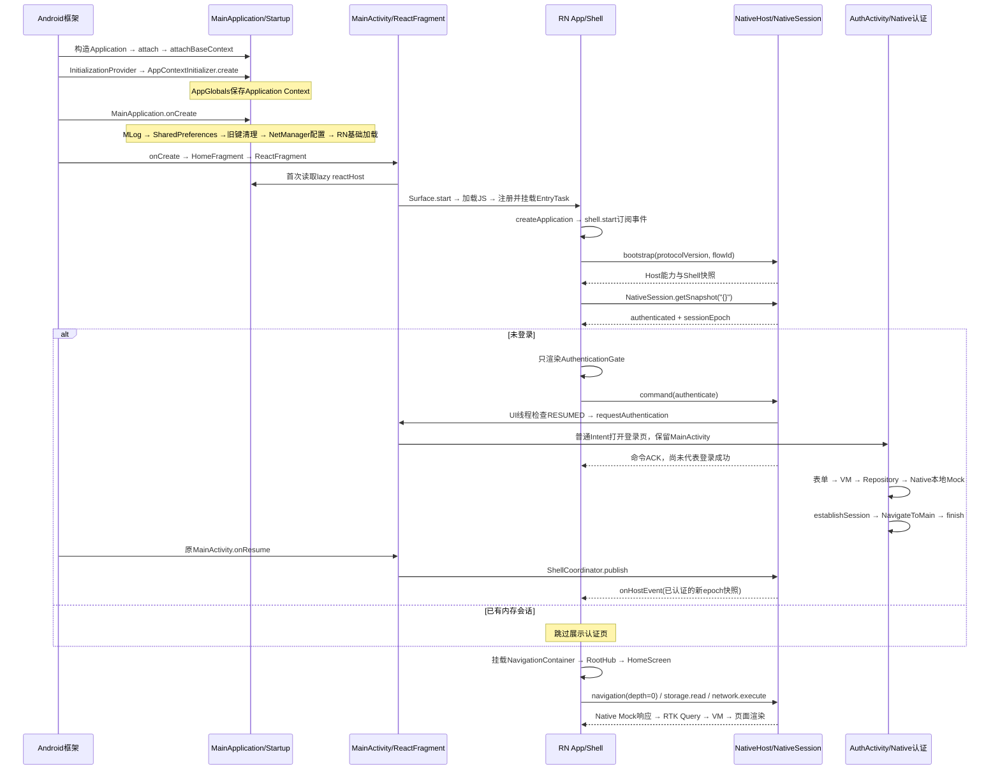

# EntryTask 启动与登录全链路源码详解

核对日期：2026-10-19。范围：当前 Android + RN 源码，默认 `HomeFragment.USE_REACT_NATIVE=true`，从冷启动到登录成功、首页请求及后续会话变化。本文是源码调用链说明，不是设备时序实测，不将技术方案中的待实施能力当成现有实现。

代码链接标注当前文件和起始行，可直接对照方法；改代码后行号可能变化，以方法名为准。`node_modules/` 的框架代码需 `npm ci` 后存在，`android/app/build/generated/` 的 Codegen/入口代码需原生构建后生成，均不能手工维护。Android 框架步骤已对照本机 SDK 36 源码，不在仓库虚构一个 attachBaseContext 实现。

## 1. 先明确几个关键结论

| 问题 | 当前实际行为 | 对应代码 |
| --- | --- | --- |
| 是否在 attachBaseContext 初始化业务？ | 否。MainApplication 直接继承 Application，没有 override attachBaseContext；只经过框架默认的 Context 绑定 | [MainApplication · L13](../../android/app/src/main/java/com/entrytask/MainApplication.kt#L13) |
| 谁最先初始化 AppGlobals？ | lib_base Manifest 注册的 Startup Provider，在 Application.onCreate 前调用 AppContextInitializer.create | [Startup Provider注册 · L6](../../android/lib_base/src/main/AndroidManifest.xml#L6)、[AppContextInitializer.create · L8](../../android/lib_base/src/main/java/com/entry/lib/base/AppContextInitializer.kt#L8) |
| loadReactNative 是否等于加载首页？ | 否。先初始化 SoLoader/新架构入口；ReactFragment 后续创建 Surface 并启动 JS，最后通过登录门禁才挂载业务首页 | [生成的loadReactNative入口 · L23](../../android/app/build/generated/autolinking/src/main/java/com/facebook/react/ReactNativeApplicationEntryPoint.java#L23)、[RN ReactFragment.onCreateView · L86](../../node_modules/react-native/ReactAndroid/src/main/java/com/facebook/react/ReactFragment.kt#L86)、[AppNavigator认证分支 · L55](../../src/app/navigation/AppNavigator.tsx#L55) |
| 谁判断登录？ | Native 保存事实；RN bootstrap 通过 Session Bridge 读取，RN Shell VM 保存安全投影，AppNavigator 据此决定门禁或业务导航 | [application.bootstrap · L64](../../src/app/CompositionRoot.ts#L64)、[NativeGateway.session · L142](../../src/platform/native/NativeGateway.ts#L142)、[SessionModule.getSnapshot · L14](../../android/app/src/main/java/com/entrytask/bridge/SessionModule.kt#L14)、[AppNavigator认证分支 · L55](../../src/app/navigation/AppNavigator.tsx#L55) |
| 打开登录页是否跨端？ | 是。RN → HostPort/NativeGateway → NativeHost TurboModule → HostModule → MainActivity → AuthActivity | [ShellViewModel.command · L83](../../src/app/navigation/ShellViewModel.ts#L83)、[HostModule.command · L24](../../android/app/src/main/java/com/entrytask/bridge/HostModule.kt#L24)、[MainActivity.requestAuthentication · L112](../../android/app/src/main/java/com/entrytask/MainActivity.kt#L112) |
| 输入账号密码后是否再走 RN Bridge？ | 否。登录表单、VM、Repository、Retrofit 和本地认证 Mock 都在 Android；凭证不经过 RN | [LoginRoute · L28](../../android/biz_user/src/main/java/com/entry/biz/user/ui/LoginScreen.kt#L28)、[UserViewModel.login · L31](../../android/biz_user/src/main/java/com/entry/biz/user/viewmodel/UserViewModel.kt#L31)、[UserRepository.login · L21](../../android/biz_user/src/main/java/com/entry/biz/user/repository/UserRepository.kt#L21)、[UserService认证接口 · L10](../../android/biz_user/src/main/java/com/entry/biz/user/network/UserService.kt#L10) |
| 谁通知 RN 登录成功？ | AuthActivity 只关闭自己；MainActivity.onResume 发布 Shell 快照，NativeHost.onHostEvent 跨端通知 RN | [AuthActivity.onCreate及成功回调 · L25](../../android/biz_user/src/main/java/com/entry/biz/user/ui/AuthActivity.kt#L25)、[MainActivity.onResume · L95](../../android/app/src/main/java/com/entrytask/MainActivity.kt#L95)、[ShellCoordinator.publish · L23](../../android/app/src/main/java/com/entrytask/bridge/ShellCoordinator.kt#L23)、[NativeGateway.observeShell · L95](../../src/platform/native/NativeGateway.ts#L95) |
| 是否销毁/重建 MainActivity、RN Host？ | 正常认证往返均保留；没有成功后 startActivity(MainActivity) 或创建第二个 Host | [UserAuthManager.startAuthActivity · L58](../../android/biz_user/src/main/java/com/entry/biz/user/manager/UserAuthManager.kt#L58)、[MainApplication.reactHost · L21](../../android/app/src/main/java/com/entrytask/MainApplication.kt#L21) |

“RN 根组件已挂载”“bootstrap 已完成”“用户已登录”“首页数据已加载”是四个不同阶段；`App.phase='ready'` 只表示启动握手/会话查询完成，不代表已登录。

## 2. 冷启动总时序



图中只表达依赖先后。Fragment transaction 的 `commit()`、RN runtime/Bundle、React effect、Promise 和事件均包含异步调度；不能把图理解为某个 Android 生命周期回调一定先于每条 JS 日志。MainActivity 首次 onResume 可能早于 RN 订阅，bootstrap 返回完整快照用于补齐；认证返回后的 publish 则用于推送变化。

## 3. 安装包与入口：运行前必须已成立的条件

| 步骤 | 执行方/方法 | 做了什么 | 代码 |
| --- | --- | --- | --- |
| P01 | Manifest 合并 | 安装身份为 com.entrytask，Application 为 .MainApplication，Launcher 为 singleTask MainActivity；AuthActivity 是非 exported Activity | [Application/Activity注册 · L5](../../android/app/src/main/AndroidManifest.xml#L5) |
| P02 | RN Gradle / Metro | Android Bundle 入口 src/index.js；开发 Host 请求 src/index，Metro保留根目录解析 | [Android Bundle入口 · L10](../../android/app/build.gradle#L10)、[MainApplication.reactHost · L21](../../android/app/src/main/java/com/entrytask/MainApplication.kt#L21)、[Metro配置 · L5](../../metro.config.js#L5) |
| P03 | Codegen | package.json 从 specs/ 生成 Java/JNI 传输接口；RN 与 Native 模块名必须一致 | [Codegen配置 · L57](../../package.json#L57)、[NativeHost.Spec · L4](../../specs/NativeHost.ts#L4)、[NativeSession.Spec · L5](../../specs/NativeSession.ts#L5) |
| P04 | 资源生产任务 | validateRuntimeResources → prepare&lt;Variant&gt;RuntimeResources → merge&lt;Variant&gt;Assets，contracts/mock进入APK | [运行时资源打包任务 · L129](../../android/app/build.gradle#L129) |

这些是构建步骤，不是在 attachBaseContext 中执行。Debug 需要 Metro 提供 JS；当前 release 由 Gradle 打包 JS Bundle。contracts/mock 是 APK assets，不由 Metro 在运行时传给 Android。

## 4. Application：从 attachBaseContext 到 onCreate

### A01：框架创建 Application 并绑定 Context

Android 框架链为 `ActivityThread.handleBindApplication → LoadedApk.makeApplicationInner → Instrumentation.newApplication → Application.attach → attachBaseContext`。SDK 36 中 Instrumentation.newApplication 调用 `app.attach(context)`，Application.attach 再调用 attachBaseContext。工程选用的类由 [Application/Activity注册 · L5](../../android/app/src/main/AndroidManifest.xml#L5) 指定；[MainApplication · L13](../../android/app/src/main/java/com/entrytask/MainApplication.kt#L13) 没有 override 此方法，因此此阶段没有项目自定义的日志、存储、网络、会话检查或 RN 页面加载。

构造 MainApplication 时会建立两个 Kotlin lazy 属性的持有器，但不会立即执行 `reactHost`、`prototypeNetwork` 的构造 lambda。它们的首次求值见后文。框架入口可对照 [Application API](https://developer.android.com/reference/android/app/Application)；SDK 源码位置为 `android/app/Instrumentation.java:newApplication` 和 `android/app/Application.java:attach`。

### A02：Startup Provider 初始化应用信息代理

在正常应用进程绑定过程中，框架安装 ContentProvider，之后才调用 Application.onCreate。Application API 明确区分了 ContentProvider 与其他组件的初始化时点；Startup 的发现与依赖调用机制见 [Android Startup 文档](https://developer.android.com/topic/libraries/app-startup)。

| 顺序 | 方法/配置 | 当前动作 | 代码 |
| --- | --- | --- | --- |
| A02.1 | lib_base Manifest provider/meta-data | `${applicationId}.androidx-startup` 注册 AppContextInitializer | [Startup Provider注册 · L6](../../android/lib_base/src/main/AndroidManifest.xml#L6) |
| A02.2 | InitializationProvider.onCreate / AppInitializer | 框架库发现Initializer并解析dependencies；本项目返回空依赖列表 | [Initializer.dependencies · L18](../../android/lib_base/src/main/java/com/entry/lib/base/AppContextInitializer.kt#L18) |
| A02.3 | AppContextInitializer.create | 取 context.applicationContext，调用 AppGlobals.initialize，返回该Context | [AppContextInitializer.create · L8](../../android/lib_base/src/main/java/com/entry/lib/base/AppContextInitializer.kt#L8) |
| A02.4 | AppGlobals.initialize | 保存Context；后续 context getter 检查是否初始化，applicationId/isDebug 按需读取宿主信息 | [AppGlobals.initialize · L11](../../android/lib_base/src/main/java/com/entry/lib/base/AppGlobals.kt#L11)、[AppGlobals.context · L18](../../android/lib_base/src/main/java/com/entry/lib/base/AppGlobals.kt#L18) |

这里尚未执行 MainApplication 的 MLog.init；Initializer 注释提到的日志/MMKV“可以初始化”不是实际调用。当前 Startup 只注入 Context，不读取账号，不检查登录，也不创建 RN Host。其他依赖可能另有 Startup Initializer，本文不假定无依赖的 Initializer 之间存在固定顺序。

### A03～A08：MainApplication.onCreate 内的确定顺序

执行于 Android 主线程；以下顺序是当前方法体的显式顺序。

| 步骤 | 调用 | 初始化/副作用 | 此时尚未发生 | 代码 |
| --- | --- | --- | --- | --- |
| A03 | super.onCreate | 进入Application生命周期 | 无项目业务启动 | [MainApplication.onCreate · L33](../../android/app/src/main/java/com/entrytask/MainApplication.kt#L33) |
| A04 | MLog.init | 根据宿主BuildConfig.DEBUG设置日志等级，随后写 application.started | 尚未创建RN Logger | [MainApplication.onCreate · L33](../../android/app/src/main/java/com/entrytask/MainApplication.kt#L33)、[MLog.init · L29](../../android/lib_base/src/main/java/com/entry/lib/log/MLog.kt#L29) |
| A05 | StorageManager.init(this) | 保存 app_default_pref 的 SharedPreferences 句柄 | 没有初始化MMKV/DataStore/Room；源码“初始化MMKV”注释与实现不符 | [StorageManager.init · L12](../../android/lib_storage/src/main/java/com/entry/lib/stroage/StorageManager.kt#L12) |
| A06 | getSharedPreferences(...).edit().remove(...).apply | 删除 key_token、mock_db_password、mock_db_username 旧键；apply的磁盘写入异步 | 不读取Token恢复登录；不是清空所有账号数据 | [MainApplication.onCreate · L33](../../android/app/src/main/java/com/entrytask/MainApplication.kt#L33) |
| A07 | NetManager.initMock | 将 baseUrl 设为 https://entrytask.invalid/ | 没有执行Retrofit请求；lazy的OkHttp/Retrofit还未必构造 | [NetManager.initMock · L22](../../android/lib_net/src/main/java/com/entry/lib/net/NetManager.kt#L22) |
| A08 | loadReactNative(this) | 生成入口调用SoLoader.init；按BuildConfig加载新架构入口/可选edge-to-edge开关 | 不会在这里调用项目AppRegistry或直接显示HomeScreen | [MainApplication.onCreate · L33](../../android/app/src/main/java/com/entrytask/MainApplication.kt#L33)、[生成的loadReactNative入口 · L23](../../android/app/build/generated/autolinking/src/main/java/com/facebook/react/ReactNativeApplicationEntryPoint.java#L23) |

UserAuthManager 是 Kotlin object，首次被访问时才建立对象；默认登录标记为 false、epoch=0，不从 SharedPreferences 自动恢复会话。实际首次访问可能由 MainActivity 更新底栏或 ShellCoordinator.snapshot 引发，不等同于 Application.onCreate 中有显式会话初始化步骤。代码：[UserAuthManager内存状态 · L13](../../android/biz_user/src/main/java/com/entry/biz/user/manager/UserAuthManager.kt#L13)。

## 5. Android 外壳与 RN Surface 挂载

| 步骤 | 类/方法 | 动作、恢复与状态 | 代码 |
| --- | --- | --- | --- |
| B01 | MainActivity.onCreate | 先设置 RNScreensFragmentFactory，再 super.onCreate；设置 activity_home、系统栏/底栏Insets及四Tab | [MainActivity.onCreate · L29](../../android/app/src/main/java/com/entrytask/MainActivity.kt#L29) |
| B02 | findFragmentByTag / transaction.add | 仅缺少 entrytask-root-hub 时添加一个 HomeFragment；已有Fragment由FragmentManager恢复 | [MainActivity.onCreate · L29](../../android/app/src/main/java/com/entrytask/MainActivity.kt#L29) |
| B03 | MainActivity.selectRoot | 从 savedInstanceState 恢复root_tab或默认1；ShellCoordinator.select更新选中Tab并publish，BottomTabBar同步选择，updateChrome控制显示 | [MainActivity.selectRoot · L69](../../android/app/src/main/java/com/entrytask/MainActivity.kt#L69)、[ShellCoordinator.select · L24](../../android/app/src/main/java/com/entrytask/bridge/ShellCoordinator.kt#L24)、[MainActivity.updateChrome · L75](../../android/app/src/main/java/com/entrytask/MainActivity.kt#L75) |
| B04 | MainActivity.onResume | authRequested=false，重新计算底栏，发布最新Shell快照；这一步不是自动拉登录页 | [MainActivity.onResume · L95](../../android/app/src/main/java/com/entrytask/MainActivity.kt#L95) |
| B05 | HomeFragment.getComponentName | RN模式返回EntryTask；false分支返回null并使用原生文本布局 | [HomeFragment.getComponentName · L12](../../android/app/src/main/java/com/entrytask/home/HomeFragment.kt#L12) |
| B06 | BaseFragment.onCreateView | RN模式创建FrameLayout，固定R.id.rn_content | [BaseFragment.onCreateView · L18](../../android/app/src/main/java/com/entrytask/base/BaseFragment.kt#L18) |
| B07 | BaseFragment.onViewCreated → mountReactFragment | 先查 entrytask-rn-root；不存在才Builder设置组件名/launchOptions并挂载ReactFragment | [BaseFragment.onViewCreated · L44](../../android/app/src/main/java/com/entrytask/base/BaseFragment.kt#L44)、[BaseFragment.mountReactFragment · L74](../../android/app/src/main/java/com/entrytask/base/BaseFragment.kt#L74) |
| B08 | ReactFragment.onCreate | RN框架读取ReactApplication.reactHost，构造ReactDelegate | [RN ReactFragment.onCreate · L31](../../node_modules/react-native/ReactAndroid/src/main/java/com/facebook/react/ReactFragment.kt#L31) |
| B09 | MainApplication.reactHost lazy | 首次读取才组装PackageList、添加EntryTaskPackage并调用getDefaultReactHost，入口src/index；后续读取复用 | [MainApplication.reactHost · L21](../../android/app/src/main/java/com/entrytask/MainApplication.kt#L21)、[RN getDefaultReactHost · L62](../../node_modules/react-native/ReactAndroid/src/main/java/com/facebook/react/defaults/DefaultReactHost.kt#L62) |
| B10 | ReactFragment.onCreateView → ReactDelegate.loadApp | 新架构路径创建Surface、调用surface.start，返回RootView供Android挂载 | [RN ReactFragment.onCreateView · L86](../../node_modules/react-native/ReactAndroid/src/main/java/com/facebook/react/ReactFragment.kt#L86)、[RN ReactDelegate.loadApp · L322](../../node_modules/react-native/ReactAndroid/src/main/java/com/facebook/react/ReactDelegate.kt#L322) |
| B11 | ReactFragment.onResume/onPause | 框架转发ReactDelegate.onHostResume/onHostPause到ReactHost，维护当前Activity与RN生命周期 | [RN ReactFragment生命周期 · L95](../../node_modules/react-native/ReactAndroid/src/main/java/com/facebook/react/ReactFragment.kt#L95)、[RN ReactDelegate.onHostResume · L121](../../node_modules/react-native/ReactAndroid/src/main/java/com/facebook/react/ReactDelegate.kt#L121) |

B02 的 commit 是异步调度；B04 与子 Fragment/RN JS 的具体交错由框架安排，不能凭表格断言它们在单次主线程调用栈连续执行。稳定容器/Fragment复用用于避免重复Surface，不代表绝不会因系统回收重建。

getDefaultReactHost 使用当前安装 RN 的 DefaultReactHostDelegate、TurboModule delegate 和默认 Hermes runtime factory。Debug 开发支持从Metro加载，release使用包内Bundle。**ReactHost是进程级宿主；Surface是业务视图；加载JS和显示已登录首页不是一个动作。** 框架依据：[RN getDefaultReactHost · L62](../../node_modules/react-native/ReactAndroid/src/main/java/com/facebook/react/defaults/DefaultReactHost.kt#L62)、[RN ReactDelegate.loadApp · L322](../../node_modules/react-native/ReactAndroid/src/main/java/com/facebook/react/ReactDelegate.kt#L322)。

## 6. TurboModule 如何连到 app/bridge 下的实现

这套跨端调用是当前 RN 新架构 TurboModule/Codegen 通路，文中“Bridge”是平台能力边界的通称，不表示工程又创建了旧架构 RCTBridge。

```text
RN platform/native/modules.ts
  → specs/NativeHost.ts / NativeSession.ts
  → TurboModuleRegistry.get('NativeHost' / 'NativeSession')
  → RN生成的JSI/JNI方法绑定
  → EntryTaskPackage.getModule(name, reactContext)
  → app/bridge/HostModule 或 SessionModule
  → Android具体能力 / Promise统一JSON信封
```

| 层 | 作用 | 对应代码 |
| --- | --- | --- |
| 模块清单 | MainApplication把EntryTaskPackage放入PackageList | [MainApplication.reactHost · L21](../../android/app/src/main/java/com/entrytask/MainApplication.kt#L21) |
| Native工厂 | getModule按模块名创建实现；getReactModuleInfoProvider标注TurboModule信息 | [EntryTaskPackage.getModule · L11](../../android/app/src/main/java/com/entrytask/bridge/EntryTaskPackage.kt#L11)、[EntryTaskPackage模块信息 · L19](../../android/app/src/main/java/com/entrytask/bridge/EntryTaskPackage.kt#L19) |
| TS签名 | Host的bootstrap/command/EventEmitter，Session的getSnapshot | [NativeHost.Spec · L4](../../specs/NativeHost.ts#L4)、[NativeSession.Spec · L5](../../specs/NativeSession.ts#L5) |
| RN能力适配 | modules.ts集中导入specs；业务页面不直接访问原始NativeModule | [平台Codegen模块集中导入 · L3](../../src/platform/native/modules.ts#L3) |
| 生成绑定 | NativeHostSpec/NativeSessionSpec定义方法、模块名及事件发射；JNI将方法调用接到实现 | [生成的NativeHostSpec · L23](../../android/app/build/generated/source/codegen/java/com/entrytask/specs/NativeHostSpec.java#L23)、[生成的NativeSessionSpec · L23](../../android/app/build/generated/source/codegen/java/com/entrytask/specs/NativeSessionSpec.java#L23)、[生成的JSI/JNI绑定 · L15](../../android/app/build/generated/source/codegen/jni/EntryTaskSpecs-generated.cpp#L15) |
| 平台调用与解码 | NativeGateway编码参数、等待Promise、decodeReply验证信封和data形状 | [NativeGateway.command · L115](../../src/platform/native/NativeGateway.ts#L115)、[NativeGateway.decodeReply · L21](../../src/platform/native/NativeGateway.ts#L21) |
| Native返回 | BridgeReply.ok/error产生稳定JSON字符串，不返回原始异常对象 | [BridgeReply · L5](../../android/app/src/main/java/com/entrytask/bridge/BridgeReply.kt#L5) |

注册Package不等于Application.onCreate中已经new五个模块。模块依赖在JS import求值/TurboModule解析时被取得；当前 modules.ts 会导入多份spec，不能把每个模块的首次创建时间简单等同于第一次业务execute。模块构造与方法执行是不同阶段。

## 7. JS 入口、应用图和启动握手

| 步骤 | RN类/方法 | 动作与跨端情况 | 代码 |
| --- | --- | --- | --- |
| C01 | src/index.js模块求值 | import App及其依赖；AppRegistry.registerComponent注册EntryTask。import时的specs解析属于前述模块解析，注册本身不进行登录 | [JS注册入口 · L7](../../src/index.js#L7) |
| C02 | App() → useState(createApplication) | 根组件每次Surface挂载创建一份应用图；phase初始loading，先显示准备态。不是每次render重建应用图 | [RN App · L18](../../src/app/App.tsx#L18) |
| C03 | createApplication | 构造Logger并setSink到nativeGateway.emitLogs；构造双Transport/Router、Store、RTK Query、ResourceClient和ShellViewModel | [createApplication · L19](../../src/app/CompositionRoot.ts#L19)、[createAppStore/baseQuery · L7](../../src/infrastructure/state/createAppStore.ts#L7)、[ResourceClient.source/open · L7](../../src/infrastructure/state/ResourceClient.ts#L7) |
| C04 | App.useEffect | createId生成flowId；调用application.bootstrap，成功设置phase=ready，失败归一错误并显示诊断码/重试按钮 | [RN App · L18](../../src/app/App.tsx#L18) |
| C05 | bootstrap → shell.start | 先订阅NativeHost.onHostEvent，再拉快照；订阅是跨端事件注册，不是HTTP请求 | [application.bootstrap · L64](../../src/app/CompositionRoot.ts#L64)、[ShellViewModel.start · L29](../../src/app/navigation/ShellViewModel.ts#L29)、[NativeGateway.observeShell · L95](../../src/platform/native/NativeGateway.ts#L95) |
| C06 | NativeGateway.bootstrap | JSON.stringify协议版本/flowId，经Host TurboModule跨端调用 | [NativeGateway.bootstrap · L124](../../src/platform/native/NativeGateway.ts#L124) |
| C07 | HostModule.bootstrap | Native读取APK contracts/bridge/runtime.json，校验协议；构造bootId、capabilities和ShellCoordinator.snapshot；通过Promise返回 | [HostModule.bootstrap · L59](../../android/app/src/main/java/com/entrytask/bridge/HostModule.kt#L59)、[ShellCoordinator.snapshot · L16](../../android/app/src/main/java/com/entrytask/bridge/ShellCoordinator.kt#L16)、[运行时Bridge契约 · L2](../../contracts/bridge/runtime.json#L2) |
| C08 | decodeReply → shell.accept | 验证protocolVersion、componentName和Shell字段；revision或sessionEpoch回退的快照被拒绝 | [NativeGateway.decodeReply · L21](../../src/platform/native/NativeGateway.ts#L21)、[Host响应校验 · L61](../../src/platform/native/NativeGateway.ts#L61)、[ShellViewModel.accept · L35](../../src/app/navigation/ShellViewModel.ts#L35) |
| C09 | NativeGateway.session | 再调用NativeSession.getSnapshot('{}')，这是独立的RN→Native登录态查询 | [NativeGateway.session · L142](../../src/platform/native/NativeGateway.ts#L142) |
| C10 | SessionModule.getSnapshot | UserAuthManager.sessionSnapshot在同一锁内读取登录布尔值和epoch；只返回安全字段，不读取密码/Token给RN | [SessionModule.getSnapshot · L14](../../android/app/src/main/java/com/entrytask/bridge/SessionModule.kt#L14)、[UserAuthManager.sessionSnapshot · L33](../../android/biz_user/src/main/java/com/entry/biz/user/manager/UserAuthManager.kt#L33) |
| C11 | shell.acceptSession | Session不含Shell revision，按epoch判定新旧，只更新authenticated/sessionEpoch，不覆盖Tab/depth/revision | [ShellViewModel.acceptSession · L75](../../src/app/navigation/ShellViewModel.ts#L75) |
| C12 | bootstrap返回 → App.phase=ready | 写session.snapshot.checked/bootstrap.completed日志；App开始渲染AppNavigator，仍需检查authenticated | [application.bootstrap · L64](../../src/app/CompositionRoot.ts#L64)、[RN App · L18](../../src/app/App.tsx#L18) |

C03 仅构造查询封装，不代表已请求首页API；真正订阅在登录后RootHub/HomeScreen激活资源时发生。Logger连接Native sink早于Host握手，RN Console可独立输出；日志批量emitBatch也是跨端调用，但属于旁路诊断，不作为登录前置成功条件。代码：[Logger.setSink · L36](../../src/infrastructure/logging/Logger.ts#L36)、[NativeGateway.emitLogs · L191](../../src/platform/native/NativeGateway.ts#L191)、[TelemetryModule.emitBatch · L14](../../android/app/src/main/java/com/entrytask/bridge/TelemetryModule.kt#L14)。

两次读取的职责不同：Host bootstrap获得协议/能力/外壳快照，Session Bridge显式获得Native认证快照。它们不是两个登录存储，也不是轮询两次后才算登录。竞态例子：Session返回前已收到退出epoch=2事件，则迟到的authenticated=true/epoch=1必须被acceptSession忽略。

若bootstrap已返回有效的内存会话，C08的ShellViewModel.accept就可能先发起资产显隐偏好读取；它与C09的Session查询可交错，偏好读取失败默认隐藏资产，不作为登录失败或阻断启动的条件。初次未登录不会进行这次受保护偏好读取。

## 8. 未登录分支：RN如何请求Native登录

| 步骤 | 方法 | 实际动作 | 代码 |
| --- | --- | --- | --- |
| D01 | AppNavigator | useSyncExternalStore订阅Shell；authenticated=false则只返回AuthenticationGate，不创建NavigationContainer/RootHub/业务VM订阅 | [AppNavigator认证分支 · L55](../../src/app/navigation/AppNavigator.tsx#L55) |
| D02 | AuthenticationGate.useEffect | 挂载时记录authentication.required，调用requestLogin；按钮“前往登录”复用同一动作 | [AuthenticationGate · L114](../../src/app/navigation/AppNavigator.tsx#L114) |
| D03 | requestLogin → ShellViewModel.command | 构造{type:'authenticate'}，记录命令开始，通过注入的HostPort调用；不是直接startActivity | [AuthenticationGate · L114](../../src/app/navigation/AppNavigator.tsx#L114)、[ShellViewModel.command · L83](../../src/app/navigation/ShellViewModel.ts#L83) |
| D04 | NativeGateway.command | stringify后调用hostModule.command，await后验证data===true | [NativeGateway.command · L115](../../src/platform/native/NativeGateway.ts#L115) |
| D05 | HostModule.command | 解析JSON，仅记录净化命令名；currentActivity必须是有效MainActivity，然后runOnUiThread | [HostModule.command · L24](../../android/app/src/main/java/com/entrytask/bridge/HostModule.kt#L24) |
| D06 | UI线程重查 | 若已销毁/finishing或authenticate时未RESUMED，返回HOST_NOT_READY，不在后台强行弹页 | [HostModule.command · L24](../../android/app/src/main/java/com/entrytask/bridge/HostModule.kt#L24) |
| D07 | MainActivity.handleHostCommand | authenticate分支进入requestAuthentication | [MainActivity.handleHostCommand · L79](../../android/app/src/main/java/com/entrytask/MainActivity.kt#L79) |
| D08 | requestAuthentication | 已登录则publish后结束；重复/无效请求直接忽略；否则置authRequested，启动认证，异常时恢复标记再返回错误 | [MainActivity.requestAuthentication · L112](../../android/app/src/main/java/com/entrytask/MainActivity.kt#L112) |
| D09 | UserAuthManager.startAuthActivity | Activity Context使用普通Intent；只有非Activity Context才加NEW_TASK，当前实际调用来自MainActivity | [UserAuthManager.startAuthActivity · L58](../../android/biz_user/src/main/java/com/entry/biz/user/manager/UserAuthManager.kt#L58) |
| D10 | HostModule返回ACK | startActivity受理后resolve BridgeReply.ok(true)，RN记录command.completed | [HostModule.command · L24](../../android/app/src/main/java/com/entrytask/bridge/HostModule.kt#L24)、[ShellViewModel.command · L83](../../src/app/navigation/ShellViewModel.ts#L83) |

Native并不会把 `authenticate` 的Promise悬挂到用户输完密码。ACK只表示命令处理完成；真正认证结果通过后续Shell事件到达。当前没有专门的认证结果Promise或Activity Result协议。

需要区分三种“校验”：SessionModule仅查询Native内存登录事实；AppNavigator按事实决定页面访问；登录表单的账号密码比较在后文Native Mock中执行，受保护Network/Storage能力还会独立鉴权。`UserAuthManager.isLogin()`输出“检查当前内存登录状态: false”只表示返回了Boolean，不会自行跳转；导航由requestAuthentication执行。对应 [UserAuthManager.isLogin · L38](../../android/biz_user/src/main/java/com/entry/biz/user/manager/UserAuthManager.kt#L38) 与 [MainActivity.requestAuthentication · L112](../../android/app/src/main/java/com/entrytask/MainActivity.kt#L112)。

此时任务栈是 `[MainActivity, AuthActivity]`。MainActivity暂停/停止但没有finish，HomeFragment、ReactHost以及RN门禁仍保留；ReactFragment相应转发host pause。首次未登录底栏在updateChrome已隐藏。代码：[MainActivity.updateChrome · L75](../../android/app/src/main/java/com/entrytask/MainActivity.kt#L75)、[RN ReactFragment生命周期 · L95](../../node_modules/react-native/ReactAndroid/src/main/java/com/facebook/react/ReactFragment.kt#L95)。singleTask限制和系统回收边界见[Android任务栈说明](https://developer.android.com/guide/components/activities/tasks-and-back-stack)。

## 9. Native登录UI、VM、Repository和本地网络

### E01～E05：创建认证页和接收表单动作

| 步骤 | 类/方法 | 动作 | 代码 |
| --- | --- | --- | --- |
| E01 | AuthActivity.onCreate | 注册Back回调，构造UserRepository(userService)、VM Factory，通过ViewModelProvider取得UserViewModel，再setContent | [AuthActivity.onCreate及成功回调 · L25](../../android/biz_user/src/main/java/com/entry/biz/user/ui/AuthActivity.kt#L25) |
| E02 | 顶层userService lazy → NetManager.create | AuthActivity构造Repository时首次取得UserService，触发Retrofit/OkHttp lazy初始化；仅创建client/proxy，不立即登录 | [userService lazy · L30](../../android/biz_user/src/main/java/com/entry/biz/user/network/UserService.kt#L30)、[NetManager.create · L107](../../android/lib_net/src/main/java/com/entry/lib/net/NetManager.kt#L107)、[NetManager.okHttpClient lazy · L74](../../android/lib_net/src/main/java/com/entry/lib/net/NetManager.kt#L74)、[NetManager.retrofit lazy · L96](../../android/lib_net/src/main/java/com/entry/lib/net/NetManager.kt#L96) |
| E03 | AuthNavHost | Compose NavHost默认login；切register在同一AuthActivity中导航，共用该UserViewModel | [AuthNavHost · L18](../../android/biz_user/src/main/java/com/entry/biz/user/ui/navigation/AuthNavGraph.kt#L18) |
| E04 | LoginRoute → ComposableScreen | 收集只读uiState并传入onIntent；通过LaunchedEffect收集uiEffect处理Toast/导航 | [LoginRoute · L28](../../android/biz_user/src/main/java/com/entry/biz/user/ui/LoginScreen.kt#L28)、[ComposableScreen · L18](../../android/lib_base/src/main/java/com/entry/lib/base/mvvm/ui/ComposableScreen.kt#L18)、[BaseViewModel.uiEffect Channel · L56](../../android/lib_base/src/main/java/com/entry/lib/base/mvvm/viewmodel/BaseViewModel.kt#L56) |
| E05 | LoginScreenContent | 输入发UpdateUsername/UpdatePassword；登录按钮发SubmitLogin → UserViewModel.handleIntent | [LoginScreen输入事件 · L79](../../android/biz_user/src/main/java/com/entry/biz/user/ui/LoginScreen.kt#L79)、[登录按钮SubmitLogin · L101](../../android/biz_user/src/main/java/com/entry/biz/user/ui/LoginScreen.kt#L101)、[UserViewModel.handleIntent · L22](../../android/biz_user/src/main/java/com/entry/biz/user/viewmodel/UserViewModel.kt#L22) |

当前StateFlow收集使用STARTED生命周期；uiEffect则由LaunchedEffect内collect，并非同一套repeatOnLifecycle策略。NavigateToMain是Channel上的一次性效果，不是持久化认证任务状态。此处说明当前实现，不把方案中计划的状态恢复机制描述为已落地。

### E06～E12：登录请求与会话提交（全程Android内部）

| 步骤 | 类/方法 | 校验/线程/数据流 | 代码 |
| --- | --- | --- | --- |
| E06 | UserViewModel.login | isLoading防重复；账号密码空白直接Toast；viewModelScope.launch置loading并调用repository.login | [UserViewModel.login · L31](../../android/biz_user/src/main/java/com/entry/biz/user/viewmodel/UserViewModel.kt#L31) |
| E07 | UserRepository.login | 调用UserService.login，等待ApiResponse；此时尚未建立会话 | [UserRepository.login · L21](../../android/biz_user/src/main/java/com/entry/biz/user/repository/UserRepository.kt#L21) |
| E08 | UserService.login | Retrofit suspend + @FormUrlEncoded POST api/user/login，账号密码是Native表单参数 | [UserService认证接口 · L10](../../android/biz_user/src/main/java/com/entry/biz/user/network/UserService.kt#L10) |
| E09 | NetManager.okHttpClient | 认证client安装lib_net MockInterceptor，retry关闭，连接/读写10s、整Call30s；Retrofit异步请求在OkHttp worker执行拦截器 | [NetManager.okHttpClient lazy · L74](../../android/lib_net/src/main/java/com/entry/lib/net/NetManager.kt#L74) |
| E10 | MockInterceptor.intercept | 当前认证分支以path.contains('login')匹配，extractParams读取表单；本地等待1000～2500ms，比较SP中的注册账号与密码，合成Response，本地终止不出网 | [认证MockInterceptor.intercept · L43](../../android/lib_net/src/main/java/com/entry/lib/net/MockInterceptor.kt#L43)、[MockInterceptor.extractParams · L146](../../android/lib_net/src/main/java/com/entry/lib/net/MockInterceptor.kt#L146)、[MockInterceptor.buildResponse · L194](../../android/lib_net/src/main/java/com/entry/lib/net/MockInterceptor.kt#L194) |
| E11 | UserRepository.login | 业务code=200且data非空才读取user；token非空并由establishSession进一步检查，失败抛异常，成功返回User | [UserRepository.login · L21](../../android/biz_user/src/main/java/com/entry/biz/user/repository/UserRepository.kt#L21)、[UserAuthManager.establishSession · L23](../../android/biz_user/src/main/java/com/entry/biz/user/manager/UserAuthManager.kt#L23) |
| E12 | UserAuthManager.establishSession | synchronized内生成username哈希scope、保存内存credential、置authenticated=true并递增epoch；不是只设置Boolean | [UserAuthManager.establishSession · L23](../../android/biz_user/src/main/java/com/entry/biz/user/manager/UserAuthManager.kt#L23) |

这里**没有RN→Native Bridge再次调用**：RN只发起了展示认证页，表单和认证网络完全由Native完成。当前认证Mock的账号记录使用SharedPreferences，token为演示值；登录/注册响应是Kotlin内联JSON，不是逐API fixture驱动；不能把RN业务专用PrototypeMockInterceptor的实现套到认证请求上。认证延迟1000～2500ms也与统一目标1000～3000ms存在偏差。上述是当前源码事实，不属于本轮文档任务的代码调整。

### E13～E15：成功关闭认证页

| 步骤 | 调用链 | 动作 | 代码 |
| --- | --- | --- | --- |
| E13 | Repository成功 → UserViewModel.login | sendEffect(NavigateToMain)，finally恢复isLoading | [UserViewModel.login · L31](../../android/biz_user/src/main/java/com/entry/biz/user/viewmodel/UserViewModel.kt#L31)、[BaseViewModel.sendEffect · L78](../../android/lib_base/src/main/java/com/entry/lib/base/mvvm/viewmodel/BaseViewModel.kt#L78) |
| E14 | BaseViewModel Channel → ComposableScreen → LoginRoute | LoginRoute处理NavigateToMain并调用onLoginSuccess；AuthNavHost继续转给Activity | [BaseViewModel.uiEffect Channel · L56](../../android/lib_base/src/main/java/com/entry/lib/base/mvvm/viewmodel/BaseViewModel.kt#L56)、[ComposableScreen · L18](../../android/lib_base/src/main/java/com/entry/lib/base/mvvm/ui/ComposableScreen.kt#L18)、[LoginRoute · L28](../../android/biz_user/src/main/java/com/entry/biz/user/ui/LoginScreen.kt#L28)、[AuthNavHost · L18](../../android/biz_user/src/main/java/com/entry/biz/user/ui/navigation/AuthNavGraph.kt#L18) |
| E15 | AuthActivity onLoginSuccess lambda | 记录成功，finish当前认证页；不创建MainActivity，不销毁/重建ReactHost，也不向RN传token | [AuthActivity.onCreate及成功回调 · L25](../../android/biz_user/src/main/java/com/entry/biz/user/ui/AuthActivity.kt#L25) |

“会话已提交”先于“导航效果被消费”。会话在UserAuthManager内，UI返回由Channel效果驱动；登录成功后若UI恢复异常，应分别核对Native快照与效果消费，不能把command ACK当成成功证据。

## 10. MainActivity恢复后如何通知RN并显示首页

| 步骤 | 类/方法 | 动作 | 代码 |
| --- | --- | --- | --- |
| F01 | MainActivity.onResume | 原实例恢复，解除认证防重标记，按Native登录态/深度刷新底栏，再ShellCoordinator.publish | [MainActivity.onResume · L95](../../android/app/src/main/java/com/entrytask/MainActivity.kt#L95)、[MainActivity.updateChrome · L75](../../android/app/src/main/java/com/entrytask/MainActivity.kt#L75) |
| F02 | ShellCoordinator.publish/snapshot | revision递增；原子读取Native authenticated/epoch，加上tabId/depth，通知监听器 | [ShellCoordinator.publish · L23](../../android/app/src/main/java/com/entrytask/bridge/ShellCoordinator.kt#L23)、[ShellCoordinator.snapshot · L16](../../android/app/src/main/java/com/entrytask/bridge/ShellCoordinator.kt#L16) |
| F03 | HostModule.stopObserving注册的回调 | observe回调调用生成接口emitOnHostEvent(json)，产生Native→RN跨端事件 | [HostModule宿主事件回调 · L23](../../android/app/src/main/java/com/entrytask/bridge/HostModule.kt#L23)、[生成的NativeHostSpec · L23](../../android/app/build/generated/source/codegen/java/com/entrytask/specs/NativeHostSpec.java#L23) |
| F04 | NativeGateway.observeShell | 解析JSON、isShell验证字段，调用ShellViewModel.accept | [NativeGateway.observeShell · L95](../../src/platform/native/NativeGateway.ts#L95)、[Shell快照校验 · L77](../../src/platform/native/NativeGateway.ts#L77) |
| F05 | ShellViewModel.accept | 拒绝旧revision/epoch；新epoch清旧查询、默认隐藏资产、通知React订阅；已认证新epoch另起storage.read读取用户显隐偏好 | [ShellViewModel.accept · L35](../../src/app/navigation/ShellViewModel.ts#L35)、[ResourceClient.reset · L107](../../src/infrastructure/state/ResourceClient.ts#L107)、[NativeGateway.readVisibility · L163](../../src/platform/native/NativeGateway.ts#L163)、[StorageModule.perform · L17](../../android/app/src/main/java/com/entrytask/bridge/StorageModule.kt#L17) |
| F06 | AppNavigator重新渲染 | authenticated=true，AuthenticationGate卸载，NavigationContainer/Stack挂载RootHub；App/application图仍是同一份 | [AppNavigator认证分支 · L55](../../src/app/navigation/AppNavigator.tsx#L55) |
| F07 | NavigationContainer.onReady | 经Host command上报navigation/depth=0，MainActivity更新深度与底栏 | [AppNavigator认证分支 · L55](../../src/app/navigation/AppNavigator.tsx#L55)、[MainActivity.handleHostCommand · L79](../../android/app/src/main/java/com/entrytask/MainActivity.kt#L79) |
| F08 | RootHub | 以sessionEpoch调用createChannels；记录访问过的根页，仅渲染访问过的Panel，首页默认Tab1；其他Tab也复用同一Surface | [RootHub · L140](../../src/app/navigation/AppNavigator.tsx#L140)、[application.createChannels · L39](../../src/app/CompositionRoot.ts#L39) |
| F09 | HomeScreen → useResource | 首页active时激活内容/商品资源；ResourceViewModel.activate打开ResourceSource订阅，不是组件直接发Axios请求 | [HomeScreen资源绑定 · L28](../../src/features/home/presentation/HomeScreen.tsx#L28)、[useResource · L4](../../src/shared/presentation/useResource.ts#L4)、[ResourceViewModel.activate · L20](../../src/shared/presentation/ResourceViewModel.ts#L20) |

资产偏好的异步读取与首页请求可能并行；Native onResume的底栏更新与RN事件消费也不是同一个帧的原子UI提交。本说明没有承诺它们毫秒级同时完成。

## 11. 首页首批请求：再次跨端，但与认证client不同

```text
HomeScreen / useResource
  → HomePageViewModel.content/products
  → ResourceSource.open / RTK Query initiate
  → createAppStore.baseQuery
  → TransportRouter.execute → EndpointRegistry.resolve
  → NativeTransport.execute → NativeNetwork.execute（跨端）
  → NetworkModule.execute → MainApplication.prototypeNetwork（首次lazy构建）
  → PrototypeMockInterceptor.intercept → APK中分API JSON
  → onResponse → BridgeReply → Promise
  → Router校验HTTP/业务码/响应Schema → RTK Query缓存
  → ResourceViewModel订阅更新 → HomeScreen重新渲染
```

| 步骤 | 关键实现 | 代码 |
| --- | --- | --- |
| G01 | 首页工厂绑定home.content与product.list，创建资源源，不在工厂直接请求 | [createHomePageViewModel · L9](../../src/features/home/di/createHomePageViewModel.ts#L9) |
| G02 | source.open触发RTK Query initiate；scope/epoch纳入缓存隔离 | [ResourceClient.source/open · L7](../../src/infrastructure/state/ResourceClient.ts#L7) |
| G03 | baseQuery把请求与AbortSignal交给Router；Router解析接口策略并分配requestId/flowId/spanId | [createAppStore/baseQuery · L7](../../src/infrastructure/state/createAppStore.ts#L7)、[TransportRouter.execute · L20](../../src/infrastructure/network/TransportRouter.ts#L20)、[EndpointRegistry.resolve · L16](../../src/infrastructure/network/EndpointRegistry.ts#L16) |
| G04 | NativeTransport编码请求并调用模块，监听Abort以调用cancel | [NativeTransport.execute · L17](../../src/infrastructure/network/transports/NativeTransport.ts#L17)、[NetworkModule.execute · L28](../../android/app/src/main/java/com/entrytask/bridge/NetworkModule.kt#L28) |
| G05 | NetworkModule验证apiId/exposure、认证、长度和参数，构造受控URL并捕获epoch，交给prototypeNetwork.newCall/enqueue | [NetworkModule.execute · L28](../../android/app/src/main/java/com/entrytask/bridge/NetworkModule.kt#L28) |
| G06 | prototypeNetwork首次构造独立OkHttpClient；PrototypeMockInterceptor后台延迟1000～3000ms，按apiId/manifest读取APK fixture与本地演示状态 | [MainApplication.prototypeNetwork · L14](../../android/app/src/main/java/com/entrytask/MainApplication.kt#L14)、[PrototypeMockInterceptor.intercept · L28](../../android/demo_engine/src/main/java/com/entry/demo/PrototypeMockInterceptor.kt#L28) |
| G07 | Native onResponse检查请求epoch未过期及响应大小，返回httpStatus/bodyText；Router验证Schema后返回data | [NetworkModule.onResponse · L69](../../android/app/src/main/java/com/entrytask/bridge/NetworkModule.kt#L69)、[TransportRouter.execute · L20](../../src/infrastructure/network/TransportRouter.ts#L20) |
| G08 | RTK Query store变化 → ResourceViewModel.update → useSyncExternalStore →页面刷新；停用页面释放订阅，最后消费者取消请求 | [ResourceViewModel.update · L29](../../src/shared/presentation/ResourceViewModel.ts#L29)、[useResource · L4](../../src/shared/presentation/useResource.ts#L4)、[ResourceClient.source/open · L7](../../src/infrastructure/state/ResourceClient.ts#L7) |

Native Network/Storage仍独立鉴权；RN门禁不能代替这些边界。RN HTTP通路虽然存在，但当前首页演示API明确选择nativeMock，失败不切换Axios通路。

## 12. 注册、取消、失败、退出与恢复分支

| 场景 | 当前完整处理 | 代码入口 |
| --- | --- | --- |
| 转到注册 | AuthNavHost navigate('register')，RegisterRoute收集同一VM；SubmitRegister → register → UserRepository.register → UserService.register → Native认证Mock | [AuthNavHost · L18](../../android/biz_user/src/main/java/com/entry/biz/user/ui/navigation/AuthNavGraph.kt#L18)、[RegisterRoute · L29](../../android/biz_user/src/main/java/com/entry/biz/user/ui/RegisterScreen.kt#L29)、[UserViewModel.register · L57](../../android/biz_user/src/main/java/com/entry/biz/user/viewmodel/UserViewModel.kt#L57)、[UserRepository.register · L40](../../android/biz_user/src/main/java/com/entry/biz/user/repository/UserRepository.kt#L40)、[UserService认证接口 · L10](../../android/biz_user/src/main/java/com/entry/biz/user/network/UserService.kt#L10)、[认证MockInterceptor.intercept · L43](../../android/lib_net/src/main/java/com/entry/lib/net/MockInterceptor.kt#L43) |
| 注册成功 | Native Mock写注册数据并返回User/token；Repository调用同一establishSession；VM发Toast和NavigateToMain；RegisterRoute → onRegisterSuccess → Activity.finish，随后走F链路 | [UserViewModel.register · L57](../../android/biz_user/src/main/java/com/entry/biz/user/viewmodel/UserViewModel.kt#L57)、[UserRepository.register · L40](../../android/biz_user/src/main/java/com/entry/biz/user/repository/UserRepository.kt#L40)、[RegisterRoute · L29](../../android/biz_user/src/main/java/com/entry/biz/user/ui/RegisterScreen.kt#L29)、[UserAuthManager.establishSession · L23](../../android/biz_user/src/main/java/com/entry/biz/user/manager/UserAuthManager.kt#L23) |
| 空表单/认证失败 | VM空值本地拦截或Repository业务异常；ShowToast并恢复loading，留在认证页，不放行业务导航 | [UserViewModel.login · L31](../../android/biz_user/src/main/java/com/entry/biz/user/viewmodel/UserViewModel.kt#L31)、[UserRepository.login · L21](../../android/biz_user/src/main/java/com/entry/biz/user/repository/UserRepository.kt#L21) |
| 返回取消 | AuthActivity Back先尝试收键盘，否则finish；MainActivity恢复发布authenticated=false；RN门禁保持挂载，因此不会再次触发mount effect；用户点按钮才重试 | [AuthActivity.onCreate及成功回调 · L25](../../android/biz_user/src/main/java/com/entry/biz/user/ui/AuthActivity.kt#L25)、[MainActivity.onResume · L95](../../android/app/src/main/java/com/entrytask/MainActivity.kt#L95)、[AuthenticationGate · L114](../../src/app/navigation/AppNavigator.tsx#L114) |
| 无宿主/后台展示失败 | HostModule返回HOST_UNAVAILABLE/HOST_NOT_READY等；Shell.command记失败，门禁可显式重试；无自动队列 | [HostModule.command · L24](../../android/app/src/main/java/com/entrytask/bridge/HostModule.kt#L24)、[ShellViewModel.command · L83](../../src/app/navigation/ShellViewModel.ts#L83) |
| bootstrap资源/协议失败 | HostModule返回HOST_RESOURCE_MISSING/INVALID或PROTOCOL_VERSION_MISMATCH；App留初始化错误页，尚未进入认证门禁 | [HostModule.bootstrap · L59](../../android/app/src/main/java/com/entrytask/bridge/HostModule.kt#L59)、[NativeGateway.decodeReply · L21](../../src/platform/native/NativeGateway.ts#L21)、[RN App · L18](../../src/app/App.tsx#L18) |
| 退出登录 | 设置页发logout Host命令；Native清credential/scope并递增epoch，depth=0、selectRoot(1)发布事件；RN清查询/卸载业务树、回门禁并请求认证 | [设置页退出登录 · L410](../../src/app/navigation/AppNavigator.tsx#L410)、[MainActivity.handleHostCommand · L79](../../android/app/src/main/java/com/entrytask/MainActivity.kt#L79)、[UserAuthManager.logout · L46](../../android/biz_user/src/main/java/com/entry/biz/user/manager/UserAuthManager.kt#L46)、[ShellViewModel.accept · L35](../../src/app/navigation/ShellViewModel.ts#L35) |
| 后台回前台 | 同进程内存会话保留；MainActivity.onResume发布快照，不无条件弹登录页 | [MainActivity.onResume · L95](../../android/app/src/main/java/com/entrytask/MainActivity.kt#L95)、[UserAuthManager内存状态 · L13](../../android/biz_user/src/main/java/com/entry/biz/user/manager/UserAuthManager.kt#L13) |
| RN重挂载/Reload | 再建该Surface的应用图并bootstrap，重新读Native会话；有效则跳过认证。不能把JS state重置误认为Native已退出 | [RN App · L18](../../src/app/App.tsx#L18)、[application.bootstrap · L64](../../src/app/CompositionRoot.ts#L64) |
| 进程终止重启 | UserAuthManager内存状态归初始false；账号记录可能保留，但登录会话不从磁盘恢复，重新执行门禁 | [UserAuthManager内存状态 · L13](../../android/biz_user/src/main/java/com/entry/biz/user/manager/UserAuthManager.kt#L13)、[MainApplication.onCreate · L33](../../android/app/src/main/java/com/entrytask/MainApplication.kt#L33)、[NativeGateway.session · L142](../../src/platform/native/NativeGateway.ts#L142) |
| Native-only调试模式 | HomeFragment返回null，BaseFragment渲染Native文本，不运行RN启动图/门禁；不是当前RN业务登录验收路径 | [HomeFragment.getComponentName · L12](../../android/app/src/main/java/com/entrytask/home/HomeFragment.kt#L12)、[BaseFragment.onCreateView · L18](../../android/app/src/main/java/com/entrytask/base/BaseFragment.kt#L18) |

认证页活动期间再次从外部启动singleTask首页可能影响其上层Activity；当前没有专门onNewIntent认证恢复编排。登录过程不主动finish MainActivity，但系统仍可回收Activity/进程，不能承诺对象永远存活。

当前注册Mock写入同一组SP账号/密码键；再次注册会覆盖原记录，并不是多账号数据库。注册成功同样先提交Native会话，再关闭认证页，和“注册成功先返回登录再手动登录”的历史说明不同。

### 生命周期清理与登录往返的区别

| 时点 | 当前清理动作 | 对应代码 |
| --- | --- | --- |
| 认证页覆盖首页 | ReactFragment.onPause转发host pause；不因此卸载整个RN App或dispose应用图 | [ReactFragment.onPause · L102](../../node_modules/react-native/ReactAndroid/src/main/java/com/facebook/react/ReactFragment.kt#L102) |
| 认证成功/取消 | finish AuthActivity，原MainActivity及RN App继续使用；UserViewModel随认证Activity销毁清理viewModelScope | [AuthActivity回调 · L25](../../android/biz_user/src/main/java/com/entry/biz/user/ui/AuthActivity.kt#L25)、[UserViewModel.login · L31](../../android/biz_user/src/main/java/com/entry/biz/user/viewmodel/UserViewModel.kt#L31) |
| 退出会话、业务树卸载 | RootHub effect调用channels.dispose；资源VM释放订阅/查询句柄，不销毁进程ReactHost | [RootHub清理 · L160](../../src/app/navigation/AppNavigator.tsx#L160)、[业务域dispose · L52](../../src/app/CompositionRoot.ts#L52) |
| RN App根组件真正卸载 | effect调用application.dispose，解除Shell事件订阅，重置查询Store，清理Logger | [App卸载清理 · L50](../../src/app/App.tsx#L50)、[应用图dispose · L78](../../src/app/CompositionRoot.ts#L78)、[Shell.dispose · L128](../../src/app/navigation/ShellViewModel.ts#L128) |
| ReactFragment销毁 | RN框架onHostDestroy/unloadApp停止Surface；与普通onPause不同，进程Host属性仍由Application持有 | [ReactFragment.onDestroy · L109](../../node_modules/react-native/ReactAndroid/src/main/java/com/facebook/react/ReactFragment.kt#L109)、[ReactDelegate.unloadApp · L344](../../node_modules/react-native/ReactAndroid/src/main/java/com/facebook/react/ReactDelegate.kt#L344) |
| Native模块被runtime invalidate | Host注销Shell监听；Network取消Call并清表；Storage关闭IO执行器 | [HostModule.invalidate · L58](../../android/app/src/main/java/com/entrytask/bridge/HostModule.kt#L58)、[NetworkModule.invalidate · L91](../../android/app/src/main/java/com/entrytask/bridge/NetworkModule.kt#L91)、[StorageModule.invalidate · L35](../../android/app/src/main/java/com/entrytask/bridge/StorageModule.kt#L35) |

是否触发ReactFragment销毁、模块invalidate由真实宿主/runtime生命周期决定；它们不是每次登录成功时必经的步骤。

## 13. 初始化与线程核对表

| 能力 | 首次初始化/读取时点 | 执行位置/线程特点 | 是否等待登录 |
| --- | --- | --- | --- |
| AppGlobals | Startup Provider调用Initializer | Android主线程，保存applicationContext | 否 |
| MLog | MainApplication.onCreate | Android主线程配置；级别影响日志可见性 | 否 |
| StorageManager | MainApplication.onCreate | SharedPreferences句柄；apply磁盘写异步 | 否 |
| Native认证NetManager | onCreate仅改baseUrl；AuthActivity取得userService才触发client/proxy lazy | 构造发生在调用方；Retrofit请求拦截在OkHttp worker | 构造否，请求为认证本身 |
| RN基础库 | Application.loadReactNative | 主线程入口，SoLoader/新架构配置 | 否 |
| ReactHost | ReactFragment首次读取Application.reactHost | lazy构造单个宿主，runtime/Bundle由框架调度 | 否 |
| RN App/Store/Logger | 根组件首次挂载 | JS运行环境；不是Android主线程Compose代码 | 否 |
| NativeModule方法 | 通过TurboModule调度 | 不假定所有方法均在UI线程；Host显式切UI、网络enqueue、Storage专用IO | 按能力鉴权 |
| UserAuthManager | 首次object访问 | 内存状态；会话提交/快照有同步锁 | 初始未认证 |
| 四域业务资源/首批查询 | 全局门禁放行后RootHub/HomeScreen激活 | JS订阅 → 跨端网络 → OkHttp后台 | 是 |
| prototypeNetwork | 第一次NetworkModule.execute触发属性读取 | 专用Native客户端lazy；Mock等待在OkHttp线程 | 当前业务入口是 |
| DownloadManager | 启动链没有引用/调用 | 下载是单独进程内能力，不会在Application启动自动下载 | 不在本启动链 |

依据分别为A、B、C、E、F、G步骤的代码链接。没有实际测量耗时，不能由“lazy”或“后台线程”推断整体启动已达性能目标。

## 14. 对照日志与断点定位

| 检查点 | 现有日志/状态 | 最适合的断点 |
| --- | --- | --- |
| Provider是否执行 | 当前无专属启动日志；此时MLog尚未配置 | [AppContextInitializer.create · L8](../../android/lib_base/src/main/java/com/entry/lib/base/AppContextInitializer.kt#L8)、[AppGlobals.initialize · L11](../../android/lib_base/src/main/java/com/entry/lib/base/AppGlobals.kt#L11) |
| Application是否完成基础配置 | application.started（其后的存储/网络/RN加载仍可能失败） | [MainApplication.onCreate · L33](../../android/app/src/main/java/com/entrytask/MainApplication.kt#L33) |
| RN是否开始启动握手 | RN bootstrap.started，Native bootstrap.started/completed | [application.bootstrap · L64](../../src/app/CompositionRoot.ts#L64)、[HostModule.bootstrap · L59](../../android/app/src/main/java/com/entrytask/bridge/HostModule.kt#L59) |
| 是否读到真实Native登录态 | session.snapshot.completed；RN session.snapshot.checked | [SessionModule.getSnapshot · L14](../../android/app/src/main/java/com/entrytask/bridge/SessionModule.kt#L14)、[ShellViewModel.acceptSession · L75](../../src/app/navigation/ShellViewModel.ts#L75) |
| 是否触发跨端展示登录 | authentication.required/requested、command.started、host.command.received | [AuthenticationGate · L114](../../src/app/navigation/AppNavigator.tsx#L114)、[HostModule.command · L24](../../android/app/src/main/java/com/entrytask/bridge/HostModule.kt#L24) |
| Native是否实际执行展示 | 通过Native Bridge拉起登录注册界面；AuthActivity创建 | [MainActivity.requestAuthentication · L112](../../android/app/src/main/java/com/entrytask/MainActivity.kt#L112)、[AuthActivity.onCreate及成功回调 · L25](../../android/biz_user/src/main/java/com/entry/biz/user/ui/AuthActivity.kt#L25) |
| 是否会话提交而非仅命令成功 | 登录成功后sessionEpoch变化；MainActivity恢复并发布快照 | [UserAuthManager.establishSession · L23](../../android/biz_user/src/main/java/com/entry/biz/user/manager/UserAuthManager.kt#L23)、[MainActivity.onResume · L95](../../android/app/src/main/java/com/entrytask/MainActivity.kt#L95)、[ShellViewModel.accept · L35](../../src/app/navigation/ShellViewModel.ts#L35) |
| 是否已进入首页数据阶段 | request.started、EntryTask.Mock request.completed、request.completed | [TransportRouter.execute · L20](../../src/infrastructure/network/TransportRouter.ts#L20)、[PrototypeMockInterceptor.intercept · L28](../../android/demo_engine/src/main/java/com/entry/demo/PrototypeMockInterceptor.kt#L28) |

在仓库根目录用 `npm run logs:android`，Metro按 `j` 查看RN DevTools；Android Studio关注EntryTask.Bridge、EntryTask.Auth、EntryTask.RN、ReactNativeJS及现有AuthActivity/UserViewModel标签。Release的MLog门槛为WARN，因此INFO/DEBUG阶段日志可能不输出，不能据此判断方法未执行。

启动bootstrap的flowId用于握手关联，请求的requestId用于网络关联；当前认证命令和Native表单链路尚无完整独立authFlowId。不要把跨阶段日志时间相邻当成严格的单流程因果证据。

## 15. 源码现状与本说明的边界

1. 当前Native认证Mock仍保存明文注册密码、在日志输出账号，并使用内联响应；这是现有遗留实现，不能作为生产认证安全方案。这里只描述调用链，不复制真实账号/密码或输出敏感载荷。证据：[认证MockInterceptor.intercept · L43](../../android/lib_net/src/main/java/com/entry/lib/net/MockInterceptor.kt#L43)。
2. 当前VM通过Channel发导航效果，catch Exception也会覆盖协程取消；完整认证结果恢复、取消与统一SessionCoordinator仍需专项实施。证据：[UserViewModel.login · L31](../../android/biz_user/src/main/java/com/entry/biz/user/viewmodel/UserViewModel.kt#L31)、[BaseViewModel.uiEffect Channel · L56](../../android/lib_base/src/main/java/com/entry/lib/base/mvvm/viewmodel/BaseViewModel.kt#L56)。
3. MainActivity只在恢复时主动发布认证结果快照；不是SessionModule持续监听登录，也不是轮询SP。当前没有独立Session事件模块。证据：[SessionModule.getSnapshot · L14](../../android/app/src/main/java/com/entrytask/bridge/SessionModule.kt#L14)、[MainActivity.onResume · L95](../../android/app/src/main/java/com/entrytask/MainActivity.kt#L95)。
4. 本文不改业务代码，也不新增attachBaseContext覆盖来制造“看起来完整”的初始化入口。iOS尚无对等Native能力，不能据共享RN页面推断其启动/认证链路已实现。
5. 本轮仅按源码核查方法、顺序、链接和行号；未进行设备时序采样。设备验证与目标设计见 [Android技术方案](../design/Android%20技术方案.md)，产品门禁决策见 [ADR-011](../adr/011-required-native-authentication.md)，入口配置见 [RN运行说明](rn-foundation.md)。
