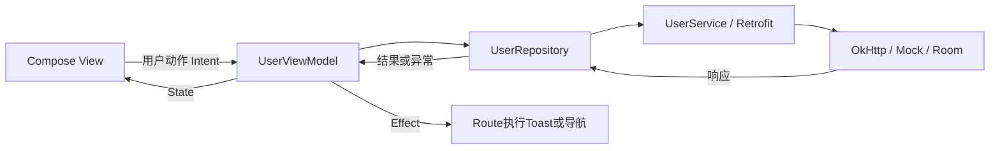
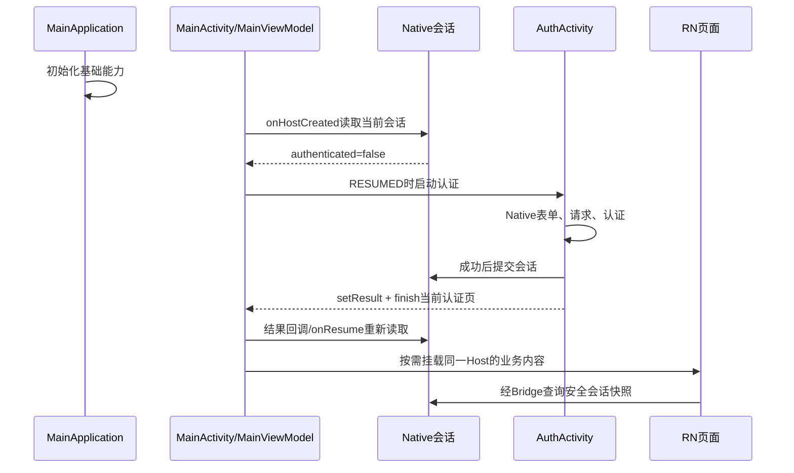
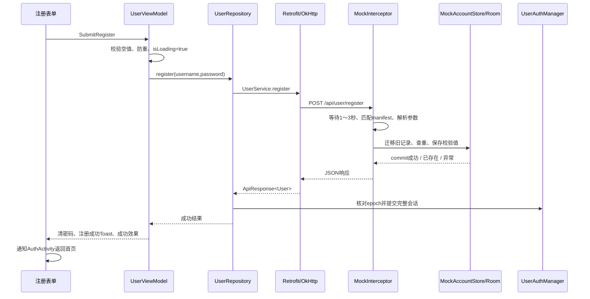

# EntryTask 登录注册功能新手指南

> 2026-10-25更新：注册/登录账号已由SP迁入Room。UI、MVVM和会话流程不变；SP只作为旧账号迁移源和普通偏好。完整数据库封装、失败恢复及验证见[Room认证存储实施说明](Room认证存储实施说明.md)。


适用读者：没有 Kotlin（简称 KT）、Android 或本项目基础，希望通过一个完整功能学习工程开发的同学。

更新日期：2026-10-22。本文依据当前仓库源码编写，主要讲 Android Native 登录注册。RN 是 React Native 的简称，负责登录后的业务页面；iOS 认证尚未实施。本文是教学文档，不把本地演示认证当作真实银行的生产认证方案。

阅读时注意代码标记：**源码摘录**来自当前实现，可能省略 import、注释或其他分支；**教学示例**用于解释概念，不能直接覆盖工程文件。所有账号、密码示例均为合成内容，请勿使用真实银行凭证练习。

## 阅读路线

| 顺序 | 章节 | 读完应能回答 |
| --- | --- | --- |
| 先建立印象 | [01 功能现状](#01-从用户视角认识登录注册)、[02 工程地图](#02-先找到工程入口和源码) | 页面在哪里，哪些代码负责什么？ |
| 补齐语法 | [03 Kotlin 入门](#03-读懂本功能所需的-kotlin-语法) | val、fun、data class、lambda、suspend是什么意思？ |
| 理解架构 | [04 MVVM](#04-mvvm如何把功能分工)、[05 状态与事件](#05-stateintenteffect如何配合) | 为什么不把请求、存储全部写在按钮里？ |
| 理解界面 | [06 Compose 与 XML](#06-compose与xml有什么区别)、[07 共用表单](#07-当前-compose-表单是怎样组成的) | 输入怎样更新页面，密码显隐放在哪里？ |
| 顺着代码走 | [08 启动门禁](#08-应用启动时为什么先出现登录页)、[09 输入数据流](#09-输入一个字符会发生什么)、[10 注册](#10-注册流程从按钮一直走到sp)、[11 登录](#11-登录流程怎样读取同一份账号数据) | 点击后经过哪些类、哪些方法？ |
| 理解稳定性 | [12 存储与会话](#12-表单sp账号和登录会话是三件事)、[13 协程与线程](#13-协程线程和网络请求怎么理解)、[14 取消与竞态](#14-为什么需要取消防重和多个编号)、[15 导航与生命周期](#15-页面导航返回与生命周期) | 为什么退出后不能被旧响应重新登录？ |
| 动手开发 | [16 真实后台](#16-以后接真实后台应该改哪里)、[17 运行与排查](#17-怎样运行调试和定位问题)、[18 测试与练习](#18-测试应该验证什么新手怎样练习) | 怎样安全修改、验证，而不是依靠猜测？ |
| 随时查阅 | [19 常见问题](#19-新手常见问题)、[20 词汇与源码索引](#20-词汇表与源码阅读索引) | 忘记名词或文件职责时到哪里找？ |

第一次建议先读01、02、04，再读03中的语法例子。第二次打开源码，沿09～11的链路逐个搜索方法。第三次完成18的练习。暂时不懂泛型、密码派生算法的内部细节，也可以先理解整个业务流程。

## 01 从用户视角认识登录注册

当前行为如下：

1. 应用先启动 Android 的 `MainActivity`。它是首页宿主，但未登录时会先打开 Native 登录页，不需要等 RN 页面加载。
2. 登录页和注册页都在 `AuthActivity` 里，用 Compose 导航切换；不是两个独立 Activity。
3. 输入用户名、密码，点击按钮后显示按钮内进度，防止重复提交。
4. 当前没有真实后端。请求仍经过 Retrofit、OkHttp，由 Native Mock 拦截器本地处理，普通模拟等待为随机1～3秒。
5. 注册成功后自动建立 Native 会话并进入首页，不要求用户再手动登录一次。
6. 注册账号校验记录保存在 Room；进程终止后记录仍在，但内存会话不在，所以需要重新登录。
7. 登录或注册失败留在原页面，用 Toast 显示提示。Toast 是屏幕上短暂出现的小提示，不是对话框。
8. 登录根页返回先收键盘；没有键盘时首次提示，2秒内再次返回退出整个应用任务，不露出未认证首页。注册页系统返回则回到登录页。

[登录效果图](../ui/verification/auth-login.png) · [注册效果图](../ui/verification/auth-register.png)。

先记住两个不同问题：

- **这个账号是否注册过？** 由 Mock 拦截器侧读取 Room 账号记录回答。
- **当前进程现在是否已登录？** 由 Native 的 `UserAuthManager` 回答。

有注册记录，不代表当前已登录；页面中输入了正确文本，也不代表已经登录。

## 02 先找到工程入口和源码

### 2.1 先认识文件类型

| 名称 | 含义 | 本工程中的例子 |
| --- | --- | --- |
| `.kt` | Kotlin代码文件，里面可以写业务逻辑，也可以写Compose UI | `UserViewModel.kt` |
| `.xml` | 结构化资源文件，可以定义布局、文字、图标、应用组件 | `strings.xml`、`AndroidManifest.xml` |
| `.json` | 结构化数据文件 | `mock/manifest.json`及各API响应模板 |
| `build.gradle` / `.kts` | 模块的构建配置；`.kts`表示使用Kotlin脚本语法 | `biz_user/build.gradle.kts` |
| `src/main` | 模块的正式应用源码与资源 | `biz_user/src/main` |
| `src/test` | 通常可在开发机运行的单元测试 | `AuthFormStateTest.kt` |
| `src/androidTest` | 需要Android设备/模拟器的测试 | `AuthNavigationTest.kt` |

Gradle负责“怎样编译、依赖哪些库”，不是登录按钮点击时执行的业务代码。不要为了修改界面随意改Gradle版本。

### 2.2 模块与包名不是同一件事

**模块**可以理解为工程中有独立构建配置的一块代码。**包名**是Kotlin类的命名空间，写在文件第一行。例如：

```kotlin
package com.entry.biz.user.viewmodel
```

它帮助区分同名类，不是网络地址。磁盘上的 `com/entry/biz/user/viewmodel/` 是相应目录结构。

本功能涉及：

```text
EntryTask/                         仓库根目录
├── android/
│   ├── app/                       启动、MainActivity、RN宿主、Bridge、资源打包
│   ├── biz_user/                  登录注册UI、VM、Repository、用户会话
│   ├── lib_base/                  共用ViewModel与Compose状态收集包装
│   ├── lib_net/                   Retrofit/OkHttp、认证Mock、Mock账号存储适配
│   ├── lib_storage/               既有通用存储封装
│   └── demo_engine/               RN业务API模拟，与认证Mock分开
├── src/                           RN业务源码，登录表单不在这里
├── mock/
│   ├── manifest.json              API路由清单
│   ├── auth/login/response.success.json
│   ├── auth/register/response.success.json
│   └── errors/                    共用错误响应模板
└── docs/                          工程文档
```

`app` 才是安装运行的应用模块；`biz_user` 是被应用使用的业务库模块。运行配置通常选 `app`，不是单独运行 `LoginRoute.kt`。

### 2.3 第一遍只认识这几个文件

| 文件 | 用一句话理解 |
| --- | --- |
| [AuthActivity](../../android/biz_user/src/main/java/com/entry/biz/user/ui/AuthActivity.kt) | 承载认证界面，组装依赖，处理成功返回和退出任务 |
| [AuthNavHost](../../android/biz_user/src/main/java/com/entry/biz/user/ui/navigation/AuthNavHost.kt) | 管理登录与注册两个页面，以及各自VM的归属 |
| [LoginRoute](../../android/biz_user/src/main/java/com/entry/biz/user/ui/LoginRoute.kt)、[RegisterRoute](../../android/biz_user/src/main/java/com/entry/biz/user/ui/RegisterRoute.kt) | 收集各自VM的状态和Toast/导航事件 |
| [AuthFormContent](../../android/biz_user/src/main/java/com/entry/biz/user/ui/AuthFormContent.kt) | 复用的品牌区、输入框、密码显隐、提交按钮 |
| [AuthUiContract](../../android/biz_user/src/main/java/com/entry/biz/user/ui/contract/AuthUiContract.kt) | 约定页面状态、用户动作、一次性效果的类型 |
| [UserViewModel](../../android/biz_user/src/main/java/com/entry/biz/user/viewmodel/UserViewModel.kt) | 接收输入/提交动作，组织请求与页面状态 |
| [UserRepository](../../android/biz_user/src/main/java/com/entry/biz/user/repository/UserRepository.kt) | 调用接口、判断业务结果、提交Native会话 |
| [UserService](../../android/biz_user/src/main/java/com/entry/biz/user/network/UserService.kt) | 声明请求路径、方法和表单字段 |
| [MockInterceptor](../../android/lib_net/src/main/java/com/entry/lib/net/MockInterceptor.kt) | 拦截网络调用，模拟后台注册/登录 |
| [MockAccountStore](../../android/lib_net/src/main/java/com/entry/lib/net/mock/MockAccountStore.kt) | 维护Mock账号校验记录、查重和迁移 |
| [UserAuthManager](../../android/biz_user/src/main/java/com/entry/biz/user/manager/UserAuthManager.kt) | 持有当前进程的登录事实、凭证与会话版本 |

当前文件按职责命名：LoginRoute/RegisterRoute连接VM和效果处理，AuthFormContent绘制共用UI，AuthNavHost管理导航；AuthUiContract定义交互契约。旧版LoginScreen/RegisterScreen/AuthNavGraph/UserContract已按这些名称整理。共享成功回调统一为onAuthSuccess，效果AuthSucceeded只表示认证成功通知，不固定导航目标。

阅读方法：先看类名和公开方法，再顺着函数调用找下一层。不要第一次就逐行研究所有基类、RN引擎和密码算法。

## 03 读懂本功能所需的 Kotlin 语法

本章只覆盖后文真正会遇到的语法；不要求先学完整Kotlin课程。

### 3.1 val、var、类型和字符串

教学示例：

```kotlin
val username: String = "demo-only" // 变量名: 类型 = 初始值
var isLoading: Boolean = false    // Boolean只有true/false
val count: Int = 1                // 整数
val epoch: Long = 0L              // Long是另一种整数类型，L表示Long字面量
```

- `val`：这个变量不能重新指向另一个值。
- `var`：可以重新赋值，例如 `isLoading = true`。
- Kotlin常能推断类型，所以源码经常写 `val operation = "login"`。
- `val`不等于对象内部永远不可变。例如 `val list = mutableListOf<String>()` 仍可向列表加元素，只是不能把list变量重新指向另一个列表。

字符串模板：

```kotlin
val operation = "login"
val message = "request.started operation=$operation"
```

`$operation`会替换成变量值；复杂表达式用 `${表达式}`。实际日志只记录操作名、错误码等安全字段，不能把密码放进模板。

### 3.2 fun声明函数，命名参数帮助阅读

教学示例：

```kotlin
fun welcome(name: String): String {
    return "欢迎，$name"
}

val text = welcome(name = "演示用户")
```

`fun`表示函数；括号里是输入参数；冒号后是返回类型。没有有用返回值时可以省略 `: Unit`，类似“只执行动作”。

源码中的：

```kotlin
private fun login() = submit(isRegistration = false)
private fun register() = submit(isRegistration = true)
```

这是短函数写法。两个入口都复用submit，通过布尔参数区分操作；不表示注册会绕过网络。

### 3.3 类、构造参数、对象和可见性

源码摘录：

```kotlin
class UserRepository(private val userService: UserService)
```

意思是创建Repository时，必须提供一个UserService。`private val`把它保存为类内部属性。

```kotlin
val userRepository = UserRepository(userService)
```

调用类名就是创建实例，不写Java中的 `new`。

| 关键字 | 含义 |
| --- | --- |
| `private` | 限制到相应文件/类内部使用 |
| `internal` | 在同一Kotlin编译模块内可见 |
| `public`或不写可见性 | 对外可见 |
| `object UserAuthManager` | 声明单例对象，当前进程共享这一份 |
| `companion object` | 类关联的对象，常用于TAG、常量、工厂辅助信息 |
| `override` | 实现或重写父类/接口约定的方法 |

`object`单例不是跨进程永久存储：应用进程结束，对象和它的字段也结束。

### 3.4 问号、空值和安全调用

```kotlin
val token: String? = null
val length = token?.length ?: 0
```

`String?`允许值为空；`?.`表示“非空才继续调用”；`?:`表示“左边为空就用右边”。

源码例子：

```kotlin
val username = params["username"]?.trim().orEmpty()
```

按顺序读：从参数里取username → 如果非空就去掉两端空白 → 没有值则得到空字符串。

`requireNotNull(user.token)`表示这里要求Token非空，否则抛异常；它不会凭空生成Token。`!!`也会强制当作非空，但空值会出错，新手不要靠到处加 `!!` 修复类型报错。

### 3.5 data class是数据对象，copy产生新状态

源码摘录：

```kotlin
data class AuthUiState(
    val username: String = "",
    val password: String = "",
    val isLoading: Boolean = false
) : IUiState
```

它把页面需要的三个字段放在一起。`= ""`、`= false`是默认值。

```kotlin
val oldState = AuthUiState(username = "demo-only")
val newState = oldState.copy(isLoading = true)
```

newState保留原用户名和密码，只改变isLoading；oldState本身不被修改。这样每次变化有明确的前后状态。

源码 `val (username, password) = currentState` 是**解构**，按data class参数顺序取前两个字段，不是根据变量名匹配字段。调整数据类参数顺序前要检查这类代码。

### 3.6 interface、sealed、data object和when

`interface`声明需要实现的能力或类型约定。例如 `UserService` 声明有login/register方法。

本项目用有限种类表示用户动作：

```kotlin
sealed interface AuthUiIntent : IUiIntent {
    data class UpdateUsername(val value: String) : AuthUiIntent
    data object SubmitLogin : AuthUiIntent
}
```

- `sealed interface`把类型的直接实现限制在Kotlin规定的范围，便于列举所有情况。
- `data class UpdateUsername`携带输入内容。
- `data object SubmitLogin`代表一个不需要额外字段的动作。
- 这里的 `AuthUiIntent` 是项目自己的“用户动作”，不要与Android启动Activity用的 `android.content.Intent` 混淆。

```kotlin
when (intent) {
    is AuthUiIntent.UpdateUsername -> updateState { copy(username = intent.value) }
    is AuthUiIntent.SubmitLogin -> login()
    // 实际源码还处理密码输入和提交注册。
}
```

`when`可以理解为按不同情况分支处理；`is`判断类型。右侧 `->` 后写该情况要执行的代码。

### 3.7 lambda、it和回调

```kotlin
onValueChange = { onIntent(AuthUiIntent.UpdateUsername(it)) }
```

大括号里是一小段可传递的函数，叫lambda。`it`是只有一个参数时的默认参数名；等价的教学展开是：

```kotlin
onValueChange = { newText ->
    onIntent(AuthUiIntent.UpdateUsername(newText))
}
```

回调的意思是：先把“以后发生输入时做什么”交给组件，而不是现在立即执行。

```kotlin
onClick = { submit() } // 点击时调用
```

如果不理解这一点，就容易把请求写成组件显示时直接执行，而不是点击时执行。

### 3.8 函数类型、方法引用和尾随lambda

```kotlin
onIntent: (AuthUiIntent) -> Unit
```

表示一个函数参数：接收AuthUiIntent，执行后不返回有用结果。`onSwitchForm: () -> Unit`则连输入参数也没有。

```kotlin
viewModel::handleIntent
```

是方法引用：把handleIntent这段处理能力传给别人。这里不是立刻调用它。

当函数的最后一个参数也是函数时，Kotlin允许把lambda放到括号外：

```kotlin
Button(onClick = { submit() }) {
    Text("登录")
}
```

最后的大括号描述按钮里面要放的UI。

### 3.9 by、remember和可观察状态

```kotlin
var passwordVisible by remember { mutableStateOf(false) }
```

这里的 `by` 是委托语法：读写passwordVisible时，由Compose状态对象处理。先把整句理解为“在本次组件生命周期里保存一个可被UI观察的布尔值，初始为false”。

`by`也可能用于别的委托机制，不是所有出现by的地方都与Compose有关。

### 3.10 泛型、冒号与注解

```kotlin
BaseViewModel<AuthUiState, AuthUiEffect, AuthUiIntent>(AuthUiState())
```

尖括号里的类型告诉共用基类：当前功能用哪种状态、效果和动作。基类不用为每个业务复制一份。

类声明里的冒号表示继承父类或实现接口；并不总是“字段类型”。

`@Composable`、`@POST`、`@Synchronized`是不同用途的**注解**：

| 注解 | 本文中的作用 |
| --- | --- |
| `@Composable` | 告诉Compose编译器，这个函数参与UI描述 |
| `@POST`、`@Field` | 告诉Retrofit怎样生成请求 |
| `@Synchronized` | 通过同步锁保护此方法，避免并发修改破坏一致性 |
| `@Test` | 标识测试方法 |

### 3.11 suspend、launch、try/catch/finally先认识含义

- `suspend fun`：这是可以挂起的函数；等待结果时可以暂停协程，不等于自动新开线程。
- `viewModelScope.launch { ... }`：在VM管理的协程作用域中启动一项任务。
- `try`：尝试执行；`catch`：区分并处理异常；`finally`：离开这段处理时执行收尾。
- `throw`：把异常继续抛给上层；`return`：返回；`return@launch`：只结束这个launch代码块。

网络与线程的完整解释在13章。先记住：**可挂起不代表里面随便放阻塞IO都安全。**

## 04 MVVM如何把功能分工

MVVM是职责分工方式，不是要求创建固定数量文件。它把页面、页面逻辑和数据处理分开。

| 部分 | 本项目对应 | 负责什么 | 不应该负责什么 |
| --- | --- | --- | --- |
| View | AuthFormContent、LoginRoute、RegisterRoute | 展示输入/进度，转发动作，执行Toast等平台效果 | 保存注册账号、直接读取数据库校验密码 |
| ViewModel | UserViewModel | 更新状态、表单校验、防重、调用Repository、产生结果效果 | 持有Activity/View，直接控制按钮对象 |
| Model侧 | User、Repository、Service及IO实现 | 数据模型、请求、响应解释、账号与会话能力 | 在网络库里弹Toast、引用登录UI |
| 组装入口 | AuthActivity、UserViewModel.Factory | 把依赖连接起来，为页面创建VM | 混入密码校验算法或账号数据库操作 |

本工程在MVVM中使用 `Intent → State/Effect` 的单向数据流写法。它借用了MVI中常见的表达方式，但不需要把整个项目重新叫成另一套架构。



### 4.1 为什么不把请求直接写在按钮里

如果按钮里同时读取数据库、发请求、设置登录状态、弹Toast和打开首页，那么换一套UI或测试失败流程，都要依赖这个按钮和Activity。更容易出现：切页后请求还修改旧控件、两处按钮使用不同校验规则、注册写完Room但登录读另一套数据。

现在按钮只产生 `SubmitLogin` / `SubmitRegister`。相同业务处理不依赖按钮的具体外观，失败和竞态也可以在不启动界面的单元测试中验证。

### 4.2 为什么没有每层都加一个UseCase

当前认证行为集中在少量Repository和VM方法中。没有额外的UseCase类，不代表不符合MVVM。以后若出现多步骤认证编排、复杂资格判断或跨业务复用，再按实际复杂度提取；不要为了目录看起来完整，增加只转调一行代码的空层。

## 05 State、Intent、Effect如何配合

### 5.1 State是“现在页面应该长什么样”

当前 `AuthUiState` 中：

| 字段 | 含义 | 控制的UI |
| --- | --- | --- |
| username | 本页当前用户名 | 用户名输入框value |
| password | 本页当前密码，暂存在内存 | 密码输入框value |
| isLoading | 本页请求是否处理中 | 输入是否可编辑、按钮是否可点、进度是否显示 |

状态没有保存Activity、按钮对象、NavController或注册账号库。

### 5.2 Intent是“用户想做什么”

当前动作有四种：`UpdateUsername`、`UpdatePassword`、`SubmitLogin`、`SubmitRegister`。

输入和提交分开，VM可以统一决定怎样更新状态，而不是让不同组件各自修改公共可变字段。

### 5.3 Effect是“需要执行一次的操作”

```kotlin
sealed interface AuthUiEffect : IUiEffect {
    data class ShowToast(val message: String) : AuthUiEffect
    data object AuthSucceeded : AuthUiEffect
}
```

用户名需要持续显示，所以属于State；“提示一次错误”“通知宿主认证成功”属于Effect。

不要在渲染函数里写“只要isSuccess=true就Toast一次”，因为组件可能重新执行，多次产生同一个提示。

### 5.4 BaseViewModel怎样保证外部只读

源码摘录，位于 [BaseViewModel](../../android/lib_base/src/main/java/com/entry/lib/base/mvvm/viewmodel/BaseViewModel.kt)：

```kotlin
private val _uiState = MutableStateFlow(initialState)
val uiState: StateFlow<State> = _uiState.asStateFlow()

protected fun updateState(reducer: State.() -> State) {
    _uiState.update { it.reducer() }
}
```

`MutableStateFlow`保存最新值，允许内部更新；外部只得到StateFlow读取入口。StateFlow是一种状态流：观察者可以获得当前状态及后续变化，它不是磁盘存储，也不是保证逐条交付每一次变化的事件队列。

源码 `updateState { copy(isLoading = true) }` 中，lambda的接收者就是当前状态，所以可以直接调用copy。它根据最新状态计算新状态，减少散落字段的不同步问题。

一次性效果由 `Channel` 缓冲，再通过Flow交给Route收集。缓冲能处理短时间收发速度不一致，但**不等于跨进程保存或严格一次交付保证**。当前实现不是完整的可恢复业务事件系统。

### 5.5 ComposableScreen怎样把状态交给UI

源码摘录，位于 [ComposableScreen](../../android/lib_base/src/main/java/com/entry/lib/base/mvvm/ui/ComposableScreen.kt)：

```kotlin
val uiState by viewModel.uiState.collectAsStateWithLifecycle(
    minActiveState = Lifecycle.State.STARTED
)

LaunchedEffect(viewModel) {
    viewModel.uiEffect.collect { effect -> onEffect(effect) }
}

content(uiState, viewModel::handleIntent)
```

上面为教学精简，实际代码先判断可空的onEffect。

- 第一段把VM状态转换成Compose可观察状态；低于STARTED时暂停这段UI状态收集。
- 第二段收集一次性效果，让Route弹Toast或执行回调。
- 最后一段把最新状态和动作处理函数交给UI。

这里有一个需要认真区分的地方：State收集是生命周期感知的；Effect的LaunchedEffect跟随组合生命周期。**暂停UI状态收集不代表VM请求自动取消，也不保证后台没有计算。** 页面离开时取消任务是另一段代码负责的。

## 06 Compose与XML有什么区别

### 6.1 它们解决的是UI表达问题

传统Android常用XML描述布局，再用Kotlin找到控件、监听输入和更新属性。Compose直接用Kotlin函数描述UI，并根据状态变化更新需要更新的部分。

**MVVM是分工方式，Compose/XML是UI实现方式。** 两者不是互相替代的概念：XML可以使用MVVM，Compose也不会自动让业务逻辑具备良好架构。

### 6.2 用同一个按钮对比

以下是XML方式的教学示例，不是本项目认证页现有文件：

```xml
<Button xmlns:android="http://schemas.android.com/apk/res/android"
    android:id="@+id/submit"
    android:layout_width="match_parent"
    android:layout_height="wrap_content"
    android:text="登录" />
```

相应Kotlin关键逻辑通常需要连接状态与控件：

```kotlin
// 教学示例：省略Activity初始化和import。
val button = findViewById<android.widget.Button>(R.id.submit)
button.setOnClickListener {
    viewModel.handleIntent(AuthUiIntent.SubmitLogin)
}
lifecycleScope.launch {
    repeatOnLifecycle(Lifecycle.State.STARTED) {
        viewModel.uiState.collect { state ->
            button.isEnabled = !state.isLoading
            button.text = if (state.isLoading) "正在登录…" else "登录"
        }
    }
}
```

Compose表达同一个状态关系：

```kotlin
// 教学示例，需在Composable作用域内，state与onIntent由外部提供。
Button(
    enabled = !state.isLoading,
    onClick = { onIntent(AuthUiIntent.SubmitLogin) }
) {
    Text(if (state.isLoading) "正在登录…" else "登录")
}
```

这里直接声明“处理中就禁用，并显示处理中”。不需要保存一个Button对象再逐个改属性。

这只是说明差异，不表示所有XML代码都必须手动findViewById。XML也能配合ViewBinding、DataBinding及状态收集；本项目首页使用自己的MainShellView渲染XML。

### 6.3 什么叫声明式和重组

声明式可以理解为：**给定现在的状态，描述现在应该出现的UI。**

```kotlin
if (state.isLoading) {
    CircularProgressIndicator()
}
```

当isLoading变化时，Compose会安排对相关UI描述进行重新计算，这个过程叫重组。它不等于每次都重新启动Activity，也不等于整张屏幕所有控件都重建。

因此Composable函数体里不能随意放这些代码：

```kotlin
// 错误教学示例：不要这样写。
@Composable
fun BadLoginPage() {
    // 不要在这里直接发注册请求、写SP、弹Toast或启动Activity。
}
```

应把点击动作交给VM，或者在明确的Effect中处理有生命周期的操作。否则重新执行UI描述时，可能重复注册、重复提示或重复跳转。

### 6.4 Compose里普通变量不等于UI状态

```kotlin
// 教学示例：仅这样声明，不会让Compose自动观察普通赋值。
var visible = false
```

应使用Compose状态：

```kotlin
var visible by remember { mutableStateOf(false) }
```

或像本工程的表单业务状态一样，由VM的StateFlow提供。不能同时让输入框维护一套用户名、VM又维护另一套用户名，否则会出现两份数据不一致。

### 6.5 为什么当前工程同时存在XML与Compose

| 位置 | 当前UI方式 | 说明 |
| --- | --- | --- |
| MainActivity首页外壳 | XML + MainViewModel/MainShellView | 容器、Native底栏和RN宿主适配 |
| AuthActivity登录注册 | Compose + UserViewModel | Native认证UI |
| 四Tab业务内容 | RN | 单个RN实例内的业务页面 |

这些可以共存。为了改一个输入框，没有必要顺带把MainActivity全部转换成Compose。

此前看到“一个XML改成Compose要改很多文件”，其中一部分可能来自MVVM、认证协调、宿主适配和恢复处理；那些并不都是Compose本身要求的改动。

### 6.6 选择时看什么

| 维度 | XML/View | Compose |
| --- | --- | --- |
| UI描述 | XML资源及View对象 | Kotlin的Composable函数 |
| 状态更新 | 需要建立状态到View属性的连接，可用绑定工具 | 在UI描述中直接读取可观察状态 |
| 组件复用 | 自定义View、include等 | 参数化Composable函数 |
| 学习重点 | View生命周期、布局、绑定 | 状态归属、重组、Effect、组合生命周期 |
| 与MVVM关系 | 可以配合 | 可以配合 |
| 性能 | 需要实际测量 | 同样需要实际测量，不因采用Compose就自动更快 |

## 07 当前 Compose 表单是怎样组成的

源码：[AuthFormContent](../../android/biz_user/src/main/java/com/entry/biz/user/ui/AuthFormContent.kt)。

### 7.1 组件树先看结构

```text
AuthActivity.setContent
└── AuthNavHost
    ├── LoginRoute：登录VM + 效果处理
    │   └── AuthFormContent(isRegistration=false)
    └── RegisterRoute：注册VM + 效果处理
        └── AuthFormContent(isRegistration=true)
            ├── BankBrand：标志、银行名称、欢迎语
            ├── 页面标题与说明
            ├── AuthInput：用户名
            ├── AuthInput：密码 + 显隐按钮
            ├── 提交按钮与加载状态
            └── 切换登录/注册的文字按钮
```

复用的是UI结构，不是同一个VM或同一份账号密码状态。`isRegistration`只决定文案和提交哪一种动作。

### 7.2 常见UI积木

| 组件/概念 | 简单解释 |
| --- | --- |
| Column | 把子项从上到下排列 |
| Row | 把子项从左到右排列 |
| Box | 可以叠放内容，也能控制对齐 |
| Text | 显示文字 |
| OutlinedTextField | 带外框的输入组件 |
| Button / TextButton / IconButton | 普通按钮、文字按钮、图标按钮 |
| Spacer | 留出间距 |
| Modifier | 一串布局/外观/交互描述，例如宽度、间距、背景 |
| dp | 布局尺寸单位，不是直接写死物理像素 |
| sp | 字体尺寸单位，会考虑用户字体缩放设置 |

`Modifier`顺序可能影响结果，例如先限制最大宽度、再填满允许的宽度，与先强制占满整屏再限制，效果可能不同。不要只凭方法名随意调整顺序。

### 7.3 标签、提示和输入值各是什么

教学精简，取自AuthInput的结构：

```kotlin
Text(label)                         // 固定在输入框上面
Spacer(Modifier.height(10.dp))
OutlinedTextField(
    value = value,                  // 用户已经输入的内容
    onValueChange = onValueChange,  // 用户修改时向外通知
    placeholder = { Text(placeholder) }, // 空输入时的提示
    enabled = enabled,
    singleLine = true
)
```

- 标签帮助知道“这个字段是什么”，当前固定在框上面，不随聚焦移动。
- placeholder帮助知道“现在应输入什么”，不是实际值。
- value才是会提交的字段数据；不能把placeholder当作已经输入的用户名。

中文文案在 [strings.xml](../../android/biz_user/src/main/res/values/strings.xml)，源码使用 `stringResource(R.string.xxx)` 读取。`R`是构建生成的资源访问类，不要手工编辑生成的R类。

### 7.4 密码显示/隐藏只是呈现方式

源码关键语句：

```kotlin
var passwordVisible by remember { mutableStateOf(false) }

visualTransformation = if (passwordVisible) {
    VisualTransformation.None
} else {
    PasswordVisualTransformation()
}
```

显隐按钮只改变passwordVisible，不改变 `state.password`。同一个密码可以显示成圆点，也可以显示成文字；提交的内容保持相同。

必须区分：**显示圆点不是加密，隐藏输入不等于网络或存储已经安全。**

当前组件不使用rememberSaveable保存显隐状态；在ON_PAUSE时重新隐藏，点击提交也重新隐藏。密码本身由VM短暂持有，不写入Bundle或SavedStateHandle。

### 7.5 remember、LaunchedEffect、DisposableEffect的区别

| 机制 | 用途 | 当前例子 |
| --- | --- | --- |
| remember | 让值跨同一组合位置的重组保留 | 密码是否可见 |
| rememberSaveable | 可把支持的状态保存到恢复机制 | 当前密码显隐没有使用，密码也不应借它保存 |
| LaunchedEffect(key) | 为组合启动协程，key变化/离开组合时取消旧任务 | 收集VM一次性效果 |
| DisposableEffect(key) | 注册某资源，并在离开或key变化时清理 | 添加/移除LifecycleObserver、离页调用onFormLeft |

这些都是UI生命周期工具，不是后台数据库或全局任务系统。

### 7.6 加载、键盘与可访问性

请求中，`state.isLoading=true`：

- 用户名和密码输入禁用。
- 提交按钮与切页按钮禁用。
- 按钮显示小进度圈与“正在登录/注册”。

这能改善交互，但VM仍必须自己防重，因为动作还可能由键盘等入口发出。

用户名键盘的“下一项”移动到密码，密码的“完成”触发提交。`imePadding`为输入法预留空间，`verticalScroll`允许小屏或键盘出现时滚动，`safeDrawing`处理系统栏安全区域。具体机型、横屏和大字体仍需实际验证，不能仅凭用了这些Modifier就认定适配全部完成。

眼睛按钮的 `contentDescription` 为“显示密码/隐藏密码”，方便屏幕阅读器识别；表单宽度上限为480dp，避免大屏上无限拉宽。

## 08 应用启动时为什么先出现登录页

详细代码链路另见 [启动与登录全链路源码详解](启动与登录全链路源码详解.md)。这里保留新手需要的主线。

### 8.1 Application、Activity和页面的区别

- `Application`：应用进程级初始化入口。当前是MainApplication，负责日志、存储、网络配置及唯一RN Host的组装。
- `Activity`：Android界面宿主。当前MainActivity承载应用首页外壳；AuthActivity承载登录注册。
- Compose页面：可以在同一Activity内部切换，例如Login和Register。
- 进程：运行这些对象的系统执行环境。关闭页面、结束任务和结束进程是不同动作。

### 8.2 首次未登录的启动主线



`RESUMED`可以先理解成Activity已经处于可与用户交互的前台阶段。不是刚创建了一个对象，就可以在任意生命周期时刻随意弹页面。

这里省略了可选的引擎预热：它默认关闭；显式开启时在Native认证首帧后启动唯一引擎，不提前挂载业务页面或查询首页。系统恢复已有Fragment时也可能走不同创建时序，所以RN自己的门禁仍然需要。

### 8.3 两种入口不要混为一谈

| 场景 | 谁决定打开登录 | 是否经过RN Bridge |
| --- | --- | --- |
| 首次启动未登录 | MainActivity → MainViewModel → Native会话校验 | 不需要 |
| RN受保护页面发现未登录 | RN页面门禁 → HostPort → NativeHost → Native认证协调 | 需要 |
| 登录页点击提交 | Native View → VM → Repository → Retrofit | 不经过RN Bridge |
| RN查询当前登录态 | NativeSession能力返回安全快照 | 需要 |

Bridge是RN与Native的通信边界，不是每一次Native内部函数调用都要经过它。用户名、密码及银行凭证不需要绕到JS里再传回来。

## 09 输入一个字符会发生什么

以用户名输入框为例。源码关键语句位于AuthFormContent：

```kotlin
value = state.username,
onValueChange = { onIntent(AuthUiIntent.UpdateUsername(it)) }
```

假设用户从空值输入到合成用户名 `demo-only`：

| 步骤 | 代码位置 | 做了什么 |
| --- | --- | --- |
| 1 | 输入框 | 产生新的文本 |
| 2 | onValueChange | 把新文本装进UpdateUsername动作 |
| 3 | ComposableScreen传入的onIntent | 实际调用viewModel.handleIntent |
| 4 | UserViewModel.handleIntent | 执行 `updateState { copy(username = intent.value) }` |
| 5 | BaseViewModel | StateFlow中出现新的页面状态 |
| 6 | ComposableScreen | 收集最新状态，交给AuthFormContent |
| 7 | 输入框value | 显示新的state.username |

```text
输入框新文本
  → UpdateUsername
  → handleIntent
  → 新AuthUiState
  → StateFlow
  → Compose读取新状态
  → 输入框显示新值
```

这个环称为**受控输入**：输入值的权威在VM状态里。UI不会另存一个独立用户名，也不会每输入一个字就写SP或发登录请求。

密码走同样路径，只是使用 `UpdatePassword`。禁止为了验证是否收到文本而直接把密码打到日志中。

## 10 注册流程从按钮一直走到Room

先把角色分开：View和VM发起“客户端请求”；MockInterceptor及其MockAccountStore暂时扮演“本地模拟后台”；RoomMockAccountStorage通过lib_storage的Room封装实现这个模拟后台的持久化。

**账号写Room的调用属于拦截器侧，不属于UI或Repository的本地绕过请求行为。**

### 10.1 整体时序



失败时不会一路执行到提交会话：错误进入VM的catch，显示一次Toast，恢复可操作状态。

### 10.2 VM入口怎样选择注册

源码摘录：

```kotlin
private fun register() = submit(isRegistration = true)

private fun submit(isRegistration: Boolean) {
    if (currentState.isLoading) return
    val (username, password) = currentState
    if (username.isBlank() || password.isBlank()) {
        sendEffect { AuthUiEffect.ShowToast("账号或密码不能为空") }
        return
    }
    // 后续才进入异步请求，见下文。
}
```

- isLoading先挡住重复操作。
- 从当前State取本次要提交的值，不是等网络返回后再去输入框读取。
- 空值直接在本地反馈，不进入模拟网络延迟。
- 通过校验后同步设置 `isLoading=true`，避免第二次点击趁协程还没运行就又被受理。

### 10.3 Repository只调用接口、解释结果和建立会话

源码精简，方法位于UserRepository：

```kotlin
suspend fun register(username: String, password: String): User {
    val epoch = UserAuthManager.sessionSnapshot().second
    val response = userService.register(username, password)
    if (response.code == 200 && response.data != null) {
        val user = response.data
        commitSession(user, epoch)
        return user
    } else {
        throw AuthRejectedException(
            if (response.code == 409)
                "该用户名已注册，请更换用户名或直接登录"
            else "注册失败，请稍后重试"
        )
    }
}
```

epoch稍后在14章讲解。这里先理解为：请求前记下会话版本，成功后确认这个结果仍然有效。

Repository没有绕过请求直接调用Room写账号。若让它在请求前自行写一份“注册成功数据”，就会出现接口失败但本地已经注册的双重事实。

### 10.4 UserService怎样变成一个请求

源码摘录：

```kotlin
@FormUrlEncoded
@POST("api/user/register")
suspend fun register(
    @Field("username") username: String,
    @Field("password") password: String
): ApiResponse<User>
```

逐个解释：

- `@POST`：请求方法为POST，后面是接口路径。
- `@FormUrlEncoded`：请求体按表单编码，不是JSON。
- `@Field("password")`：网络字段名由注解中的password决定；当前Kotlin参数也统一叫password，便于顺着调用链阅读。
- `ApiResponse<User>`：响应外层是ApiResponse，data里期望是User。

Retrofit读取这些声明生成请求；OkHttp执行请求。当前Mock拦截器会在真正Socket通信之前返回本地结果，所以调用了网络库，也不代表访问了真实后端。

`+`、`&`等特殊字符需要正确编码。不要自己拼 `"username=$username&password=$password"`，否则字段内容可能被误当作分隔符。

### 10.5 路由清单怎样决定处理方式

来自 [mock/manifest.json](../../mock/manifest.json)：

```json
{
  "apiId": "auth.register",
  "method": "POST",
  "path": "/api/user/register",
  "handler": "register",
  "exposure": "nativeOnly",
  "response": "auth/register/response.success.json"
}
```

| 字段 | 意思 |
| --- | --- |
| apiId | 稳定接口标识，用来识别和排查请求 |
| method/path | 精确匹配请求方法与路径 |
| handler | 需要运行注册逻辑，不只是原样返回一个文件 |
| exposure | 接口属于Native内部认证，不作为RN随意调用的接口 |
| response | 成功数据模板在哪里 |

不能用 `path.contains("register")` 判断，否则其他名字中恰好包含register的路径也可能误命中。

### 10.6 拦截器怎样写Room

注册仍由 `MockInterceptor.handleAuthentication` 调用 `MockAccountStore.register`。已有账号返回409；新账号经过KDF派生后，调用存储端口的 `create`。页面和Repository不直接写账号。

```text
MockInterceptor.handleAuthentication
  → MockAccountStore.register
  → migrateLegacy（需要时先完成旧账号迁移）
  → storage.create(key, verifier)
  → RoomMockAccountStorage.create
  → CredentialStore.insertIfAbsent
  → Room事务 INSERT OR IGNORE
```

### 10.7 “写完才返回成功”在哪里实现

[Room适配器](../../android/app/src/main/java/com/entrytask/storage/RoomMockAccountStorage.kt)关键代码：

```kotlin
override fun create(key: String, verifier: String): Boolean {
    importVerifiers()
    require(key.startsWith(ACCOUNT_PREFIX))
    return key in credentials.insertIfAbsent(mapOf(key to verifier))
}
```

`insertIfAbsent`在[RoomStorage](../../android/lib_storage/src/main/java/com/entry/lib/stroage/room/RoomStorage.kt)内执行事务，只有提交成功后才返回新增主键。冲突返回空集合，映射409；数据库异常不会返回200。唯一主键保护多连接写入，已有密码不被覆盖；进程锁继续协调本进程的派生和迁移。所有操作发生在OkHttp后台线程。

旧SP清理与Room不在同一事务中；先写Room，确认成功后删旧键，中断后可重试。更详细的失败恢复见[迁移说明](Room认证存储实施说明.md)。

### 10.8 返回JSON为什么必须用模板和对象构造

成功模板在 [auth/register/response.success.json](../../mock/auth/register/response.success.json)。模板中的用户名为空，运行时由拦截器注入本次规范化用户名：

```kotlin
JSONObject(asset(route.getString("response"))).apply {
    getJSONObject("data").put("username", username)
}
```

不要用字符串直接拼JSON。用户名中若带引号，手拼内容可能变成非法JSON；JSONObject会处理必要的转义。

模板是安装包中的只读初始数据，不是在模板文件里保存新注册账号。真正可变化的账号校验记录在Room数据库里。

## 11 登录流程怎样读取同一份账号数据

### 11.1 与注册共用哪些层

```text
登录按钮 → SubmitLogin → UserViewModel.submit(false)
  → UserRepository.login → UserService.login
  → POST /api/user/login → MockInterceptor
  → MockAccountStore.verify → 同一个entrytask_auth.db
  → 响应 → Repository提交会话 → VM成功效果 → AuthActivity.finish
```

UI、VM、Repository不直接读取账号校验记录做密码比较。登录和注册都经过同一条请求链，拦截器侧共用同一种账号记录格式。

### 11.2 匹配规则

拦截器解析请求后：

```kotlin
val username = params["username"]?.trim().orEmpty()
val password = params["password"].orEmpty()
```

- 用户名去掉两端空白，当前仍区分大小写。
- 密码保留原样，不trim。因此教学密码 `" pass-only "` 与 `"pass-only"` 不一样。
- 参数有效后，login分支调用 `accounts.verify(username, password)`。
- 账号不存在或密码不匹配都返回业务401，不借错误提示泄露更多账号细节。

当前拦截边界还限制用户名最多256字符、密码最多1024字符。这是源码现状；文档中其他阶段的目标长度不代表已实现。

### 11.3 不是读取明文密码后直接比较

注册时保存密码校验值。登录时读取同一账号的算法、salt和校验值，使用本次输入的密码重新计算，再比较结果。

```text
输入用户名 → 规范化 → 算出账号主键 → 读取账号记录
输入密码 + 记录中的salt/算法/参数 → 算出候选校验值
候选校验值 与 已保存校验值一致 → 认证成功
```

源码使用 `MessageDigest.isEqual` 比较字节数组，不把密码打印出来排查。

### 11.4 HTTP状态与业务码分开看

本工程Native认证的典型返回是：HTTP状态200，JSON里面 `code` 为401。这表示“请求被Mock成功处理，但凭证校验失败”，不是HTTP层的401。

| 情况 | 当前Native认证结果 | 最终表现 |
| --- | --- | --- |
| 正确注册/登录 | HTTP200，业务code=200，data有用户/演示凭证 | 建立Native会话并返回首页 |
| 凭证不符 | HTTP200，业务code=401 | Toast“账号或密码错误，请检查后重试” |
| 重复注册 | HTTP200，业务code=409 | Toast提示已注册，不覆盖原密码 |
| 参数无效 | 通常HTTP200，业务code=400 | 本地空值先提示；其余按当前Repository规则处理 |
| Mock数据/存储处理异常 | 认证分支通常HTTP200，业务code=500 | 操作失败Toast，不建立会话 |
| 未找到路由 | HTTP404 | 网络库按HTTP错误路径处理 |
| 取消 | 协程/请求取消 | 不显示成“登录失败” |

共享错误JSON里原本使用字符串错误码；认证拦截器将其适配成当前Native DTO需要的数字，RN其他错误契约不因此改变。

### 11.5 从JSON到Kotlin对象

[User.kt](../../android/biz_user/src/main/java/com/entry/biz/user/model/User.kt) 中定义：

```kotlin
data class ApiResponse<T>(
    val code: Int,
    val message: String,
    val data: T?
)
```

这里T在认证接口中就是User。Gson转换器负责把JSON解析成Kotlin/Java可使用的对象；不是靠变量名“自动认识所有后台接口”。字段名称、类型和空值语义必须与响应一致。

模拟成功结构的**教学简化示例**：

```json
{
  "code": 200,
  "message": "success",
  "data": {
    "id": 1,
    "username": "demo-only",
    "nickname": "演示用户",
    "avatar": null,
    "token": "<仅原生内部消费的演示凭证>"
  }
}
```

上面的Token占位说明不是实际fixture值。它不应传给RN或打到日志。

## 12 表单、Room账号和登录会话是三件事

### 12.1 三份数据的生命周期

| 数据 | 保存在哪里 | 谁负责 | 进程终止后还在吗 |
| --- | --- | --- | --- |
| 当前输入用户名/密码/isLoading | 本页VM的AuthUiState | UserViewModel | 不保证恢复；密码不持久化 |
| 密码是否显示 | Compose remember状态 | AuthFormContent | 不在，且后台时恢复隐藏 |
| 注册账号校验记录 | 应用私有Room数据库 | 拦截器侧MockAccountStore/Room适配器 | 正常保留，卸载/清数据会丢失 |
| 当前是否已登录、凭证、用户scope、epoch | Native进程内存 | UserAuthManager | 不在，不从SP自动恢复登录 |
| Tab/认证流程等非敏感恢复信息 | 相应SavedStateHandle/框架状态 | Shell/导航 | 有条件恢复，不是永久账号库 |

SavedStateHandle/rememberSaveable用于恢复合适的界面状态，不是数据库。系统恢复也不能作为保存密码、Token的理由。

### 12.2 Native会话提交的关键代码

源码精简，UserRepository：

```kotlin
private suspend fun commitSession(user: User, expectedEpoch: Long) {
    currentCoroutineContext().ensureActive()
    if (!UserAuthManager.commitAuthentication(
            user.username, requireNotNull(user.token), expectedEpoch)) {
        throw CancellationException("AUTH_REQUEST_SUPERSEDED")
    }
}
```

源码，UserAuthManager：

```kotlin
@Synchronized
fun commitAuthentication(username: String, token: String, expectedEpoch: Long): Boolean {
    if (sessionEpoch != expectedEpoch) return false
    establishSession(username, token)
    return true
}
```

它不是只把一个Boolean设成true。establishSession还检查必要字段，记录Native凭证、生成用户数据隔离scope、更新epoch。

`@Synchronized`让“比较版本”和“提交会话”在同一锁内完成，避免比较完版本后又被并发退出打断这项原子判断。

### 12.3 Room新记录是什么

文件为应用私有 `databases/entrytask_auth.db`，版本1，表 `auth_credentials`：

```text
account_key（唯一主键）：mock_auth_v1.<SHA-256(trim后的用户名)>
password_verifier：v1:<算法>:120000:<salt的hex>:<verifier的hex>
```

不同用户名各有一条记录；随机盐16字节、校验值32字节，当前优先PBKDF2WithHmacSHA256，旧Provider兼容SHA1，参数沿用已有v1格式。用户名和密码原文均不保存。salt使相同密码的记录不同，verifier用于比较，不能解密取回密码。

Room负责表、SQL、事务与版本，不等于数据库加密或生产认证。Keystore和生产后端仍未实现；hex也只是编码。未来改表需要显式Migration，禁止删库重建来解决升级问题。

### 12.4 旧账号如何迁移

旧SP的 `mock_auth_v1.*` 校验记录先整批导入Room，成功后删对应旧键；完整 `mock_reg_username/password`、`mock_db_username/password` 先派生，再写Room并清旧键。Room已有记录优先，其次旧版加盐记录，再按mock_reg、mock_db优先级处理。

Room提交和SP删键无法原子完成：中间崩溃时两份可能同时存在，下一次通过唯一主键忽略重复，再清旧键；Room失败不删SP，也不回退SP认证。普通偏好/残缺键对保留，已经丢失的账号无法凭空恢复。详见[失败恢复表](Room认证存储实施说明.md)。

### 12.5 为什么应用重启还要登录

Mock账号库模拟的是“后台知道这个账号”；Native会话表示“这个进程已经成功认证”。两者独立。

真正结束进程后，会话对象重新从未登录开始；账号记录保留。用户重新输入后，Native拦截器再读取Room验证。

按Home退到后台不一定结束进程；结束Activity任务也不保证系统进程立即消失。登录页双击退出会显式清会话，不能把这个行为推广成所有页面退出都强杀进程。

## 13 协程、线程和网络请求怎么理解

### 13.1 主线程负责界面，不应该长时间等IO

可以把主线程理解为界面的工作队列：点击、很多生命周期回调和UI状态更新都要用它。若在这里做长时间等待、磁盘写入或密集密码计算，页面可能卡住。

| 工作 | 当前主要执行位置 |
| --- | --- |
| 点击/输入回调、VM更新页面状态 | 主线程 |
| viewModelScope中发起Retrofit suspend调用 | 通常从主线程协程发起 |
| OkHttp执行拦截器、Mock等待、Room事务/旧SP迁移、密码派生 | OkHttp后台工作线程 |
| Retrofit结果交回后的VM状态处理 | 恢复到调用协程的上下文，当前通常是主线程 |
| Toast、Activity导航 | Android UI侧 |

这里依赖的是本项目Retrofit的挂起接口调用路径，不表示在任意地方调用MockAccountStore都会自动变成后台执行。

### 13.2 suspend不是“自动切后台”

教学示例：

```kotlin
viewModelScope.launch {
    val user = repository.login(username, password)
    // 等待登录期间，这个协程可以挂起；主线程仍有机会处理其他UI工作。
}
```

协程是一段有生命周期、可以暂停/恢复的任务，不应简单理解成一条专用线程。

如果自己在launch中直接调用阻塞文件API或长时间循环，而没有合适的调度位置，仍可能阻塞主线程。`Thread.sleep`出现在当前Mock拦截器中，是因为该拦截器此时运行在OkHttp后台线程；不要把这段sleep复制到按钮或Composable函数体。

### 13.3 viewModelScope、Job和取消

```kotlin
private var requestJob: Job? = null
requestJob = viewModelScope.launch {
    // 当前请求
}
```

Job是这项任务的控制句柄，用来取消或了解任务状态。VM销毁会取消viewModelScope下的任务；当前代码还在离页时主动取消requestJob。

取消通常是合作式的：到挂起点、取消检查或支持取消的IO边界，任务才响应取消。不是调用cancel就能撤销已经落盘的后台注册事实。

### 13.4 submit中最值得读的部分

下面是UserViewModel.submit的关键结构摘录，省略日志和具体错误文案映射：

```kotlin
val version = ++requestVersion
updateState { copy(isLoading = true) }
requestJob = viewModelScope.launch {
    try {
        if (isRegistration) repository.register(username, password)
        else repository.login(username, password)
        currentCoroutineContext().ensureActive()
        if (version != requestVersion) return@launch
        updateState { copy(password = "") }
        if (isRegistration) sendEffect { AuthUiEffect.ShowToast("注册成功") }
        sendEffect { AuthUiEffect.AuthSucceeded }
    } catch (cancelled: CancellationException) {
        throw cancelled
    } catch (error: Exception) {
        if (version == requestVersion) {
            // 实际源码区分业务、超时、IO和其他失败，再发ShowToast。
        }
    } finally {
        if (version == requestVersion) updateState { copy(isLoading = false) }
    }
}
```

逐段解释：

1. 先给本次请求记录页面版本，并置忙。
2. 调用Repository，等待结果。
3. 结果到达后再检查取消与版本，不能因为“后台成功”就无条件修改已离开的页面。
4. 成功时清本页密码，发提示/导航效果。
5. CancellationException继续向上抛，不把用户取消当作错误。
6. 其他异常转换成用户可理解的提示。
7. finally结束本次loading，但只有版本仍匹配时才允许更新。

finally是正常控制流/异常传播中的收尾机制，不是跨进程保障；进程被强制结束时，不能依赖它一定执行。

当前普通失败会恢复isLoading，不会在该失败分支立刻清掉本页密码；切页、成功或VM清理才清密码。读代码时不要把“失败”“离页”“进入后台”混成同一个动作。

### 13.5 错误提示从哪里决定

| 来源 | 示例 | 谁决定显示文案 |
| --- | --- | --- |
| 表单本地校验 | 空账号/密码 | VM |
| 业务失败 | 401凭证不符、409重复账号 | Repository映射为受控AuthRejectedException，VM转成效果 |
| 超时 | SocketTimeoutException | VM使用超时提示 |
| 一般IO失败 | IOException | VM使用网络连接提示 |
| 其他异常 | 未预期响应/内部失败 | VM使用当前操作的通用失败提示 |

当前错误分类是演示版，不能把每一条“网络连接失败”都当作断网的证据：部分底层解析问题也可能经IO异常路径表现。排查应结合异常类和拦截器业务码；以后可以进一步细分协议错误，而不是把原始异常文本直接Toast。

## 14 为什么需要取消、防重和多个编号

### 14.1 只禁用按钮还不够

用户可能快速点两次，键盘也可能提交；UI状态更新到屏幕还存在调度过程。因此有两层防重：

- UI层：处理中禁用交互。
- VM层：`if (currentState.isLoading) return`，并在launch之前同步置忙。

新手不要以为“按钮已经灰了”就可以删除VM的防重。

### 14.2 requestVersion防止旧页面结果改新状态

源码onFormLeft：

```kotlin
fun onFormLeft() {
    requestVersion++
    requestJob?.cancel()
    requestJob = null
    updateState { copy(password = "", isLoading = false) }
}
```

用一个时间线理解：

```text
请求A开始，捕获页面版本1
用户离开，版本变成2，请求A取消
用户回来又发请求B，版本变成3，B正在loading
A的finally晚到：发现1不等于3，不修改B的loading
```

没有版本检查时，旧请求的收尾可能把新请求的loading设为false。导航回调和组合清理都可能防御性调用onFormLeft，计数多递增一次不表示多发了一次网络请求；应看request.started和拦截器日志判断实际调用。

### 14.3 sessionEpoch防止退出后被旧响应重新登录

假设请求发起时epoch=10：

```text
发起登录A，Repository记住epoch=10
用户双击退出 → logout → epoch=11
后台A晚到，返回成功
commitAuthentication检查：当前11 != 发起时10
拒绝提交，按取消结束，不重新登录、不导航首页
```

页面版本解决“本页谁还能更新UI”；sessionEpoch解决“这个认证结果还属于当前会话吗”。两个计数不能随意合并。

### 14.4 flowId与requestId又是什么

| 名称 | 用途 | 当前主要位置 |
| --- | --- | --- |
| requestVersion | 区分同一个VM中先后请求/离页版本 | UserViewModel |
| sessionEpoch | 区分会话生命周期与变更 | UserAuthManager、Repository、会话快照 |
| 认证flowId | 区分一次Native认证展示流程，隔离singleTask重入的旧返回结果 | MainViewModel、AuthActivity的Intent/Activity Result |
| requestId/traceId | 标记一次具体网络调用，帮助对应日志和响应 | MockInterceptor等网络边界 |

这些名字看起来相似，但解决的问题不同。当前也不代表所有跨端日志已经共用一个完整关联链，不应因为字段存在就声称全链路追踪全部完成。

### 14.5 取消等待不等于撤回注册

注册写入Room的事务可能已经成功，但用户此时退出了页面。客户端可以取消等待、拒绝建立旧会话，却不能假装已经提交的“模拟后台账号”没有发生。

这与真实后台常见的情况相同：客户端超时，不代表服务器一定没处理成功。因此注册等写操作不能没有明确契约就自动重复发起。再次注册可能得到已存在，这时应按业务提示登录，而不是覆盖原密码。

## 15 页面导航、返回与生命周期

### 15.1 为什么两个页面用同一个VM类型，却不共享密码

AuthNavHost为每个导航entry分别取得VM：

```kotlin
val loginViewModel: UserViewModel = viewModel(
    viewModelStoreOwner = loginEntry,
    factory = viewModelFactory,
)
```

`loginEntry`是登录页面在导航返回栈中的记录，注册使用自己的registerEntry。登录entry与注册entry不同，所以获得各自的VM实例。

```text
同一个AuthActivity
├── login entry    → UserViewModel A → State A
└── register entry → UserViewModel B → State B
```

共用Factory只表示用同一种方法构造依赖，不表示共用一个VM。不要在AuthActivity里创建一个表单VM再同时传给两个页面，否则很容易重现“登录输入带到注册页”。

### 15.2 Factory和依赖注入如何理解

VM需要Repository，Repository需要UserService。AuthActivity负责连接：

```kotlin
val userRepository = UserRepository(userService)
val viewModelFactory = UserViewModel.Factory(userRepository)
```

Factory告诉Android框架“要创建UserViewModel时，请带上这个Repository”。生命周期归框架管理，不是每次重组都直接 `UserViewModel(...)` 创建一个新VM。

把依赖从外面传进去就是一种依赖注入，不一定要使用某个特定框架。测试可以把真实Service替换成Fake，从而控制返回错误、一直等待等情况。

### 15.3 切页、后台和销毁分别发生什么

| 时点 | 当前处理 | 不能误解成 |
| --- | --- | --- |
| 普通重组 | 重新计算相关UI，remember状态按组合位置保留 | Activity重新启动 |
| 点击去注册 | 登录onFormLeft清密码/取消请求；创建或进入注册entry | 把登录账号密码作为注册参数 |
| 从注册返回登录 | 注册VM/组合按导航生命周期清理；登录保留自己原来的账号 | 保留并带回注册密码 |
| 页面进入后台/ON_PAUSE | 隐藏密码、重置退出计时 | 所有VM请求都自动取消、密码字段自动清空 |
| Route离开组合 | DisposableEffect.onDispose调用onFormLeft | 所有对象立即由系统释放 |
| 配置变化重建 | 框架可能保留VM；本页清理规则仍生效，密码不写恢复状态 | VM一定销毁或密码一定应自动恢复 |
| 进程终止 | 内存对象消失；Room账号正常保留 | UI StateFlow也写入了磁盘 |

登录页在返回栈中保留时，原页面账号可以保留。已经pop移除的注册entry下次重新进入时通常得到新的VM和空表单。完整异常进程恢复仍要专项验证，不把单次重建通过当作所有恢复场景都覆盖。

### 15.4 成功后的AuthSucceeded实际做了什么

AuthSucceeded表示“Native会话已提交成功”的通知，不指定要打开哪个页面。登录和注册Route都转成onAuthSuccess回调；当前AuthActivity决定关闭自己，返回原MainActivity。

```text
VM发AuthSucceeded
 → LoginRoute/ RegisterRoute收到Effect
 → 调用成功回调
 → AuthNavHost通知AuthActivity
 → AuthActivity setResult(RESULT_OK, authResultData)，finish自己
 → 系统恢复原MainActivity
```

源码关键语句：

```kotlin
setResult(RESULT_OK, authResultData)
finish()
```

authResultData里带原认证flowId，不带密码或Token。MainActivity并非只看RESULT_OK就把用户设成已登录，而是再次读取Native会话事实。

### 15.5 为什么保留singleTask MainActivity

正常栈是：

```text
启动MainActivity
[MainActivity]

未登录，打开认证
[MainActivity, AuthActivity]

登录成功，只关闭认证
[MainActivity]
```

MainActivity暂停/停止不等于finish。这样正常认证往返不需要重新创建首页宿主或新建RN runtime。

singleTask是Android任务栈的启动行为，不表示Kotlin全局单例，也不保证系统永远不回收这个Activity对象。退出整个任务是用户明确要求的例外，会关闭MainActivity。

### 15.6 双击退出为什么要先清Result

AuthActivity的关键退出分支：

```kotlin
if (exitPolicy.shouldExit()) {
    UserAuthManager.logout()
    setResult(RESULT_CANCELED)
    finishAffinity()
}
```

前面还会先处理键盘；第一次返回只提示。AuthExitPolicy使用单调时钟和2秒窗口，进入后台或表单切换时重置计时。

Android不允许finishAffinity同时携带要交付的Activity Result，因此这里只在退出整个任务的分支清掉结果载荷。正常认证成功仍携带flowId，不能把成功分支也改成finishAffinity。

注册页系统返回由NavHost返回登录；登录根页有BackHandler拦截。程序性取消、系统移除及singleTask旧结果仍保留原Shell协调，这些情况不能简单等同于用户按了一次返回键。

## 16 以后接真实后台应该改哪里

### 16.1 当前职责边界为什么有利于替换

```text
保持尽量稳定：
Compose UI → UserViewModel → UserRepository → UserService

当前执行边界：
OkHttp → MockInterceptor → MockAccountStore → RoomMockAccountStorage → Room

未来真实执行边界：
OkHttp → HTTPS后台 → 服务端账号库
```

当前Room在这里模拟的是后台账号库。接真实后台后，注册账号和密码验证应该由后台负责；不能在客户端继续维护另一份权威账号库。

其他用户偏好等本地数据仍可以有合适的Native持久化方案，不能由此推导“真实模式不能使用任何SP”。

### 16.2 现在还不能只改URL就认为完成切换

[NetManager](../../android/lib_net/src/main/java/com/entry/lib/net/NetManager.kt) 当前无条件安装：

```kotlin
.addInterceptor(MockInterceptor(AppGlobals.context))
```

initMock主要设置演示BaseUrl。即使改成真实BaseUrl，当前拦截器仍会本地终止请求；Retrofit与Client又是lazy创建，首次创建后仅改一个变量也不会自动重建已有实例。

因此“页面和VM可以复用”不等于“真实后台已经无缝接好”。

### 16.3 后续应实施的切换方式

下面是**待实施的设计说明**，不是当前已存在API：

| 配置 | Mock模式 | Real模式 |
| --- | --- | --- |
| BaseUrl | 演示地址 | 经确认的HTTPS后台地址 |
| Client | 安装Mock拦截器 | 不安装Mock拦截器 |
| 账号注册/校验 | 本地Mock账号Room | 服务端账号库 |
| 普通人工延迟 | 1～3秒 | 不人为加入 |
| 失败处理 | 按Mock/协议错误返回 | 按真实HTTP/协议错误返回 |

应在首次创建网络Client/Service前明确配置，或设计有明确生命周期的重建方案；不在请求失败时偷偷从Mock切到真实网络，也不把同一注册POST自动重发到另一条通路。

### 16.4 对接前必须确认的协议

| 协议项 | 当前 | 若后台不同，主要调整哪里 |
| --- | --- | --- |
| 路径 | `/api/user/login`、`/api/user/register` | UserService/接口配置 |
| 请求体 | FormUrlEncoded，username/password | Service注解、请求DTO/适配 |
| 成功码 | 数字200 | 响应DTO、Repository解释 |
| 错误码 | Native数字401/409等 | Repository错误映射 |
| User结构 | id、username、nickname、avatar、token | DTO与业务模型映射 |
| 注册后会话 | 当前注册响应含可用演示凭证，自动登录 | 若后台只返回注册确认，需要补后续登录编排 |
| 凭证生命周期 | 当前进程内演示会话 | 按真实会话、刷新/失效协议单独设计 |

只有合同一致，才能尽量不改UI与VM。不能在尚未确认真实API内容时承诺所有代码完全不变。

## 17 怎样运行、调试和定位问题

### 17.1 先分清终端目录

仓库根目录是能看到package.json、android、src的目录。Android子目录里才有gradlew。

首次学习环境准备请先看 [根README](../../README.md) 和 [Android README](../../android/README.md)。本文不另建一套SDK/JDK配置，不要求升级依赖。

根目录：

```sh
# 只有依赖未安装时才需要，使用仓库已有锁文件。
npm ci

# 官方启动命令。
npx react-native run-android
```

也可以在另一个终端先运行 `npm start` 启动Metro。Native `.kt`、XML资源和打包Mock数据变化后，要重新构建安装；JS Fast Refresh不能更新这些Native内容。

不要恢复根目录index.js：本工程JS入口固定 `src/index.js`，组件名 `EntryTask`，应用安装身份 `com.entrytask`。

### 17.2 看日志的正确入口

在独立终端、仓库根目录运行：

```sh
npm run logs:android
```

多设备先运行 `adb devices -l`，再按实际serial选择。构建终端主要显示编译安装结果，未显示业务日志不等于应用没有运行日志。

Android Studio的Logcat可先筛选 `package:com.entrytask`，再看：

| 标签/片段 | 主要用途 |
| --- | --- |
| `EntryTask.MainActivity` | Native提前认证、认证返回、宿主恢复 |
| `Rick_tan:AuthActivity` | 认证页创建、成功关闭、退出提示 |
| `Rick_tan:UserViewModel` | request.started/completed/failed/cancelled |
| `Rick_tan:UserRepository` | 请求发起、业务拒绝码 |
| `Rick_tan:MockInterceptor` | auth.completed、apiId、requestId、code |
| `EntryTask.Auth` | Native内存会话状态 |
| `EntryTask.Bridge` / `ReactNativeJS` | 后续跨端与RN页面诊断 |

Debug与Release日志等级不同。当前Release的MLog门槛为WARN，普通INFO/DEBUG阶段可能不显示，不能以缺少INFO推断没请求。

### 17.3 建议的断点阅读顺序

在Android Studio打开对应文件，在代码行左侧点击设置断点，用Debug运行。调试真实值时仍不要把凭证复制到日志、截图或提交到仓库。

| 操作 | 依次观察的方法 |
| --- | --- |
| 输入用户名 | AuthFormContent.onValueChange → UserViewModel.handleIntent → updateState |
| 点击注册 | UserViewModel.submit → UserRepository.register → UserService → MockInterceptor.handleAuthentication → MockAccountStore.register → Room适配器create/事务 |
| 点击登录 | submit → Repository.login → handleAuthentication → MockAccountStore.verify → commitSession |
| 成功返回 | VM效果 → Route → AuthActivity成功回调 → MainActivity结果回调/onResume |
| 登录页双击返回 | handleLoginBackPressed → AuthExitPolicy.shouldExit → logout → finishAffinity |

Retrofit的UserService是接口代理，可能不能像普通类实现一样逐行单步进入。此时看声明、请求配置和拦截器断点，比找不存在的手写UserServiceImpl更有效。

### 17.4 遇到失败先确定停在哪一层

| 看到的现象 | 先检查什么 |
| --- | --- |
| 输入后文字不更新 | value是否来自State，onValueChange是否发动作，handleIntent是否更新State |
| 点击完全没请求 | isLoading是否已经为true，空值校验是否提前return，按钮/键盘是否发正确动作 |
| 有VM started，没Mock完成 | 请求是否取消，路由是否正确，模板资源能否加载，是否有解析/存储异常 |
| 业务401 | 同一账号规范化、密码是否原样、账号记录是否存在；不要先打印密码 |
| 业务409 | 已注册是正常业务结果，不是应该覆盖原密码的信号 |
| 业务200但没跳转 | data/Token是否完整、epoch是否变化、当前Job是否取消、效果是否被当前Route接收 |
| 登录后马上被门禁拦住 | Native会话是否真正提交、MainActivity是否重读、RN快照是否校准 |
| Native成功后RN页面报错 | 再检查Metro、Bundle、Bridge初始化与业务资源，不能把它归为密码错误 |
| 升级/重启后账号不见 | 区分是否卸载/清数据、旧键是否已被历史版本删除、是否仍使用同一安装身份 |

先跟数据链和错误码找证据，不要先清应用数据、关掉RN、删除Codegen或放宽所有校验。

## 18 测试应该验证什么，新手怎样练习

### 18.1 为什么先测试失败和边界

只验证“点一下成功了”无法覆盖取消、重入、旧请求迟到、写入失败等问题。新手应养成先列出预期，再用测试或实际操作核对的习惯。

当前源码测试入口：

| 测试 | 关心的行为 |
| --- | --- |
| [AuthFormStateTest](../../android/biz_user/src/test/java/com/entry/biz/user/viewmodel/AuthFormStateTest.kt) | 输入隔离、失败Toast、取消、防重、旧请求/退出后结果 |
| [AuthExitPolicyTest](../../android/biz_user/src/test/java/com/entry/biz/user/ui/AuthExitPolicyTest.kt) | 首次提示、窗口内退出、超时与重置 |
| [MockAccountStoreTest](../../android/lib_net/src/test/java/com/entry/lib/net/mock/MockAccountStoreTest.kt) | 重建Store后读取、多账号、重复注册、旧键迁移、提交失败 |
| [AuthFormIsolationTest](../../android/app/src/androidTest/java/com/entrytask/auth/AuthFormIsolationTest.kt) | 实际表单切页、密码显隐、重建后隐藏 |
| [AuthNavigationTest](../../android/app/src/androidTest/java/com/entrytask/auth/AuthNavigationTest.kt) | 返回不露出首页、双击关闭整个任务、注册返回登录 |
| [AuthPersistenceTest](../../android/app/src/androidTest/java/com/entrytask/auth/AuthPersistenceTest.kt) | 真实Retrofit/拦截器与专用Room库的注册、重启、登录、重复账号 |

### 18.2 先运行不需要设备的检查

在android目录：

```sh
./gradlew :biz_user:testDebugUnitTest :lib_net:testDebugUnitTest
./gradlew :app:assembleDebug :biz_user:lintDebug :lib_net:lintDebug -PreactNativeArchitectures=arm64-v8a --max-workers=2
```

第二条限定arm64-v8a用于当前定向检查，不代表所有ABI均已验证。Lint主要找静态问题，构建成功只说明能够编译打包，都不能替代实际流程测试。

本文编写任务没有重新执行这些测试；历史结果与执行过程见 [修复记录](认证返回与账号持久化修复.md)，不能把历史通过记录当作你本地修改后的新结果。

### 18.3 设备测试要保护已有账号

已有演示数据的设备，先构建APK，再覆盖安装并直接执行instrumentation。不要随意运行会清理/卸载目标应用的测试任务，也不要用 `pm clear` 解决测试失败。

android目录：

```sh
./gradlew :app:assembleDebug :app:assembleDebugAndroidTest -PreactNativeArchitectures=arm64-v8a --max-workers=2
```

回到根目录，以下serial只是示例：

```sh
adb -s emulator-5554 install -r android/app/build/outputs/apk/debug/app-debug.apk
adb -s emulator-5554 install -r android/app/build/outputs/apk/androidTest/debug/app-debug-androidTest.apk
adb -s emulator-5554 shell am instrument -w -r -e class com.entrytask.auth.AuthNavigationTest com.entrytask.test/androidx.test.runner.AndroidJUnitRunner
```

`install -r`是覆盖安装，正常情况下保留数据；包名、签名或降级条件不一致时仍需处理安装错误，不能直接卸载来“修复”。测试也会启动/关闭应用页面，不要在用户正在操作的会话中随意运行。

### 18.4 怎样验证真正结束进程后仍能登录

AuthPersistenceTest使用独立 `entrytask_auth_persistence_test.db` Room库及同名测试SP迁移源，不改正式演示账号。

```sh
adb -s emulator-5554 shell am force-stop com.entrytask
adb -s emulator-5554 shell am instrument -w -r -e authPhase seed -e class com.entrytask.auth.AuthPersistenceTest com.entrytask.test/androidx.test.runner.AndroidJUnitRunner
adb -s emulator-5554 shell am force-stop com.entrytask
adb -s emulator-5554 shell am instrument -w -r -e authPhase verify -e class com.entrytask.auth.AuthPersistenceTest com.entrytask.test/androidx.test.runner.AndroidJUnitRunner
```

- seed阶段：通过真实请求链在测试Room库注册，保留测试记录。
- force-stop：结束进程，不是清应用数据。
- verify阶段：新进程读取同一测试Room库，验证错误密码、正确登录、重复注册。
- verify结束只清测试自己的数据库和SP。

两阶段是同一个用例的不同运行阶段，不应算成两个完全不同的业务用例。测试在Java/Kotlin层使用 `runBlocking` 等待结果，因为这里是测试线程；不要把这个阻塞写法复制到UI主线程。

### 18.5 推荐的循序练习

| 练习 | 改哪里 | 应验证什么 |
| --- | --- | --- |
| 改注册副标题 | strings.xml | 登录文案不被误改，重建安装后显示新文案 |
| 改输入框间距 | AuthFormContent | 登录/注册一起生效，小屏/键盘仍可访问按钮 |
| 给某个失败码增加友好提示 | Repository映射、相关VM测试 | 原始错误信息不泄露，失败后loading恢复 |
| 理解防重 | 读VM同步置忙与测试Fake的调用次数 | 连续提交不会产生两次请求 |
| 理解表单隔离 | 跟踪两个entry的VM实例与State | 登录失败后去注册，注册为空；返回登录密码已清 |
| 理解存储 | 在专用测试Room库注册并重新打开数据库 | 能读取；重复注册不覆盖；不接触正式账号 |
| 理解退出竞态 | 阅读迟到结果测试，控制Fake延迟返回 | 退出后不会再成功导航或提交会话 |

### 18.6 如果以后真的要增加字段

例如产品明确要求“注册增加昵称”，先写清需求：昵称是否必填、最大长度、错误文案、是否只在注册显示、响应是否返回。

再沿链路逐层检查：

1. Contract中的State/Intent是否需要增加字段与动作。
2. AuthFormContent及注册Route怎样呈现，不要让登录也多出无关字段。
3. VM怎样校验、在本次提交中取值。
4. Service请求字段/DTO是否变更。
5. Mock参数处理、账号记录和JSON响应是否要扩展。
6. 如果存储格式改变，已有账号如何迁移。
7. Repository模型/响应映射、测试和需求文档是否同步。

不要只在UI里加一个输入框，却让请求和存储完全不知道这个字段；也不要在Compose里绕开Repository直接写SP。这个练习是修改思路，本文没有实际新增昵称功能。

## 19 新手常见问题

### 19.1 登录表单是RN写的吗

不是。当前登录注册是Android Native Compose；RN实现四Tab及业务子页。首次启动拉登录不依赖Bridge，后续RN页面请求认证才经过Bridge。

### 19.2 没有后端，为什么还需要Retrofit

因为要让客户端走正常的请求与响应链，把“模拟后台”放在网络执行边界。以后替换执行环境时，UI/VM不用依赖Room账号库细节。当前请求本地终止，不等于拿JSON直接冒充VM数据。

### 19.3 为什么Room代码不直接全部写在MockInterceptor一个类里

拦截器拥有“收到注册就持久化账号”的流程；MockAccountStore负责账号规则，RoomMockAccountStorage适配持久化端口，lib_storage封装SQL和事务。拆开更容易测试和替换，IO不进入UI或Repository。

### 19.4 注册成功为什么进入首页，不返回登录

当前产品基线是注册后自动登录，且返回完整有效会话。若产品未来要求先登录，需改变业务流程和验收，不是只把一个导航按钮改文字。

### 19.5 用户名留在原登录页，算不算泄漏到注册

不是。原登录VM保留自己的账号，与注册VM获得一份账号是两件事。当前要求是不同页面不共享字段，密码离页清理；不是每次回来都必须连原用户名也清空。

### 19.6 切换密码显示，为什么不放到VM

目前它只是本组件的瞬时呈现状态，与注册请求内容无关，因此留在Compose更简单。需要跨组件或业务共同决策的状态才适合提升归属，不是所有布尔值都要放进VM。

### 19.7 为什么我在Composable里面打印日志，看到执行多次

重组会重复执行UI描述。不要把它当作“按钮被点击多次”或“Activity启动多次”的证明。关键业务日志应放在动作处理、请求和结果边界；UI性能日志也要受控，不能在输入时打印密码。

### 19.8 为什么不能catch所有异常后都提示登录失败

取消是正常生命周期动作，需继续传播；业务拒绝、网络超时、协议错误也需要不同诊断。如果全部吞掉，可能把用户退出说成失败，还阻止父作用域正确取消。

### 19.9 成功效果收到后，直接把isLogin改成true可以吗

不可以。会话已由Repository/Native权威提交，效果只负责UI后续动作。MainActivity和RN都应读Native事实，而不是再各自写一个成功Boolean。

### 19.10 Channel会不会保证进程被杀后还收到导航

不会。它是当前进程的内存通信机制；缓冲不是持久事务。当前工程仍有完整认证状态恢复、统一SessionCoordinator等待实施项。

### 19.11 Compose一定比XML快、文件一定更少吗

不能这样判断。性能需按设备、变体与实际场景测量；文件数量还取决于职责拆分。使用Compose不会自动消除网络慢、业务逻辑耦合或生命周期问题。

### 19.12 改了KT后Fast Refresh为什么看不到效果

Fast Refresh更新的是RN JS内容，不会重新编译Android Kotlin或XML资源。需要重新构建安装Native应用。

### 19.13 现在能把NetManager.init改为真实URL就上线吗

不能。当前Mock仍强制安装，lazy实例也不会自动更新；真实请求/响应、错误、凭证与安全发布条件都需要明确对接。参照16章拆清切换点。

## 20 词汇表与源码阅读索引

### 20.1 常用词汇

| 词 | 在本文中的意思 |
| --- | --- |
| Native | Android原生代码与系统能力 |
| RN | React Native，当前承载四Tab业务页面 |
| Activity | Android界面宿主 |
| Fragment | Android可组合的界面/宿主片段，本项目首页用来承载RN |
| Compose | Kotlin声明式UI框架 |
| Composable | 参与Compose UI描述的函数 |
| MVVM / VM | 页面、页面逻辑与数据职责分工 / ViewModel |
| State | 当前应展示的页面数据 |
| Intent | 本工程UI契约中的用户动作；与Android启动Intent需区分 |
| Effect | Toast、导航通知等一次性效果 |
| Repository | 数据访问与结果解释的协调层 |
| DTO | 请求/响应传输用的数据形状，需与协议一致 |
| Retrofit | 根据接口声明组织请求、适配响应的库 |
| OkHttp | 执行HTTP调用并支持拦截器的库 |
| Interceptor | 可以观察、处理、终止或继续请求的执行环节 |
| Mock | 模拟服务端行为的本地实现 |
| fixture | 可复用的初始响应模板/测试数据文件 |
| SP | SharedPreferences，Android键值持久化机制 |
| session | 当前认证会话，不等于注册账号记录 |
| epoch / version | 用来判断旧结果是否仍有效的版本编号 |
| Coroutine / Job | 协程任务 / 任务控制句柄 |
| Flow / StateFlow | 异步数据流 / 保存最新状态的可观察流 |
| IME | 输入法/软键盘相关系统界面 |
| 重组 | Compose重新计算相关UI描述 |
| 生命周期 | 对象或界面从创建、前台、后台到清理的阶段 |

### 20.2 按一次操作定位源码

| 想找的行为 | 文件/方法 |
| --- | --- |
| 启动先检查登录 | [MainActivity.onCreate/onResume](../../android/app/src/main/java/com/entrytask/MainActivity.kt)、[MainViewModel.onHostCreated](../../android/app/src/main/java/com/entrytask/shell/presentation/MainViewModel.kt) |
| 认证页组装依赖 | [AuthActivity.onCreate](../../android/biz_user/src/main/java/com/entry/biz/user/ui/AuthActivity.kt) |
| 登录注册分别创建VM | [AuthNavHost](../../android/biz_user/src/main/java/com/entry/biz/user/ui/navigation/AuthNavHost.kt) |
| 输入框和密码显隐 | [AuthFormContent/AuthInput](../../android/biz_user/src/main/java/com/entry/biz/user/ui/AuthFormContent.kt) |
| 页面状态/动作/效果 | [AuthUiContract](../../android/biz_user/src/main/java/com/entry/biz/user/ui/contract/AuthUiContract.kt) |
| 输入及提交处理 | [UserViewModel.handleIntent/submit/onFormLeft](../../android/biz_user/src/main/java/com/entry/biz/user/viewmodel/UserViewModel.kt) |
| 状态更新与效果发送 | [BaseViewModel](../../android/lib_base/src/main/java/com/entry/lib/base/mvvm/viewmodel/BaseViewModel.kt) |
| UI收集状态和效果 | [ComposableScreen](../../android/lib_base/src/main/java/com/entry/lib/base/mvvm/ui/ComposableScreen.kt) |
| 请求结果与会话提交 | [UserRepository.register/login/commitSession](../../android/biz_user/src/main/java/com/entry/biz/user/repository/UserRepository.kt) |
| API方法与路径 | [UserService](../../android/biz_user/src/main/java/com/entry/biz/user/network/UserService.kt) |
| 网络Client创建 | [NetManager](../../android/lib_net/src/main/java/com/entry/lib/net/NetManager.kt) |
| Mock路由及参数/JSON | [MockInterceptor.intercept/handleAuthentication](../../android/lib_net/src/main/java/com/entry/lib/net/MockInterceptor.kt) |
| 账号查重/校验/迁移 | [MockAccountStore](../../android/lib_net/src/main/java/com/entry/lib/net/mock/MockAccountStore.kt) |
| Room接入/旧SP迁移 | [RoomMockAccountStorage](../../android/app/src/main/java/com/entrytask/storage/RoomMockAccountStorage.kt) |
| 会话事实与迟到结果保护 | [UserAuthManager](../../android/biz_user/src/main/java/com/entry/biz/user/manager/UserAuthManager.kt) |
| 双击退出窗口 | [AuthExitPolicy](../../android/biz_user/src/main/java/com/entry/biz/user/ui/AuthExitPolicy.kt) |
| 模拟API清单与成功数据 | [manifest](../../mock/manifest.json)、[登录模板](../../mock/auth/login/response.success.json)、[注册模板](../../mock/auth/register/response.success.json) |
| 中文文案与图标 | [strings.xml](../../android/biz_user/src/main/res/values/strings.xml)、`biz_user/src/main/res/drawable/` |

### 20.3 本文之外继续看什么

- [工程根README](../../README.md)：环境、运行、模块和多端文档入口。
- [登录注册UI实现说明](../ui/登录注册UI实现说明.md)：视觉、交互和错误提示规则。
- [认证返回与账号持久化修复](认证返回与账号持久化修复.md)：修复依据、迁移、命令和历史验证边界。
- [启动与登录全链路源码详解](启动与登录全链路源码详解.md)：进一步追MainApplication、Shell、Bridge和RN门禁。
- [Android技术方案](../design/Android%20技术方案.md)：当前实现与中大型应用目标的差别。
- [排障说明](troubleshooting.md)：Native能力不可用、资源与日志诊断。

学习时可以用下面几个问题自测：注册账号真正在哪一层写入？为什么保存账号不代表登录？为什么成功导航只finish认证页？为什么一个旧请求不能重新登录？如果能沿源码清楚解释这四件事，再开始扩展业务会更稳妥。
