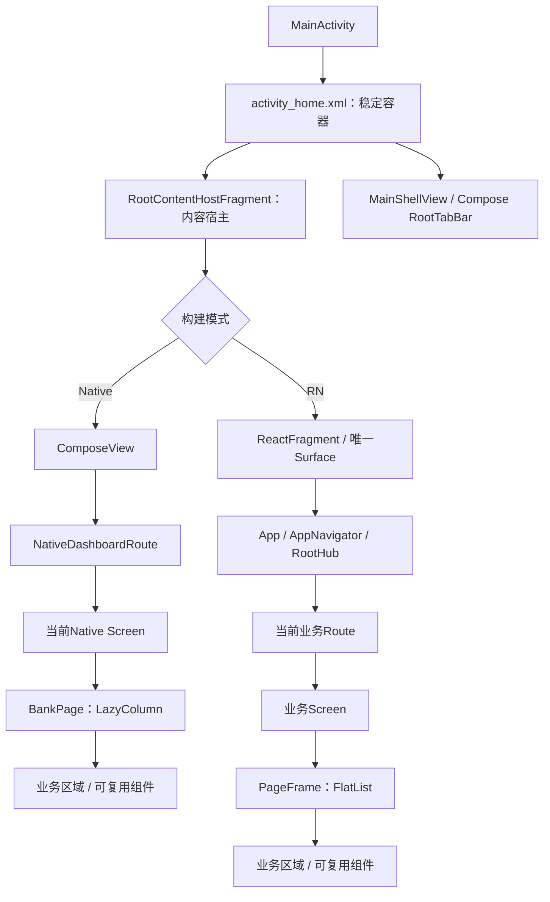
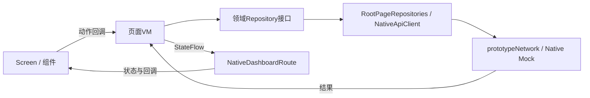

# 首页 UI 新手指引：四个 Tab 的架构、组件与状态流

本文结合 EntryTask 当前源码，解释应用主界面以及“首页、财富、会员、我的”四个根页面。面向刚接触 Android、Compose 和 RN 的开发者。

**先回答实现方式：Android Studio 默认构建下，四个根页面使用 Jetpack Compose；官方 RN CLI 默认构建下，四个根页面使用 React Native。XML 仍承担 Native 外壳的稳定容器，但不负责当前四页业务内容的绘制。**

本文是当前实现的阅读指南，不是新增技术方案；涉及源码的结论以链接所指实现为准。文中的简化示例不代表新增了组件或业务功能。

## 阅读路线

| 阶段 | 阅读内容 | 应能回答的问题 |
| --- | --- | --- |
| 分清技术 | 第1～3节 | 为什么还有XML？为什么只有一个Fragment？ |
| 找到页面 | 第4～6节 | 一个页面怎样分区？四页分别有哪些内容？ |
| 理解复用 | 第7～8节 | 组件如何复用？Compose怎样表达布局？ |
| 理解行为 | 第9～12节 | 点Tab、筛选、眼睛或签到后发生什么？ |
| 动手维护 | 第13～16节 | 改样式/数据该找哪里？怎样预览、调试和验证？ |

只想快速看入口，可以先阅读 [RootContentHostFragment](../../android/app/src/main/java/com/entrytask/shell/host/RootContentHostFragment.kt)、[Native RootScreens](../../android/biz_dashboard/src/main/java/com/entry/biz/dashboard/ui/compose/RootScreens.kt) 与 [RN AppNavigator](../../src/app/navigation/AppNavigator.tsx)。

## 1. 当前究竟是 XML、Compose，还是 RN

### 1.1 按运行模式区分

| 部分 | Android Studio默认Native模式 | 官方CLI默认RN模式 |
| --- | --- | --- |
| MainActivity及稳定容器 | XML宿主骨架 | 同一XML宿主骨架 |
| 根底部四Tab | Native Compose `RootTabBar` | 同一个Native Compose `RootTabBar` |
| 四个根页业务内容 | Compose `Home/Wealth/Member/ProfileScreen` | RN同名业务Screen/Route |
| 页面承载 | RootContentHostFragment中的ComposeView | RootContentHostFragment中的ReactFragment |
| 登录注册 | Native认证模块 | 同一Native认证模块 |
| 根Tab权威 | Native ShellRepository | 同一Native ShellRepository，通过Bridge通知RN |
| 网络演示数据 | Native网络→本地Mock | RN受控网络层→Bridge→Native网络→本地Mock |

这里的“我的”在源码中常用`Profile`命名，不是遗漏了一个`MeScreen`。

运行模式由 [app/build.gradle](../../android/app/build.gradle)计算，写入`BuildConfig.USE_REACT_NATIVE_PAGES`，由`RootContentHostFragment.usesReactNative()`读取。显式`entrytaskUiMode`覆盖优先，其次IDE标记、CLI端口参数、默认Native。它不是靠“Metro是否可连接”在运行时猜测。

```sh
# 仓库根目录：官方CLI默认选择RN
npx react-native run-android

# android目录：显式构建Native，构建后还需要安装运行
./gradlew :app:assembleDebug -PentrytaskUiMode=native
```

Android Studio与CLI安装的是同一个`com.entrytask`应用。切模式需要构建和覆盖安装；桌面重新打开应用，不会自动改变已安装APK的模式。具体覆盖规则见 [双页面模式说明](native-dashboard.md)。

### 1.2 为什么有 activity_home.xml，却说页面是Compose

[activity_home.xml](../../android/app/src/main/res/layout/activity_home.xml)只提供三类结构：

```text
LinearLayout：shellRoot
├── FrameLayout：fragmentContainer，权重1，占据内容区
└── LinearLayout：bottomChrome
    └── ComposeView：bottomTabBar
```

它没有定义首页服务宫格、资产卡、VIP卡或签到卡。那些内容在Compose函数中定义。

`ComposeView`是View体系与Compose之间的承载入口：外层可以保留XML/Fragment，内部通过`setContent { ... }`绘制Compose内容。混合结构是框架支持的互操作方式，不表示必须把所有XML都删除才算使用Compose。[官方 Compose与View互操作说明](https://developer.android.com/develop/ui/compose/migrate/interoperability-apis/compose-in-views)。

本工程保留XML容器，是为了稳定Fragment恢复、系统Insets和现有宿主协调；底栏及Native四页可见业务UI已采用Compose。

### 1.3 当前源码阅读入口

| 位置 | 职责 |
| --- | --- |
| `app/.../shell/host/RootContentHostFragment.kt` | 两种模式的唯一根宿主 |
| `biz_dashboard/.../ui/compose/` | Native 四页与公共 Compose 组件 |
| `biz_dashboard/.../presentation/pages/`、`domain/pages/`、`data/pages/` | 页面状态、领域契约与数据实现 |
| `src/features/*/presentation/` | RN 四域 Route、Screen 和 VM |
| `src/shared/ui/` | RN 共性组件 |

`@Composable`函数、`ComposeView.setContent`和实际调用链是识别 Native 渲染方式的依据。完整组件及数据边界见[首页技术方案](../design/首页与四Tab技术方案.md)。

## 2. “首页”在讨论中有两个层次

| 说法 | 本文含义 |
| --- | --- |
| 应用主界面/首页外壳 | MainActivity、认证协调、内容宿主、底部四Tab |
| 首页Tab | 第1个Tab的导航、快捷入口、营销及产品等内容 |
| 四个根页面 | 首页、财富、会员、我的 |
| 业务子页面 | 产品详情、消息等更深层页面；不等同于四个Tab |
| 内容宿主 | 承载当前页面的RootContentHostFragment，本身不代表首页业务 |

因此，“四个Tab”不要求“四个Fragment”。当前只有一个根宿主，内部根据Tab状态选择一个Screen/Route；四页仍有各自的ViewModel和业务数据契约。

单RN instance与单Fragment也是不同概念。本工程同时选择了单ReactHost、单根内容宿主、单RN Surface；不能理解成框架强制所有混合应用这样设计。

## 3. 总体 UI 结构：从 Activity 到卡片



### 3.1 第一层：MainActivity管理平台与认证

[MainActivity](../../android/app/src/main/java/com/entrytask/MainActivity.kt)负责：

- 创建稳定内容槽和底栏槽，连接主界面VM。
- 在合适的生命周期时机展示Native登录页。
- 创建或复用根Fragment，协调返回和singleTask重入。
- 将系统返回交给RN或根返回策略。

它不负责拼装财富产品卡，也不在点击Tab时创建新的RN实例。

### 3.2 第二层：RootContentHostFragment选择内容实现

[RootContentHostFragment](../../android/app/src/main/java/com/entrytask/shell/host/RootContentHostFragment.kt)是根内容入口。

```kotlin
// 当前实现中的模式入口摘录
fun usesReactNative(): Boolean = BuildConfig.USE_REACT_NATIVE_PAGES
```

| 模式 | onCreateView及后续行为 |
| --- | --- |
| RN | 调用BaseFragment的RN挂载路径；组件名为EntryTask |
| Native | 创建ComposeView，initView中setContent绘制NativeDashboardRoute |

Native分支为ComposeView设置`DisposeOnViewTreeLifecycleDestroyed`，使组合随Fragment的View生命周期释放。Fragment对象、Fragment View和Compose组合有各自生命周期，不能把“Fragment仍在”理解为旧View也应一直持有。

[BaseFragment](../../android/app/src/main/java/com/entrytask/base/BaseFragment.kt)负责按稳定tag查找RN子Fragment，已存在就复用，不因每次切Tab重复挂载。

### 3.3 第三层：Route绑定状态，Screen组合布局

**Native：** `NativeDashboardRoute`按`tab`收集当前页面状态，并调用对应Screen。它是同一个Route函数中的四个分支，不是四个独立Native Route类。

**RN：** HomeRoute、WealthRoute、MemberRoute、ProfileRoute分别绑定各域VM及资源订阅，随后将状态和动作传给Screen。

两种实现遵守同一职责：

```text
Route：取哪些状态、何时订阅、动作交给谁
Screen：有哪些区域、什么顺序、给组件传什么输入
区域组件：一组内聚业务内容怎样布局
基础组件：卡片/图标/金额/宫格等共同视觉规则
```

### 3.4 第四层：页面区域与叶子控件

例如首页的“财富精选”是一个业务区域，它组合分类条、加载/错误状态、最多3张产品卡和更多入口。产品卡内部再组合标题、分销标记、收益指标、期限和风险提示。

区域不是Fragment，也不需要单独一个VM。只有具备独立业务状态或生命周期需要时，才进一步拆状态所有者。

## 4. 外壳、底栏与系统安全区

### 4.1 根底栏只有一份

[RootTabBar](../../android/app/src/main/java/com/entrytask/shell/presentation/compose/RootTabBar.kt)绘制“首页、财富、会员、我的”。输入是`selected`和`onSelect`，组件自己不另外保存根Tab权威。

```text
点击RootTabBar
  → MainViewModel.selectTab(tabId)
  → ShellRepository更新tabId/revision
  → MainShellView.render回写底栏选中状态
  → 当前内容按同一tabId切换
```

[MainShellView](../../android/app/src/main/java/com/entrytask/shell/presentation/MainShellView.kt)将VM投影连接到Compose底栏，还负责`bottomChrome`显隐。即使内容是RN，底栏也依然是Native Compose，不在RN中再复制一套根导航。

### 4.2 稳定身份为什么要保留

| 身份 | 用途 |
| --- | --- |
| `entrytask-root-hub` | 查找/恢复根内容Fragment |
| `R.id.fragmentContainer` | Activity内容槽 |
| `entrytask-rn-root` | 查找/恢复RN子Fragment |
| `R.id.rn_content` | RN子层容器 |
| `R.id.native_dashboard` | Native ComposeView身份 |

MainActivity直接安装RN Screens的`RNScreensFragmentFactory`；Fragment恢复使用稳定tag/id，修改UI时不能跳过恢复状态或重复添加宿主。

### 4.3 Safe Area / Insets是布局的一部分

[ShellInsetsAdapter](../../android/app/src/main/java/com/entrytask/shell/host/ShellInsetsAdapter.kt)协调外壳内容区与系统状态栏、导航栏、刘海等Insets；RN根部还使用SafeAreaProvider相关组件。

排查顶部空白或底部遮挡时，要区分：系统安全区、外壳容器、内容页padding、卡片内padding。不能看到空白就往每一层都添加相同高度，否则容易重复预留。

## 5. Native 四页的 UI 结构

以下函数目前集中在 [RootScreens.kt](../../android/biz_dashboard/src/main/java/com/entry/biz/dashboard/ui/compose/RootScreens.kt)。多数叶子函数是文件私有函数，不是每个页面各有一个Kotlin文件；不要按“找不到HomeScreen.kt”判断缺少实现。

### 5.1 公共页面骨架 BankPage

```text
BankPage
└── LazyColumn（唯一主要纵向滚动列表）
    ├── RootRegion(id=稳定区域标识)
    ├── RootRegion(...)
    ├── ...
    └── AppFooterLogo（最后一个内容项）
```

`RootRegion`包含区域id和内容函数。BankPage统一提供浅灰底、水平12dp留白、区域间12dp间距、列表状态和区域可见性。

品牌Logo随内容滚动到达，不是固定在窗口中部，也不是用大空白把内容强行撑到屏幕底部。`RootTabBar`则位于外壳底部，与这个页尾Logo不是同一个层级。

列表使用稳定区域key，使区域身份与排列位置分开。`LazyColumn`按区域组织组合；一个区域内部仍可能有多张卡，因此不能声称每张产品卡都作为独立虚拟列表项处理。

### 5.2 首页 HomeScreen

```text
HomeScreen → BankPage
├── home-top：HomeTopBar + 未读数状态
├── home-quick：四个金色快捷入口
├── home-banner：BannerCarousel
├── home-services：第二服务宫格
├── home-shortcuts：HomeShortcutRow
├── 第一块运营section：当前为耀钻空间
├── home-products：财富精选
│   ├── 标题/副标题
│   ├── 横向分类条
│   ├── 产品状态区
│   ├── FinancialProductCard × 最多3项
│   └── 查看更多产品
├── 后续运营sections
│   ├── 特色单品
│   ├── 私行服务
│   ├── 尊享服务及权益
│   ├── 投研资讯
│   └── 私行入口
└── AppFooterLogo
```

[HomeSections.kt](../../android/biz_dashboard/src/main/java/com/entry/biz/dashboard/ui/compose/HomeSections.kt)封装首页的快捷条、完整金融产品卡和运营分区。

当前代码将`sections.take(1)`放在产品区之前、`sections.drop(1)`放在之后，所以**运营数组顺序也是页面编排契约的一部分**，不能只改JSON顺序却认为UI位置不变。

运营分区只允许有限布局：`banner`、`cards`、`menu`、`news`。这是数据驱动已有组件，不是从网络下载任意组件或执行脚本。

### 5.3 财富 WealthScreen

```text
WealthScreen → BankPage
├── wealth-assets：财富标题 + AssetPrivacyCard
├── wealth-market：MarketTickerCarousel
├── wealth-services：StandardGridMenu（5列）
├── wealth-category：分类条 + 结果状态 + 最多3项产品摘要
└── AppFooterLogo
```

注意当前财富根页采用**轻量产品摘要**，并未复用首页完整的FinancialProductCard。不能因为组件名称存在，就说四页都使用了完整产品卡或都做了完整产品专区。

### 5.4 会员 MemberScreen

```text
MemberScreen → BankPage
├── member-vip：蓝色会员区域
│   ├── VipProfileCard：身份、等级、资产进度
│   ├── 身份资源状态
│   └── 白色权益卡 + StandardGridMenu（4列、蓝色图标）
├── member-task：会员专属活动
│   ├── InteractiveTaskCard：签到按钮、状态、日历/规则
│   └── 签到资源状态
└── AppFooterLogo
```

这里的“会员”不只是静态蓝卡：签到动作经过VM和Mock账本，有提交防重与结果确认流程。普通权益入口仍可能只展示演示说明，不表示所有权益领取能力都已完成。

### 5.5 我的 ProfileScreen

```text
ProfileScreen → BankPage
├── profile-identity：UserCardHeader（身份及5项统计）
├── profile-assets：AssetPrivacyCard
├── profile-cashflow：MonthlyCashflowCard
├── profile-credit：CreditBillCard
├── profile-loan：LoanSummaryCard
└── AppFooterLogo
```

`financial`一个资源同时提供月度收支、信用卡和借款摘要，不为三张卡分别造三份相同响应缓存。资产、身份和财务仍有各自状态，不让某个区域失败直接遮掉整页。

## 6. RN 四页的对应结构

### 6.1 从RootHub进入业务Route

[AppNavigator](../../src/app/navigation/AppNavigator.tsx)的RootHub根据Native Shell中的`tabId`，挂载当前业务Route：

| Tab | Route | Screen | VM |
| --- | --- | --- | --- |
| 首页 | HomeRoute | HomeScreen | HomePageViewModel |
| 财富 | WealthRoute | WealthScreen | WealthViewModel |
| 会员 | MemberRoute | MemberScreen | MemberViewModel |
| 我的 | ProfileRoute | ProfileScreen | ProfileViewModel |

当前不是把四页同时隐藏在四个RN根视图中。切Tab会切换当前Route；会话级业务对象和轻量页面状态由组装层保留，再按活动状态持有资源订阅。RootHub通过[useRootChannels](../../src/app/navigation/useRootChannels.ts)在effect中组装模型，RootPages负责渲染；不在render/useMemo中初始化Store状态。换会话先卸载旧内容，再绑定新模型。

### 6.2 Route与Screen用首页举例

[HomeRoute](../../src/features/home/presentation/HomeRoute.tsx)主要工作：

```text
订阅model.ui的分类选择
  + useResource(model.content, active)
  + useResource(model.products, active)
  → 传给HomeScreen
  → 将onCategory、retry等动作绑定回VM
```

[HomeScreen](../../src/features/home/presentation/HomeScreen.tsx)主要工作是构造`regions`，复用ServiceGrid、BannerCarousel、ChoiceRail、ProductCard和HomeEditorialSection，不直接读取NativeModule、Axios或Mock fixture。

### 6.3 PageFrame与Native BankPage相对应

[DashboardComponents.tsx](../../src/shared/ui/DashboardComponents.tsx)中的PageFrame统一承担：

- 以FlatList组织主纵向列表，区域id作为key。
- 给当前区域提供活动/可见上下文，控制轮播计时。
- 保存滚动偏移，通过PageUiStatePort写回会话UI状态。
- 等内容尺寸和资源就绪后恢复一次位置，按新内容高度夹取合法偏移。
- 通过ListFooterComponent统一追加AppFooterLogo。

这里的`ready`主要控制滚动恢复时机，不是“网络未就绪就完全不渲染页面”的总开关。

FlatList提供列表虚拟化能力，但当前虚拟化单位仍是区域。区域内的产品映射、小宫格等有界内容直接组合；不应把无界长数据塞进一个区域后宣称已经充分虚拟化。[RN FlatList文档](https://reactnative.dev/docs/flatlist)。

### 6.4 两端是语义对齐，不是同一套控件

| Native Compose | RN | 对齐的职责 |
| --- | --- | --- |
| BankPage / RootRegion | PageFrame / PageRegion | 页面分区、主列表、页尾 |
| HomeTopBar | ChannelHeader的home模式 | 扫码、搜索、消息、客服 |
| StandardGridMenu | ServiceGrid | 等宽宫格、图标、角标、点击 |
| BankCard | Surface | 卡片容器与间距 |
| SectionTitle / Caption | SectionHeading / ui文字样式 | 标题与辅助文案 |
| FinancialProductCard | ProductCard（由wealth公开接口导出） | 首页产品指标与风险信息 |
| HomeEditorialSection | HomeEditorialSection / CampaignCard | 首页运营区 |
| VipProfileCard / InteractiveTaskCard | MemberRegions中的同类组件 | 会员身份和签到 |
| UserCardHeader / 月收支等卡片 | ProfileRegions中的同类组件 | 我的页面业务区域 |

两端共享契约、Mock和部分素材，但Compose函数不能直接当作RN组件复用，RN组件也不是Android XML自定义View。

## 7. 复用组件怎样分层

### 7.1 按职责分四级

| 级别 | 例子 | 应包含什么 |
| --- | --- | --- |
| 页面框架 | BankPage、PageFrame | 列表、区域身份、滚动/可见性、页尾 |
| 通用视觉组件 | BankCard/Surface、图标、金额、宫格 | 通过输入控制的布局与交互规则 |
| 业务区域组件 | VIP、签到、产品卡、收支卡 | 一组稳定业务语义与展示字段 |
| 页面编排 | HomeScreen等 | 区域顺序、组合、状态与动作传递 |

“复用”不要求全部提到全局shared目录。Native目前公共业务UI位于biz_dashboard内；RN通用视觉位于shared/ui，会员/我的专用区域留在各自域的components下。

### 7.2 当前跨Tab真正复用哪些内容

| 组件 | 首页 | 财富 | 会员 | 我的 |
| --- | --- | --- | --- | --- |
| BankPage / PageFrame及品牌页尾 | 使用 | 使用 | 使用 | 使用 |
| 卡片与标题等原语 | 使用 | 使用 | 使用 | 使用 |
| 宫格内核 | 快捷/服务/运营入口 | 服务入口 | 权益入口 | 当前根页不增加可选服务宫格 |
| AssetPrivacyCard | 当前无独立资产卡区 | 使用 | VIP采用专有卡布局 | 使用 |
| MoneyText及金额格式化能力 | 产品比率另有格式 | 资产 | VIP金额 | 资产/收支/账单等 |
| BannerCarousel | 使用 | 当前根页无横向海报区 | 当前根页无此区 | 当前根页无此区 |
| MarketTickerCarousel | 当前无此区 | 使用 | 当前无此区 | 当前无此区 |
| 完整产品卡 | 使用 | 当前只显示摘要 | 不使用 | 不使用 |

首页“资产总览”快捷入口不等于首页已经渲染一张总资产卡。不要仅按文案或类名推断复用关系。

### 7.3 自定义Composable与传统自定义View的区别

| 方面 | XML / 自定义View方式 | 当前Compose方式 |
| --- | --- | --- |
| 声明内容 | XML、View构造和属性设置 | `@Composable`函数组合 |
| 更新内容 | 找到View后设置text/visibility等 | 更新状态，由组合读取状态重新计算 |
| 组件入口 | 自定义类、XML属性、绑定函数 | 参数、Modifier、事件回调 |
| 复用方式 | include布局、继承/组合View | 函数组合、状态提升、基础视觉原语 |
| 生命周期 | View/Fragment生命周期 | 宿主生命周期加组合进入/退出 |

“声明式”不是没有布局逻辑，而是把“在给定状态下界面应该是什么”写出来。重组也不等于每次都重建Activity或整页所有控件。[Compose状态说明](https://developer.android.com/develop/ui/compose/state)。

## 8. 用一张卡理解布局代码

### 8.1 BankCard中的层次

[Compose BankComponents](../../android/biz_dashboard/src/main/java/com/entry/biz/dashboard/ui/compose/BankComponents.kt)的BankCard可以概括为：

```text
调用方Modifier
  → fillMaxWidth
  → clip圆角
  → background底色
  → padding内部留白
  → Column按间距排列子内容
```

`Row`横向排，`Column`纵向排，`Box`用于叠放或对齐；`weight`分配父容器剩余空间。`Modifier`串联尺寸、留白、背景、点击和语义，顺序会影响点击范围及视觉结果，不能当作任意顺序的属性字典。

本工程Native常用`dp`控制尺寸/间距，`sp`控制字号。RN样式使用其布局单位与文字设置，不应把视觉稿原始图片像素直接当成两端代码尺寸。

### 8.2 组件不拥有业务权威

以真实接口形态为例：

```kotlin
@Composable
fun EyeToggle(visible: Boolean, onToggle: () -> Unit) {
    // 根据visible绘制图标，点击仅调用onToggle。
    // 完整实现见BankComponents.kt，此处仅说明输入/输出。
}
```

它不自己决定哪个账号登录，也不直接保存SP或调用网络。`visible`由上层状态传入，点击动作上报到所有者，再将新状态传回。

RN中的`EyeToggle`、`ServiceGrid`也采用类似的输入与回调方式，而不是组件内部各自维护银行业务状态。

### 8.3 不要把复用做成万能组件

宫格可以通过列数、图标风格、菜单数据和回调复用。会员VIP身份与月度收支语义不同，就不应为了“都像一张卡”做成包含大量`isVip/isLoan/isHome`开关的万能卡。

当几个页面只是背景和圆角相同，复用BankCard/Surface；当业务语义也相同，才提取资产卡等更高层组件。

## 9. MVVM与UI状态到底放哪里

### 9.1 Native当前状态链



[RootPageViewModels.kt](../../android/biz_dashboard/src/main/java/com/entry/biz/dashboard/presentation/pages/RootPageViewModels.kt)包含四个页面VM及协调VM。数据接口在domain/pages，IO实现在data/pages。UI不直接访问网络或fixture。资产加载由页面资源管理，刷新会重新请求API；页面资源负责展示当前数据和加载状态。

| 状态 | Native当前所有者 | RN当前所有者 |
| --- | --- | --- |
| 选中根Tab、会话权威 | Native ShellRepository / UserAuthManager | 接受Native快照及事件，不另造根Tab权威 |
| 每页内容资源 | 页面VM的PageResource | RTK Query资源缓存，经ResourceViewModel投影 |
| 首页/财富分类 | Home/Wealth页面VM | PageUiStatePort接客户端Store，页面VM处理动作 |
| 资产显隐 | DashboardCoordinatorViewModel | ShellViewModel中的会话UI状态 |
| 滚动位置 | SaveableStateHolder及列表可保存状态 | PageUiStatePort中的offset |
| 说明弹层是否打开 | NativeDashboardRoute组合状态 | RootHub的demoTitle |
| 签到提交状态 | MemberPageViewModel | MemberViewModel |

资产显隐在同一模式、同一会话的四页间保持；两种渲染模式是不同构建实现，不承诺重新安装切模式后仍保留同一个UI偏好。它也不是账号登录事实，不写入Room认证库。

### 9.2 Native四个VM是否都会创建

当前RootContentHostFragment以`by viewModels`定义四页VM，归属同一个Fragment的ViewModelStore。Native `initView`创建`listOf(home, wealth, member, profile)`时会访问四个属性，因此**四个VM实例都会被取得/创建**。

但“创建VM”不等于“四页全部发请求”。`page.show(authenticated && tab匹配, epoch)`只激活当前页，其他页停用。RN分支走BaseFragment的挂载路径，不执行这段Native `initView`。

这里以实际源码为准，不将设计文档中的“惰性”概念直接等同于当前全部VM实例都延后创建。

### 9.3 区域状态为什么要独立

[RegionState](../../android/biz_dashboard/src/main/java/com/entry/biz/dashboard/presentation/pages/PageResources.kt)由`data`、`loading`和`error`组成：

| 情形 | UI应表达的含义 |
| --- | --- |
| 首次加载且没有数据 | 显示当前区域加载状态 |
| 有旧数据正在刷新 | 可以保留旧内容，显示适合的刷新反馈 |
| 请求失败 | 显示安全错误和重试入口，尽量不遮掉其他区域 |
| 成功但列表为空 | 显示空态，不伪装成请求失败 |
| 请求取消 | 停止等待，不作为网络错误提示 |

当前Native部分重试回调复用页面`refresh`，会重新请求该页多个资源；RN Screen通常有区域级retry。不能将“区域状态独立”误写成“两端所有重试都只打单个API”。

## 10. 四条常见交互的数据流

### 10.1 点击底部“财富”

```text
RootTabBar.onSelect(2)
  → MainViewModel.selectTab
  → ShellRepository发布新快照
  ├── Native：RootContentHostFragment切换页面激活状态
  │           → NativeDashboardRoute调用WealthScreen
  └── RN：HostModule发出宿主事件
          → RN ShellViewModel接受快照
          → RootHub挂载WealthRoute
          → WealthScreen
```

这不是`replace(WealthFragment)`，也不会新建ReactHost。

### 10.2 点击首页或财富的分类

```text
分类组件.onSelect(id)
  → 页面VM更新分类
  → 释放/取消旧分类请求或资源订阅
  → Repository请求product.list（带category）
  → Native Mock过滤对应JSON数据
  → 新结果进入资源状态
  → Route重新提供状态，Screen绘制结果
```

Native使用PageResource的generation和协程取消避免旧结果覆盖；RN通过资源源替换和查询订阅生命周期处理。不要只改变分类文字颜色，却不改变请求条件和结果。

### 10.3 点击资产“眼睛”

```text
EyeToggle点击
  → Native coordinator.toggle / RN actions.toggleVisibility
  → 当前会话UI状态更新
  → 资产卡、会员相关金额、我的财务卡按新状态重绘
```

切会话或未认证时重置隐藏。格式化后的金额和读屏信息都应遵守显隐规则；不要只把文本颜色设透明，却让可访问性仍读出原金额。

### 10.4 点击会员签到

```text
InteractiveTaskCard
  → Member VM：检查状态、防重
  → Repository / CheckinRepository
  → Native网络Mock账本
  → 提交结果或查询结果确认
  → 更新签到状态及提示
```

它是核心写流程，不应在组合函数体里“渲染一次就请求一次”，也不能把按钮变成已签到就假定账本写入成功。当前实现对取消及不确定结果有确认处理，细节沿Member VM与测试阅读。

## 11. 页面生命周期、滚动和动画

### 11.1 Native的激活与清理

RootContentHostFragment在`viewLifecycleOwner`的STARTED区间收集Shell快照；进入后台/销毁View时，finally停用各页。

[RootPageViewModel.show](../../android/biz_dashboard/src/main/java/com/entry/biz/dashboard/presentation/pages/PageResources.kt)根据活动标记和sessionEpoch执行：

- 当前页激活后加载所需资源。
- 离页取消未完成资源任务。
- 换会话清理旧数据，并重置页内选择。
- PageResource检查取消和generation，迟到响应不覆盖新状态。

`NativeDashboardRoute`使用`key(epoch)`和`SaveableStateProvider("$epoch:$tab")`管理会话内各页可保存UI状态。保存滚动位置不等于持久化登录态；新进程仍要重新认证。

### 11.2 RN的订阅与清理

当前RootHub一次挂载当前Tab的Route。`useResource`管理对应ResourceViewModel激活/释放，PageFrame将offset写回PageUiStatePort；切会话时组装层销毁旧channels并重置相关状态。

创建四个VM/资源source不代表订阅了四页全部API。不要在组件render里重新创建应用Store、VM或网络对象，避免多份缓存、重复请求和监听泄漏。

### 11.3 自动轮播什么时候运行

| 条件 | Native | RN |
| --- | --- | --- |
| 当前区域可见 | BankPage计算可见区域 | PageFrame提供RegionActive |
| 页面可交互/未被弹层覆盖 | enabled参与判断 | active参与判断 |
| 应用在前台 | 生命周期RESUMED区间 | AppState |
| 用户按住/拖动 | 暂停 | 暂停 |
| 有多于一条数据 | 才自动切换 | 才自动切换 |

当前默认间隔5秒；横向海报和纵向行情使用各自专用组件。RN还监听减少动态效果设置，调整动画表现；不把动画配置等同于数据刷新周期。

定时器/协程应随效果或组合退出而清理。不能在任意页面进程单例中永久定时翻页。

## 12. Mock、契约、素材与UI的关系

### 12.1 数据经过哪些边界

| 页面 | 主要API |
| --- | --- |
| 首页 | home.content、product.list、message.unread |
| 财富 | wealth.content、asset.summary、product.list |
| 会员 | member.content、member.summary、checkin.status、checkin.submit |
| 我的 | profile.summary、asset.summary、profile.financialOverview |

Native页面经`RootPageRepositories → NativeApiClient → prototypeNetwork → PrototypeMockInterceptor`。

RN页面经`ResourceClient / Repository → EndpointRegistry → TransportRouter → NativeTransport → Bridge → Native网络Mock`。RN架构允许显式选择其他HTTP通路，但当前这些无后端演示API使用Native Mock，不能失败后偷偷切通路。

`mock/manifest.json`映射到分API JSON。普通Mock人工延迟为后台可取消的随机1～3秒，实际端到端耗时还包含调度/Bridge/渲染，不应把每次测得总耗时都声称严格落在该区间。

Native运行资源随APK打包，不从开发机读取；RN不直接import响应fixture假装请求成功。认证Room库保存账号校验值，也不是用来直接读取这四页金融响应的数据库。

### 12.2 数据、组件和视觉属性分别在哪

| 想调整什么 | 首先看哪里 |
| --- | --- |
| 服务入口文案、图标key、活动内容 | 对应Mock JSON及契约模型/schema |
| 卡片顺序、区域插入位置 | Screen的regions编排 |
| 某类卡片的布局 | 域内区域组件 |
| 所有宫格的间距/点击范围 | StandardGridMenu / ServiceGrid |
| 页面统一留白和页尾 | BankPage / PageFrame |
| 颜色/字号/圆角 | Native组件中的样式值；RN theme与组件StyleSheet |
| 数据条件和取消处理 | VM / Repository / 数据适配层 |

当前Native没有已经独立完成的全应用Design System；部分色值集中在BankComponents，部分仍在叶子组件。RN已有`theme.ts`，但同样存在组件内专用样式。不能把目标Token方案当作所有值已经集中管理的现状。

### 12.3 图片和图标怎样复用

共享源位于`src/shared/assets/`：PNG装饰素材、RN静态资源映射以及`icons.json`线条图标目录。

- RN通过`Artwork`/`Icon`及资源映射解析白名单素材。
- Native业务区由DashboardArtTask把共享PNG和图标目录生成到构建资源，通过variant.sources接入。
- Native根底栏当前使用app自己的`ic_tab_*`资源，不应声称全应用每个图标都来自icons.json。
- 新增素材需要同步检查两端映射/白名单及最终APK；只改JSON中的assetKey不一定能显示新图。

现有正式Logo、VIP纹理、专属资讯图片等仍有素材或近似表达限制。组件结构对齐不等于已做到整张长图像素级还原，视觉验收仍需对照 [PRD视觉稿目录](../../prd/UI原型)。

## 13. 新手实际维护时怎么找文件

### 13.1 推荐源码阅读顺序

| 顺序 | 文件 | 主要看什么 |
| --- | --- | --- |
| 1 | [activity_home.xml](../../android/app/src/main/res/layout/activity_home.xml) | 外壳内容槽与底栏槽 |
| 2 | [MainActivity](../../android/app/src/main/java/com/entrytask/MainActivity.kt) | 认证、根宿主、返回 |
| 3 | [RootContentHostFragment](../../android/app/src/main/java/com/entrytask/shell/host/RootContentHostFragment.kt) | 模式选择及Native状态收集 |
| 4 | [RootTabBar](../../android/app/src/main/java/com/entrytask/shell/presentation/compose/RootTabBar.kt) | 底栏输入与动作 |
| 5 | [RootScreens](../../android/biz_dashboard/src/main/java/com/entry/biz/dashboard/ui/compose/RootScreens.kt) | 当前Native页面树 |
| 6 | [BankComponents](../../android/biz_dashboard/src/main/java/com/entry/biz/dashboard/ui/compose/BankComponents.kt) | 共用视觉与轮播 |
| 7 | [HomeSections](../../android/biz_dashboard/src/main/java/com/entry/biz/dashboard/ui/compose/HomeSections.kt) | 首页业务分区 |
| 8 | [RootPageViewModels](../../android/biz_dashboard/src/main/java/com/entry/biz/dashboard/presentation/pages/RootPageViewModels.kt) | 各页状态、分类和签到 |
| 9 | [RootPageRepositories](../../android/biz_dashboard/src/main/java/com/entry/biz/dashboard/data/pages/RootPageRepositories.kt) | API调用和领域映射 |
| 10 | [AppNavigator](../../src/app/navigation/AppNavigator.tsx) | RN路由与Native Shell状态连接 |
| 11 | [HomeRoute](../../src/features/home/presentation/HomeRoute.tsx)、[HomeScreen](../../src/features/home/presentation/HomeScreen.tsx) | RN订阅与区域编排 |
| 12 | [DashboardComponents](../../src/shared/ui/DashboardComponents.tsx) | RN页面骨架与公共控件 |

### 13.2 改一张资产卡的间距

1. 先确认要改Native、RN还是两端。
2. Native找compose/BankComponents的AssetPrivacyCard，RN找DashboardComponents中的对应组件。
3. 判断是资产卡专用padding，还是所有BankCard/Surface共有规则。
4. 改专用需求时先改叶子组件；只有全局一致变化才改公共原语。
5. 对照财富和我的两页，避免只看一个使用位置。

Native资产卡的视觉修改应落在Compose组件中。

### 13.3 增加一个服务入口

1. 确认入口属于哪个API和业务目标，是否只做演示说明。
2. 修改共享数据及受影响契约，必要时更新模型/校验器。
3. 确认图标key在两端都可解析。
4. 复用宫格数据渲染，不在两个Screen里各加一个硬编码按钮。
5. 验证3/4/5列等当前参数下布局、长文案和可访问性。
6. 若涉及真实子页或新能力，另补导航与业务契约，不能只让按钮看起来可点击。

### 13.4 增加一种卡片

先回答“其他页共享的是外观，还是业务语义”。外观相同可用BankCard/Surface；业务专用组件放域内，再由Screen编排。

Native复用范围当前在biz_dashboard内部；RN跨业务域只能从public导入公开能力，例如首页使用wealth公开导出的ProductCard，不直接穿透到其他域私有文件。

## 14. 预览、运行和排障

### 14.1 Compose Preview怎样帮助阅读

Preview适合对输入状态固定的纯UI叶子组件，不应在Preview中启动认证、请求Native Mock、创建Room库或真实VM。

当前BankComponents中有一个隐藏资产状态的预览示例，并非四个根页都已经有完整多状态Preview。若要扩展，应给组件传匿名演示值，覆盖长文案、加载/错误和不同宽度；不要假称本指南已经新增这些预览。

RN没有同一个`@Preview`机制，当前工程也没有因为本文新增Storybook。RN页面通过应用运行与现有测试验证。

### 14.2 快速判断“为什么修改没有生效”

| 现象 | 先检查 |
| --- | --- |
| 只改activity_home.xml，业务卡片没变化 | XML仅是宿主，业务卡片在Compose/RN组件中 |
| 修改Compose没变化 | 当前安装的是否是RN模式 |
| 修改RN没变化 | 当前是否Native模式、Metro是否连到正确工程 |
| 新Mock文案没变化 | 是否重建安装APK；Fast Refresh不会更新Native assets |
| 新图标/图片没显示 | 共享资源映射、白名单、生成资源及APK是否包含 |
| 四Tab底栏选中不一致 | 是否绕过Native Shell新增了本地根Tab状态 |
| 切页后显示旧账号内容 | epoch、订阅清理、资源缓存与scope是否正确 |
| 开眼睛后别页还是旧状态 | 是否在叶子组件私存了一份显隐标记 |
| 返回/重建后出现多个内容层 | 稳定tag、Factory、子Fragment复用及挂载时机 |

### 14.3 日志怎么看

```sh
# 仓库根目录；独立终端运行
npm run logs:android
```

Android Studio可按`package:com.entrytask`过滤。Native页面诊断关注`EntryTask.NativeDashboard`，宿主/认证关注对应MainActivity、Bridge与Auth标签；RN还可使用Metro的`j`打开RN DevTools。

构建终端没有JS日志，不代表没有请求或没有页面。日志只记录安全的阶段、apiId、错误码、耗时及关联编号，不输出密码、Token、全资产响应或全量请求体。

## 15. 如何验证一次UI修改

| 改动 | 建议验证 |
| --- | --- |
| 纯文字/简单间距 | 对照相关页面与宽度，检查diff；不机械新增镜像样式测试 |
| 共享卡片/宫格 | 检查所有使用页、长文案、字体放大、点击与读屏 |
| VM/筛选/签到逻辑 | 错误、取消、重复点击、迟到响应的行为测试 |
| Mock/schema | contracts检查，必要时生成校验器，重建安装并核对资源 |
| 宿主/入口/生命周期 | Native构建、官方CLI、登录/切Tab/返回/Activity重建 |

Native相关单测与编译可按改动选择：

```sh
# android目录
./gradlew :biz_dashboard:testDebugUnitTest :app:testDebugUnitTest
./gradlew :app:assembleDebug -PentrytaskUiMode=native
```

RN检查在仓库根目录：

```sh
npm run typecheck
npm run lint
npm run architecture:check
npm test -- --runInBand
```

设备回归可参考 [NativeDashboardTest](../../android/app/src/androidTest/java/com/entrytask/home/NativeDashboardTest.kt)、[RnRequiredDashboardTest](../../android/app/src/androidTest/java/com/entrytask/home/RnRequiredDashboardTest.kt) 和 [ShellHostTest](../../android/app/src/androidTest/java/com/entrytask/shell/ShellHostTest.kt)。在有演示账号的设备使用保留安装和隔离测试会话，不用卸载/清数据代替测试准备。

方案与组件边界见[首页技术方案](../design/首页与四Tab技术方案.md)；认证流程见[登录注册方案](../design/登录注册技术方案.md)。

## 16. 入门自查与小练习

| 练习 | 完成标准 |
| --- | --- |
| 画出Activity到一个资产Text的层次 | 能区分外壳、宿主、Route、Screen、卡片、叶子 |
| 找出Native与RN各自的首页入口 | 沿宿主、Route、Screen定位当前页面 |
| 沿一次Tab点击追踪状态 | 明确Native Shell是根Tab权威，没有第二套底栏状态 |
| 解释一次分类切换 | 请求条件变化、旧任务释放、结果可观察，不只改颜色 |
| 解释“眼睛”跨Tab同步 | 知道状态所有者，不在每张卡内另存一份 |
| 找出Logo和底栏的不同父节点 | Logo随列表，底栏属于外壳 |
| 调整共享宫格并检查其他使用页 | 能识别复用的影响范围 |
| 给纯叶子组件规划预览 | 用输入状态展示，不引入真实IO/凭据 |

阅读时始终把三个问题分开：**谁承载生命周期，谁拥有状态，谁绘制内容。**在当前工程里，它们分别由外壳/宿主、VM/Repository与页面组件协作完成。
